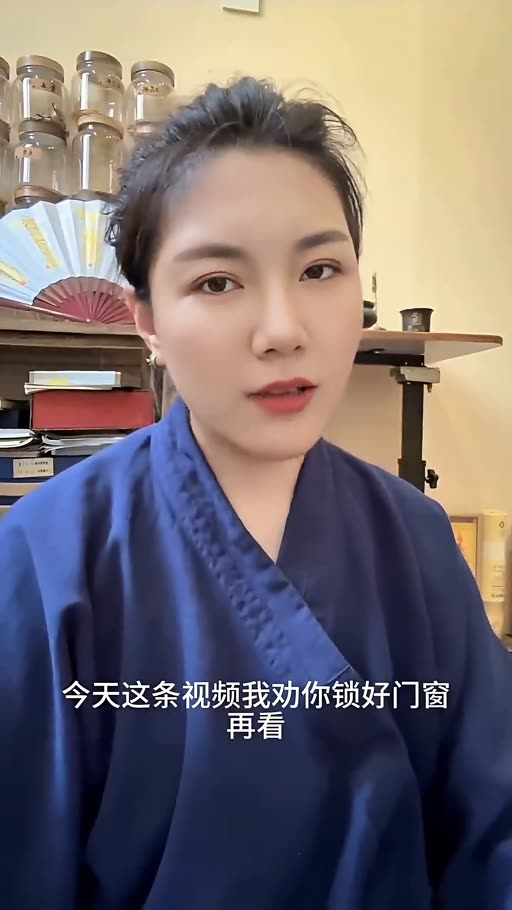

# 養生功法 呼吸五步法

- 來源：https://www.facebook.com/share/v/1DDHANhGtp/
- 平台 / 上傳者：Facebook / 王多多
- 長度：07:56 (475.7s)
- 逐字稿來源：whisper (groq)
- 更新日期：2026-10-19
- **關鍵字：** #養生功法 #呼吸 #丁樁 #龜窩 #沉爐 #開合 #化境 #丹田 #五步功法 #講者主張

## 摘要與名詞說明

**一句話重點**：講者（王多多，自稱「彭祖養生術傳承人」）主張，多數人的氣從未沉到腹部，並傳授由「丁樁→龜窩→沉爐→開合→化境」五步、循序漸進的呼吸功法（以下皆講者主張，未查證，非醫療建議；身分、效果與「兩個月見效」均未驗證）。

| 時間 | 重點 |
|---|---|
| 00:00 | 開場：自稱傳承人，稱此套是二十年前要磕頭遞帖子才學得到的第三層；批評網路上只教「吸吐」，等於深呼吸 |
| 01:04 | 提問「你的氣到過肚子嗎？」主張氣只在喉嚨與胸口打轉，是疲、虛、睡不踏實、臉色灰的根源 |
| 01:35 | 立規矩：五步不許跳、不許急，前一步沒踩實下一步就是懸崖 |
| 01:52 | 第一步丁樁：坐姿脊背如竹竿、渾身放鬆，雙手放膝、舌尖輕抵上顎、閉眼守鼻尖呼吸；念頭跑了輕輕拉回，坐 3–5 分鐘鼻尖氣息清楚、心穩即過關 |
| 03:08 | 第二步龜窩：只管呼氣，輕帶一念讓氣落到胸口正中的凹窩（心窩），不用意念硬壓；少則三五天、多則十天半個月會覺得該處沉、熱 |
| 04:16 | 第三步沉爐（講者稱分水嶺）：把暖意如蜜糖化開般引到肚臍下三寸（小腹／丹田）；不推不趕，心急用意念「捅」易練岔；每天至少 40 分鐘，早晚各一次 |
| 05:43 | 第四步開合：不教，等氣自行從尾椎沿脊椎上翻過頭頂、回到小腹走一圈；守「不忘、不助」 |
| 06:37 | 第五步化境：坐下如泡溫泉、呼吸若有若無，頭頂心發脹發熱；身體比腦子聰明，別插手 |
| 07:05 | 總原則：全程放鬆、不憋氣不咬牙、呼吸細綿如抽蠶絲；沒有明確訊號不進下一關，「寧可慢三個月，不可快三天」 |

## 名詞說明
- **丁樁／龜窩／沉爐／開合／化境**：講者自訂的五個階段名稱（畫面字幕顯示「丁樁」「龜窩」「開合」「化境」）。
- **心窩**：講者指兩排肋骨交匯處的凹窩；**小腹／丹田**：肚臍下三寸。
- **不忘不助**：知道氣在走（不忘），不推它（不助）。

## 轉錄校正備註
- 逐字稿為 Groq 轉錄；影片本身有燒錄的簡體字幕，據此核對丁樁、化境、磨人、練廢、小腹等；與字幕不同者以字幕為準。
- 推測性校正（疲、遞帖子、那股暖意、不助、知道）已記在 `known_asr_errors`；04:12「氣開始扔露了」語意存疑，未更動。
- 影片標題用 `--title` 自訂（原標題只有 #傳統文化 #養生功法），原始標題在 `meta.json.title_raw`。

## 圖文對照（畫面 + 逐字稿）

### 投影片 1：開場：為什麼講、你的氣沒到過肚子（00:00–01:52）

**重點：** 講者自稱「彭祖養生術傳承人」，主張一般只教吐納、等於深呼吸；氣只在喉嚨與胸口之間打轉（講者主張，未查證）。

**標籤：** #養生功法 #氣

我是彭祖，養生術的傳承人，今天這條影片，我勸你鎖好門窗再看，不是嚇你，是我接下來要講的這套東西，在二十年前是要磕頭遞帖子才換得來的，我一個師姐，當年跟著老師學了七年，才摸到今天我要講的第三層，而我現在打算一次性全給你掀開，你可能會問，為什麼？因為我看不下去了，滿屏都在教你吸吐，彷彿人活到今天連喘氣都不會了，拜託，那些花架子練到天荒地老，你也不過就是個深呼吸，跟醫院裡護士教產婦的，沒什麼兩樣，真正的東西，沒人敢講，也沒人捨得講，今天我把家底亮了，得罪人的事我來扛，但你聽好，這種東西放在網上能留多久，我自己心裡都沒底，這現在還在，點個收藏，釘死在你的收藏夾裡，行，我燒到這兒了，我直接上乾貨，你先回答我一個問題，你活了這麼多年，你的氣，到過你肚子嗎，別猜，我替你答，沒到過，你吸進去的每一口氣，在嗓子眼到胸口之間來回晃盪，跟個沒頭蒼蠅一樣，身體底下一大片，從來沒被滋養過，這就是你疲，你虛，你睡不踏實，你臉色發灰的根子，不是你身體不行，是你那口氣，壓根沒送對地方，接下來我講的五步，是一條完整的路，從第一步走到最後一步，你整個人等於換了一套發動機，但規矩我先立在這，不許跳，不許急，一步沒踩實，下一步你踩上去就是懸崖。

### 投影片 2：第一步丁樁、第二步龜窩（01:52–04:16）

**重點：** 坐姿脊背挺直、舌抵上顎、守鼻尖呼吸，念頭跑了就輕輕拉回；第二步只管呼氣，輕帶一念讓氣落到心窩。

**標籤：** #丁樁 #龜窩

第一步，丁樁找個清靜角落坐好凳子沙發都行唯一的要求脊樑骨像竹竿一樣立起來但你不能僵渾身要鬆，兩手自然擱在膝蓋上，嘴唇閉攏，舌尖輕輕舔住上顎，記好了，從頭到尾別放下來，眼簾一合，全世界跟你沒關係了，你唯一要做的事情就是，守住鼻尖，一呼一吸，氣從鼻尖進出，涼的熱的你就看著它，別的什麼都不管，你說這有什麼難的，你試試就知道了，做不了三十秒，你腦子裡就開始翻跟頭，一會兒想明天的會，一會兒想中午吃什麼，念頭跟爆米花似的，噼裡啪啦炸個不停，跑了怎麼辦，輕輕拽回來，再跑，再拽，別惱，別跟自己較勁，你就當遛一條不聽話的狗，拽多了，它就老實了，什麼時候算過關，你一坐下來，三五分鐘，鼻尖上那道氣息清清楚楚，心裡頭穩得像一碗端平的水，恭喜你，地基成了，這一關你要是糊弄過去，後面全是空中樓閣，我醜話撂在這了，第二步，龜窩，地基扎穩了，現在開始幹正事，從這一步起，你只需要管呼氣，吸氣愛怎樣怎樣，你別搭理他，呼氣的時候，心裡輕輕帶個念頭，讓這口氣順著嗓子眼往下走，落到哪呢，你摸摸自己胸口正中間，兩排肋骨往下交匯的那個凹窩，就是那兒，注意我的用詞，輕輕帶，不是拿意念往下摁，不是使勁拽，你就好像往水面上吹了口氣，讓一片落葉飄過去，四兩撥千斤的那個勁，頭幾天，你大概什麼感覺都沒有，別急，太正常了，你身體裡的氣散了幾十年了哪能一喊就回來你就老老實實每天坐著往那待少則三五天多則十天半個月，突然有一次你會覺得那塊地方發沉，發熱，像塞了一塊溫熱的鵝卵石，那一刻你就知道氣開始扔露了，灶堂裡的火苗子攏住了，底下的事才剛剛開始。

### 投影片 3：第三步沉爐、第四步開合（04:16–06:37）

**重點：** 把心窩暖意往下引到肚臍下三寸（小腹）；每天至少 40 分鐘；第四步等氣自行沿脊椎走一整圈，「不忘不助」。

**標籤：** #沉爐 #開合 #小腹

第三步，沉爐，這一步是整套功夫的分水嶺，也是最磨人的一關，當心窩那股暖意穩穩當當站住了，你就順勢往下引，呼氣的時候，讓那團熱乎勁像蜜糖化開一樣，慢慢流到肚臍底下三寸那片地方，小腹深處，我再說一遍，不能推，不能趕，不能急，你把自己想象成一座山，山上有一眼泉，泉水自己知道往低處走，你要做的就是別拿石頭堵它的路，有人心急火燎，拿意念往下捅，十個裡頭，八個練岔，剩下兩個直接練廢，我不是說著玩的，等到有一天，你小腹那兒暖洋洋的，像揣了個剛出鍋的烤紅薯，走到哪兒都覺得丹田裡有底氣，恭喜你，爐子安上了，從今往後，你哪兒也別去了，就守著這團火，呼吸的時候，有意無意照看一下，什麼意思呢，就好比你家院子裡種的棵樹，你不用時刻盯著它長，但心裡知道它在那，該澆水澆水，該曬太陽曬太陽，這一關有人蹲一個月，有人蹲三個月，你就安安心心蹲著，火候越足，後面的路越順，每天至少做40分鐘，能做一個小時更好，早晚各一次鐵打不動，第四步開合，這一步我沒法教你，身體自己會教你，你只需要等，某一天你正坐著呢突然感覺尾椎那跳了一下或者一股熱流竄上來別怕別激動更別拿意念去幫忙那是氣在找路，它比你聰明，你就跟著它走，它從脊樑骨一節一節往上翻，過後腰，過兩肩胛骨之間，過後腦勺，翻過頭頂，順著前面下來，重新回到小腹，走一整圈，記住六個字，不忘，不住，知道它在走，這叫不忘，它在哪停了，你別推它，這叫不助，這條環路一旦跑通，你身體裡等於修了一條高速公路，氣血自己就流轉起來了，什麼淤堵啊，寒氣啊，沿途全給你衝乾淨。

### 投影片 4：第五步化境與總原則（06:37–07:56）

**重點：** 渾身如泡溫泉、頭頂發脹；總原則：全程放鬆、不憋氣不咬牙、呼吸細綿；沒有明確訊號不進下一關。

**標籤：** #化境 #原則

第五步，化境，路通了，往後每次一坐下來，渾身就像泡在溫泉裡，呼吸若有若無，念頭來了，去了你都不在乎，偶爾頭頂心，發脹發熱，像有個小漩渦在轉，那是好事，把注意力輕輕挪上去，帶一帶就行，到了這一層，你的身體比你的腦子聰明一百倍，別插手，由它去，最後這幾句話，你拿筆刻在牆上，全程一個鬆字管到底，不許憋氣，不許咬牙，呼吸越細越綿越好，像抽蠶絲一樣，斷了就廢了，每一關，你必須等身體給你明確訊號了，才能進下一關，沒感覺就繼續蹲，寧可慢三個月，不可快三天，多少人活了大半輩子，那口氣從來沒沉到過肚子裡，五臟六腑，跟旱了三年的河床一樣，乾巴巴的硬撐著，今天這條路，你要是肯老老實實走下來，等於給自己的身體修了一條活水河道，能點醒一個人就值了，你要是真練了，兩個月以後，身體自己會替我說話，到時候你回來告訴我，我等你。

## 已知轉錄錯誤

| 時間 | 聽成 | 應為 |
|---|---|---|
| 01:24 | 這就是你皮 | 這就是你疲（推測） |
| 00:10 | 磕頭地鐵子 | 磕頭遞帖子（畫面字幕「磕頭遞」，「帖子」為推測） |
| 04:23 | 心窩內骨暖意 | 心窩那股暖意（推測） |
| 04:12 | 氣開始扔露了 | 原文存疑，未改（不確定） |
| 06:24 | 這叫不住 | 這叫不助（推測：對應「別推它」，即勿忘勿助） |
| 04:45 | 泉水自己直到 | 泉水自己知道（推測） |
