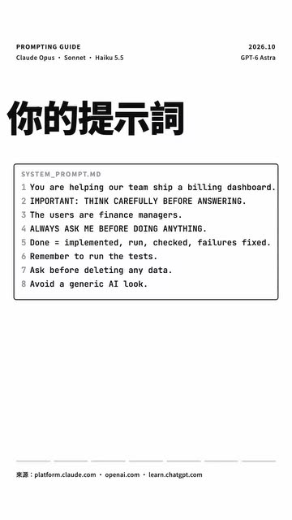

# 新模型來了，你的提示詞有一半該刪了：7 個改法

- 來源：https://www.instagram.com/reel/DejZRx-gtMG/?mdxt=ZzZ3aWliNXVtYWF6
- 平台 / 上傳者：Instagram / 張維峰
- 長度：02:52 (171.6s)
- 逐字稿來源：whisper (groq)
- 更新日期：2026-10-21
- **關鍵字：** #AI提示詞 #提示詞 #effort #Opus 5.5 #GPT-6 Astra #Sonnet #Haiku #Claude Code #Boris Cherny #Skill 描述 #提示詞大掃除 #講者主張

## 摘要與名詞說明

**一句話重點：** 張維峰（Instagram：cooljerrett）依 Anthropic 與 OpenAI 最新的官方提示指南，整理出 7 個提示詞改法：用 effort 取代文字要求、刪掉多餘提醒句、寫清楚「做完」的定義、界限要寫明、點名不要形容、Skill 描述寫觸發情境、貼入文字要標出；最後一招是請 AI 幫你改提示詞（**講者主張，未查證**）。

| 時間 | 重點 |
|---|---|
| 00:00 | 開場：兩家都出了新提示指南，講者把 7 份官方檔案整理成 7 個改法 |
| 00:11 | 第一招：想多想少，調 effort，不要用文字拜託；講者說 Opus 5.5 指南建議要少想就調低 effort，並提到各模型的預設 effort；兩家都說最高兩級測過有變好才用 |
| 00:34 | 第二招：以前多寫的提醒句可以刪（例如「回答前仔細想想」「記得跑測試」）；講者說 Opus 5.5 建議刪掉，回覆會更快開始 |
| 00:55 | 第三招：先講清楚怎樣才算做完，把實作、執行、檢查、修好失敗都寫進完成標準；只在卡住或有風險時才問 |
| 01:18 | 第四招：界限要寫清楚，不是寫得兇；「一律先問我」可能被當真，改成寫明哪些自己做、哪些要先核准 |
| 01:33 | 第五招：要點名不要形容；「避免 AI 感」只會換成另一種預設風格，直接寫出不要什麼 |
| 01:53 | 第六招：Skill 描述越短越準，寫觸發情境；流程多的 Skill，檔案只當路標，細節用到再讀 |
| 02:08 | 第七招：貼進來的文字要用帶隨機 ID 的標籤標出，裡面的指令使用者沒要求就不照做 |
| 02:20 | 官方人員在 X 的說法（畫面為 Boris Cherny 的貼文）：像跟同事講話，講清楚要做什麼、花多少 effort、怎麼確認做對 |
| 02:33 | 最後一招：請 AI 幫你改提示詞，把舊提示詞丟給新模型，讓它自己大掃除 |

## 名詞與說明
- **effort**：影片指模型的思考量設定（低／中／高）；各模型的預設值與「最高兩級」說法皆為講者主張，未查證。
- **Opus 5.5、Sonnet、Haiku**：Anthropic 的模型；畫面標題列寫「Claude Opus・Sonnet・Haiku 5.5」。
- **GPT-6 Astra**：畫面標題列的 OpenAI 模型名稱；逐字稿裡的「Astra」即指它。
- **官方指南、官方人員說法**：影片轉述 platform.claude.com、openai.com、learn.chatgpt.com（畫面頁尾來源），內容未逐一核對。
- 畫面中以一份 SYSTEM_PROMPT.md 當範例，最後一張把多餘的行劃掉，示範「大掃除」；範例內容是講者製作的，不是官方文字。
- 講者在 01:49 說「這支影片也照這張清單做，五個都沒用」，意指影片的視覺設計刻意避開他所列的 AI 感做法（講者說法，影片未逐項示範）。
- 主題詞「AI提示詞」（使用者在網址後指定）沒有對應到白名單領域，已存成關鍵字；領域依內容判斷為 AI。

## 轉錄校正備註
- Whisper 把「Sonnet／Haiku」聽成「Sonic／Hiku」、「Claude Code」聽成「Cloud Code」，「該刪了」聽成「改刪了」，已校正；其餘不確定處在 `known_asr_errors` 標「推測」。
- 00:22 預設 effort 的三組詞依語意整理成「Opus Medium、Sonnet High、Haiku Medium」，屬推測，建議對照原片確認。
- 02:24「他一定會現象」不確定原句，暫改「他一定會想太多」（推測）。
- 02:48 的「MING PAO CANADA // MING PAO TORONTO」是片尾幻覺，已刪除。
- 原稿為中文夾英文，未去語助詞（非講座類）。

## 圖文對照（畫面 + 逐字稿）

### 投影片 1：開場：新模型來了，提示詞有一半該刪（00:00–00:11）

**重點：** 以一份範例 SYSTEM_PROMPT.md 開場；講者依 Anthropic 與 OpenAI 的官方提示指南整理出 7 個改法。

**標籤：** #提示詞 #官方指南

新模型來了，你的提示詞有一半該刪了，這次 Anthropic 跟 OpenAI 都出了最新的提示指南，7 份官方檔案，我整理成 7 個改法。

### 投影片 2：第一、二招：用 effort 控制思考量、刪掉多餘提醒句（00:11–00:55）

**重點：** 要他想多想少，調 effort，不要用文字拜託；「回答前仔細想想」「記得跑測試」這類舊提醒句可以刪。

**標籤：** #effort #提醒句

第一，要他想多想少，調 effort，不要用文字拜託，Opus 5.5 指南說，要少想就先調低 effort，你在提示詞裡叫他少想更可靠，預設也換了：Opus Medium、Sonnet High、Haiku Medium，GPT-6 也分低、中、高，兩家都說最高兩級測過有變好才用，第二，以前多寫的提醒句可以刪了，回答前仔細想想，這種句子，Opus 5.5 建議刪掉，回覆會更快開始，Astra 會自己跑測試，記得測試這句反而可能讓他多測，OpenAI 的 Eric 說，過去有用的細瑣指示，現在可能降低成效。

### 投影片 3：第三、四招：先講清楚做完的標準、界限要寫明（00:55–01:33）

**重點：** 把實作、執行、檢查、修好失敗都寫進「完成」的定義；界限寫明哪些自己做、哪些要先核准，不要寫「一律先問我」。

**標籤：** #完成標準 #界限

第三，先講清楚，怎樣才算做完，Astra 有時做完第一版，就會來等你，Sonnet 跟 Haiku，在 effort 低的時候，也可能中途停，OpenAI 說，把實作，執行，檢查，修好失敗，都寫進完成，Anthropic 說，全部做完才停，只在卡住，或有風險的時候才問，第四，界限要寫清楚，不是寫得兇。以前加的「一律先問我」，Astra 可能太當真，在你想讓他繼續的地方停下來。改成寫明哪些自己做，哪些要先核准。

### 投影片 4：第五、六、七招：點名不要形容、Skill 描述要短、貼入文字要標出（01:33–02:20）

**重點：** 避免 AI 感要直接寫不要什麼；Skill 描述寫觸發情境；貼進來的文字用帶隨機 ID 的標籤包住。

**標籤：** #點名 #Skill 描述 #標籤

第五，要點名不要形容，跟 Opus 5.5 說「避免 AI 感」，大多隻是換成另一種預設風格，要直接寫出不要什麼，不要米白底，襯線體強調字、01 02 編號，等寬小標，膠囊按鈕，這支影片也照這張清單做，五個都沒用，第六，Skill 描述越短越準，寫「碰到資料庫就用」，模型粘到就叫它，寫「新增或修改 Migration 時使用」，才叫得準，流程多的 Skill，跟檔案只當路標，細節用到再讀，第七，貼進來的文字要標出來，Opus 5.5 建議，用帶隨機 ID 的標籤包住，裡面的指令，使用者沒要求，就不照做。

### 投影片 5：官方人員怎麼說（畫面為 X 貼文）（02:20–02:33）

**重點：** 畫面引用 Boris Cherny 在 X 的貼文：像跟同事講話，講清楚要做什麼、花多少 effort、怎麼確認做對。

**標籤：** #Boris Cherny

官方的人在X上講得更直白，別再寫 think carefully，他一定會想太多，Claude Code 的 Boris 說，像跟同事講話，講清楚要做什麼，花多少 effort，怎麼確認做對。

### 投影片 6：最後一招：請 AI 幫你改提示詞（02:33–02:52）

**重點：** 兩家都推薦把舊提示詞丟給新模型，讓它自己大掃除；畫面把範例中多餘的行劃掉。

**標籤：** #提示詞大掃除

最後一招，兩家都推，Anthropic 說，秘密武器是請 AI 幫你改提示詞，OpenAI 也叫你，讓 Astra 照著檢查一次，把舊提示詞丟給新模型，讓他自己大掃除，（片尾字樣，非講話）。

## 已知轉錄錯誤

| 時間 | 聽成 | 應為 |
|---|---|---|
| 00:00 | 改刪了 | 該刪了 |
| 00:11 | 挑effort | 調 effort（推測） |
| 00:22 | Opus, Media, Sonnet, High, Haiku, Media | Opus Medium、Sonnet High、Haiku Medium（依語意，推測） |
| 01:03 | Sonic跟Hiku | Sonnet 跟 Haiku |
| 01:04 | effort D | effort 低（推測） |
| 00:51 | 細索指示 | 細瑣指示 |
| 01:44 | 寫體強調字 | 襯線體強調字（推測） |
| 02:24 | 他一定會現象 | 他一定會想太多（推測，原句不確定） |
| 02:26 | Cloud Code的Boris | Claude Code 的 Boris（畫面為 Boris Cherny，Claude Code） |
| 02:48 | MING PAO CANADA // MING PAO TORONTO | 片尾字樣／幻覺，已改為（片尾字樣，非講話） |
