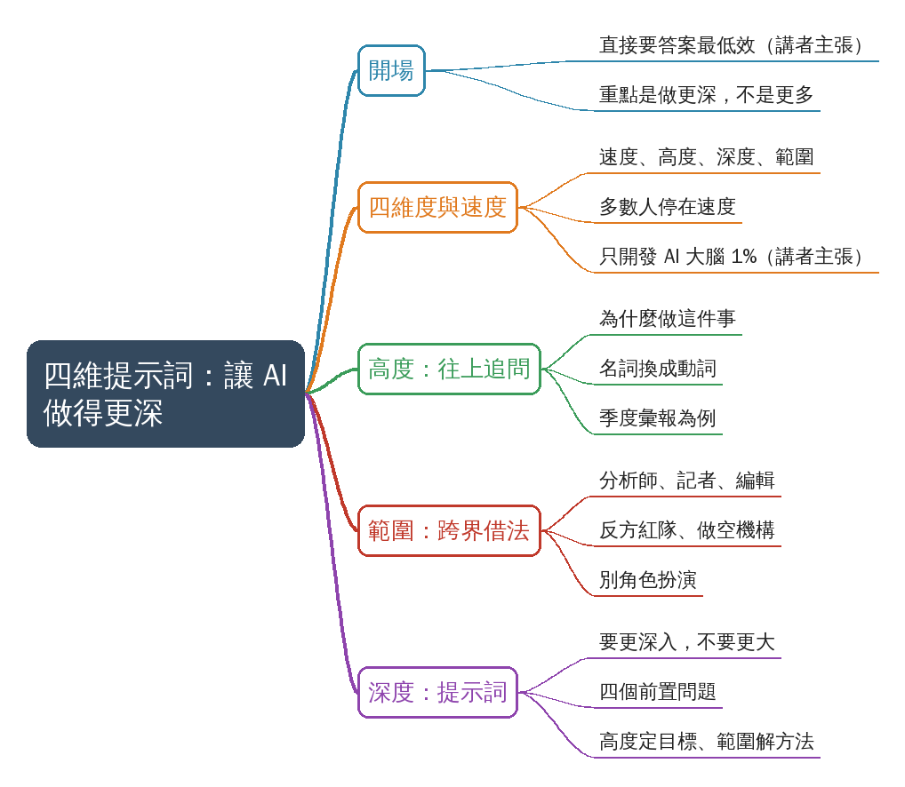

# 分享一段Claude的技術主管的ai指令，讓AI進行深度思考

- 來源：https://vt.tiktok.com/ZSg4LWWb1/
- 平台 / 上傳者：TikTok / yangzhujun1
- 長度：02:44 (164.4s)
- 逐字稿來源：whisper (groq)
- 更新日期：2026-10-26
- **關鍵字：** #ai提示詞 #Claude #Felix Rieseberg #速度高度範圍深度 #四維提示詞 #深度思考 #跨界借法 #創新的藝術

## 摘要與名詞說明

**一句話重點：**講者（竹子）介紹 Claude 工程主管 Felix 的用法——別只追求 AI 的「速度」，要用「高度、範圍、深度」讓任務做得更深，並附一段可複製的「更深入版本」提示詞（講者主張，未查證）。

| 時間 | 重點 |
|---|---|
| 00:00 | 開場：直接讓 AI 給答案可能最低效；真正會用的人是把任務做得更深（講者主張，未查證） |
| 00:19 | Claude 內部口號「雄心勃勃地使用 AI」；四個維度：速度、高度、深度、範圍；多數人只停在速度，只開發 AI 大腦不到 1%（講者主張，未查證） |
| 00:45 | 高度：往上追問「為什麼做」；把指令中的名詞換成動詞（例：不要「做 PPT」，要「30 分鐘內幫管理層看清因果關係，決定下一季度錢和人投在哪」） |
| 01:22 | 範圍：跨界借其他專業的方法（資料分析、調查記者、編輯、反方紅隊、做空機構與法務會計）；不要角色扮演，要求它調用具體研究方法 |
| 01:59 | 深度：提示詞「我要更深入而不是更大的版本」＋四個前置問題；高度定目標、範圍解方法、深度做紮實 |

**名詞說明：**
- **四維度**：速度（做得更快）、高度（目的往上一層）、範圍（跨領域借方法）、深度（照頂尖專家的做法做紮實）。
- **反方紅隊**：專門挑毛病、反向審查的角色。
- 《創新的藝術》：講者指「名詞換動詞」出自湯姆·凱利與強納森·利特曼的 *The Art of Innovation*（畫面有書封）；歸屬為講者說法，未查證。

**轉錄校正備註：**逐字稿來源為 Groq Whisper。已依畫面字幕與推文截圖改正：Cloud→Claude、帖子詞／70詞→提示詞、混溝→鴻溝、在網上→往上、挑測→挑刺、請呼叫→請調用。標「推測」未定案者：基督彙報→季度彙報、皈依模型→回歸模型、作風機構→做空機構（見 `meta.json.known_asr_errors`）。完整提示詞英文原文見 `supplement.md` S1。

## 補充資料（影片未呈現的資訊）


### S1｜畫面遺漏：Felix 的「更深入版本」提示詞（英文原文＋畫面中譯）
- 來源：影片畫面（Felix Rieseberg 教程頁面《How to be more ambitious: A tutorial for humans with models》，頁面左側目錄為 Start／Altitude／Depth／Range，畫面為瀏覽器雙語翻譯版）；取得日期：2026-10-26；取得方式：自影片 02:17 起畫面原解析度截圖逐字抄錄（影片原檔不入庫）。
- 為何需要補充：講者 02:05–02:27 口述了提示詞的中文大意，但畫面有完整英文原文與逐字中譯；影片結尾說「方法放到最後」，實際只口述、未提供文字版。對應報告「第三維度：深度」一段（`slide_05.jpg`，02:25）。
**原文（逐字）**
```
A simple prompt that often helps me:
一个经常能帮到我的简单提示：

I want a deeper version of this task, not a bigger one. Before rewriting
it: (1) say what a top professional in this field would do here that I'm
not asking for; (2) name the rawest material they would start from
instead of what has already been digested for me; (3) name the
specific methods and tools they would use; (4) say what, other than
you or me, would show the result is right. Then rewrite my prompt to
ask for exactly that.

我想要的是一个更深入的版本，而不是一个更大的版本。在重写题目之前：
（1）请说明该领域的顶尖专家会做哪些我没有要求的事情；（2）请列出他们会从哪些最原始的素材入手，而不是我已经整理好的素材；（3）请列出他们会使用的具体方法和工具；（4）除了你我之外，还有什么可以证明结果是正确的。然后，请修改我的题目，使其完全符合上述要求。
```
**Claude 的對照分析**
- 與影片一致：講者口述的四點（頂尖專家會做而我沒要求的事、最原始素材、具體方法與工具、你我之外的驗證依據）與畫面英文四點一一對應；「更深入而不是更大」亦一致。
- 補充直接寫明（影片沒有的）：英文原句，包含最後一句「Then rewrite my prompt to ask for exactly that」——要求 AI 先回答四點再改寫使用者的原始提示。
- 據此推定（非補充直接寫明）：畫面中文為網頁機器翻譯，「題目」對應英文 prompt；講者「請列出他們會使用…」等用字與此中譯一致。
**備註**
- 畫面中譯的簡體字照抄；英文為教程作者原文，影片未提供原始網址，教程內容與出處未查證。
- 逐字稿「帖子詞」「70詞」皆為「提示詞」之誤（畫面字幕寫「提示词」）。

### S2｜畫面遺漏：Felix 推文與教程出處
- 來源：影片畫面 00:10 前後（`frame_0005.jpg` 一帶）推文截圖；取得日期：2026-10-26；取得方式：自影片原解析度截圖抄錄。
- 為何需要補充：講者只說「Cloud 的技術主管 Felix」，畫面直接寫明姓名、職稱與教程標題。
**原文（逐字）**
```
Felix Rieseberg @felixrieseberg · Oct 13
Hi, I'm Felix. I'm an eng lead working on Claude. I love watching people take
flight and do things they never thought possible.

We often describe that as "being more ambitious" when using AI, which is
tricky advice to follow. I wrote a tutorial:

（畫面中譯）大家好，我是 Felix，Claude 项目的工程主管。我喜欢看到人们展翅高飞，完成他们从未想过自己能做到的事情。
我们通常将这种做法描述为在使用人工智能时"更具雄心"，但这其实很难做到。我写了一篇教程：

How to be more ambitious: A tutorial for humans with models
（互動數據：405 回覆、3.1K 轉推、24K 喜歡、5.3M 檢視）
```
**Claude 的對照分析**
- 補充直接寫明：發文者為 Felix Rieseberg，自述為「working on Claude 的 eng lead」，教程標題如上；逐字稿「Cloud」應為 Claude。
- 與影片一致：「Claude 的技術主管 Felix」「內部口號＝要雄心勃勃地使用 AI」（畫面為 "being more ambitious"）。
**備註**
- 職稱、互動數字與日期皆為畫面所示，未查證；括號內中譯與互動數據為畫面註記，非推文原文。

## 思維導圖



- 原圖：[mindmap.png](mindmap.png)；文字大綱：[mindmap.md](mindmap.md)（與本報告同資料夾）

## 圖文對照（畫面 + 逐字稿）

### 投影片 1：開場：直接要答案反而最低效（00:00–00:19）


**重點：** 講者（竹子）指出直接叫 AI 給答案可能是最低效的用法，真正會用的人是把任務做得更深而不是更多。她引用 Claude 技術主管 Felix 分享的用法，並預告結尾有一段可直接複製的提示詞。

**標籤：** #Felix #提示詞

最近有個研究挺顛覆的，直接讓AI給你答案，反而可能是最低效的方法，真正會玩的人，不是讓AI寫的更多，而是把任務做的更深，Claude的技術主管Felix，剛剛分享了他用AI的方法，還有一條拿來就能用的提示詞，我用下來非常受啟發，方法我放到最後了，你複製發給AI，一定會有驚喜，Felix這篇教程也非常有意思。

### 投影片 2：四個維度與「速度」陷阱（00:19–00:45）


**重點：** Claude 內部口號是「要雄心勃勃地使用人工智慧」，Felix 認為要考慮速度、高度、深度、範圍四個維度。多數人只停在第一層「速度」（寫文章、寫程式更快），講者稱這只開發了 AI 大腦不到 1%（講者主張，未查證）；其餘三個維度才是高手與新手的鴻溝。

**標籤：** #速度 #四個維度

分享給大家，首先他說Claude的內部有一個口號，要雄心勃勃的使用人工智慧，他認為要做到這一點，需要考慮四個維度，速度高度深度和範圍，但現在大多數人就停留在第一層，也就是速度，比如說你寫文章更快了，寫程式碼更快了，同樣工作更快完成，這件事大家都做到了，但是這才開發了AI大腦的1%還不到，另外的三個維度，才是區分高手和小白的最大的鴻溝，我們具體來講一講。

### 投影片 3：第一維度：高度——把名詞換成動詞（00:45–01:22）


**重點：** 高度是讓 AI 往上追問一層：我做這件事到底是為了什麼。以季度彙報為例，不要說「根據資料做一個 PPT」，而要說「在 30 分鐘內幫管理層看清因果關係，決定下一季度的錢和人投在哪裡」。講者說這是《創新的藝術》提過的老技巧，舊的方法論都能和 AI 結合。

**標籤：** #高度 #名詞換動詞

第一個是高度，說白了就是讓AI往上追問一層，我做這件事到底是為了什麼，拿我們最常見的季度彙報來做例子，普通人會讓AI按模板整理資料，然後生成彙報初稿，然後再進行一輪又一輪的修改，但Felix給了一個非常妙的技巧，把指令中的名詞換成動詞，不要說根據資料給我做一個PPT，而要說在30分鐘內幫管理層看清因果關係，決定下一季度的錢和人投在哪裡，是不是有點意思，這個其實是湯姆·凱利和強納森·利特曼，在《創新的藝術》這本書裡面提到的一個老技巧，所以你知道的很多的方法論其實都可以結合AI來用。

### 投影片 4：第二維度：範圍——跨界借方法，別角色扮演（01:22–01:59）


**重點：** 範圍是把其他專業的好方法跨界借來，讓彙報無懈可擊：資料分析師的回歸模型、調查記者挖故事的手法、頂尖編輯的表達結構、專挑毛病的反方紅隊，以及做空機構與法務會計的審查眼光。Felix 特別提醒（講者稱 90% 的人會踩，未查證）：不要叫 AI 角色扮演、模仿口氣，而是直接要求它調用該專業的具體研究方法。

**標籤：** #範圍 #紅隊 #別角色扮演

第二個就是範圍，意思就是把其他專業裡面好用的方法都跨界借過來，還是做這份彙報，怎麼才能讓它無懈可擊，Felix方法是作為一支跨界戰隊，同樣一份彙報，你可以讓AI結合，資料分析師的回歸模型，調查記者挖故事的手法，頂尖編輯的表達結構，甚至來一支專門挑刺的反方紅隊，借用做空機構和法務會計的眼光，來做反向審查，但Felix特別提醒了一個90%的人都會踩的坑，千萬不要讓AI搞什麼角色扮演，別讓他模仿做空者的這個語氣來寫稿，那樣只會讓文字變得陰陽怪氣，你就直接要求他，請調用做空者做研究的具體方法，讓不同的專業工具各自解決，我彙報裡的一個真實問題。

### 投影片 5：第三維度：深度——可複製的提示詞（01:59–02:44）


**重點：** 深度是照頂尖高手的方法把問題做紮實。提示詞要求「更深入而不是更大的版本」，並在重寫題目前先回答四件事：頂尖專家會做哪些我沒要求的事、會從哪些最原始的素材入手、會用哪些具體方法與工具、除了你我之外還有什麼能證明結果正確。講者總結：高度定目標、範圍解方法、深度做紮實；結尾邀請留言領取完整教程（約 10 秒，併入本段）。

**標籤：** #深度 #提示詞

第三個深度，也就是按頂尖高手的方法，把問題做紮實，可以複製這段提示詞直接發給AI，我想要的是一個更深入的版本，而不是一個更大的版本，在重寫題目之前，一 請說明該領域的頂尖專家，會做哪些我沒有要求的事情，二 請列出他們會從哪些最原始的素材入手，而不是我已經整理好的素材，三 請列出他們會使用的具體方法和工具，四 除了你我之外，還有什麼可以證明結果是正確的，然後請修改我的題目，使其完全符合上述要求，你看它是用高度來定目標，用範圍來解方法，再用這一段提示詞把深度做紮實，一旦掌握了，你會發現AI的潛力遠超你的想象，那這套思維用法的教程和提示詞呢，我都整理好了，感興趣的朋友評論區告訴我，我是竹子，關注我，快進一步，把握AI時代機遇。

## 已知轉錄錯誤

| 時間 | 聽成 | 應為 |
|---|---|---|
| 00:08 | Cloud的技術主管Felix（另 00:19） | Claude（畫面推文為 Claude 專案工程主管 Felix Rieseberg） |
| 00:11 | 帖子詞 | 提示詞（畫面字幕「提示词」） |
| 02:32 | 70詞 | 提示詞（02:37 字幕「提示词」；另 02:32 同） |
| 00:41 | 混溝 | 鴻溝（字幕「最大鸿沟」） |
| 00:46 | 在網上追問一層 | 往上追問一層（字幕「再往上追问一层」） |
| 01:37 | 挑測 | 挑刺（字幕「专门挑刺的反方红队」） |
| 01:53 | 請呼叫 | 請調用（字幕「请调用做空者」） |
| 00:51 | 基督彙報 | 季度彙報（推測；字幕該句只到「拿我们最常见的」，後文「下一季度」呼應） |
| 01:33 | 皈依模型 | 回歸模型（推測；資料分析師常用方法） |
| 01:40 | 作風機構 | 做空機構（推測；與 01:53「做空者」呼應） |
| 01:13 | 湯姆凱利和強奈森·利特曼 | 湯姆·凱利與強納森·利特曼（書封 Tom Kelley, The Art of Innovation） |

## 補充資料連結

- 補充資料檔：[supplement.md](supplement.md)（與本報告同資料夾；內容已收錄於上方〈補充資料〉）
- 思維導圖：[mindmap.png](mindmap.png)、文字大綱：[mindmap.md](mindmap.md)（與本報告同資料夾）
