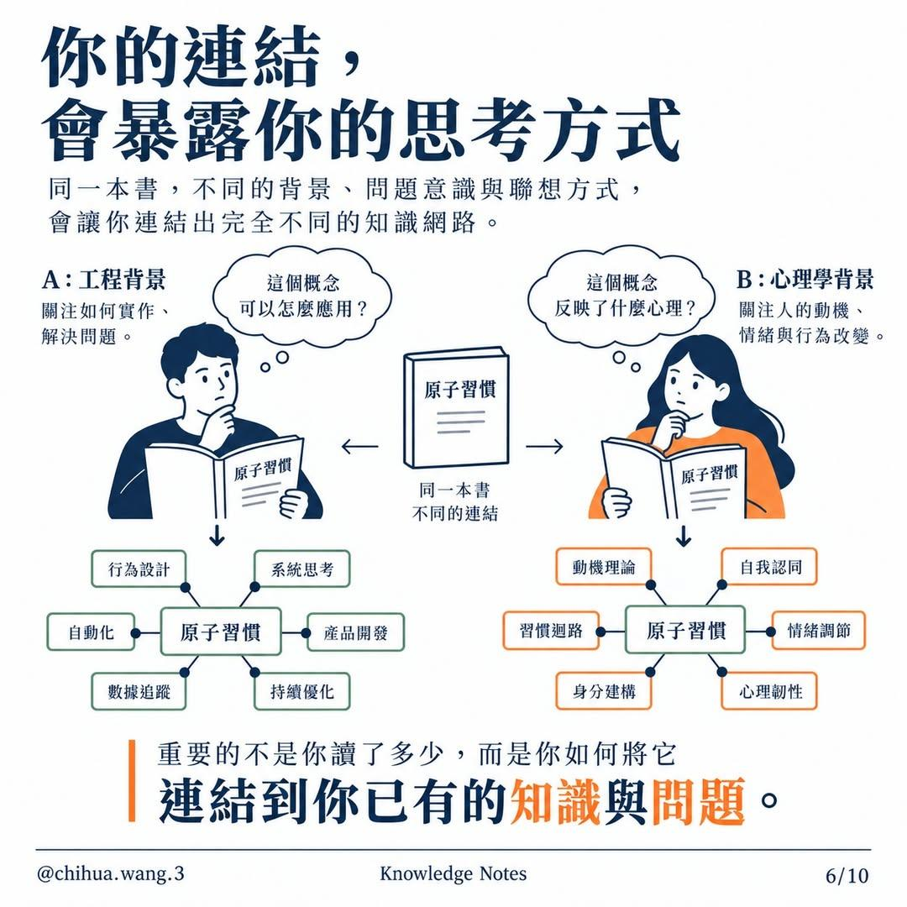
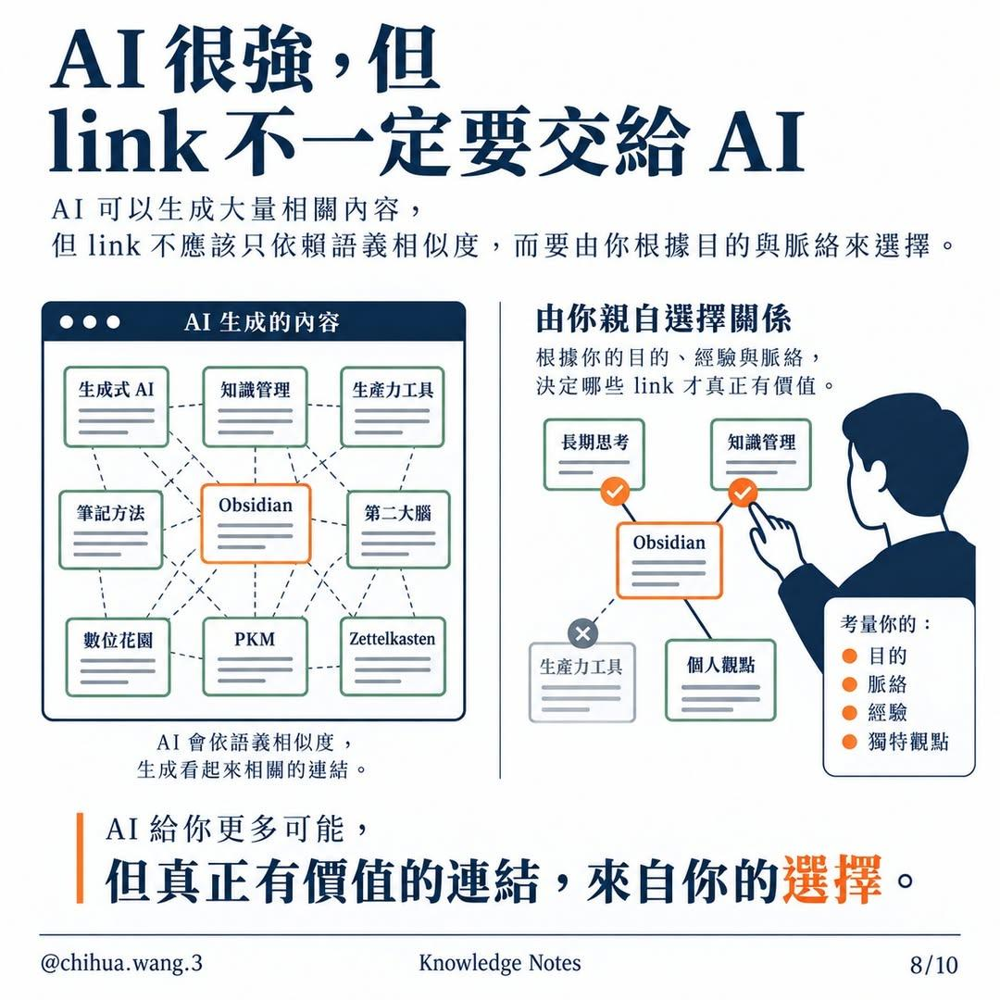

# AI 時代為什麼 Obsidian 反而更重要？

- 來源：（使用者上傳圖片，原貼文網址未提供）
- 平台 / 上傳者：Image / @chihua.wang.3（Knowledge Notes）
- 頁數：8 頁（共 10 頁，第 9–10 頁未提供）
- 逐字稿來源：圖片文字（逐頁人工抄錄，非語音轉錄）
- 更新日期：2026-10-27
- **關鍵字：** #Obsidian #知識管理 #連結 #Wikilink #Markdown #AI協作

## 摘要與名詞說明

**一句話重點：** @chihua.wang.3（Knowledge Notes）的圖文輪播主張：AI 能大量生成內容，但「真正的價值，不是更多的文字，而是你選擇建立的關係」——Obsidian 把 AI 產物以 Markdown 接住，由人親自建立有意義的 link，才讓內容變成自己的知識（**作者主張，未查證**）。

| 頁 | 重點 |
|---|---|
| 1 | 總論：AI 材料（對話、摘要、研究整理、程式與筆記）放進 Obsidian，由你比較、延伸、質疑、整合 |
| 2 | Obsidian 是接住 AI 產物的地方：AI 產出 → 轉 Markdown（簡單、開放、可長期保存）→ 進知識庫與既有筆記連結 |
| 3 | 怎麼留下來：標題層級、Callout、Wikilink `[[ ]]`、待建立節點；AI 負責生成素材，人負責判斷、連結與整合 |
| 4 | 該問的問題：這份筆記要跟什麼連在一起？（統計推論、哲學、心理學、管理學、社會脈絡、實際情境） |
| 5 | link 不是排版而是定義關係：有意義的連線有方向、有脈絡、能延伸思考；亂連只會混亂 |
| 6 | 連結會暴露思考方式：同一本《原子習慣》，工程背景與心理學背景連出不同網路 |
| 7 | 每個 link 都在替未來鋪路：核心概念 → 歷史脈絡／實際應用 → 反例與侷限／另一個學科 |
| 8 | AI 很強，但 link 不一定要交給 AI：AI 只依語義相似度連，由你依目的、脈絡、經驗、獨特觀點選擇 |

## 名詞與說明
- **Obsidian**：以本機 Markdown 檔為基礎的筆記軟體；一個資料夾就是一個 vault，筆記間可用雙向連結互連。
- **Wikilink**：`[[筆記名稱]]` 語法；指向尚未建立的筆記時仍可先寫（貼文稱「待建立節點」）。
- **Callout**：Obsidian 的色塊標註語法（`> [!tip] 標題`），用來突出關鍵想法。
- **語義相似度**：貼文指 AI 以「意思相近」自動推薦連結；貼文立場是這種連結不能取代人依目的選擇的連結（作者主張）。
- 本檔為**圖文貼文，非影片**：以頁碼代替時間碼（第 N 頁＝00:0N），逐字稿欄是逐頁人工抄錄的圖片文字。
- 貼文共 10 頁，使用者只提供 1–8 頁；第 9–10 頁內容未知，不做推測。
- 第 2 頁結語圖上寫「素素材」，應為「素材」之筆誤。
- 貼文全屬觀點與方法主張，無可查證的數字；原貼文網址未提供。

## 補充資料
- 缺頁說明與在 Obsidian 實作的對照，見 `supplement.md`。

## 補充資料（影片未呈現的資訊）

### 缺頁
- 貼文標示 1/10 至 10/10，本次只收到 1–8 頁；第 9、10 頁（可能為結論或行動建議）內容未知，取得後請補進 `transcript.md`、`meta.json.slides` 與 `frames/` 再重建。

### 在 Obsidian 的對應做法（整理者補充，非貼文原文；推測性建議，未實測）
- 把 AI 產出另存 `.md`，放進 vault 的 `AI產出/` 之類資料夾（第 2 頁）。
- 用標題層級（`#`）、Callout（`> [!tip] 重點`）、Wikilink（`[[概念]]`）整理（第 3 頁）。
- 每寫完一篇筆記，自問第 4 頁六個問題，只留下說得出「關係」的 link（第 5 頁）。
- 本 repo 的對應功能：`scripts/obsidian_export.py` 把歸檔結果匯成 vault 筆記，連結只取自手寫的 `links.md`，不自動以相似度產生（呼應第 8 頁）。

## 思維導圖

- 原圖：[mindmap.png](mindmap.png)；文字大綱：[mindmap.md](mindmap.md)（與本報告同資料夾）

## 圖文對照（畫面 + 逐字稿）

### 第 1 頁：AI 時代為什麼 Obsidian 反而更重要？

**重點：** AI 生成的材料（AI 對話、文章摘要、研究整理、程式與筆記）放進 Obsidian，由你主動比較、延伸、質疑、整合，形成屬於你的思考路徑。

**標籤：** #Obsidian #AI #知識管理

AI 時代為什麼 Obsidian 反而更重要？AI 生成大量內容，而你需要一個能把知識留下來、連結起來、變成自己思考的地方。左：AI 生成的材料（想法、摘要、草稿、觀點……）＝AI 對話、文章摘要、研究整理、程式與筆記 → 把材料放進 Obsidian。中：Obsidian 圖譜（AI 與人類協作、知識管理、閱讀筆記、核心概念、個人觀點、長期思考、跨領域連結）。右：你主動建立連結（比較、延伸、質疑、整合，讓不同想法彼此對話）；形成屬於你的思考路徑（從一個想法，延伸出更多可能，建立可持續成長的知識網絡）。結語：真正的價值，不是更多的文字，而是你選擇建立的關係。

### 第 2 頁：Obsidian 是接住 AI 產物的地方

**重點：** AI 的產出（對話、摘要、靈感、研究重點）整理輸出成 .md 檔——簡單、開放、可長期保存——再放進 Obsidian，與既有筆記連結成更大的網絡。

**標籤：** #Markdown #AI產出

Obsidian 是接住 AI 產物的地方，AI 可以快速生成大量內容，而 Obsidian 幫你把這些零散的產出，收進同一個知識系統。AI 產出各種內容（想法、摘要、草稿、靈感……）：AI 對話、文章摘要、靈感想法、研究重點。轉換為 Markdown 檔案（簡單、開放、可長期保存）：AI 摘要.md、研究筆記.md、靈感整理.md。進入你的 Obsidian 知識庫（與既有筆記連結，形成更大的網絡）：資料夾 AI 產出、研究筆記、專案筆記、閱讀筆記、想法、日常；檔案 AI 摘要.md、研究筆記.md、靈感整理.md、待思考問題.md。結語：AI 給你素材，而 Obsidian 讓它們變成你的知識。（圖上寫成「素素材」，疑為筆誤）。

### 第 3 頁：AI 可以生內容，但 Obsidian 決定內容怎麼留下來

**重點：** 同一份 AI 長文，經標題層級、Callout、Wikilink 與待建立節點整理後，從一時的輸出變成可持續累積的知識；AI 負責生成素材，人負責判斷、連結與整合。

**標籤：** #Wikilink #Callout #筆記結構

AI 可以生內容，但 Obsidian 決定內容怎麼留下來，同一份文字，經過整理與連結，從一時的輸出，變成可持續累積的知識。左：AI 生成的文字（一份長篇內容，資訊混雜）→ 整理進 Obsidian。範例筆記「AI 與人類協作」：1. 核心觀念；2. 應用情境；重點 callout（AI 負責生成素材，人負責判斷、連結與整合。）；3. 延伸思考：參考 [[知識管理]] 提升長期價值、與 [[個人知識庫]] 結合形成系統、待探索：[[AI 倫理]]。標題層級：將重點拆成清楚的標題，建立可快速瀏覽的結構。Callout：用色塊標註關鍵想法，讓重要內容更突出。Wikilink：用 [[雙向連結]] 將相關概念串起來，建立網絡。待建立節點：遇到新概念先建立連結，即使尚未撰寫，也能留下思考的入口。結語：內容的價值，不在於一次看完，而在於你能否持續讓它生長。

### 第 4 頁：真正重要的問題：這份筆記要跟什麼連在一起？

**重點：** 一個想法的價值來自它能連到的其他知識；圍繞「我的筆記」問六個問題：統計推論、哲學、心理學、管理學、社會脈絡、實際情境。

**標籤：** #連結 #提問

真正重要的問題：這份筆記要跟什麼連在一起？一個想法的價值，往往來自它能連結到的其他知識。主動思考這份筆記應該跟哪些概念、領域或實際情境建立關聯。中心：我的筆記。統計推論：這個現象背後有什麼證據？哲學：牽涉哪些前提？有什麼價值判斷？心理學：這和人類行為有什麼關係？管理學：可以如何應用在決策與行動？社會脈絡：在更大的社會結構中代表什麼？實際情境：可以在哪些場景驗證或實踐？結語：筆記不是結束，而是你主動建立連結的起點。

### 第 5 頁：link 不是排版，而是在定義關係

**重點：** 好的 link 連結兩個相關概念、有方向有脈絡；把不相關內容隨意連起來只會混亂。link 是在定義關係，不是在排版。

**標籤：** #連結品質 #雙向連結

link 不是排版，而是在定義關係，真正的連結，不是把東西湊在一起，而是建立有意義的關係，讓知識形成一個可思考的結構。有意義的連線：連結兩個相關的概念，讓想法彼此支撐、產生新的理解。例：人工智慧 —互補關係— 人類協作；有方向、有脈絡、能延伸思考。無意義的連線：把不相關的內容隨意連在一起，只會造成混亂，難以形成理解。例：時間管理、行銷策略、量子力學、飲食健康、程式語言、藝術創作彼此亂連；缺乏主題、關係模糊、難以產生價值。結語：好的 link，不是為了漂亮，而是讓知識開始對話。

### 第 6 頁：你的連結，會暴露你的思考方式

**重點：** 同一本書，因背景與問題意識不同，連出完全不同的網絡：工程背景連到行為設計、系統思考；心理學背景連到動機理論、自我認同。重點是連到你已有的知識與問題。

**標籤：** #思考方式 #原子習慣

你的連結，會暴露你的思考方式，同一本書，不同的背景、問題意識與聯想方式，會讓你連結出完全不同的知識網路。A：工程背景（關注如何實作、解決問題）——「這個概念可以怎麼應用？」→ 原子習慣：行為設計、系統思考、自動化、產品開發、數據追蹤、持續優化。B：心理學背景（關注人的動機、情緒與行為改變）——「這個概念反映了什麼心理？」→ 原子習慣：動機理論、自我認同、習慣迴路、情緒調節、身分建構、心理韌性。中間：同一本書，不同的連結（《原子習慣》）。結語：重要的不是你讀了多少，而是你如何將它連結到你已有的知識與問題。

### 第 7 頁：每一個 link，都在替未來的自己鋪路

**重點：** 從核心概念出發，順著 link 延伸到歷史脈絡、實際應用、反例與侷限、另一個學科，知識不再孤立，而是越來越大的地圖。

**標籤：** #知識地圖 #延伸

每一個 link，都在替未來的自己鋪路，把一個想法，順著連結延伸，你會發現知識不再孤立，而是一張越來越大的地圖。核心概念：從一個想法出發，提出問題，開始連結。歷史脈絡：這個概念是如何誕生？過去有哪些關鍵事件？實際應用：可以用在什麼領域？能解決什麼真實問題？反例與侷限：哪些情況下不適用？曾經出現什麼失敗案例？另一個學科：這個概念還能連到哪些不同領域的知識？（連線：核心概念 → 歷史脈絡、實際應用；歷史脈絡 → 反例與侷限、另一個學科。），結語：知識的價值，不在於你記住多少，而在於你能連結出多少可能。

### 第 8 頁：AI 很強，但 link 不一定要交給 AI

**重點：** AI 會依語義相似度生出看起來相關的連結；有價值的 link 由你根據目的、脈絡、經驗與獨特觀點選擇（打勾保留、打叉剔除）。

**標籤：** #AI #連結選擇

AI 很強，但 link 不一定要交給 AI，AI 可以生成大量相關內容，但 link 不應該只依賴語義相似度，而要由你根據目的與脈絡來選擇。左：AI 生成的內容——生成式 AI、知識管理、生產力工具、筆記方法、Obsidian、第二大腦、數位花園、PKM、Zettelkasten 全部互連；AI 會依語義相似度，生成看起來相關的連結。右：由你親自選擇關係（根據你的目的、經驗與脈絡，決定哪些 link 才真正有價值）：Obsidian 與長期思考、知識管理、個人觀點保留（打勾），生產力工具剔除（打叉）。考量你的：目的、脈絡、經驗、獨特觀點。結語：AI 給你更多可能，但真正有價值的連結，來自你的選擇。

## 補充資料連結

- 補充資料檔：[supplement.md](supplement.md)（與本報告同資料夾；內容已收錄於上方〈補充資料〉）
- 思維導圖：[mindmap.png](mindmap.png)、文字大綱：[mindmap.md](mindmap.md)（與本報告同資料夾）
