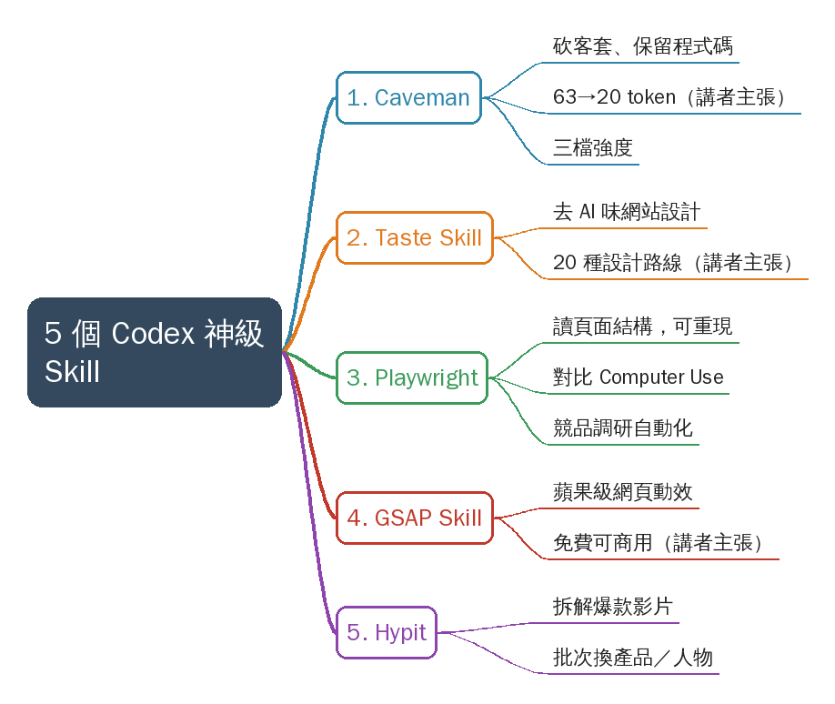
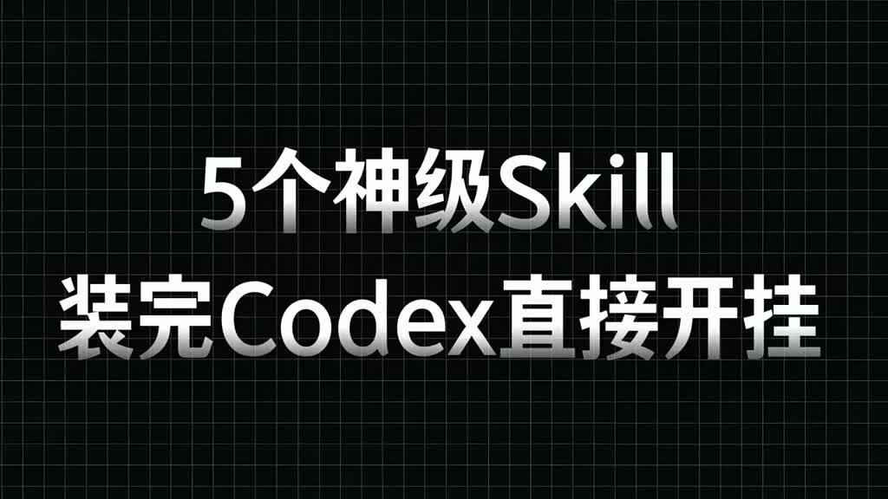
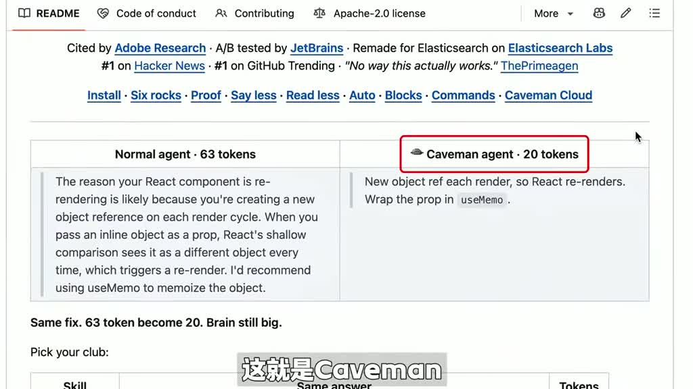
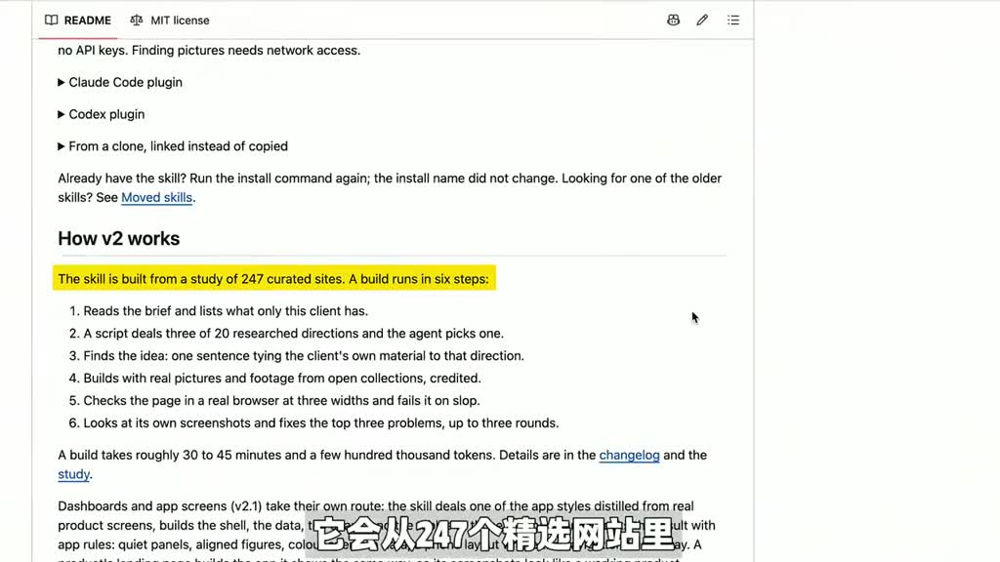
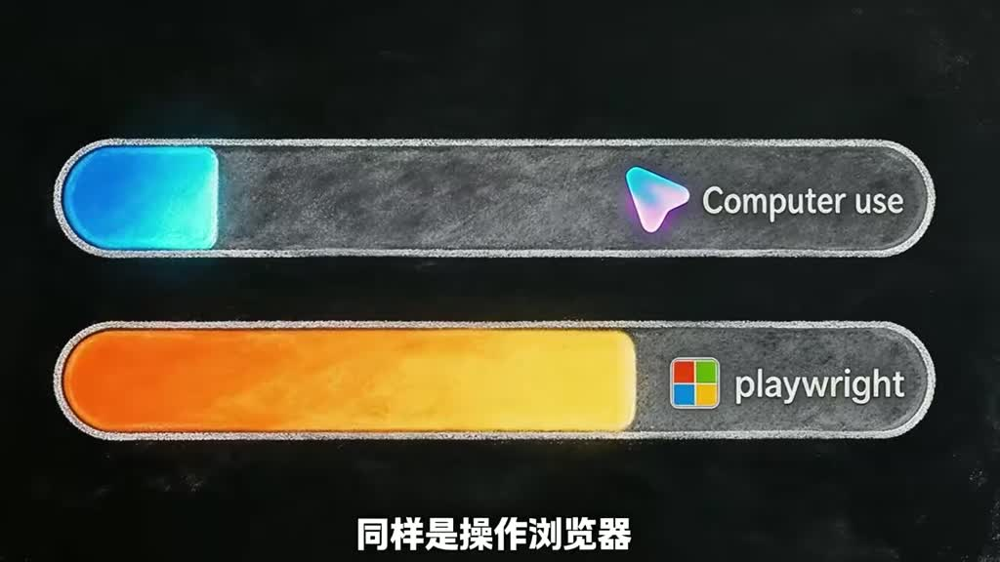
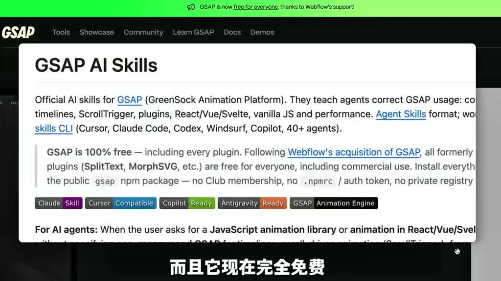
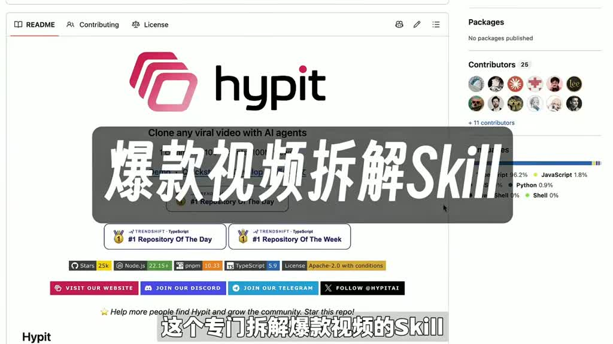

# 5個神級Skill，裝完Codex直接開掛！

- 來源：https://vt.tiktok.com/ZSgpbTTbB/
- 平台 / 上傳者：TikTok / lestaridewi530
- 長度：02:01 (121.1s)
- 逐字稿來源：whisper (groq)
- 更新日期：2026-10-28
- **關鍵字：** #ai-skill #Codex #Caveman #Taste Skill #Playwright #GSAP #Hypit #省 token #網頁動效 #爆款影片拆解

## 摘要與名詞說明

**一句話重點**：講者推薦 5 個可裝進 Codex 的 Skill（Caveman、Taste Skill、Playwright、GSAP、Hypit），分別用於省 token、去 AI 味網頁設計、精確操作瀏覽器、網頁動效與拆解爆款影片。影片中的星數、價格、token 數等皆為講者主張，未查證。

| 時間 | 重點 |
|---|---|
| 00:00 | 開場：5 個 Skill，裝完 Codex 直接開掛 |
| 00:02 | 1. Caveman：砍掉客套與冗長總結、保留程式碼；63→20 token（講者主張），三檔強度最低 13 token（講者主張），GitHub 星數逾 11 萬（講者主張） |
| 00:26 | 2. Taste Skill：從 247 個精選網站歸納 20 種設計路線（講者主張），去 AI 味；星數逼近 10 萬（講者主張） |
| 00:48 | 3. Playwright：被 OpenAI 收進官方 Skill 庫（講者主張）；相較 Computer Use 看螢幕找元素，它直接讀頁面結構、可重現；適合競品調研 |
| 01:18 | 4. GSAP Skill：蘋果發表會級網頁動效；專業工作室報價 2 萬起（講者主張）；免費、可商用（講者主張） |
| 01:37 | 5. Hypit：拆解爆款影片的腳本、字幕、素材、動效、節奏，可批次替換產品／人物／語言；2.4 萬星（講者主張） |

## 名詞說明
- **Skill**：給 AI 代理（此處為 Codex）安裝的可重用能力／指令包。
- **token**：模型計費與輸出長度的單位。
- **Computer Use**：AI 看螢幕截圖、模擬滑鼠鍵盤操作；**Playwright**：以程式碼與 DOM 結構驅動瀏覽器的自動化框架。
- **GSAP**：GreenSock 動畫函式庫。

## 轉錄校正備註
- 「競選網站」→「精選網站」、「Github新數」→「GitHub 星數」、「集水分」→「去水分」、「誘魔人」→「磨人」（推測）、「幣裝」→「必裝」（推測）；畫面字幕有對照者以字幕為準。
- 00:48 補上被漏掉的「3. Playwright」標題（畫面標題卡可證）；原「強盜」判為 Playwright 的誤聽。
- 00:42–00:52 為插入的無關廣告（畫面與英文語音），非影片內容，報告不採用。

## 補充資料（影片未呈現的資訊）

### 影片未呈現／需注意
- **插入廣告**：00:42–00:52 畫面出現與主題無關的角色廣告與英文語音（「My family… We've lost everything… Choose your AI girlfriend at sweetlove.ai」），不是講者內容；已在逐字稿標註。
- **Skill 名稱與連結**：影片只秀 GitHub 頁面，未唸出網址；實際專案請自行搜尋名稱確認（推測：Caveman、taste-skill、Playwright、GSAP AI Skills、Hypit 皆為 GitHub 上的專案）。
- 畫面的 `npx skills add …` 安裝指令因截圖解析度與被廣告遮蔽，無法完整辨認，影片未示範完整安裝步驟。

## 思維導圖

- 原圖：[mindmap.png](mindmap.png)；文字大綱：[mindmap.md](mindmap.md)（與本報告同資料夾）

## 圖文對照（畫面 + 逐字稿）

### 投影片 1：開場：5 個 Codex Skill（00:00–00:02）

**重點：** 講者開場說明：安裝這 5 個 Skill 後，Codex 能力大幅提升。後面逐一介紹，每個都附 GitHub 專案頁。

**標籤：** #Codex #Skill

5個神級skill,裝完codex直接開掛。

### 投影片 2：1. Caveman：省 token（00:02–00:26）

**重點：** 同一問題，不裝約 63 個 token，裝了只要 20 個（講者主張，未查證）。它砍掉 AI 回覆中的客套、重複解釋與冗長總結，但完整保留程式碼、命令與修復方案。有三檔強度（含 Ultra、Mega），最低可壓到 13 個 token（講者主張）；講者稱 GitHub 星數已超 11 萬（講者主張）。

**標籤：** #Caveman #token

1. Caveman，同樣問一個問題，不裝這個skill,要花63個token,裝了它只要20個，這就是Caveman,GitHub已超11萬新的省token skill，它專門給AI回覆去水分，客套化，重複解釋，冗長總結，直接砍掉，程式碼，命令和修復方案完整保留，想更狠還有Ultra Cave,Mega Cave,三檔強度可選，最低壓到13個token，如果你每天都在高頻使用codex,這就是一個實打實的省錢skill。

### 投影片 3：2. Taste Skill：去 AI 味的網站設計（00:26–00:48）

**重點：** 用 Codex 做網站最怕一眼 AI 味，這個設計類 Skill 專門解決。拿到需求後可先讓它定視覺方向：它從 247 個精選網站歸納出 20 種設計路線，每套各有視覺主張（講者主張）。講者稱 GitHub 星數逼近 10 萬（講者主張）。00:42–00:52 插入一段與主題無關的外部廣告畫面與英文語音，非影片內容。

**標籤：** #Taste Skill #設計

2. Taste skill，用Codex做網站，最怕一眼AI味，這個Skill專門解決這個問題，它是目前設計類Skill裡的頂流，GitHub星數逼近10萬，拿到需求後，可以先讓它定視覺方向，它會從247個精選網站裡，總結出20種設計路線，每套都有自己的視覺主張，（廣告插播，非影片內容）My family，We've lost everything，Could you help me?。

### 投影片 4：3. Playwright：精確操作瀏覽器（00:48–01:18）

**重點：** 講者稱 Playwright 被 OpenAI 收進官方 Skill 庫。與 Computer Use 同樣是操作瀏覽器，但 Computer Use 是看螢幕靠眼睛找，Playwright 直接鑽進頁面結構、讀資料並按程式碼驅動，每步確定且可重現。適合競品調研：檢索、逐頁開商品詳情、整理成表格並保留連結與截圖。

**標籤：** #Playwright #Computer Use

3. Playwright，Choose your AI girlfriend at sweetlove.ai，Playwright被OpenAI直接收進官方Skill庫同樣是操作瀏覽器它斷層領先Computer Use相比Computer Use看著螢幕憑眼睛找Play Right直接鑽進頁面結構讀資料按程式碼精確驅動每一步都確定可復現，像競品調研這種費時間磨人的活，比如檢索資訊，逐頁開啟商品詳情，整理成表格，保留連結和截圖，它都會從頭到尾替你幹完，複雜流程瞬間變簡單，你完成任務的速度會變得很快。

### 投影片 5：4. GSAP Skill：網頁動效（01:18–01:37）

**重點：** 講者稱這是蘋果發表會級別的網頁動效 Skill，找專業工作室報價 2 萬起（講者主張）。只要描述想要的感覺，一句話就能把普通網頁升級成有節奏、有敘事感的作品；講者稱完全免費、支援商用（講者主張，畫面上的 GSAP 頁面也有標示免費）。

**標籤：** #GSAP #動效

4. GSAP Skill，一個蘋果釋出會級別的網頁動效Skill，找專業工作室報價2萬起步，現在裝上這個Skill，一句話就能實現，你只要描述清楚想要的感覺，普通網頁直接升級成有節奏，敘事感的數字作品，而且它現在完全免費，支援商用，等於白撿一個動效導演給你免費打工，用上直接開掛。

### 投影片 6：5. Hypit：拆解爆款影片＋結語（01:37–02:01）

**重點：** 專門拆解爆款影片的 Skill，講者稱上線不到三個月就 2.4 萬星（講者主張）。給它一條爆款影片，就能拆解腳本、字幕、素材、動效與節奏，產出可批次交付的工作流；產品、人物、語言可替換並保留節奏，也能衍生不同開場與多個版本。結語：想批次生產爆款影片的人必裝。

**標籤：** #Hypit #影片工作流

5.Hypit，這個專門拆解爆款影片的Skill，上線不到三個月就衝到2.4萬星，你只要給它一條爆款影片，它就能自己拆解指令碼，字幕 素材 動效和節奏，可批次交付的影片工作流，產品 人物 語言都能自由替換，原有節奏依然成立，還能快速衍生不同開場和多個版本，想批次生產爆款影片的這個Skill必裝。

## 補充資料連結

- 補充資料檔：[supplement.md](supplement.md)（與本報告同資料夾；內容已收錄於上方〈補充資料〉）
- 思維導圖：[mindmap.png](mindmap.png)、文字大綱：[mindmap.md](mindmap.md)（與本報告同資料夾）
