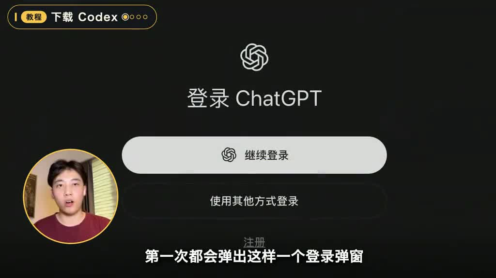
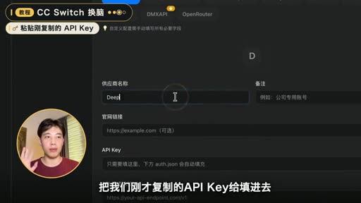
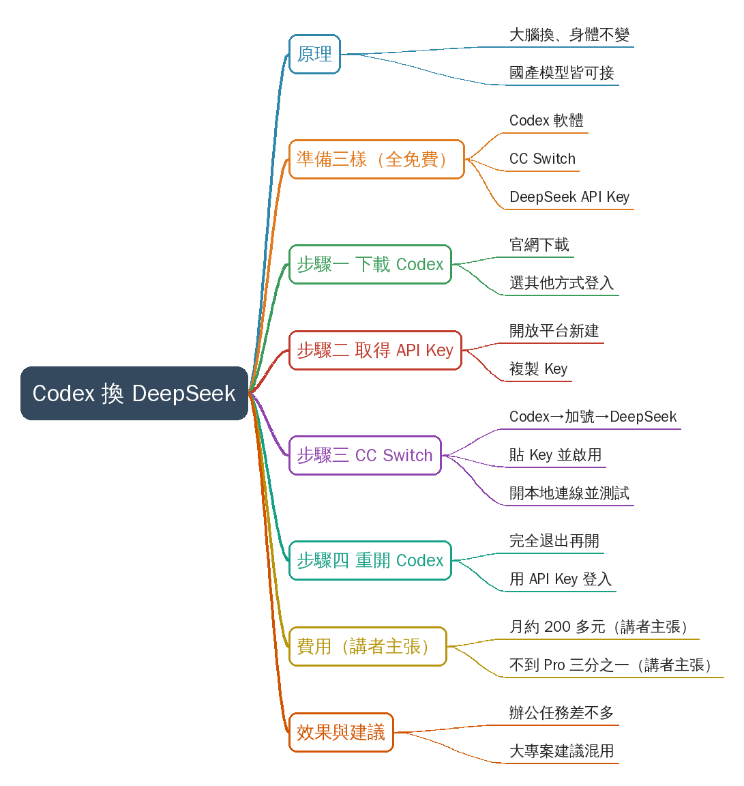
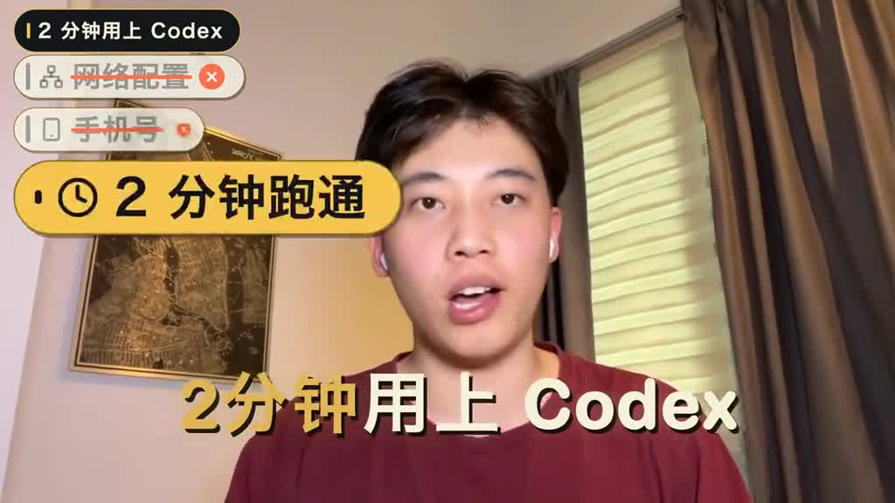
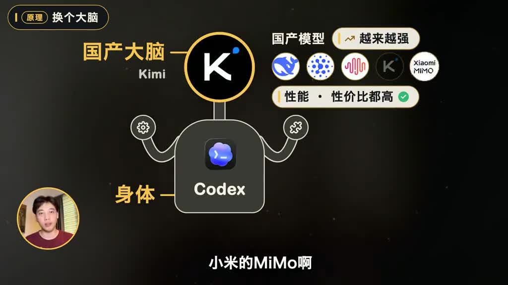
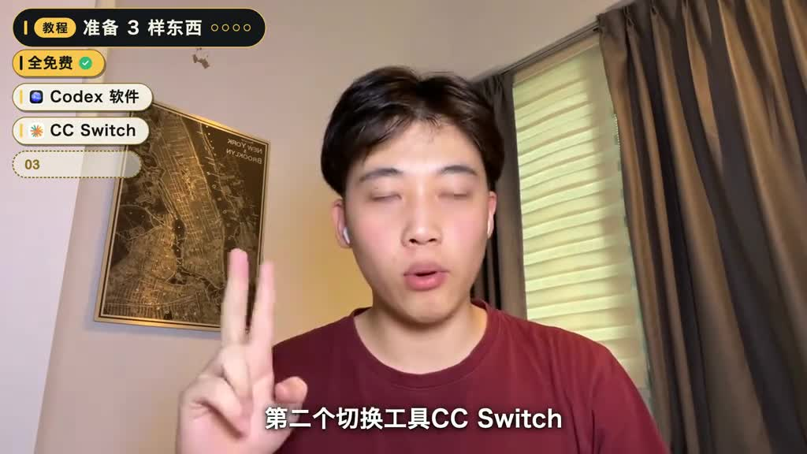
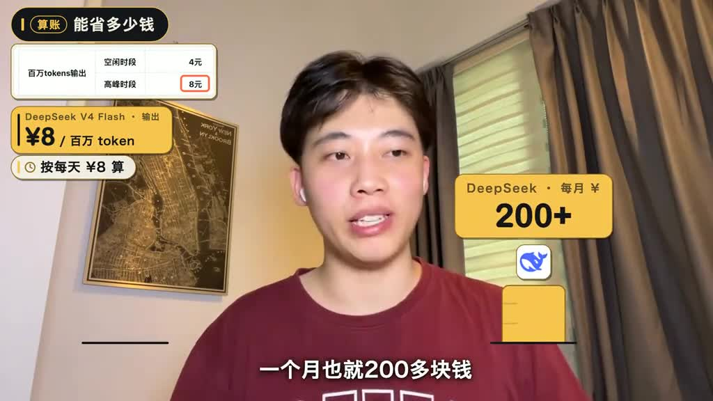
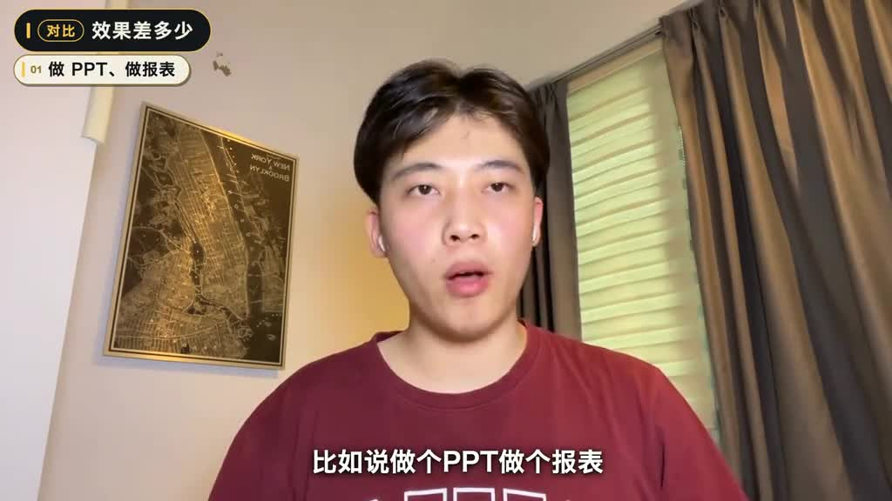

# A super simple Codex setup guide, no sign-up needed. Get it installed...

- 來源：https://vm.tiktok.com/ZSgpgNqYd/
- 平台 / 上傳者：TikTok / putrianggita599
- 長度：03:29 (208.9s)
- 逐字稿來源：whisper (groq)
- 更新日期：2026-10-28
- **關鍵字：** #ai-codex #Codex #DeepSeek #CC Switch #API Key #國產模型 #省錢 #安裝教學

## 摘要與名詞說明

**一句話重點**：講者示範下載 Codex、取得 DeepSeek API Key、用 CC Switch 把 Codex 的模型換成 DeepSeek，並稱費用不到官方 Pro 方案的三分之一（講者主張，未查證）。

| 時間 | 重點 |
|---|---|
| 00:00 | 開場：兩分鐘用上 Codex，不需網路配置與手機號 |
| 00:20 | 原理：Codex 是身體、模型是大腦，只換大腦 |
| 00:50 | 準備三樣免費東西：Codex、CC Switch、DeepSeek API Key |
| 00:59 | 步驟一：從 ChatGPT 官網下載 Codex，登入選「其他方式登入」 |
| 01:09 | 步驟二：DeepSeek 開放平台建立並複製 API Key |
| 01:38 | 步驟三：CC Switch 選 Codex→加號→DeepSeek→貼 Key→啟用→開本地連線→測試 |
| 02:11 | 步驟四：完全退出 Codex 再重開，用 API Key 登入，選 DeepSeek |
| 02:26 | 費用：講者稱每月約 200 多元，Pro 約 700 多元（講者主張，未查證） |
| 02:58 | 效果：辦公任務差別不大，大專案建議混用（講者主張，未查證） |

## 名詞
- **Codex**：OpenAI 的程式／代理工具。**CC Switch**：切換 Codex 模型供應商的工具。**API Key**：模型服務發的專屬密碼，依 Token 用量計費。

## 校正備註
- 逐字稿「DeepSick／DeepSake」等已統一為 DeepSeek；「智普」→「智譜」。「好冷」疑為 Holland（畫面字卡）、「實圖」疑為「識圖」，均標推測，保留原文。轉錄來源 Groq，語言自動偵測為中文，無去語助詞（非講座）。

## 操作 SOP（依影片整理，照著做）

### 把 Codex 的模型換成 DeepSeek

**前置條件**
- 三樣免費軟體／資源：Codex 軟體、CC Switch、DeepSeek API Key（00:50）。
- DeepSeek 依 Token 用量計費（講者主張，未查證）。

**步驟**
1. 從 ChatGPT 官網下載並安裝 Codex。（00:59）
2. 首次開啟的登入彈窗不要登入，選「其他方式登入」。（01:04）
   
3. 開啟 DeepSeek 開放平台，左側點「API Keys」，新建一個（名稱自訂）。（01:17）
4. 建立後點「Copy」複製 API Key。（01:25）
   
5. 從 CC Switch 官網下載並安裝 CC Switch。（01:38）
6. 開啟 CC Switch，點 Codex 圖示，再點右上角加號，選擇「DeepSeek」。（01:54）
7. 把剛複製的 API Key 填入，點「啟用」。（01:58）
   
8. 出現開啟本地連線服務提示時，到左上角「設定」開啟本地連線總開關，勾選對應選項後點「測試」；顯示執行正常即切換成功。（02:01）
9. 將 Codex 完全退出再重新開啟。（02:14）
10. 在登入方式填入 API Key，模型清單即可選到 DeepSeek。（02:17）
    
11. 發一句話，正常回覆即表示跑通。（02:22）

**注意事項**
- 第 9 步完全退出最容易漏（講者提醒）。
- 官網網址、CC Switch 設定頁中勾選的具體選項：影片未示範。
- 大專案建議與原模型混用（講者主張，未查證）。

## 補充資料（影片未呈現的資訊）

### 畫面遺漏

**費用卡片（約 02:46–02:56 畫面，講者未逐字唸出）**
- 「DeepSeek V4 Flash・輸出：¥8／百萬 token」，「按每天 ¥8 算」。
- 價目表「百萬 tokens 輸出」：空閒時段 4 元、高峰時段 8 元（畫面標示；講者主張，未查證）。
- 月費比較卡：「DeepSeek・每月 ¥ 176+」（動畫尚在跑，後續畫面為「200+」）；Pro「592+」，標示「不夠 1/3」（講者主張，未查證）。

**CC Switch 操作畫面（01:54 起）**
- 「添加新供應商」頁籤為「Codex 供應商」，預設供應商含：自定義配置、OpenAI Official、Azure OpenAI、PackyCode、Cubence、HubMix、DMXAPI、OpenRouter 等。

### 影片未呈現
- 各軟體下載網址、DeepSeek 開放平台網址：影片未顯示。

## 思維導圖

- 原圖：[mindmap.png](mindmap.png)；文字大綱：[mindmap.md](mindmap.md)（與本報告同資料夾）

## 圖文對照（畫面 + 逐字稿）

### 投影片 1：開場：兩分鐘用上 Codex（00:00–00:20）

**重點：** 講者說看完影片就能用上 Codex，不需網路配置、不需手機號，兩分鐘跑通。上期講了 Codex 省 token，評論區最多人問的卻是怎麼下載，所以這次出保姆級教學，建議邊看邊照著操作。

**標籤：** #Codex #保姆級教學

今天我要讓你看完這個影片就能用上Codex，不需要網路配置也不需要手機號，兩分鐘就能輕鬆跑通，那麼上期呢我講了Codex怎麼省Token，評論區問的最多的卻是Codex到底怎麼下載，到底怎麼才能用上，所以說呢這次我直接出一個保姆級的Codex教程，建議大家點贊收藏，裝的時候對應著操作。

### 投影片 2：原理：換腦不換身體（00:20–00:50）

**重點：** 講者把 Codex 比喻成身體、模型比喻成大腦：工具呼叫、Skill 呼叫仍用 Codex 那一套，只把大腦換成 DeepSeek。DeepSeek、智譜 GLM、MiniMax、Kimi、小米 MiMo 等國產模型，用哪個順手都能接進 Codex（效能與性價比高為講者主張，未查證）。

**標籤：** #DeepSeek #國產模型 #大腦與身體

那麼大家現在看到我的這個Codex，它背後其實跑的是DeepSeek，我們可以把這個理解為大腦和身體，我們只是把大腦換成DeepSeek，整個像是工具呼叫啊，Skill呼叫啊，用的還是Codex的那一套，大家別看不起國產模型啊，現在國產模型也越來越強了，就比如說DeepSeek、智譜的GLM，它們的效能和價效比都很高，而且像是MiniMax呀，Kimi呀，小米的Mimo啊，你用的哪一個順手都可以接到Codex裡，那麼今天我們就拿DeepSeek來演示一下。

### 投影片 3：準備三樣東西（00:50–00:59）

**重點：** 示範以 DeepSeek 為例，先備好三樣全免費的東西：Codex 軟體、切換工具 CC Switch、DeepSeek 的 API Key。

**標籤：** #CC Switch #API Key

首先我們要準備三樣東西，全是免費的，第一個就是下載Codex的軟體，第二個切換工具CC Switch，還有就是DeepSeek的API Key。

### 投影片 4：步驟一：下載 Codex（00:59–01:09）

**重點：** Codex 直接從 ChatGPT 官網下載。第一次開啟會彈出登入視窗，不必登入，直接選「其他方式登入」。

**標籤：** #下載 #其他方式登入

Codex我們直接從ChatGPT的官網上下載即可，一般我們下載好後，第一次都會彈出這樣一個登入彈窗，我們不用管它，直接選其他方式登入。

### 投影片 5：步驟二：取得 DeepSeek API Key（01:09–01:38）

**重點：** API Key 相當於 DeepSeek 發給你的專屬密碼，用多少 Token 就扣多少錢。打開 DeepSeek 開放平台，左側點 API Keys、新建一個（名稱自訂），建立後按複製即完成。講者另稱 DeepSeek V4 加上識圖能力後他越用越多（講者主張，未查證）。

**標籤：** #API Keys #Token 計費

接著就是獲取模型的API Key，API Key它就相當於DeepSeek發給你的專屬密碼，你用多少Token就會扣多少錢，那麼我們開啟DeepSeek的開放平臺，在左邊點API Keys，我們新建一個，名字隨便起一個你想要的都可以，建立完之後，把API Key點一下複製，到此這一步就算完成了，而且我這邊插一句嘴，自從DeepSeek的V4加上實圖能力之後，我用它用的越來越多了，在這裡還是要感嘆一句，良勝牛逼。

### 投影片 6：步驟三：用 CC Switch 換腦（01:38–02:11）

**重點：** CC Switch 的功能是把 Codex 原本的大模型切換成 DeepSeek，同樣從其官網下載。開啟後點 Codex 圖示、右上角加號、選 DeepSeek、貼上剛才的 API Key，再點啟用；它會提示開啟本地連線服務，到左上角設定打開本地連線總開關、勾選對應選項後按測試，顯示執行正常即切換成功。

**標籤：** #CC Switch #本地連線 #測試

那麼第三步就是安裝這個CC Switch它的主要功能就是幫我們把Codex原本的大模型切換成DeepSeek你可以理解為它就是一個換腦手術一樣它也是去CC Switch的官網上下載，然後點開CC Switch，我們點Codex的圖示，再點右上角的加號，選擇DeepSeek，把我們剛才複製的API Key給填進去，再點啟用，它就會提示開本地連線服務，我們去左上角設定把本地連線的總開關開啟，勾上對應選項點一下測試，顯示執行正常就說明我們切換成功了。

### 投影片 7：步驟四：完全退出再重開 Codex（02:11–02:26）

**重點：** 這步最容易漏：必須把 Codex 完全退出再重新開啟，然後在登入方式填入 API Key，模型就能選到 DeepSeek。發一句話，正常回覆就代表跑通。

**標籤：** #重啟 Codex #API Key 登入

那麼最後一步也是我們最容易漏的，就是我們要把Codex完全退出，然後再重新開啟，然後我們在登入方式裡面填寫API Key，模型就能選到DeepSeek了，然後我們發一句話，它正常會回我們，就說明這個事情跑通了。

### 投影片 8：費用比較：DeepSeek 對 Pro（02:26–02:58）

**重點：** 講者稱天天用 Codex 的人基本得上 Pro 5X，最低約每月 700 多元；DeepSeek 沒有月費也沒有五小時限額，用多少扣多少。以 V4 Flash 算，100 萬 Token 輸出 8 元，每天 8 元約一個月 200 多元，不到 Pro 的三分之一（以上皆講者主張，未查證）。

**標籤：** #Pro 5X #V4 Flash #計費

然後到最後還有個大家很關心的問題，就是我換成DeepSeek之後，它到底能給我省多少錢，然後它的效果會不會差得很大，對於天天都用Codex的人來說，基本上都得上一個Pro5X了，要不是真的不夠用啊，也就是說最低也得一個月700多塊錢吧，但是呢你換成DeepSeek，它是沒有月費的，也沒有五小時的限額，你用多少它就扣多少嘛，我們就按這個V4 Flash來算，100萬的Token輸出才8塊錢，也就是說我們按每天8塊錢來算，一個月也就200多塊錢，差不多也只有Pro的三分之一不到。

### 投影片 9：效果評估與建議（02:58–03:13）

**重點：** 講者用它做 PPT、報表等辦公任務，覺得與原版差別不大；但若要做整個專案這類大工作，建議兩者結合使用（講者主張，未查證）。

**標籤：** #辦公任務 #混合使用

至於效果呢，我用它生成了很多辦公類的任務，比如說做個PPT啊，做個報表啊，在這個方面我覺得沒有太大的區別，但如果你要一下做個大活，比如說你要寫一個整個專案的話，我建議你還是把它們結合起來去使用更好一些。

### 投影片 10：結語（03:13–03:29）

**重點：** 邀請觀眾在留言區說想接哪家模型、安裝遇到的問題；講者「Holland」（逐字稿聽成「好冷」，推測）預告下期再見。

**標籤：** #結語

那麼大家準備接哪家模型呢，或者裝的時候遇到了哪些問題呢，歡迎大家隨時都可以在評論區裡面跟我溝通，也可以直接問大家，那麼以上就是本期影片的全部內容了，我是好冷，關注我分享更多AI變現和產品玩法，我們下期再見，拜拜。

## 已知轉錄錯誤

| 時間 | 聽成 | 應為 |
|---|---|---|
| 全片 | DeepSick／DeepSake／Deep Seek | DeepSeek（畫面為 DeepSeek 圖示與網站） |
| 00:36 | 智普的GLM | 智譜 GLM（推測） |
| 03:24 | 我是好冷 | Holland（畫面字卡「Holland」，推測） |
| 01:31 | 實圖能力 | 識圖能力（推測） |

## 補充資料連結

- 補充資料檔：[supplement.md](supplement.md)（與本報告同資料夾；內容已收錄於上方〈補充資料〉）
- 思維導圖：[mindmap.png](mindmap.png)、文字大綱：[mindmap.md](mindmap.md)（與本報告同資料夾）
