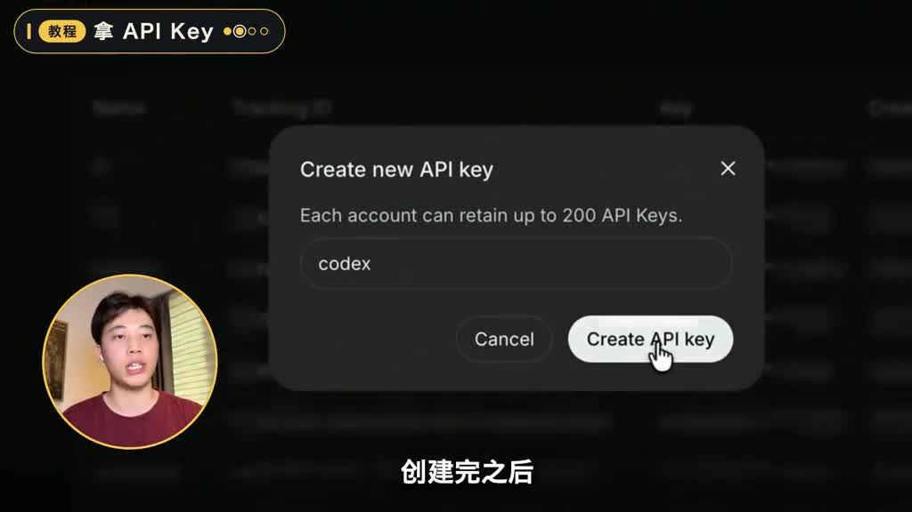
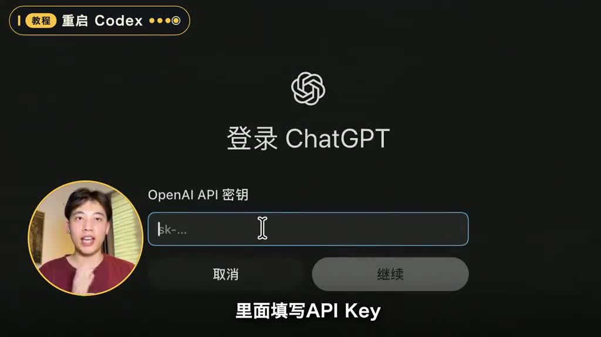

# A super simple Codex setup guide, no sign-up needed. Get it installed...：操作 SOP

- 來源：https://vm.tiktok.com/ZSgpgNqYd/（步驟後標註影片時間）
- 更新日期：2026-10-28
- 說明：本文由影片整理；影片中的價格、硬體需求與效果為講者主張，未查證。

## 把 Codex 的模型換成 DeepSeek

**前置條件**
- 三樣免費軟體／資源：Codex 軟體、CC Switch、DeepSeek API Key（00:50）。
- DeepSeek 依 Token 用量計費（講者主張，未查證）。

**步驟**
1. 從 ChatGPT 官網下載並安裝 Codex。（00:59）
2. 首次開啟的登入彈窗不要登入，選「其他方式登入」。（01:04）
   
3. 開啟 DeepSeek 開放平台，左側點「API Keys」，新建一個（名稱自訂）。（01:17）
4. 建立後點「Copy」複製 API Key。（01:25）
   
5. 從 CC Switch 官網下載並安裝 CC Switch。（01:38）
6. 開啟 CC Switch，點 Codex 圖示，再點右上角加號，選擇「DeepSeek」。（01:54）
7. 把剛複製的 API Key 填入，點「啟用」。（01:58）
   
8. 出現開啟本地連線服務提示時，到左上角「設定」開啟本地連線總開關，勾選對應選項後點「測試」；顯示執行正常即切換成功。（02:01）
9. 將 Codex 完全退出再重新開啟。（02:14）
10. 在登入方式填入 API Key，模型清單即可選到 DeepSeek。（02:17）
    
11. 發一句話，正常回覆即表示跑通。（02:22）

**注意事項**
- 第 9 步完全退出最容易漏（講者提醒）。
- 官網網址、CC Switch 設定頁中勾選的具體選項：影片未示範。
- 大專案建議與原模型混用（講者主張，未查證）。

