# Anthropic Prompting 101：用車禍報告範例逐步打造提示詞

- 來源：https://x.com/huxlab/status/2116346641838211440
- 平台 / 上傳者：X / Hux
- 長度：24:47 (1487.3s)
- 逐字稿來源：captions (en, manual, original)
- 更新日期：2026-10-31
- **關鍵字：** #提示工程 #prompt engineering #Anthropic #system prompt #XML 標籤 #few-shot #prefill #extended thinking #prompt caching #hallucination

## 摘要與名詞說明

**一句話重點**：Anthropic Applied AI 團隊的 Hannah 與 Christian 以「瑞典車險車禍報告表＋手繪草圖」為例，在 console 從極簡提示詞（Claude 誤判成滑雪事故）一路迭代到五版，示範十個提示詞要點，最後得到格式嚴謹、有信心的判定輸出。

> 注意：原推文標題寫「Claude Code 中你不知道的免費功能」，但影片實際內容是 Prompting 101（Claude API／console 的提示詞技巧），與 Claude Code 功能無關。

## 重點表

| 時間 | 重點 |
|---|---|
| 00:00 | 開場；提示工程＝寫清楚指令、給足脈絡、安排資訊順序 |
| 00:52 | 情境：瑞典保險公司以車禍報告表（17 個勾選框）＋手繪草圖判斷誰有過失 |
| 02:05 | v1 極簡提示詞：Claude 誤以為是滑雪事故 |
| 03:17 | 提示詞結構與十個要點總覽；提示工程是迭代的實證科學 |
| 05:25 | v2：任務脈絡＋語氣（保持事實、有把握才判斷） |
| 08:40 | 背景資料放系統提示詞；固定內容適合 prompt caching |
| 09:37 | v3：用 XML 標籤組織資訊；Claude 更有信心判定 B 車有過失 |
| 12:51 | 範例（few-shot）：把棘手案例與解法放進系統提示詞 |
| 14:55 | 對話歷史：面向使用者的應用才需要 |
| 15:45 | 結尾重述任務、防幻覺（看不清就說看不清） |
| 16:56 | v4：逐步思考，先看表單再看草圖，順序很重要 |
| 20:01 | v5：輸出格式，最終判定包進 final verdict 標籤 |
| 22:10 | 預填回應（prefill）控制輸出開頭與格式 |
| 23:14 | 延伸思考可當提示工程的輔助，用思考軌跡改進系統提示詞 |
| 24:14 | 結語；預告「面向智能體的提示詞」場次 |

## 十個要點（影片投影片）

1. Task context　2. Tone context　3. Background data, documents, images　4. Detailed task description & rules　5. Examples　6. Conversation history　7. Immediate task description or request　8. Thinking step by step　9. Output formatting　10. Prefilled response

## 名詞與縮寫

- **System prompt（系統提示詞）**：放不隨查詢改變的背景與規則。
- **Prompt caching**：快取固定內容以省時省成本。
- **Few-shot（範例）**：以範例引導模型行為。
- **Prefill**：預先寫好 Assistant 回應開頭，讓模型接著寫。
- **Extended thinking（延伸思考）**：混合推理模型可開啟的思考模式。

## 轉錄校正備註

- 來源為平台英文字幕（人工）。全文把 `Cloud` 改回 `Claude`（影片明確講 Claude 3.7／Claude 4／ClaudePlays Pokémon）。
- 「Claude 4 solid」→「Sonnet」、「max soaking budget」→「max thinking budget」為**推測**；「Edelman application」語意不明，保留原文，見 `meta.json.known_asr_errors`。
- 影片數字與模型說法（如 Claude 4 Sonnet、temperature 0、17 個勾選框）皆為講者主張，未查證。

## 思維導圖

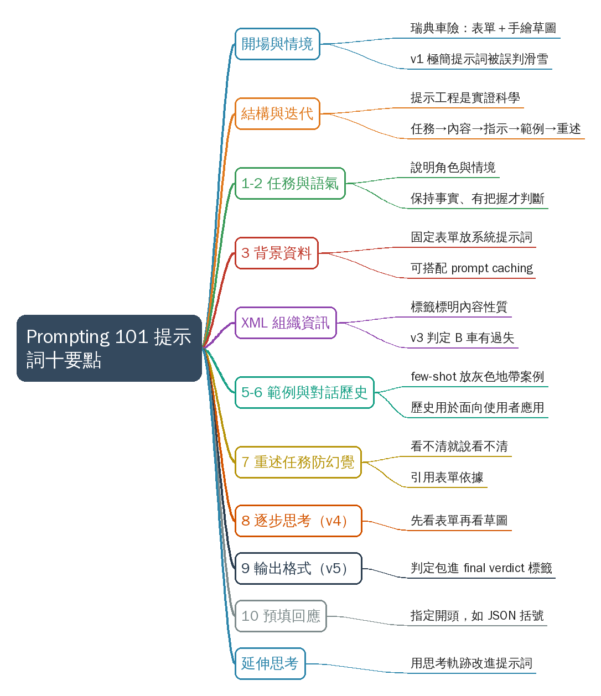

- 原圖：[mindmap.png](mindmap.png)；文字大綱：[mindmap.md](mindmap.md)（與本報告同資料夾）

## 圖文對照（畫面 + 逐字稿＋中譯）

### 投影片 1：開場：什麼是提示工程（00:00–00:52）

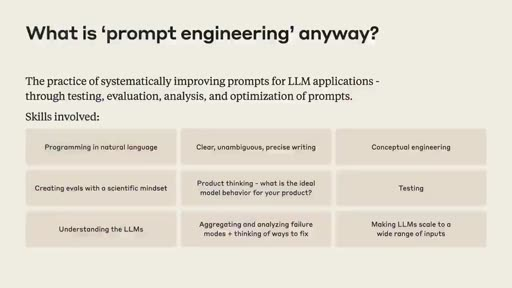

**重點：** Hannah 與 Christian（Anthropic Applied AI 團隊）自我介紹，說明今天要用真實情境一起建一份提示詞。提示工程是替模型寫清楚指令、給足脈絡並安排資訊順序；學習最好的方法是實作。

**標籤：** #提示工程 #Applied AI

Hey everyone. Thank you for joining us today for Prompting 101. My name's Hannah I'm part of the Applied AI team here at Anthropic And with me is Christian also part of the Applied AI team And what we're going to do today is take you through a little bit of prompting best practices and we're going to use a real-world scenario and build up a prompt together So a little bit about what prompt engineering is prompt engineering you're all probably a little bit familiar with this This is the way that we communicate with a language model and try to get it to do what we want. So this is the practice of writing clear instructions for the model giving the model the context that it needs to complete the task and thinking through how we want to arrange that information in order to get the best result so there's a lot of detail here a lot of different ways you might want to think about building out a prompt and as always the best way to learn this is just to practice doing it.

**中譯：** 大家好，感謝今天來參加 Prompting 101。我是 Hannah，Anthropic Applied AI 團隊的成員；和我一起的是同樣在 Applied AI 團隊的 Christian。今天我們會帶大家看一些提示詞（prompting）的最佳實務，並用一個真實情境，一起把提示詞一步步組出來。先簡單說明什麼是提示工程：這就是我們與語言模型溝通、讓它做我們想做的事的方式，也就是替模型寫出清楚的指令、給它完成任務所需的脈絡，並思考如何安排這些資訊，以得到最好的結果。這裡面有很多細節、很多不同的思考方式，而學習它最好的辦法就是實際去做。

### 投影片 2：情境：瑞典車險理賠（00:52–02:05）

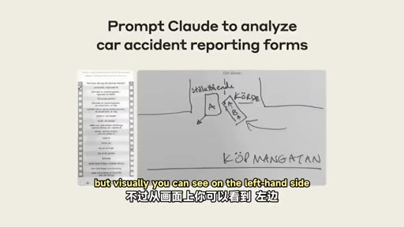

**重點：** 情境改編自真實客戶：瑞典保險公司要讓 Claude 讀車禍報告表（17 個勾選框）與人手繪製的事故草圖，抽出事實並判斷誰有過失。重點是從圖片取得事實資訊，再做判斷。

**標籤：** #車禍報告 #圖片分析

so today we're going to go through a hands-on scenario we're going to use an example inspired by a real customer that we worked with So we've modified what the actual customer asked us to do but this is a really interesting case of trying to analyze some images and get factual information out of the images and have Claude make a judgment about what content it finds there And I actually do not speak the language that this content is in but luckily Christian and Claude both do so I'm going to pass it over to Christian to talk about the scenario and the content. So For this example that we have here it's, intended, so, so to set the stage imagine you're working for a Swedish insurance company and you deal with car insurance claims on a daily manner and the purpose of this is that you have two pieces of information we're going to these in detail as well but visually you can see on the left-hand side we have a car accident report form just detailing out what transpired before the action accident actually took place And then finally we have a sort of human-drawn sketch of how the accident took place as well So these two pieces of information is what we're gonna try to pass on to Claude and to begin with we could just take these two and throw them into the console and just see what.

**中譯：** 所以今天我們走一個動手實作的情境，改編自我們合作過的一位真實客戶。我們修改了客戶實際的需求，但這是個很有意思的案例：分析圖片、從中取得事實資訊，再讓 Claude 對內容做出判斷。圖片內容的語言我其實看不懂，但幸好 Christian 和 Claude 都懂，那就交給 Christian 說明情境與內容。先設定場景：想像你在一家瑞典保險公司工作，每天處理車險理賠。你手上有兩份資料：左邊是一份車禍報告表，記錄事故發生前後的經過；另一份是人手繪製的事故現場草圖。這兩份資料就是我們要交給 Claude 的內容。一開始，我們可以先把這兩樣直接丟進 console，看看會發生什麼事。

### 投影片 3：基準版 v1：Claude 以為是滑雪事故（02:05–03:17）

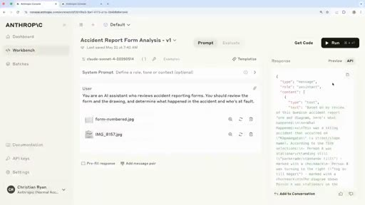

**重點：** 在 console 用 Claude 4 Sonnet、temperature 0，只給極簡提示詞。結果 Claude 把它當成瑞典街道上的滑雪事故，因為提示詞完全沒交代情境。

**標籤：** #console #基準版

what happens So if we transition over to a console as well we can actually do this in a real manner. And in this case here you can see we have our shiny beautiful Anthropic console. We're using the new Claude 4 Sonnet model as well In this case, Setting temperature to zero and having a, a, a huge max thinking budget as well just helping us make sure that there's no limitations to what Claude can do In this case you can see you have a very simple prompt just setting the stage of what Claude's supposed to do in this case, mentioning that this is intended to review a an accident report form and eventually also determine what happened in the accident and who's at fault So you can see here with this very simple prompt if I just run this let me go to preview We can see here that Claude thinks that this is in relation to skiing accidents that happened on a street called Schaffangatan it's a very common street in Sweden and in many ways you can sort of understand this innocent mistake in the sense that in our prompt we actually haven't done anything to set the stage on what is actually taking place here So this sort of first guess is not too bad but we still know there's a lot of intuition that we can bake into Claude.

**中譯：** 切到 console，這是 Anthropic 的 console，使用新的 Claude 4 Sonnet 模型，temperature 設為 0，並給很大的 max thinking budget，確保 Claude 的能力不受限制。提示詞非常簡單，只交代 Claude 的任務：審閱一份車禍報告表，判斷事故經過與誰有過失。用這個簡單提示詞直接執行，Claude 以為這是發生在瑞典某條常見街道上的滑雪事故。這個誤會情有可原，因為我們的提示詞完全沒有交代這裡到底在發生什麼事。第一次猜測其實不算太糟，但我們仍有很多直覺可以放進 Claude 裡。

### 投影片 4：迭代與提示詞結構（十個要點總覽）（03:17–05:25）

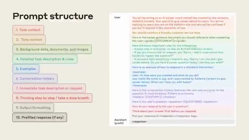

**重點：** 提示工程是反覆迭代的實證科學，可設測試案例驗證。API 任務要一次到位：任務描述→內容→詳細指示→範例→重要事項重複提醒，共拆成十個要點，之後逐一在 console 建構。

**標籤：** #迭代 #提示詞結構

So we switch back to slides You can see here that in many ways, prompt engineering is a very iterative empirical science in this case here we could almost have a test case where Claude is supposed to make sure it understands it's in a car or a vehicular environment nothing to do with skiing and in that way you iteratively build upon your prompt to make sure it's actually tackling the problem you're intending to solve and to do so we go through some best practices of how we we at Anthropic break this down internally and how we recommend others do so as well So we're going to talk about some best practices for developing a great prompt first we want to talk a little bit about what a great prompt structure looks like So you might be familiar with kind of interacting with a chatbot with Claude, going back and forth having a more kind of conversational style interaction When we're working with a task like this we're probably using the API and we kind of want to send one single message to Claude and have it nail the task the first time around without needing to kind of move back and forth so the kind of structure that we recommend is setting the task description up front so telling Claude what are you here to do? What's your role? What task are you trying to accomplish today? Then we provide content so in this case it's the images that Christian was showing the form and the drawing of the accident and how they occurred That's our dynamic content. This might also be something you're retrieving from another system depending on what your use case is We're going to give some detailed instructions to Claude so almost like a step-by-step list of how we want Claude to go through the task and how we want it to tackle the reasoning We may give some examples to Claude Here's an example of some piece of content you might receive. Here's how you should respond when given that content And at the end we usually recommend repeating anything that's really important for Claude to understand about this task Kind of, reviewing the information with Claude emphasizing things that are extra critical and then telling Claude okay, go ahead and do your work So here's another view. This has a little bit more detail a little bit more of a breakdown and we're going to walk through each of these ten points individually and show you how we build this up in the console.

**中譯：** 切回投影片：提示工程是一門反覆迭代、靠實證的科學。以這個例子來說，我們幾乎可以設一個測試案例，確保 Claude 明白這是車輛環境、與滑雪無關，並一步步改進提示詞，確保它真的處理了你想解決的問題。為此，我們來看 Anthropic 內部如何拆解提示詞，以及我們建議大家怎麼做：先談好提示詞的結構。你可能習慣與聊天機器人來回對話，但像這樣的任務通常是用 API，我們希望只送出一則訊息，就讓 Claude 一次把任務做對，不用來回修正。我們建議的結構是：先在最前面寫任務描述，告訴 Claude 它的角色與今天要完成什麼任務。接著提供內容，在這個案例就是車禍表單與事故草圖；這是動態內容，也可能是從別的系統取回的資料。然後給詳細指示，幾乎像是一份逐步清單，說明希望 Claude 如何完成任務、如何推理。可以再給一些範例：「收到這樣的內容時，這樣回應。」最後，通常建議重複任何對任務特別重要的事項，與 Claude 一起回顧並強調關鍵點，再請它開始工作。這是更細的版本，共十個要點，接下來我們逐一走過，並在 console 裡把提示詞建起來。

### 投影片 5：要點 1–2：任務脈絡與語氣（v2）（05:25–08:40）

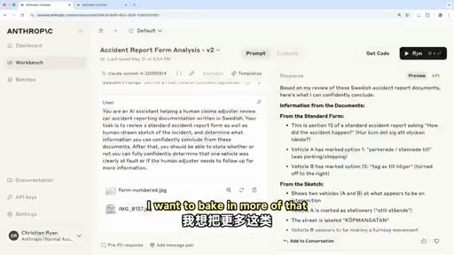

**重點：** 在 v2 說明系統是協助理賠人員審閱瑞典文車禍表、草圖為人手繪製，並要求保持事實、有把握才下判斷。結果 Claude 辨認出是車禍、抓到 A 車勾第 1 格、B 車勾第 12 格，但仍誠實指出資訊不足。

**標籤：** #task context #tone #v2

So the first couple things Christian's going to talk about the task context and the tone context Perfect So yeah, if we begin with the task context as you realized when I went through a little demo there we didn't have much elaborating what what what's the scenario of Claude is actually working within And because of that you can also tell that Claude doesn't necessarily need to guess a lot more on what you actually want from it So in our case we really want to break that down make sure we can give more clear-cut instructions and also make sure we understand what's the task that we're asking Claude to to do secondly as well we also make sure we add a little bit of tone into it all key thing here is we want Claude to stay factual and to stay confident So if, Claude can't understand what it's looking at we don't want it to guess and just sort of mislead us. We want to make sure that any assessment and in our case we want to make sure that we can understand who's at fault here We want to make sure that assessment is as clear and as confident as possible If not we're sort of losing track of what we're doing So if we transition back to the to the console we can jump to a V2 that we have here So I'll just navigate to V2 And you can see here I'll also just illustrate the data because we didn't really do that last time around just to really highlight what we're looking at So what we're seeing here this is the Car accident report form and it's just seventeen different check boxes going through what actually happened. You can see there's a vehicle A and vehicle B both on the left and right hand side and the main purpose of this is that we want to make sure that Claude can understand this manually generated data to assess what's actually going on And that is, corroborated by, if I navigate back here to this sketch that we can highlight here as well In this case, the form is just a different data point for the same scenario and in this case here I want to bake in more of that information into our version two and by doing so I'm actually elaborating a lot more on what's going on So you can see here I'm specifying that this AI system is supposed to help a human's claim claims adjuster that's reviewing car accident report forms in Swedish as well you can see here we're also elaborating that it's a human-drawn sketch of the incident and that it should not make an assessment if it's not actually fully confident And that's really key because if we run This you'll see that and you can see it's the same settings as well Claude four, a new shiny model zero temperature as well. If we run this we can see here what actually happens In this case, Claude's able to pick up that now it's relating to car accidents not skiing accidents, which is great We can see it's able to pick up that vehicle A was marked on on checkbox one and then vehicle B was on twelve and if we scroll down though we can still tell that there's some information missing for Claude to make a fully confident determination of who's at fault here And this is great. This is pertaining to the task we have set Make sure you don't make anything any claims that aren't factual and make sure you you only sort of assess things when you're when you're confident But there's a lot of information we're still missing here regarding the form, what the form actually entails and a lot of that information is what we want to want to bake into this LLM application as well And the best way of doing so is actually adding it to the system prompt.

**中譯：** 先由 Christian 講任務脈絡（task context）與語氣脈絡（tone context）。剛才的示範裡，我們幾乎沒說明 Claude 面對的是什麼情境，它只好大量猜測；所以我們要拆解清楚，給更明確的指示，並讓它理解被要求的任務是什麼。其次是加入語氣：重點是讓 Claude 保持事實、保持有把握。如果 Claude 看不懂眼前的內容，我們不希望它亂猜誤導我們；我們要的是關於誰有過失的判斷，盡可能清楚、有信心，否則就失去了目的。回到 console，切到 V2。我先把資料呈現出來：這是車禍報告表，共有 17 個勾選框，說明事故經過，左右兩欄分別是 A 車與 B 車。目的是讓 Claude 讀懂這份人工填寫的資料，並與這張草圖互相印證；表單與草圖是同一情境的不同資料點。在第二版裡，我加入更多資訊：這個 AI 系統是協助理賠人員審閱瑞典文的車禍報告表；說明那是人手畫的事故草圖；並要求沒有十足把握就不要下判斷。執行後，Claude 能辨識出這是車禍而不是滑雪事故，也看出 A 車勾選第 1 格、B 車勾選第 12 格；往下看，它仍指出資訊不足、無法完全有把握判斷誰有過失。這正符合我們設定的任務：不要做沒有事實依據的主張，有把握才評估。但關於表單本身（表單包含什麼）我們還缺很多資訊，最好的做法是把它加進系統提示詞，由 Hannah 接著說明。

### 投影片 6：要點 3：背景資料、文件與圖片（08:40–09:37）

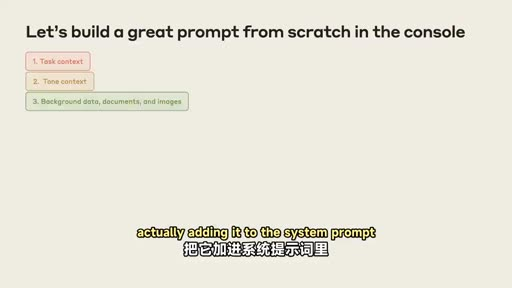

**重點：** 表單結構每次相同，只有填寫內容會變，最適合放進系統提示詞，也適合用 prompt caching。事先知道表單長相，Claude 不必每次重新弄懂，讀表單表現也更好。

**標籤：** #背景資料 #prompt caching #系統提示詞

which Hannah will elaborate on so back in the slides we have the next item we're going to add to the prompt and this is, background detail, data, documents, and images And here, as Christian was saying we actually know a lot about this form The form is going to be the same every single time. The form will never change And so this is a really great type of information to provide to Claude to tell Claude here's the structure of the form you'll be looking at. We know that will not ever alter between different queries The way the form is filled out will change but the form itself is not going to change. And so this is a great type of information to put into the system prompt Also a great thing to use prompt caching for. If you're considering using prompt caching this will always be the same And what this will help Claude do is spend less time trying to figure out what the form is the first time it sees the form each time And it's going to do a better job of reading the form because it already knows what to expect there So.

**中譯：** 下一項是背景資料、文件與圖片。我們其實很了解這份表單：它每次都一樣、結構不會變，只是填寫的內容會變。這正是適合放進系統提示詞的資訊，告訴 Claude 它會看到的表單結構。這也很適合用 prompt caching，因為內容永遠相同。這能讓 Claude 不必每次初次看到表單時都花時間弄清楚它是什麼，並且因為事先知道要看什麼，讀表單的表現更好。

### 投影片 7：組織資訊：XML 標籤與 v3（09:37–12:51）

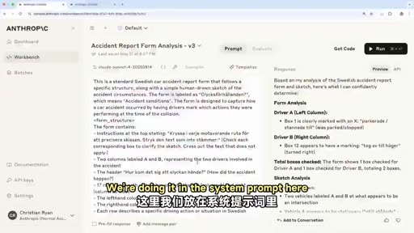

**重點：** Claude 喜歡結構；用 XML 標籤（或 Markdown）分隔資訊，並能標明內容性質、方便後文回頭引用。v3 把 17 列的意義與填寫習慣（圈選、塗鴉、沒打 X）寫進系統提示詞，Claude 更有信心，判定 B 車有過失。

**標籤：** #XML #v3 #系統提示詞

another thing I want to touch on here is how we like to organize information in prompts So Claude really loves structure loves organization. That's why we recommend following kind of a standard structure in your prompts And there's a couple other tools you can use to help Claude understand the information better I also just want to mention all of this is in our docs with a lot of really great examples. So definitely take pictures but if you forget to take a picture don't worry All of this content is online with lots of examples and definitely encourage you guys to check it out there too Anyway, the, so some things you can use delimiters, like XML tags, also markdown is pretty useful to Claude but XML tags are nice because you can actually specify what's inside those tags So we can tell Claude here's, here's user preferences Now you're going to read some content and these XML tags are letting you know that everything wrapped in those tags is related to the user's preferences and it helps Claude refer back to that information maybe at later points in the prompt so I want to show in the back in the console how we actually do this in this case And Christian's going to pull up our version three So we're keeping everything about the other part of the user prompt the same And we've decided in this case to put this information in the system prompt You can try this different ways We're doing it in the system prompt here And we're going to tell Claude everything it needs to know about this form So this is a Swedish car accident form The form will be in Swedish It'll have this title It'll have two columns. The columns represent different vehicles We'll tell Claude about each of the 17 rows and what they mean You might have noticed when we ran it before Claude was reading individually each of the lines to understand what they are We can provide all of that information up front And we're also going to give Claude a little bit of information about how this form should be filled out This is also really useful for Claude We can tell it things like You know humans are filling this format basically. So it's not going to be perfect People might put a circle they might scribble they might not put an X in the box There could be many types of markings that you need to look for when you're reading this form we can also give Claude a little bit of information about how to interpret this or what the purpose or meaning of this form is And all of this is context that is hopefully really going to help Claude do a better job analyzing the form So if we run it everything else is still the same So we've kept the same user prompt down here Oh, your scroll is backwards from mine the, we have the same user prompt here still asking Claude to do the same task same context And we'll see here that it's spending less time it's kind of narrating to us a little bit less about what the form is because it already knows what that is and it's not concerned with kind of bringing us that information back It's going to give us a whole list of what it found to be checked what the sketch shows and here Claude is now becoming much more confident. With this additional context that we gave to Claude Claude now feels it's appropriate to say vehicle B was at fault in this case based on this drawing and based on this sketch So already we're seeing some improvement in the way Claude is analyzing these I think we could probably all agree if we looked at the drawing and at the list that vehicle B is at fault so we'd like to see that so we're gonna go back to the slides.

**中譯：** 另一件事是提示詞裡資訊的組織方式。Claude 很喜歡結構與條理，所以我們建議遵循標準結構，也可以用一些工具幫助 Claude 理解資訊。這些在文件中都有很多範例，所以可以拍照，沒拍也沒關係，內容都在網路上。可用分隔符號，例如 XML 標籤，Markdown 也很有用；但 XML 的好處是可以指明標籤裡面是什麼，例如「這是使用者偏好」，包在標籤內的就都與使用者偏好有關，也幫助 Claude 在提示詞後面回頭引用那些資訊。回到 console 看第三版：使用者提示詞維持不變，但把表單資訊放進系統提示詞（也可以試別的放法）。我們告訴 Claude 這份表單的一切：這是瑞典車禍表單、語言是瑞典文、標題是什麼、有兩欄代表不同車輛、17 列各代表什麼意思。先前執行時，Claude 是逐行讀來理解每一列的意義；現在這些資訊可以預先給它。我們也說明表單怎麼填寫：因為是人填的，不會完美，人們可能畫圈、塗鴉、沒有打 X，所以讀表單時要留意各種標記方式，也說明這份表單的用途與意義，希望幫助 Claude 更好地分析。執行後，使用者提示詞與任務都沒變，但 Claude 花的時間更少，也比較不會一邊敘述表單是什麼，因為它已經知道，不必把這些資訊回報給我們。它列出所有勾選項目與草圖內容，也變得更有信心，認定依據這張圖與草圖，B 車有過失。我們大概都同意，看圖和清單後確實是 B 車有過失，所以已有改進。

### 投影片 8：要點 5：範例（few-shot）（12:51–14:55）

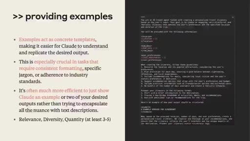

**重點：** 範例是引導 Claude 的有力機制：把人類直覺判斷正確的棘手案例，連同資料（可用 Base64 圖片）與拆解說明放進系統提示詞。實務上可能有數十到數百個灰色地帶範例，持續從失敗案例補進去。

**標籤：** #few-shot #範例 #XML

and talk about a couple of other items that we're not really using in this prompt but can be really helpful to building up building up your prompt and making it work better Exactly. I think one thing that we really highlight is examples I think examples or few shot is a mechanism that really is powerful in steering Claude So you can imagine this in, in quite a non-trivial way as well So imagine you have scenarios situations, even in this case concrete Accidents have happened that are tricky for Claude to get right but you, with your human intuition and your human label data is able to actually get to the right conclusion But you can bake that information into the system prompt itself by having clear-cut examples of A, the data that it's supposed to look at so you can have visual examples you can use Base64 encode an image and have that as part of the data that you're passing along into the examples And then on top of that you can have the sort of depiction or description rather of how to break that down and understand it This is something we really highlight and and emphasize in how you can sort of push the limits of your LLM application is by baking in these examples into system prompt And this, again is sort of the empirical science of prompt engineering so that you sort of always want to push the limits of your application and get that feedback loop in where it's going wrong and try to add that into system prompt so that next time one example that sort of mimics that takes place it's able to actually reference it in its example set You can see here as well this is just a little example of how we do this. Again really emphasizing the sort of XML structure that we we, we enjoy. It it gives a lot of structure to Claude It's what it's been fine-tuned on as well and it works perfectly well for this example In, in our case we're not doing this just because it's a simple demo but you can realistically imagine if you were building this for an insurance company you'd have tens maybe even hundreds of examples that are quite difficult maybe in the gray that you'd like to make sure that Claude actually has some basis in to make the verdict next time.

**中譯：** 接下來談幾個這次沒有用到、但對提高提示詞效果很有幫助的項目。首先是範例（examples，few-shot），這是引導 Claude 非常有力的機制。想像有些真實事故對 Claude 很棘手，但憑你的人類直覺與人工標註資料能得出正確結論；你可以把這些資訊放進系統提示詞，用明確的範例呈現：要看的資料（可用 Base64 編碼的圖片）加上如何拆解、理解的說明。這是突破 LLM 應用極限的關鍵：持續把應用推到極限，取得它哪裡出錯的回饋，再把案例加進系統提示詞，下次類似情況發生時就能參考範例。這裡是範例寫法，同樣強調我們偏愛的 XML 結構；Claude 受過這種微調，效果很好。這次只是簡單示範所以沒有用；但若是替保險公司開發，實際會有數十甚至數百個不易判斷、處於灰色地帶的範例，讓 Claude 下次下判斷時有依據。

### 投影片 9：要點 6：對話歷史（14:55–15:45）

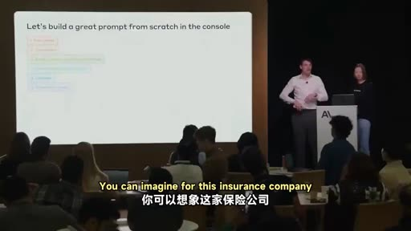

**重點：** 對話歷史與範例同理，提供豐富脈絡。本案例是後台自動化、最後有人把關，所以沒用；若是面向使用者的長對話應用，系統提示詞是放歷史的好位置。

**標籤：** #conversation history

another topic we really want to highlight which we're not doing in this demo is conversation history It's in the same vein as examples we use this to make sure that there are enough context-rich information is at close disposal when when, when close working on on, on your behalf in our case now this isn't really a user-facing Edelman application It's more something happening in the background You can imagine for this insurance company they have this automated system some data is generated out of this and then you might have a human in the loop at towards the end If you were had to build something much more user-facing where you'd have a long conversation history that would be relevant to bring in this is a perfect place in the system prompt to include because it enriches the context that Claude Claude works within in our case, we haven't done so but what we do is and the next step is try to.

**中譯：** 另一個這次沒用到的是對話歷史（conversation history），概念與範例相近，確保有足夠豐富的脈絡資訊，供 Claude 替你工作時使用。在我們的案例裡，這不是面向使用者的應用，而是在後台運作：保險公司有自動化系統產生資料，最後由人類把關。若是更面向使用者的應用，有很長且相關的對話歷史，系統提示詞就是放進去的好位置，因為它能豐富 Claude 的工作脈絡；我們這次沒有這麼做。

### 投影片 10：要點 7：重述當前任務與防幻覺（15:45–16:56）

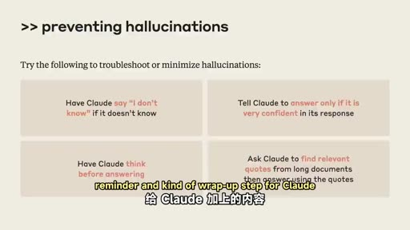

**重點：** 在提示詞末尾回頭提醒任務與重要準則，目的之一是防止幻覺：看不清就不要猜、草圖無法辨認就直說。可要求只在非常有把握時回答，並在下事實主張時引用表單依據。

**標籤：** #hallucination #reminder

make sure we give a concrete reminder of the task at hand So now we're going to build out the final part of this prompt for Claude and that's coming back to the reminder of what the immediate task is and giving Claude a reminder about any important guidelines that we want it to follow Some reasons that we may do this are A, preventing hallucinations So we want Claude to not invent details that it's not finding in this prompt right, or not finding in the data If Claude can't tell which form is checked we don't want Claude to take its best guess or invent the idea that a box might be checked when it's not If the sketch is unintelligible the person did a really bad job drawing this drawing and even a human would not be able to figure it out we want Claude to be able to say that And so these are some of the things we'll include in this final reminder and kind of wrap-up step for Claude Remind it to do things like answer only if it's very confident. We could even ask it to refer back to what it has seen in the form anytime it's making a factual claim So if it wants to say vehicle B turned right it should say, I know this Based on the fact that box two is clearly checked or whatever it might be we can kind of give plots and guidelines about that.

**中譯：** 接下來我們要組出提示詞的最後一部分：回頭提醒當下的任務，並提醒 Claude 應遵守的重要準則。這麼做的理由之一是防止幻覺：我們不希望 Claude 憑空捏造提示詞或資料裡沒有的細節。如果 Claude 看不出哪個框被勾選，我們不希望它猜、或捏造某個框被勾的說法；如果草圖畫得太糟，連人也看不懂，我們希望 Claude 能直說。這些都會放進最後的提醒與收尾步驟。例如提醒它「有十足把握才回答」，甚至要求它在做出事實主張時引用表單上看到的依據；比方要說「B 車右轉」，就要說「我知道這點，是因為第 2 格明確被勾選」，我們也可以給這類準則。

### 投影片 11：要點 8：逐步思考與分析順序（v4）（16:56–20:01）

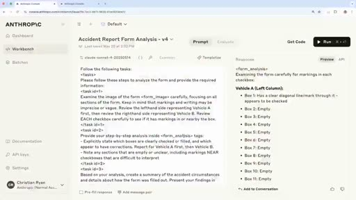

**重點：** v4 加入詳細任務清單：先仔細讀表單、列出已勾選項目，再看草圖並與表單對照，最後得出判斷。分析順序很重要，類似人類先看有脈絡的表單再看草圖；缺點是 Claude 會逐框展示過程，之後可再調整。

**標籤：** #step-by-step #v4 #順序

So if we go back to the console we can see The next version of the prompt and we're going to keep we're going to keep everything the same here in the system prompt so we're not changing any of that background context that we gave to Claude about the form about how it's going to fill everything out We're not changing anything else about the context and the role. We're just adding this detailed list of tasks and this is how we want Claude to go about analyzing this And a really key thing that we found here as we were building this demo and when we were working on the customer example is that the order in which Claude analyzes this information is very important And this is analogous to the way you might think about doing this if you were a human You would probably not look at the drawing first and try to understand what was going on right? It's pretty unclear. It's a bunch of boxes and lines We don't really know what that drawing is supposed to mean without any additional context But if we have the form and we can read the form first and understand that we're talking about a car accident and that we're seeing some checkboxes that indicate what vehicles we're doing at certain times then we know a little bit more about how to understand what might be in the drawing And so that's the kind of detail that we're going to give Claude here is to say, hey, first go look at the form Look at it very carefully Make sure you can tell what boxes are checked. Make sure you're not missing anything here Make a list for yourself of what you see in that and then move on to the sketch So after you've kind of confidently gotten information out of the form and you can say what's factually true then you can go on and think about what you can gain from that sketch keeping in mind your understanding of the accident so far So whatever you've learned from the form you're trying to match that up with the sketch And that's how you're going to arrive at your final assessment of the form And we'll run it And here you can see one behavior that this produced for Claude Because I told it to very carefully examine the form it's showing me its work as it does that. So it's telling me each individual box is the box checked? Is it not checked? And so this is one thing you'll notice as you do prompt engineering In our previous prompts we were kind of letting Claude decide how much it wanted to tell us about what it saw in the form Here, because I've told it carefully examine each and every box it's very carefully examining each and every box And that might not be what we want in the end so that's something we might change But it's also going to give me these other things that I asked for in XML tags So a nice analysis of the form the accident summary so far it's going to give me a sketch analysis and it's going to continue to say that vehicle B appears to be clearly at fault In this, in this example, this pretty simple example with more complicated drawings more, less clarity in the forms this kind of step-by-step thinking for Claude is really Impactful in its ability to make a correct assessment here so I think we'll go back to the slides and Christian's gonna talk about a last kind of piece that we might add to this to really make it useful for a real world task Indeed, thank you so much.

**中譯：** 回到 console，看下一版提示詞：系統提示詞完全不變，包括表單背景與填寫方式；其他脈絡與角色也不變，只是加上一份詳細的任務清單，說明希望 Claude 如何分析。我們在做這個示範與處理客戶案例時發現的關鍵是：Claude 分析資訊的順序非常重要，這和人類的做法類似。你大概不會先看草圖就想弄懂發生什麼，因為那只是一堆方框與線條，沒有額外脈絡根本不知道它代表什麼。但若先讀表單，就能知道這是車禍、看到勾選框代表哪些車輛在特定時刻的狀況，再回頭理解草圖就容易多了。所以我們告訴 Claude：先看表單，非常仔細地看，確認哪些框被勾選、不要遺漏，替自己列出所見清單；有把握地取得事實資訊後，再看草圖，並把從表單學到的對事故的理解，與草圖對照，據此得出對整份表單的最終評估。執行後可以看到一個行為：因為我要求仔細檢查表單，它把過程展示出來，逐一說明每個框有沒有被勾選。這是你做提示工程時會發現的現象：先前版本由 Claude 自己決定要說多少所見；這裡我要求仔細檢查每個框，它就真的逐框檢查，這可能不是我們最後想要的，之後可以調整。它也依要求用 XML 標籤給出其他內容：表單分析、事故摘要、草圖分析，並繼續認定 B 車明顯有過失。在這個簡單例子裡看不出差別，但遇到更複雜的圖、更不清楚的表單時，這種逐步思考對做出正確評估影響很大。回到投影片，接著由 Christian 說明最後一塊，讓它更貼近真實世界的任務。

### 投影片 12：要點 9：輸出格式（v5）（20:01–22:10）

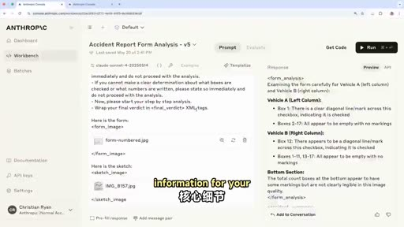

**重點：** 應用端通常只要關鍵結果存進資料庫，所以在 v5 加入重要準則（摘要清楚、簡潔、準確），並要求把最終判定包在 final verdict XML 標籤內，應用只解析標籤。輸出因此簡潔、格式嚴謹。

**標籤：** #output formatting #v5 #XML

So as Hannah mentioned we sort of set the stage in this prompt to make sure that Claude's really acting on our behalf in the right right manner and a key step that we also add towards the end of this prompt that I'm going to show you in a second is a simple sort of guidelines or reminder part as well. So just strengthening and reinforcing exactly what we want to get out of it And one important piece is actually output formatting You can imagine if you're a data engineer working on this LLM application all this sort of fancy preamble is great but at the end of the day you want your piece of information to to be stored in let's say, your SQL database wherever you want to store that data and the rest of it that is necessary for Claude to sort of give its verdict isn't really that necessary for your application You want the nitty gritty information for your application. So if we transition back to the console you'll see here that we just added a simple importance guidelines part And again this is just reinforcing the sort of mechanical behavior that we want out of Claude here We want to make sure that The summary is clear concise and accurate I want to make sure that nothing is sort of impeding in in, in Claude's assessment, apart from the the AS analyzing. And then finally when it comes to output formatting in my case here I'm just going to ask Claude to wrap its final verdict all other stuff I'm actually going to ignore from my application and just look at what it's actually assessing And that is, I can, I can use this if I want to build some sort of analytics tool afterwards as well or if I just want a clear cut determination this is the way I can do so So if I just run this here you'll see it's going through the same sort of process that we've seen before. In this case it's much more succinct because we've asked it to be to summarize its findings in a in a much more straightforward manner And then finally, towards the end you'll see that it'll wrap my output in these final verdict XML tags So you can see that during this demo we've gone from a skiing accident to sort of unconfident insecure outputs from perhaps a car accident in the second version to now a much more strictly formatted confident output that we can actually build and then let an application around and actually help you know, a real world, Car insurance company, for example.

**中譯：** 謝謝。正如 Hannah 所說，我們已設定好場景，確保 Claude 以正確的方式替我們行動；在提示詞末尾還要加上簡單的準則或提醒，強化我們想要的結果，其中一個重要項目是輸出格式（output formatting）。想像你是開發這個 LLM 應用的資料工程師，那些華麗的前言固然不錯，但最終你要的是把資訊存進 SQL 資料庫或其他儲存位置；Claude 為了給出判斷而產生的其餘內容，對應用並不必要，你要的是關鍵資訊。切回 console，這裡加入了簡單的重要準則：再次強化我們想要 Claude 展現的行為，要求摘要清楚、簡潔、準確，並確保除了分析本身，沒有任何東西妨礙 Claude 的評估。最後在輸出格式上，我要求 Claude 把最終判定包在標籤裡，其他內容我的應用都會忽略，只看它實際的評估。這樣之後可用來做某種分析工具，或只要一個明確的判定。執行後，過程與先前相同，但因為要求用更直接的方式整理發現，輸出簡潔許多；最後它把輸出包在 final verdict 的 XML 標籤裡。所以在這次示範中，我們從一場「滑雪事故」，到第二版不太有把握的車禍輸出，再到現在格式嚴謹、有信心的輸出，可以在它周圍建起應用，真正協助例如汽車保險公司這類真實世界的場景。

### 投影片 13：要點 10：預填回應（prefill）（22:10–23:14）

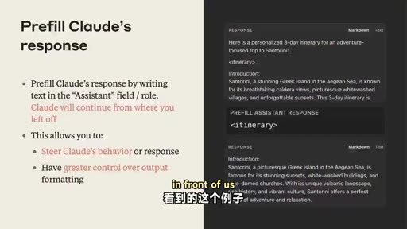

**重點：** 在 Assistant 的位置先寫上開頭文字（如左方括號或 XML 標籤），Claude 會接著往下寫，可控制回應行為與格式，例如確保 JSON 可序列化。本案例用 final verdict 標籤包起來再解析即可。

**標籤：** #prefill #JSON

finally, if we transition back to the slides another key way of shaping Claude's output is actually putting words in Claude's mouth or as we call it pre-filled responses You could imagine that parsing XML tags is nice and all but maybe you want a structured JSON output to make sure that its JSON is serializable and you can use this in a subsequent subsequent call, for example this is quite simple to do You could just add that Claude needs to begin its output with a certain format. This could be for example, a, open square bracket, square bracket, for example or even in this case that we see in front of us this would be an XML tag for itinerary In our case it could also be that final verdict XML tag and this is just a great way of again, shaping how Claude is supposed to respond without all the preamble if you don't want that even though that is also key in shaping its outputs to make sure that Claude is reasoning through the steps that we wanted So in our case here we would just wrap it in the final verdict and parse it afterwards.

**中譯：** 最後切回投影片，另一種塑造 Claude 輸出的重要方式，是「替 Claude 把話說在前面」，也就是預填回應（prefill）。解析 XML 標籤固然不錯，但也許你想要結構化的 JSON，確保可序列化並用於後續呼叫；做法很簡單，要求 Claude 必須以特定格式開頭，例如左方括號，或像畫面上的 itinerary 這個 XML 標籤，在我們的案例也可以是 final verdict 標籤。這是塑造 Claude 回應方式的好辦法，不需要前面的鋪陳；不過前言也很重要，它能確保 Claude 依我們想要的步驟推理。在我們的案例，只要包在 final verdict 裡再解析即可，但你也可以用預填。

### 投影片 14：延伸思考 vs. 提示工程（23:14–24:14）

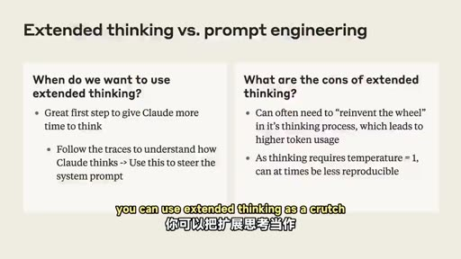

**重點：** Claude 3.7 與 Claude 4 是混合推理模型，可開延伸思考當提示工程的輔助。讀思考過程可了解 Claude 如何處理資料，再把有效的推理方式寫進系統提示詞，更省 token 也更能改進提示詞。

**標籤：** #extended thinking

but you can use prefill as well Now, finally one step that we'd like to highlight here as well is that both Claude 3.7 and especially Claude 4 of course, is a, a sort of hybrid reasoning model meaning that there's extended thinking at your disposal and this is something we want to highlight because you can use extended thinking as a crutch for your prompt engineering Basically you can enable this to make sure that Claude actually has time to think It has its thinking tags and the scratchpad and the beauty of that is that you can actually analyze that transcript to understand how Claude is going about that data So as we mentioned we have these checkboxes where it goes through step by step of the scenario that transpired for the accident And in many ways there you can actually try to help Claude in building this into the system prompt itself It's not only more token efficient but it's a good way of understanding how these intelligent models that don't have our intuition actually go about the data that we provide them And because of that it's quite key in actually trying to break down how your system prompt can get a lot better.

**中譯：** 最後還有一點：Claude 3.7，尤其是 Claude 4，都是混合推理模型，也就是可以使用延伸思考（extended thinking）。這值得強調，因為你可以把延伸思考當作提示工程的輔助。開啟後，Claude 有時間思考，有思考標籤與草稿區，好處是你可以分析那份思考過程，了解 Claude 如何處理資料。就像剛才的勾選框，它會逐步推演事故經過；你可以把這些推理方式寫進系統提示詞，不僅更省 token，也能了解這些沒有我們直覺的智慧模型如何處理我們提供的資料，因此對於改進系統提示詞非常關鍵。

### 投影片 15：結語（24:14–24:47）

**重點：** 感謝與會者，兩位講者全天都在現場回答問題。預告一小時後有「面向智能體的提示詞」場次，以及 ClaudePlays Pokémon 示範。

**標籤：** #結語

and with that said I think I'd like to thank all of you for coming today We'll be around as well so if you have any questions around prompting please, please go ahead I know there's a prompting You want to learn more about prompting? In an hour, we have prompting for agents and right now, we have an amazing demo of ClaudePlays Pokémon so don't go anywhere for that And as Christian said we'll be around all day so I know we don't have time for Q&A in this session but please come find us if you want to chat. Thank you guys for coming Thank you so much.

**中譯：** 那麼，感謝大家今天到場。我們會在現場，有任何提示詞的問題歡迎來問。想進一步學習的話，一小時後有「面向智能體的提示詞」，現在則有 ClaudePlays Pokémon 的精彩示範，請不要離開。這場沒有時間問答，但我們整天都在，歡迎來找我們聊聊。謝謝大家！

## 已知轉錄錯誤

| 時間 | 聽成 | 應為 |
|---|---|---|
| 02:16 | Claude 4 solid model | Claude 4 Sonnet（推測） |
| 02:20 | max soaking budget | max thinking budget（推測） |
| 15:12 | user-facing Edelman application | 不明，語意為面向使用者的應用（推測） |
| 05:40 等 | Cloud | Claude（已全文替換） |

## 補充資料連結

- 思維導圖：[mindmap.png](mindmap.png)、文字大綱：[mindmap.md](mindmap.md)（與本報告同資料夾）
