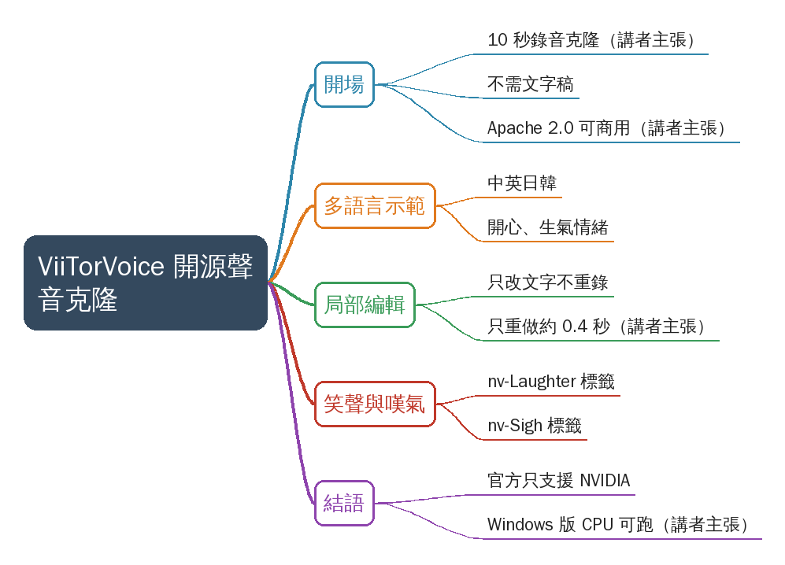
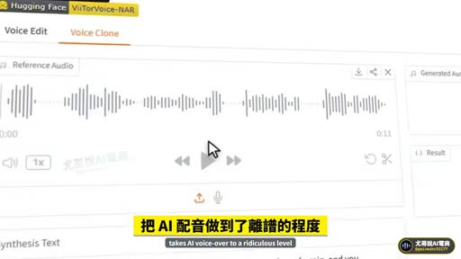
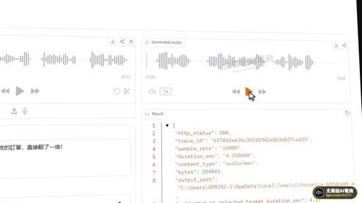
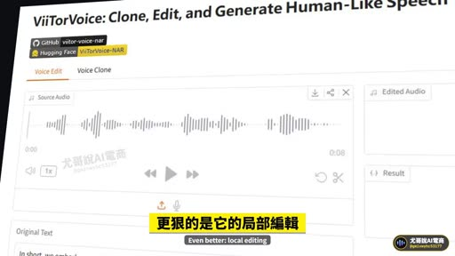
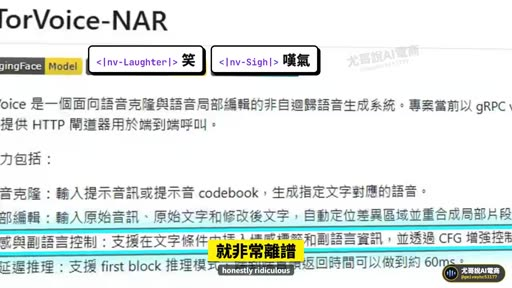
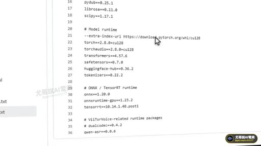

# 開源AI聲音克隆神器，不僅支援聲音克隆，還可以增加語氣，比如：笑、歎氣…最重要的一點是支援區域性編輯，音訊說錯的部分支援單獨更改！

- 來源：https://vt.tiktok.com/ZSgogGEH4/
- 平台 / 上傳者：TikTok / gmivwyhc53177
- 長度：01:46 (105.9s)
- 逐字稿來源：whisper (groq)
- 更新日期：2026-11-02
- **關鍵字：** #聲音克隆 #ViiTorVoice #TTS #開源 #Apache 2.0 #局部編輯 #情緒標籤 #多語言 #CPU 推論 #Windows 版

## 摘要與名詞說明

**一句話重點**：講者介紹 GitHub 開源專案 ViiTorVoice（畫面 README 標題為 ViiTorVoice-NAR），主打 10 秒錄音克隆聲音、句中加笑聲／嘆氣、只改動錯字的局部編輯（以上皆講者主張，未查證）。

| 時間 | 重點 |
|---|---|
| 00:00 | 開場：專案名稱、Apache 2.0 可免費商用、10 秒錄音不需文字稿（講者主張，未查證） |
| 00:27 | 以克隆聲音示範中／英／日／韓多語言與開心、生氣等情緒 |
| 00:52 | 局部編輯：只改文字，只重做約 0.4 秒，其餘保留（講者主張，未查證） |
| 01:15 | 句中笑聲、嘆氣標籤（畫面 README：`<|nv-Laughter|>`、`<|nv-Sigh|>`） |
| 01:28 | 官方只支援 NVIDIA 顯示卡；講者稱已改好 Windows 版、CPU 也能跑，壓縮包留言發送（講者主張，未查證） |

**名詞**：克隆＝複製特定人聲；局部編輯＝只重生成被修改的片段；NAR＝非自迴歸（畫面 README 稱「非自迴歸語音生成系統」）。

**校正備註**：「VITO Vivoz」依畫面改 ViiTorVoice；「區域性編輯」依畫面字幕改「局部編輯」；講者名「遊哥／魚爵／Yugo」推測為「尤哥」（浮水印「尤哥說AI電商」），未改，記在 `known_asr_errors`。
注意：此為帶貨／宣傳式短片，數字與功能皆未驗證；「留言發你」的 Windows 壓縮包來源不明，下載前應自行評估風險。

## 思維導圖

- 原圖：[mindmap.png](mindmap.png)；文字大綱：[mindmap.md](mindmap.md)（與本報告同資料夾）

## 圖文對照（畫面 + 逐字稿）

### 投影片 1：開場：10 秒錄音克隆聲音的開源專案（00:00–00:27）

**重點：** 介紹 GitHub 開源專案 ViiTorVoice，講者稱 10 秒錄音、不需文字稿就能克隆聲音，說錯字改文字即可。授權為 Apache 2.0、可免費商用（講者主張，未查證）。

**標籤：** #ViiTorVoice #Apache 2.0 #10 秒錄音

語音圈直接炸鍋了，這個GitHub開源黑科技，把AI配音做到了離譜的程度，10秒錄音就能克隆你的聲音，說錯一個字改文字就行，記住這個專案名字，ViiTorVoice，完全開源Apache 2.0協議，可以免費商用，只要一段10秒的錄音，連文字稿都不用給，它就能用你的聲音說任何話。

### 投影片 2：多語言示範與情緒演出（00:27–00:52）

**重點：** 用克隆聲音示範中、英、日、韓四語自我介紹與「今天全部半價」，並能演出開心、生氣等情緒；後段用電商情境示範（庫存表改錯、訂單翻倍）。

**標籤：** #多語言 #情緒

開心生氣都能演，大家好，我是遊哥，這句話我沒有錄過，Hi, I'm 魚爵，Today everything is half price，こんにちは,Yugoです，今日は全部半額です，안녕하세요,Yugo입니다，오늘은全部半額寫，太好了，這個月蝦皮的訂單直接翻了一倍，到底是誰把庫存表改錯了，今天的單全部出不去。

### 投影片 3：局部編輯：只重做改動的部分（00:52–01:15）

**重點：** 口播唸錯價格時不必整段重錄，只改文字，系統只重做約 0.4 秒（講者主張，未查證），其餘部分原樣保留；示範把「今天直播間只要 490」改成「390」，改完仍是同一個聲音。

**標籤：** #局部編輯

更狠的是它的局部編輯，口播唸錯一個價格，不用整段重錄，只要改文字，它只重做那0.4秒，其他部分原樣保留，這件外套原價990，今天直播間只要490，這件外套原價990，今天直播間只要390，改完還是同一個聲音。

### 投影片 4：句中笑聲與嘆氣標籤（01:15–01:28）

**重點：** 畫面 README 顯示 <|nv-Laughter|> 笑、<|nv-Sigh|> 嘆氣等標籤，可讓聲音在句子中間笑出來或嘆氣；README 另列克隆、局部編輯、情感與副語言控制、低延遲推理（first block 約 60ms，畫面文字，未查證）。

**標籤：** #情緒標籤 #nv-Laughter

甚至它還能讓你在句子中間笑出來，嘆一口氣，就非常離譜，我本來以為這支影片沒人看，結果一覺醒來，播放破萬了，好吧。

### 投影片 5：結語：Windows 版與 CPU 可跑（01:28–01:46）

**重點：** 講者稱官方只支援英偉達（NVIDIA）顯示卡，他已改好 Windows 版，CPU 也能跑，並打包成壓縮包、留言發送（講者主張，未查證）；片尾請觀眾關注。

**標籤：** #Windows 版 #CPU

那我們再改一次，這已經是第十版了，官方只支援英偉達顯示卡，我已經改好了Windows版，CPU也能跑，壓縮包一打包，留言發你，關注我，每天帶你瞭解AI最新科技。

## 已知轉錄錯誤

| 時間 | 聽成 | 應為 |
|---|---|---|
| 00:14 | VITO Vivoz | ViiTorVoice（畫面 README 標題寫 ViiTorVoice-NAR；已改） |
| 00:52 | 區域性編輯 | 局部編輯（畫面字幕與標題原文為「局部編輯」，簡轉繁詞彙誤轉；已改） |
| 00:29 | 遊哥／魚爵／Yugo | 推測為「尤哥」（畫面浮水印「尤哥說AI電商」），未改逐字稿 |
| 00:41 | 오늘은全部半額寫 | 推測為韓語「오늘은 전부 반값입니다」，ASR 混入漢字，未改 |

## 補充資料連結

- 思維導圖：[mindmap.png](mindmap.png)、文字大綱：[mindmap.md](mindmap.md)（與本報告同資料夾）
