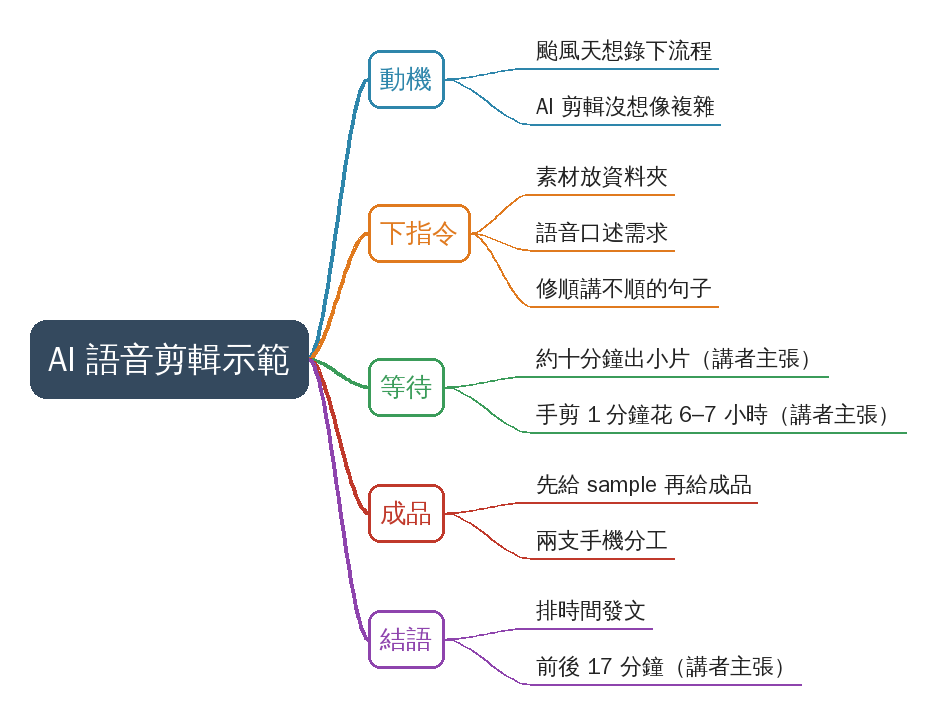
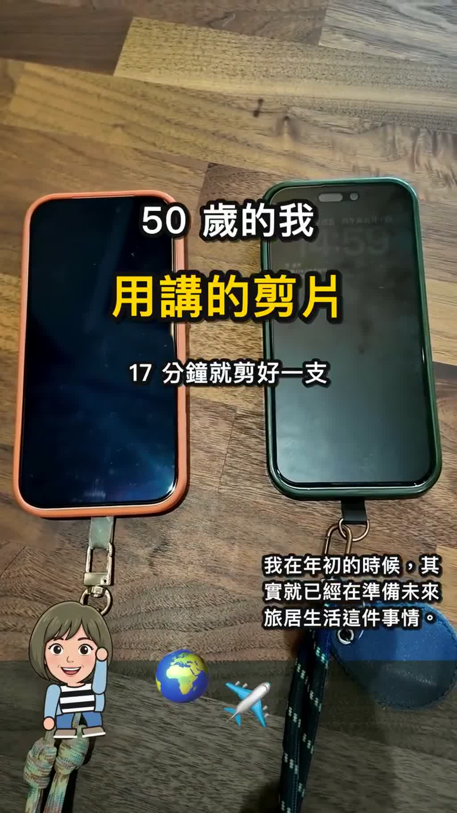
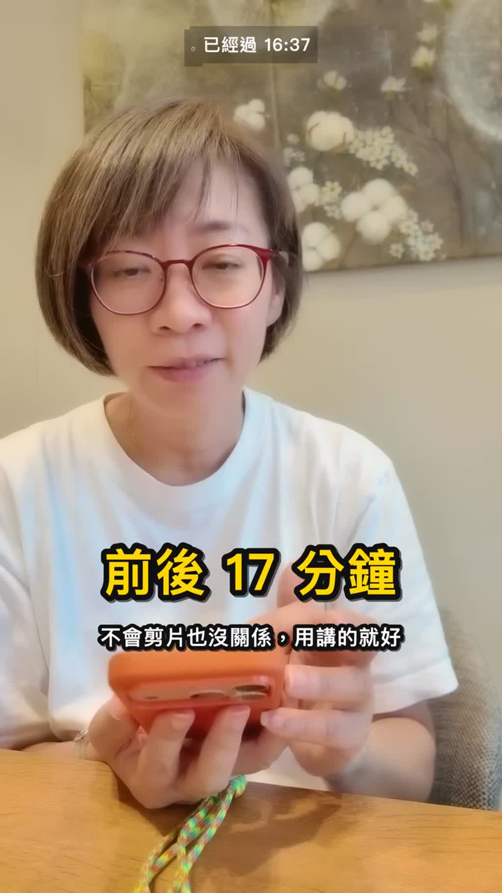

# 颱風天用嘴巴跟 AI 說想怎麼剪，17 分鐘剪好一支影片

- 來源：https://www.threads.com/@jean50pluss/post/DfQ-esshLEi
- 平台 / 上傳者：Threads / Jean Lee（@jean50pluss）
- 長度：03:40 (219.6s)
- 逐字稿來源：whisper (groq)
- 更新日期：2026-11-03
- **關鍵字：** #AI剪輯 #語音下指令 #颱風天 #旅居生活 #兩支手機 #剪映 #影片製作 #Threads

## 摘要與名詞說明

**一句話重點**：作者（Jean Lee，@jean50pluss）示範用手機語音對 AI 口述剪輯需求，不自己動手剪，前後約 17 分鐘就得到一支成品，並對比自己以前剪一分鐘影片花快 7 小時（講者主張，未查證）。

## 重點表

| 時間 | 重點 |
|---|---|
| 00:00 | 開場：颱風天想錄下 AI 剪輯流程，強調「沒有想像中複雜」 |
| 00:21 | 素材放進資料夾，語音下指令：整理檔案、沿用先前 Q 版內容、修順講不順的句子、主題＝為什麼要準備兩支手機 |
| 01:12 | 等待約十分鐘；對比手動剪映剪一分鐘影片花快 6、7 小時（講者主張，未查證） |
| 02:35 | AI 確認理解後輸出 sample 與成品；兩支手機分工（台灣用／出國拍攝、放保險箱） |
| 03:23 | 排時間發文，「前後 17 分鐘」（講者主張，未查證） |

## 補充說明
- 貼文本文：「你有沒有因為不會剪，放棄過想拍的東西？我以前也是，現在用說的就能剪了。」
- 畫面是手機螢幕錄影：AI 對話 App（可見 Sonnet 5.5、Dropbox、遠端控制字樣）＋螢幕計時「已經過 mm:ss」。影片**未說明**用的是哪個產品與剪輯後端，不推測。
- 「17 分鐘」「6、7 小時」皆為作者自述；畫面計時最後約 16:40，與 17 分鐘大致吻合，但不等於獨立驗證。作者「需事先已錄好素材、先前已有 Q 版風格」，並非零前置。

## 轉錄校正備註
Groq 轉錄品質良好，與燒入字幕一致。「剪印」應為剪映（推測，只此支影片，記於 known_asr_errors）。

## 補充資料（影片未呈現的資訊）

### 畫面遺漏（影片畫面有、講者沒唸；逐字照抄）
- 00:00 片頭字卡：「50 歲的我 用講的剪片」「17 分鐘就剪好一支」
- 01:08 作者對 AI 的指令（畫面原文，語音轉文字，含誤字）：「幫我整理一下里面的檔案。之前有請你做一個 AI 的俊 Q 版內容。我剛剛在錄的時候，後面有幾句話嘴巴講得沒有那麼順，你幫我拍得順一點。這支影片主要是告訴別人爲什麼我要準備兩隻手機的重要性。」（「里面／俊 Q 版／拍得順／兩隻」為語音辨識誤字，原意：裡面／Q 版／剪得順／兩支）
- 02:50 AI 回覆：「沒錯，橘色的是旅遊手機，那個是錢的手機。」「好，我的理解沒有錯：橘色＝旅遊手機，綠色＝錢的手機。影片裡的標籤和說法都已經是這樣，我不用改。」「我正在把整支輸出，好了傳預覽給你，同時整理資料夾。」
- 03:09 成品字卡：「完整成品，請看「兩支手機」那支貼文」；「錢的手機」「旅遊手機」；「兩支手機 安全分開放」「你出國時，有分開嗎？」
- 螢幕計時（已經過）：01:20（下完指令）→ 14:29 → 16:40（最後）。

## 思維導圖

- 原圖：[mindmap.png](mindmap.png)；文字大綱：[mindmap.md](mindmap.md)（與本報告同資料夾）

## 圖文對照（畫面 + 逐字稿）

### 投影片 1：開場：颱風天想錄下 AI 剪輯流程（00:00–00:21）

**重點：** 作者在颱風天想把自己正在做的事錄下來，讓大家知道 AI 剪輯的流程其實沒有想像中複雜。

**標籤：** #AI剪輯 #颱風天

就是未來旅居生活這件事，哎呀 就是一個颱風天，就是一個想法，想要把我正在做的事情把它錄影起來，讓大家知道一下，其實AI剪輯的流程就是這樣子，沒有想像中的那麼複雜。

### 投影片 2：對 AI 說出剪輯需求（00:21–01:12）

**重點：** 作者把錄好的素材放進雲端資料夾，改用語音輸入對 AI 下指令：整理資料夾、依先前做過的 Q 版內容處理、把後面幾句講不順的話修順，並說明影片主題是「為什麼要準備兩支手機」。送出後就等待，期間完全沒有自己動手剪（畫面是手機上的 AI 對話 App，右上角為作者錄影小視窗）。

**標籤：** #口述指令 #整理檔案 #修順口誤

那我剛剛已經把我想要錄的東西，把它放在我的檔案夾裡面了，那我現在就準備跟AI說我想要怎麼剪，幫我整理一下裡面的檔案，那之前有請你做一個AI的Q版的內容，那我剛剛在錄的時候後面有幾句話嘴巴就是講得比較就是沒有那麼順，那你幫我拍得順一點，這支影片主要是告訴別人為什麼我要準備兩支手機的重要性，然後就等待。

### 投影片 3：等待成品，並對比手動剪輯（01:12–02:35）

**重點：** AI 開始思考、處理檔案；作者說約十分鐘左右就能完成一支小片，旅遊整天的長片會久一點，但再久也不會比自己剪久。作者舉例：曾用剪映自己剪一分鐘的下午茶影片，花了快 6、7 小時（講者主張，未查證）。畫面上的 AI 工作過程以「快轉 ×24」播放。

**標籤：** #剪映 #手動剪輯 #時間比較

那我就完全沒有去做剪輯，等一下馬上可以看得出來這支影片大概會長什麼樣子，我也很期待，AI剪輯如果你準備好的話它幾乎是可以用，其實也是啦就是用嘴巴講就可以幫你想要表達的內容可以剪出來，差不多快要十分鐘了從我下指令給他到現在，一個小片，如果是一個旅遊的一整天的片子的話，可能會稍微再久一點，但再怎麼樣久都不會比自己剪還要久，我曾經剪了一個一分鐘的影片，只是一個吃一個下午茶的影片，我大概自己個人那時候用剪映剪，我大概剪了快要6、7個小時，很崩潰的。

### 投影片 4：AI 交付 sample 與成品（02:35–03:23）

**重點：** AI 先回報確認理解（橘色＝旅遊手機、綠色＝錢的手機），再輸出 sample 與成品供檢視；螢幕計時約 15 分鐘時完成。成品畫面標示兩支手機用途：一支平常在台灣用、放銀行與投資 App；出國玩帶另一支，平時放保險箱、專門拍攝。

**標籤：** #成品 #兩支手機 #旅居生活

剪好的時候他就會給我看一下整個剪好的sample跟最後的影片，我已經要15分鐘了，看一下它幫我剪的成果，年初的時候其實就已經在準備未來旅居生活這件事情，右手邊這一支我就是平常在臺灣用，裡面會有一些銀行或者是投資專案，出國玩的時候會出門會帶這個，然後另外一個會放在保險箱，那這支手機就專門拍攝，很棒耶，很讚。

### 投影片 5：結語：排時間發文，前後 17 分鐘（03:23–03:40）

**重點：** 作者看完覺得「這樣就好了」，接著排程、放上架發文即完成，從下指令到完成前後 17 分鐘（講者主張，未查證）。畫面字卡：「不會剪片也沒關係，用講的就好」。

**標籤：** #排程發文 #17分鐘

其實這樣就好了，那接下來就是排時間，然後可以放在架上就可以發文了，就這樣完成了唷，前後17分鐘，讚喔。

## 已知轉錄錯誤

| 時間 | 聽成 | 應為 |
|---|---|---|
| 00:20 | 剪印 | 剪映（推測，已改） |
| 00:37 | Gene Q版 | Q版（畫面語音文字為「俊 Q 版」，已改） |
| 02:49 | 放火前的成果 | 幫我剪的成果（依 02:52 燒入字幕，已改） |

## 補充資料連結

- 補充資料檔：[supplement.md](supplement.md)（與本報告同資料夾；內容已收錄於上方〈補充資料〉）
- 思維導圖：[mindmap.png](mindmap.png)、文字大綱：[mindmap.md](mindmap.md)（與本報告同資料夾）
