# 上週我讓 AI 連續跑了整整 27 個小時不間斷。Claude Code、Codex、Hermes Agent 三家公司同時推出了 /go...

- 來源：https://vt.tiktok.com/ZSph3HMHy/
- 平台 / 上傳者：TikTok / one.ai186
- 長度：15:55 (955.0s)
- 逐字稿來源：whisper (groq)
- 更新日期：2026-11-07
- **關鍵字：** #/goal #Claude Code #Codex #Hermes Agent #Context Anxiety #Evaluation #Rubric #長時間任務 #評審 #Anthropic

## 摘要與名詞說明

**一句話重點**：講者主張，/goal 這類「長時間自動執行」功能的成敗不在提示詞技巧，而在你能否把「做得好」定義成可驗證的評分標準（Evaluation／Rubric）；並分享六步驟 SOP，把個人品味拆成 AI 評審可執行的準則。（影片中的數字與主張皆為講者主張，未查證。）

| 時間 | 重點 |
|---|---|
| 00:00 | 開場：講者稱讓 AI agent 連跑 27 小時；真正的自動化是解放注意力 |
| 01:44 | Claude Code、Codex、Hermes Agent 同時推出 /goal：寫下目標，AI 做到完成為止 |
| 02:14 | AI 偷懶的原因：Context Anxiety（轉述 Anthropic 研究） |
| 03:07 | /goal 原理：實作者＋評審雙角色循環；前身為 Ralph Loop |
| 04:33 | 好 goal 提示詞的 5 要素：Outcome、Verification、Constraints、Iteration policy、Error handling |
| 06:21 | 難題：白領／主觀工作沒有單元測試 |
| 06:51 | Anthropic 網頁設計實驗：把「漂亮」拆成 4 維度、加重弱項權重、評審看真實畫面 |
| 09:44 | 共同指向 Evaluation，而非 Prompt／Context Engineering |
| 10:28 | 六步驟 SOP：先跑 baseline → 寫下皺眉理由 → 分類成維度 → 寫具體案例 → 多樣化案例 → 交給評審實跑 |
| 15:07 | 兩個提示詞（Rubric Builder、Goal Prompt Builder）在影片資訊欄，影片未呈現全文 |

## 名詞與縮寫
- **/goal**：在對話框輸入目標，agent 持續執行直到達成的功能。逐字稿原本辨識為「Go」，依投影片改為 /goal。
- **Context Anxiety**：講者轉述 Anthropic 研究，LLM 感到 context window 快滿時會急著收尾。
- **Rubric**：評分標準，供評審 agent 逐維度打分。
- **Baseline**：未加任何指引時 AI 的基準產出。

## 轉錄校正備註
- 逐字稿來源為 Groq Whisper；「Cloud」統一改為 Claude、「Go」依投影片改為 /goal、「Playwright」「Anthropic」等依畫面校正。
- 標「推測」的校正見 `meta.json.known_asr_errors`（如「大災問→大學問」「月籤→躍遷」）。

## 補充資料（影片未呈現的資訊）

### 影片未呈現的資訊
- 講者說兩個提示詞（Rubric Builder、Goal Prompt Builder）、官方文件連結與完整文章放在影片「資訊欄」，影片畫面只顯示摘要卡片，全文**影片未呈現**，未抄錄。
- 逐字稿中「/goal」標題與功能細節（Token 上限等）依講者口述；官方設定語法影片未示範。

## 思維導圖

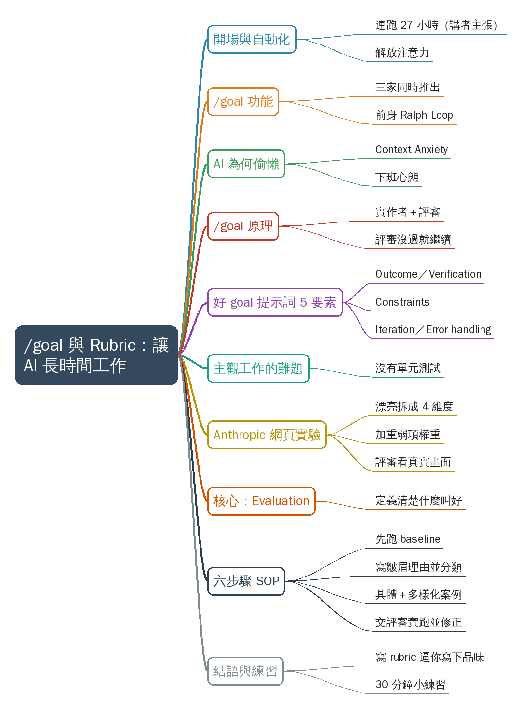

- 原圖：[mindmap.png](mindmap.png)；文字大綱：[mindmap.md](mindmap.md)（與本報告同資料夾）

## 圖文對照（畫面 + 逐字稿）

### 投影片 1：開場：讓 AI 連跑 27 小時（00:00–00:20）

**重點：** 講者主張上週讓 AI agent 連續跑了 27 小時、過程無人介入（未查證）。他批評「你問一句、它答一句」的互動模式，並預告影片教你如何定好目標後讓 AI 持續工作。

就在上週，我讓AI跑了整整27個小時，對，過程中沒有人為介入，我的agent跑了整整27個小時，如果你跟AI的互動現在還停留在你問一句他打一句的模式，那這支影片你一定要從頭看到尾，因為這支影片我會告訴你到底該如何奴役你的AI，定好目標後就讓他不眠不休地為你幹活，解放真正的生產力。

### 投影片 2：真正的自動化是解放注意力（00:20–01:07）

**重點：** 只把任務丟給 AI 還只走完自動化前半段；若你仍要每 10 分鐘回去確認、稽核、再丟下一輪，注意力依舊被綁住。講者引用認知科學說法（未查證）：心裡掛著未完成的事就會佔用腦力，因此注意力才是稀缺資源。

很多人以為自動化就是把任務丟給AI，讓他自己跑，但如果你每隔10分鐘就要回去確認他做到哪，要不要改方向，有沒有偏題，做完一輪還要你去稽核後，再丟給他跑下一輪，這樣真的是自動化嗎，你的注意力還是被綁在那邊，把任務從你手上移到AI手上，只走完了自動化的前半段，後半段是把那件事，從你的心上徹底移開，讓你的時間腦力，可以放在其他更重要的事情上，真正的自動化是解放你的注意力，Cognitive Science早就證實了，只要你心裡還掛著一件，沒處理完的事，不管你現在有沒有親自在做，它就是會佔用你的腦力，那些掛在腦子裡的事，比方說等AI跑完之後，我要記得改那個按鈕的UI，或是這個方向好像不對，等一下我得記得調整，這每一件事情都在偷偷吃掉你的注意力，而注意力才是這個時代真正稀缺的東西。

### 投影片 3：影片三部分預告（01:07–01:44）

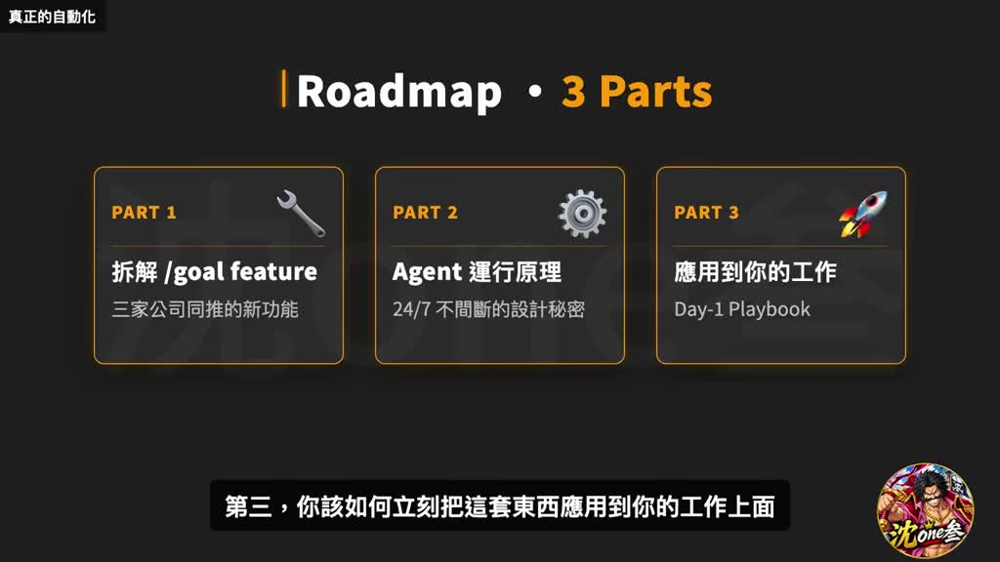

**重點：** 第一部分拆解主流工具針對長時間任務（Long Running Task）推出的功能與研究；第二部分講讓 agent 長時間運行的設計原理；第三部分教你如何立刻應用到工作上，目標是從協作者變成 AI 時代的管理者。

今天這支影片只有乾貨，你會知道怎麼樣讓AI真正為你所用，執行常任務時不會偏離目標，最後的產出也貼合你的品味，影片分成三個部分，第一，我們會拆解最近主流的AI工具，跟實驗室針對AI做Long Running Task，分別推出了什麼新功能，又做了哪些研究，第二，從這幾個工具的設計原理來看，讓AI能長時間執行的秘密到底是什麼，要怎麼做才能讓你的agent，不眠不休地為你工作，第三，你該如何立刻把這套東西，應用到你的工作上面，看完這支影片之後，我希望你不再只是AI的協作者，而是AI時代下的管理者，那我們直接開始。

### 投影片 4：三家同時推出 /goal 功能（01:44–02:14）

**重點：** 講者指出 Claude Code、OpenAI Codex、Hermes Agent 幾乎同時推出同名功能 /goal：在對話框輸入 /goal 並寫下目標，AI 就會一直做到完成為止。他認為社群對這個趨勢重視不足。

如果你有在關注AI agent的圈子，你會發現一件很有趣的事情，Claude Code，OpenAI Codex，還有Hermes Agent，這三間公司幾乎在同一時間，推出了一個一模一樣的新功能，甚至名字也都一樣，叫做/goal，這個功能是幹嘛的，簡單講就是，你只要在對話方塊裡打/goal，然後寫下你想要它達成的目標，它就會自己跑下去，直到完成為止，我看社群媒體似乎不夠重視這個趨勢，這些公司推出的這個功能，其實都是想要解決一個，所有AI工作者都遇到過的問題。

### 投影片 5：AI 為何會偷懶：Context Anxiety（02:14–03:07）

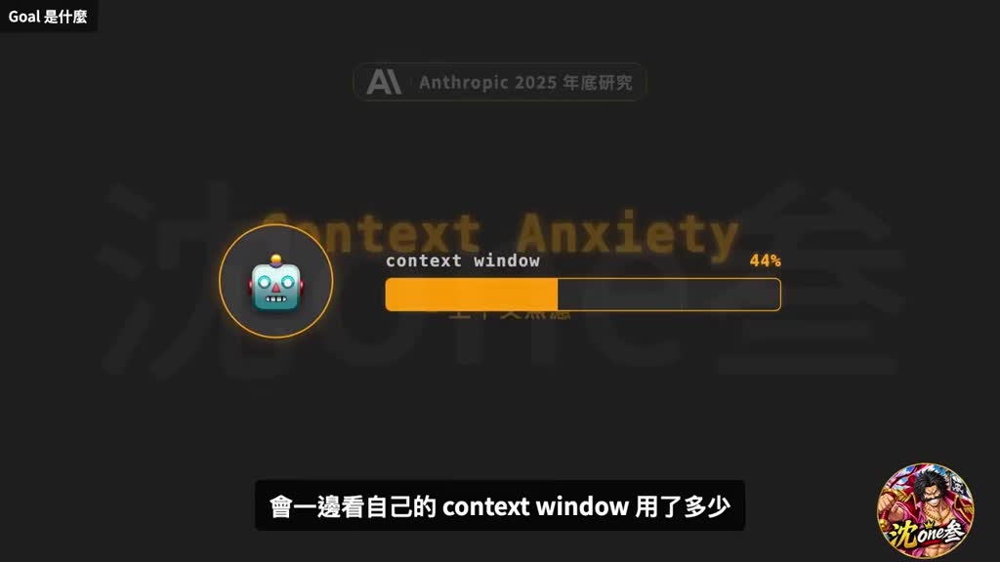

**重點：** AI 常做到一半停下來問你、或沒做完卻宣稱完成。講者轉述 Anthropic 2025 年底的研究（講者主張，未查證）：LLM 會看自己的 context window 用了多少，快滿時就開始慌著收尾交差，講者戲稱為「下班心態」。

那就是AI會偷懶，你一定有過這種經驗，叫AI做一件事，它做到一半，停下來問你，我可以繼續嗎，你要A還是B，或者更糟，明明沒做完，但卻跟你說他做完了，寫了一個漂亮的總結，然後把球丟回給你，你想要的就是，agent可以直接做完，沒做完真的不要回來煩我，但他就是會停，到底為什麼會這樣呢，Anthropic在2025年底發了一篇研究，他們發現LLM做到一半會停下來的根本原因，叫做context anxiety，翻譯成中文就是上下文焦慮，用白話文解釋的話就是，LLM在執行任務的時候，會一邊看自己的context window用了多少，當他感覺到context快滿了，就會開始慌，然後就莫名其妙開始wrap up，想要快點交差了事，然後就停了，這是刻在LLM基因裡的一種惰性，我稱之為下班心態，而/goal 這個功能就是為了對抗這種惰性而生的。

### 投影片 6：/goal 的原理：實作者＋評審（03:07–03:47）

**重點：** /goal 通常由兩個角色協作：實作者執行指令並產出，評審在每輪結束後檢查目標是否達成，沒達成就指出問題、要求繼續。講者用「胡蘿蔔吊在豬鼻子前」比喻，讓 agent 自我鞭策、不必你每三分鐘回來檢查。

接著我們聊聊/goal 的執行原理，/goal 在工作的時候通常會有兩個角色協作，一個是做髒活的實作者，另一個是負責確認產出品質，以及任務進度的評審，實作者負責執行你的指令，產出東西，評審在每一輪結束後都會檢查一次，使用者給的目標完成了嗎，只要答案是沒有，評審就會點出問題，並叫實作者繼續往下做，就像你把一根胡蘿蔔掉在豬鼻子前面，豬隻要還沒吃到那根胡蘿蔔，它就不會停下來，而你只有在這隻豬真的到達終點的時候，才會給它吃胡蘿蔔，/goal 這樣的功能讓你不再需要每三分鐘跑回來檢查，催它戳它，它讓agent有能力自我鞭策，自己跑到你給它定好的終點。

### 投影片 7：前身：Ralph Loop 外掛（03:47–04:11）

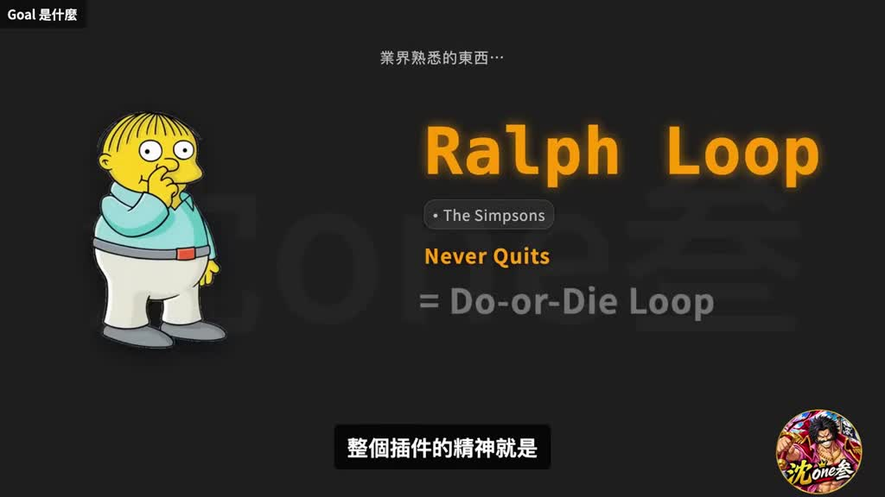

**重點：** 講者提到去年中很火的 Ralph Loop 外掛，名字取自《辛普森家庭》裡有點傻、但永遠不放棄的小孩，精神是無論如何都持續做到底的迴圈。如今三家公司把這個理念做成官方功能。

講到這邊，業界內的觀眾應該會聯想到去年中有一個滿火的外掛，也在做一樣的事情，叫做 Ralph Loop這個外掛的命名我覺得很有意思Ralph 就是辛普森家庭裡那個有點傻但永遠不會放棄的小孩整個外掛的精神就是無論如何都會持續做到底的迴圈當時這個外掛也在 AI 程式設計圈掀起一陣風潮，而今天這三家公司把這個理念變成了官方 feature。

### 投影片 8：/goal 的使用方式（04:11–04:33）

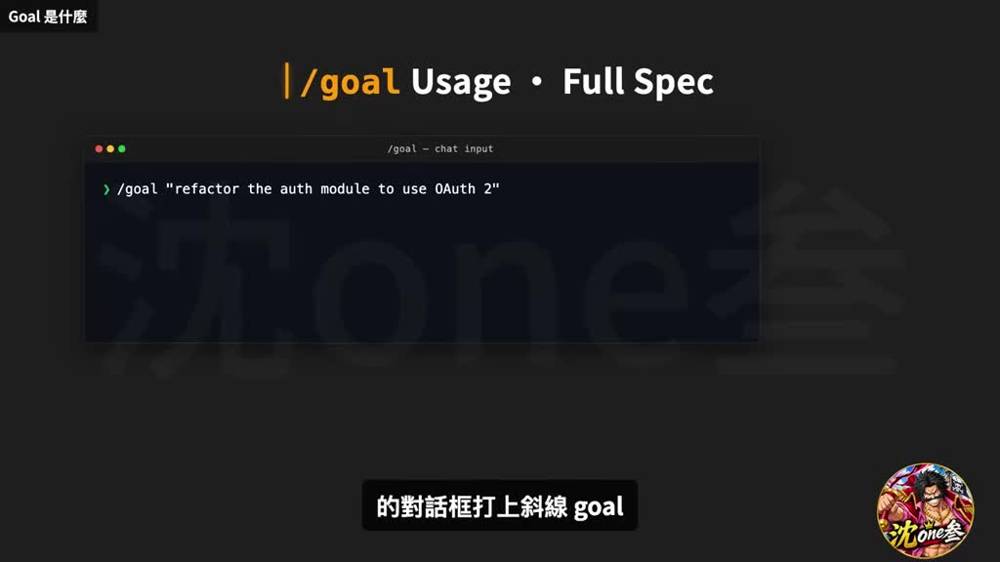

**重點：** 用法很簡單：在 Claude Code、Codex 或 Hermes Agent 的對話框輸入 /goal 並說明任務；進階設定包括限制 Token 上限等，細節請看官方文件（講者說連結放在資訊欄）。

接著我們說一下具體怎麼使用 /goal 這個功能，其實這背後沒什麼大學問，就在 Claude Code, Codex 或者 Hermes Agent 的對話方塊打上/goal，然後說明你希望它能完成的任務就好了，當然還有一些更進階的設定，像是限制他可以使用Token的上限等等，更詳細的使用說明，各位可以查閱官方文件，我會把連結放在資訊欄，功能的使用方式很簡單，暴力。

### 投影片 9：關鍵在提示詞：「好一點」沒有邊界（04:33–05:00）

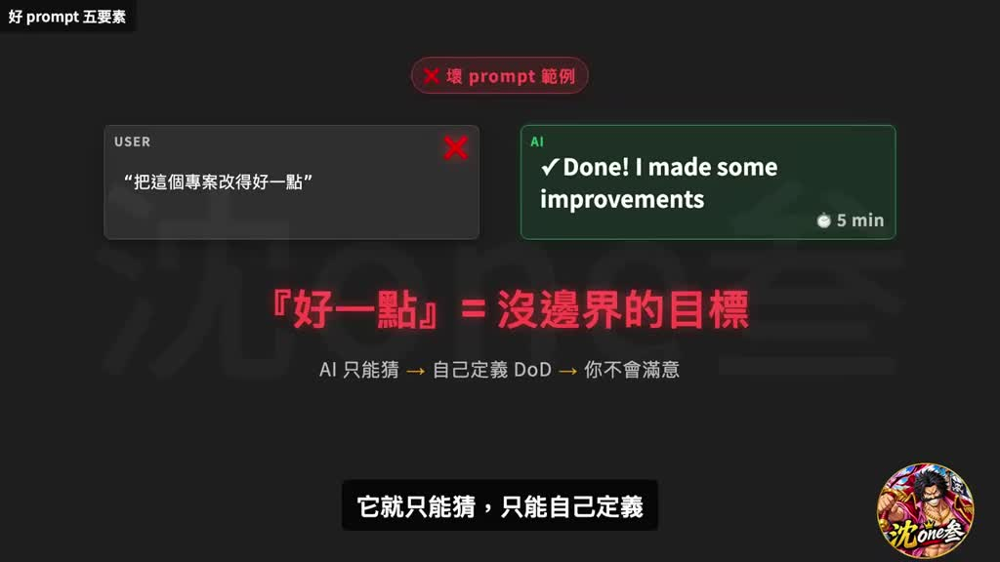

**重點：** 隨性地丟「把這個專案改得好一點」，AI 只會做一兩個小改動、五分鐘就宣稱完成，因為「好一點」是沒有邊界的目標，AI 只能自己定義 definition of done，結果通常不如你意。

但真正的問題是，要怎麼寫這個提示詞，才能讓/goal 跑出正確的東西，而不是另外一個AI Slop，如果你很隨性的丟一個Prompt，像是把這個專案改得好一點，AI會做一兩個小改動，然後說我已經讓它變得更好了，五分鐘內就把這個任務完成，為什麼，因為好一點是一個沒有邊界的目標，AI不知道什麼叫做好一點，它就只能猜，只能自己定義，而它定義的definition of done，你通常不會滿意。

### 投影片 10：寫得好的 goal 提示詞範例（05:00–05:29）

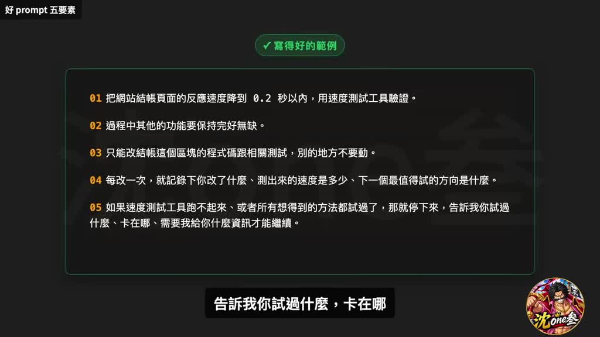

**重點：** 講者示範好例子：把結帳頁面反應速度降到 0.2 秒內、用速度測試工具驗證、其他功能不能壞、只能改結帳區塊與相關測試、每次修改要記錄內容與測出的速度與下一步，卡住時要停下回報。

再看一個寫的好的例子，把網站結賬頁面的反應速度降到0.2秒以內，用速度測試工具驗證，過程中，其他的功能要保持完好無缺，只能改結賬這個區塊的程式碼跟相關測試，別的地方不要動，每改一次就記錄下你改了什麼，測出來的速度是多少，下一個最值得試的方向是什麼，如果速度測試工具跑不起來，或者所有想得到的方法都試過了，那就停下來，告訴我你試過什麼，卡在哪，需要我給你什麼資訊才能繼續，你看是差別了嗎。

### 投影片 11：要素一：Outcome（成果）（05:29–05:38）

**重點：** 第一個要素是 outcome：任務完成時應該是什麼狀態。在範例中就是「反應速度 0.2 秒以內」，用可衡量的終點取代模糊的期待。

第二個版本里面有五個關鍵的元素，第一是outcome，也就是這個任務如果完成了，應該是什麼狀態，在這個例子中是反應速度0.2秒以內。

### 投影片 12：要素二：Verification（驗證）（05:38–05:44）

**重點：** 第二個要素是 verification：怎麼證明真的完成了。範例是用速度測試工具驗證，讓「完成」不靠 AI 自己宣稱。

第二是verification，怎麼證明它真的完成了，也就是用速度測試的工具驗證。

### 投影片 13：要素三：Constraints（限制）（05:44–05:49）

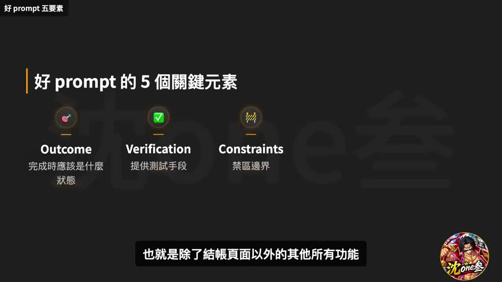

**重點：** 第三個要素是 constraints：哪些事情不能做。範例限制只能改結帳區塊的程式碼與測試，其他所有功能必須保持完好。

第三是constraints，哪些事情你不能做，也就是除了結賬頁面以外的。

### 投影片 14：要素四：Iteration Policy（迭代規則）（05:49–05:58）

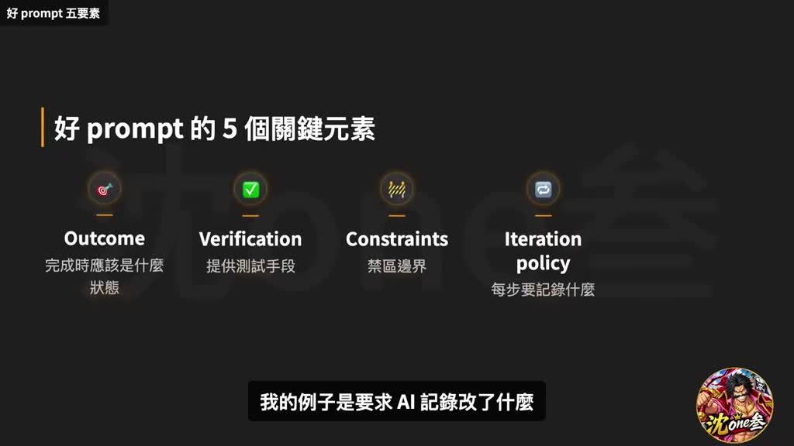

**重點：** 第四個要素是 iteration policy：每次嘗試之間要做什麼。範例要求 AI 記錄改了什麼、結果是什麼、下一個值得試的方向，讓長時間迭代有跡可循。

其他所有功能，第四是Iteration Policy，也就是每次嘗試之間要做什麼，我的例子是要求AI記錄改了什麼，結果是什麼，還有可能的下一步。

### 投影片 15：要素五：Error Handling（錯誤處理）（05:58–06:03）

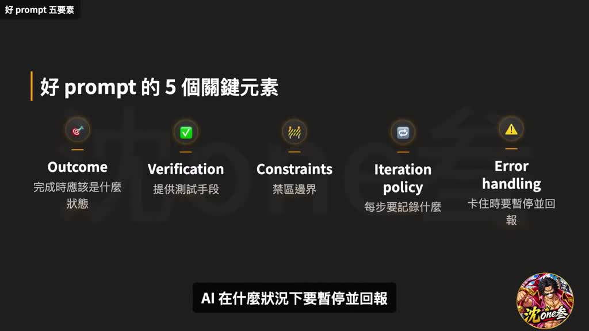

**重點：** 第五個要素是 error handling：AI 在什麼狀況下要暫停並回報，而不是無腦地一直做下去。例如測試工具跑不起來、或所有方法都試過時，要回報試過什麼、卡在哪、需要什麼資訊。

第五是Error Handling，AI在什麼狀況下要暫停並回報，而不是無腦地一直做下去。

### 投影片 16：完成的定義是提示詞的核心（06:03–06:21）

**重點：** 講者主張好的 goal 提示詞關鍵不在文筆，而在把「完成」定義得多明確：定義寫得好，AI 會一直跑到完成、成果是你要的樣子；定義寫得爛，AI 三分鐘就草草收工，浪費 token。

一份好的Goal Prompt的設計關鍵，不是Prompt都會寫，而是你把所謂的完成定義的有多明確，完成的定義寫得好，它就會一直跑，跑到完成為止，而且完成後是你要的樣子，定義寫得爛，AI就草草結束，三分鐘就收工，產出不是你想要的，不如不要浪費這些token。

### 投影片 17：難題：白領工作很難量化驗證（06:21–06:51）

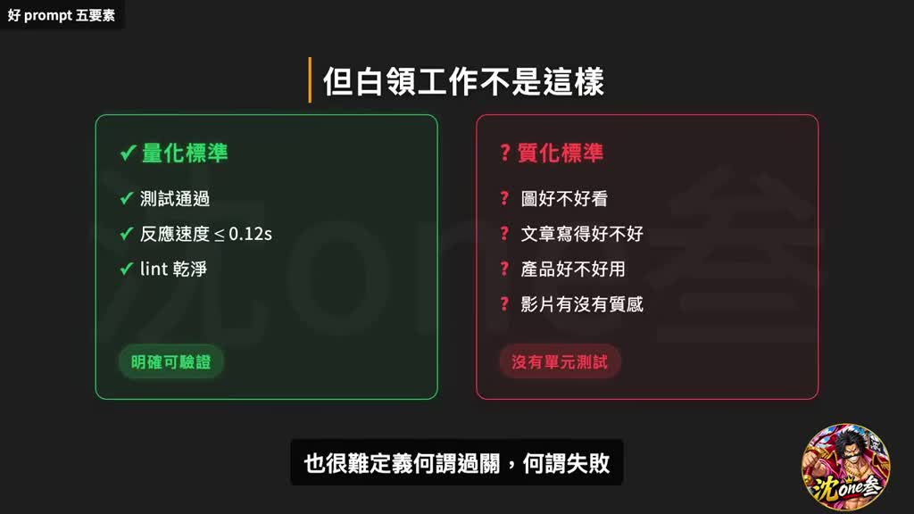

**重點：** 寫程式有測試通過、效能數字、Lint 乾淨等明確標準；但圖好不好看、文章好不好、產品好不好用、影片有沒有質感，沒有單元測試，也難定義過關或失敗。講者要回答這類工作如何套用同樣邏輯。

講到這邊你可能會說，那寫程式的人很爽，因為測試透過，反應速度低於0.12秒，或者是Lint乾淨，這些都是明確可驗證的標準，但大部分的白領知識工作不是這樣啊，你的圖好不好看，你的網頁有沒有品位，你的文章寫的好不好，你的產品好不好用，你做的影片是不是有質感，這些東西沒有單元測試，也很難定義何謂過關，何謂失敗，那這種佔了我們白領工作，絕大多數比例，偏向主觀判斷的工作，該如何套用一樣的邏輯，讓AI可以長時間替你打工。

### 投影片 18：Anthropic 實驗：讓 Claude 設計網頁（06:51–07:20）

**重點：** 講者轉述 Anthropic 另一篇研究（講者主張，未查證）：用執行者加評審架構讓 Claude 設計網站。但 AI 自評設計常把很糟的成品說成「現代感、高質感」，所以評審不能只憑感覺。

在回答這個問題之前，我想先說一下，Anthropic的另一篇研究，他們讓Claude去設計一個漂亮的網頁，然後也運用了剛剛提到的一個執行者，搭配一個評審的架構去設計這個網站，但網頁設計的漂不漂亮，是一個極度主觀的事情，你叫AI自己憑自己做的網頁漂不漂亮，明明做的超爛超醜，滿滿的AI味，它還是會把自己的設計定義成現代感，高質感，所以Anthropic把漂亮的網站，這個模糊的概念，拆成了四個明確的維度。

### 投影片 19：維度一：設計品質（07:20–07:30）

**重點：** Anthropic 把「漂亮」拆成四個明確維度。第一個是設計品質：顏色、字型、排版是否共同營造出整體的設計語言、獨特氛圍與識別感。

第一個維度是設計品質，整個網頁有沒有向使用者，傳達出一個整體的設計語言，顏色 字型 排版，有沒有共同營造出，一種獨特的氛圍跟識別感。

### 投影片 20：維度二：原創性（07:30–07:45）

**重點：** 第二個是原創性：是不是刻意的設計選擇，還是套用預設模板。Anthropic 團隊列出 AI 愛用的通用元件，例如白色卡片配紫色漸層，這類會被判定缺乏原創性。

第二個維度是原創性，有沒有刻意的設計選擇，還是用了一堆預設的模板，Anthropic團隊，羅列了一些AI很愛用的設計元件，比方說一張卡片上面有漸層的顏色，這種太通用的模板，就會被判定沒有原創性，第三個維度是技術執行。

### 投影片 21：維度三：技術執行（07:45–07:50）

**重點：** 第三個是技術執行：字型階層、間距、配色、對比等技術細節是否整齊一致；若各頁標題字型大小不一，這關就不通過。

字型階層，間距，配色，對比這些技術細節有沒有整齊，保持一致。

### 投影片 22：維度四：可用性（07:50–08:05）

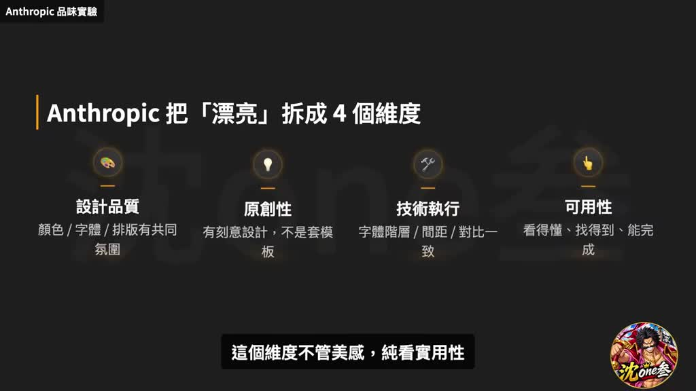

**重點：** 第四個是可用性：不談美感、純看實用，使用者看得懂介面嗎、找得到主要按鈕嗎、能直覺完成來這個網站的目的嗎。

如果每個頁面的標題字型大小都不一致那這一關就沒過第四個維度是可用性這個維度不管美感純看實用性比方說使用者看得懂這個介面在幹嘛嗎找得到主要按鈕嗎，能不能很直覺地就完成他們進來這個網站的最初目的。

### 投影片 23：加重弱項權重，評分標準＝你的 benchmark（08:05–08:33）

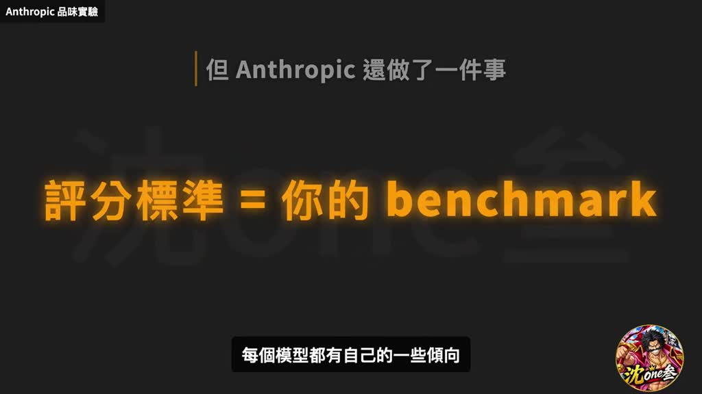

**重點：** 講者轉述：Anthropic 發現 Claude 在技術執行與可用性通常不錯，但設計品質與原創性常平庸，所以故意把評分權重偏向這兩項。評分標準可當作 benchmark，校正模型的預設傾向。

更有趣的是，他們在這四個維度之上，還會故意加重Claude，平常做不好的那些維度的權重，例如他們發現Claude在技術執行跟可用性這兩個維度通常做得不錯，但在設計品質跟原創性這兩個維度上，常常產出平庸到不行的網站，所以他們就把評審評分的權重，故意往這兩個弱項偏，每個模型都有自己的一些傾向，而你設計的評分標準，可以當作一個benchmark，校正模型的預設行為，讓模型朝著你想要的方向前進。

### 投影片 24：評審看真實畫面，不看程式碼（08:33–08:48）

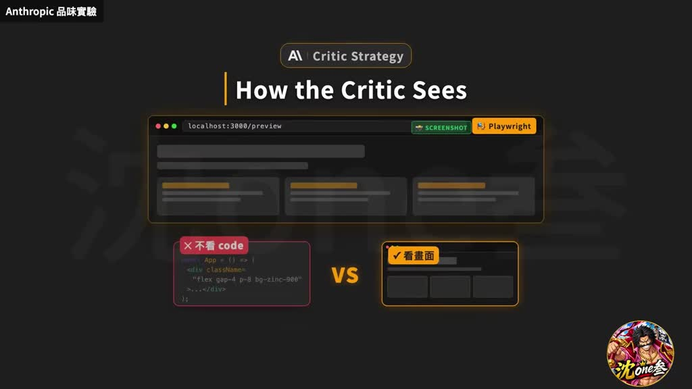

**重點：** 把評分標準（rubric）交給評審後，評審用 Playwright 開瀏覽器、自己截圖再打分，看的是使用者真的會看到的畫面，而不是程式碼。

定完前面講到的幾個維度後，他們把這份rubric，餵給評審，並讓評審自己去看，實際做出來的網頁，然後用Playwright開啟瀏覽器，自己截圖，然後打分，不是讓他看程式碼，是讓評審看，使用者真的會看到的畫面。

### 投影片 25：美術館網站：第九輪到第十輪的躍遷（08:48–09:44）

**重點：** 講者轉述案例（未查證）：第九輪產出深色主題、版面乾淨但中規中矩的網站；第十輪重新想像成空間體驗，用 CSS 透視做出 3D 展間，觀眾穿過虛擬的門走進展廳。進步不是線性的，第十輪可能比第十五輪更好。

Anthropic用以上的評估架構，去做了一個美術館的網站，跑到第九個iteration的時候，Claude做出了一個還不錯的東西，深色主題的landing page，版面乾淨 視覺精緻，但基本上就是你預期的，美術館網站該長的樣子，但到了第十輪，他把整個網站重新想象成一個空間體驗，用CSS透視渲染出一個3D房間，地板是黑白方格，藝術品像在真實畫廊一樣掛在牆上，不規則排列，觀眾不是用scroll跟click在頁面之間跳，而是穿過虛擬的門，走進不同展廳，這就像是，Claude突然被反骨附身了一樣，他們的研究人員也說，這是他從來沒看過，不可能從單一次prompt，產出的創意躍遷，而且這個躍遷不是線性的，並不是每一輪都比上一輪好，有可能第十輪的產出，反而遠遠比第十五輪的產出，更漂亮更有創意，但只要評審跟執行者，繼續對話下去，複雜度會增加，野心會增加，然後在某幾輪，會出現那種，我自己都想不到的飛躍。

### 投影片 26：共同指向：Evaluation（09:44–10:16）

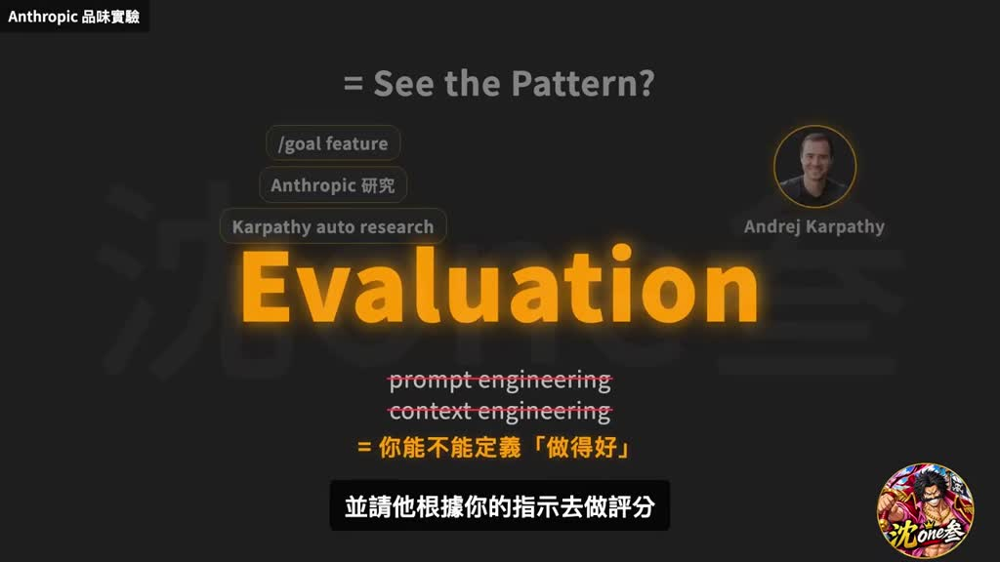

**重點：** 講者歸納：/goal 的設計、Anthropic 的研究、Karpathy 的 Auto Research 都指向 Evaluation，而不是 Prompt Engineering 或 Context Engineering——你能否定義清楚什麼叫做得好。評分標準讓評估者能逼執行者持續迭代。

所以你看出來了嗎，不論是/goal，這個功能的設計，或者是Anthropic的研究，又或者是前陣子Andrej Karpathy推出的Auto Research，其實全部都指向同一件事，那就是Evaluation，不是Prompt Engineering，不是Context Engineering，而是你身為使用者，能不能定義清楚什麼叫做得好，並請他根據你的指示去做評分，Evaluation代表的是一個評分標準，也是稽核者評估者，在每一輪的迭代中都要守住的原則，就是有這些原則跟評估標準，稽核者才能逼執行者不斷迭代，並朝著你真正想要的結果前進。

### 投影片 27：品味怎麼拆給 AI：六步驟 SOP 預告（10:16–10:28）

**重點：** 講者說自己摸索很久，收斂出一套六個步驟的 SOP，用來把工作領域裡的品味拆解成 AI 可遵循的準則。

最後我想聊聊，那我們一般人究竟要怎麼把自己工作領域裡的品位，拆解成AI可以follow的準則呢，這一題我自己也摸索了很久，最後收斂成了一套六個步驟的SOP，在這邊分享給各位。

### 投影片 28：步驟一：先讓 AI 做一輪你的工作（10:28–10:43）

**重點：** 先不要急著寫 rubric。例如要 AI 寫作，就丟 5 到 10 個主題讓它隨便跑，這是在測試你所用 AI 的基準能力（baseline）。

第一步是先讓AI做一輪你的工作，先不要急著寫rubric或者任何評估標準，如果你要請AI寫作，先丟5到10個你想寫的主題進去，讓它隨便跑，這是在測驗你使用的這個AI現在的基準能力，也就是所謂的baseline。

### 投影片 29：步驟二：親自檢視，寫下皺眉的理由（10:43–11:13）

**重點：** 逐一閱讀 baseline 產出，感受哪些讓你皺眉、以及具體原因（例如開頭沒有 hook、沒有具體例子），把理由寫成清單，就是 rubric 的雛形，像是 AI 踩的地雷。

第二步是親自看一遍AI的baseline闡述，每一個都看，然後去感受哪些你看會皺眉，更重要的是皺眉的具體原因是什麼，是因為開頭沒有吸引人注意的hook，沒有提供具體例子闡述你要說明的概念，把這些皺眉的理由寫下來，這些會是你rubric的雛形，到最後你會有一份清單，裡面寫著AI踩的地雷，像是第一句話，又是在這個快速變化的時代，整篇都在用一般人不會用的成語，或者文章裡面沒有任何具體的人名或數字。

### 投影片 30：步驟三：把皺眉理由分類成維度（11:13–12:03）

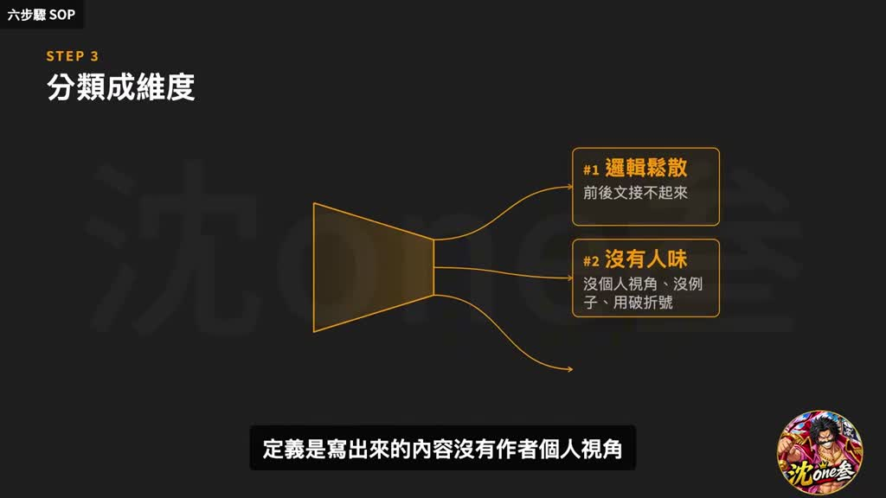

**重點：** 把清單拆成幾個維度，之後 AI 評審才能依維度打分。例：50 條理由可收斂成邏輯鬆散、沒有人味、開頭沒 hook 三類，這三個維度就是寫作 rubric 的骨架；講者說 Anthropic 也是同樣做法。

第三步是把這些東西給分類，拆成幾個不同的維度，就像剛剛提到anthropic的做法一樣，這樣之後的AI評審，就可以根據你分類出來的維度去打分，舉個例子，你列出了50條皺眉的理由，可能最後收斂成三大類，第一類是邏輯鬆散，這個分類的定義是文章邏輯有斷層，前文跟後文接不起來，第二類是沒有人味，定義是寫出來的內容沒有作者個人視角，沒有具體例子，在文章中一直使用像是波折號這類人類，不會使用的標點符號，第三類可能是文章開頭沒hook，第一句話就讓人想關掉，根本讀不下去，這三個維度就是你寫作rubric的骨架，我們也回顧一下Anthropic是怎麼做的他們也是先看了一堆Claude做的網頁把皺眉的點聚合最後收斂出了設計品質原創性技術執行還有可用性這四個維度一模一樣的動作，只是不同領域而已。

### 投影片 31：步驟四：每個維度寫成具體案例（12:03–13:11）

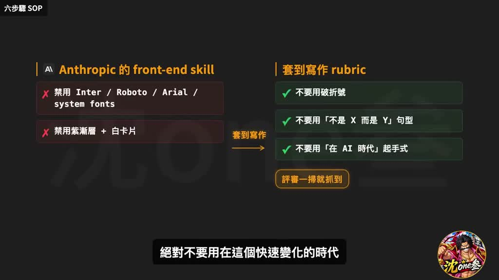

**重點：** 這是整套 rubric 的核心。不能寫「避免 AI 味」這種抽象描述，要寫「絕對不要用破折號」「絕對不要用『不是 A 而是 B』句型」。Anthropic 的 front-end skill 也點名 Inter、Roboto、Arial 字型與白底紫色漸層，每條都是評審一掃就抓得到的標準。

第四步是把每個維度，整理成具體的案例當作reference，這一步是整套rubric的核心，你不能寫避免AI way這種抽象描述，要寫絕對不要用破折號，絕對不要用不是A而是B這種句型，你的案例要足夠具體，評審才能夠一掃文字就馬上幫你抓出違規，或許你覺得這樣講還是太抽象，沒關係我們一起來看entropic是怎麼寫的，他們在官方的front end design這個skill裡面，為原創性這個維度提供了幾個具體的案例，像是絕對不要用inter roboto ariel system fonts，這四種字型，還有絕對不要用紫色漸層蓋在白色卡片上，他們不是寫要保持原創性，而是透過經驗以及人的品味，把那些AI一犯再犯的錯誤一個一個點名出來，放到我們剛剛的例子上，寫作的rubric完全可以照搬這套寫法，你所謂的沒有人味這個維度，可以這樣寫成，絕對不要用破折號連接兩個短句當作節奏感，絕對不要用不是A而是B這種句型，絕對不要用在這個快速變化的時代，在AI時代這種起手式，每一條都是評審一掃就抓得到可以推斷的標準。

### 投影片 32：步驟五：用多樣化案例取代單一描述（13:11–13:53）

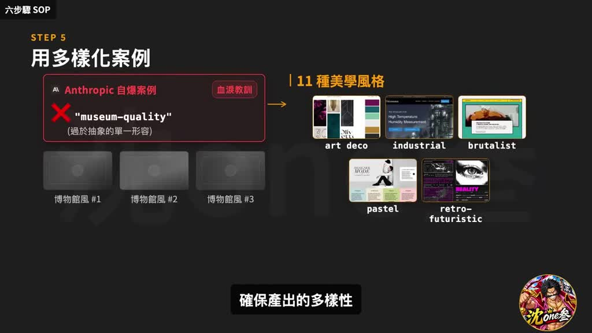

**重點：** 講者轉述 Anthropic 的教訓：rubric 寫「博物館等級質感」，結果所有產出都變成博物館風；後來改成列出 11 種美學風格（Brutalist、Art Deco 等）讓 Claude 視情況選擇。AI 容易 overfitting 範例，所以要寫多個方向。

第五步是要用多樣化的案例去取代單一的案例描述，Anthropic在Blog裡面自曝過一個血淚教訓，他們一開始在Rubric寫了一句話，請設計成博物館等級的質感，結果跑出來所有產出都變成博物館風，非常的單一且沒有多樣性，後來他們把這句整個刪掉，改成在檔案裡列出11種美學風格，比方說Brutalist, Art Deco, Pastel, Industrial，還有Retro Futuristic，然後讓Claude在設計時根據當下狀況選擇其中一種，確保產出的多樣性，有實作經驗的朋友應該都知道，AI很容易因為你給的範例而有overfitting的狀況發生，也就是過度遵從你給的範例，所以你要寫多個方向才能確保多樣化激發AI創意。

### 投影片 33：步驟六：把 rubric 交給評審 agent 實跑（13:53–14:45）

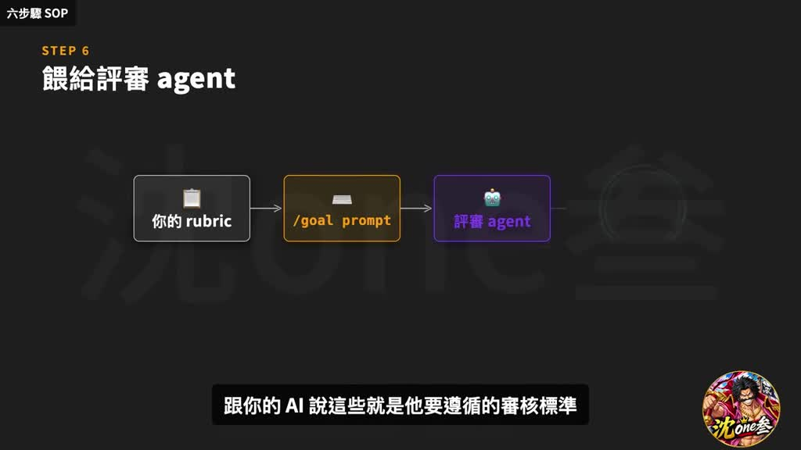

**重點：** 把前五步的 rubric 放進 goal 提示詞，要求達標前持續迭代。剛開始要人工檢查每輪產出，若評審判斷與你不一致，多半是 rubric 還沒抓到真正的品味，回頭修改；跑三四輪後，你對「好」的定義會逐漸清晰。

第六步也是最後一步，就是把你的rubric餵給評審agent，直接跑跑看產出如何，如果你有紮實的執行完前五步，這個時候你應該已經有一份相當紮實的rubric，下一步理所當然的就是把這份rubric放進的goal prompt裡面，跟你的AI說這些就是他要遵循的稽核標準，請確保在以上rubric沒有達成之前，持續迭代，不要停下，但這邊有個注意事項，建議你剛開始跑的時候，還是要人工檢查一下，看看AI執行每一輪後的產出，確保評審判斷的結果，跟你親眼看的結果是否一致，如果不一致，那大機率是你的rubric寫法，還沒抓到你內心真正渴望的那個品味標準，這時候你要做的事情就是回去改rubric，跑個三四輪之後，你就會發現你心裡對做得好的定義，正在被你一條一條的梳理出來，當有這種感覺的那一刻，你就不再只是AI的協作者了，而是能夠定義自己品位的AI管理者。

### 投影片 34：結語：寫 rubric 是在逼你把品味寫成文字（14:45–15:07）

**重點：** 講者主張，寫 Evaluation rubric 表面上給 AI 用，實際是逼你把一直只存在腦袋裡的模糊品味具體寫成文字；一旦寫成文字，AI 就能幫你守住並大規模執行。

這就是我最近自己處理出來的一套SOP，希望可以對你有幫助，講到這邊，也帶到整支影片最想跟你說的是，寫Evaluation的Rubric，表面上是給AI用的，但實際上它是在逼你把那些，一直以來只存在你腦袋裡的模糊品位，具體寫成文字，一旦寫成文字，AI就可以幫你守住它，幫你大規模執行它，當初我也花了大量的時間，在摸索如何定義自己的品位。

### 投影片 35：兩個提示詞（資訊欄領取）（15:07–15:31）

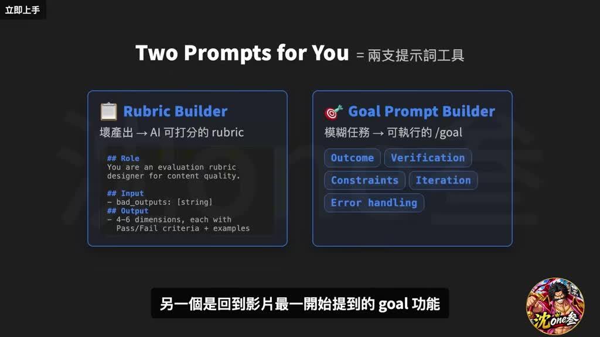

**重點：** 講者準備兩個提示詞：Rubric Builder 把過去 AI 的壞產出收斂成可打分的 rubric；Goal Prompt Builder 把模糊任務改寫成含完成標準、驗證方式、限制條件與卡住回報方式的 goal 提示詞。內容在影片資訊欄，影片本身未呈現全文。

所以我準備了兩個提示詞，第一個提示詞可以幫助你把過去AI的壞產出，收斂成AI評審，可以拿來打分的rubric，另一個是回到影片最一開始提到的/goal 功能，這個提示詞幫你擺一個模糊任務，改寫成AI可以長時間執行的goal 提示詞，包含完成標準，驗證方式，限制條件，可以動什麼，不能動什麼，以及卡住時要怎麼回報，有需要的朋友可以在影片下方資訊欄檢視完整文章。

### 投影片 36：小練習：用 30 分鐘跑完六步驟（15:31–15:55）

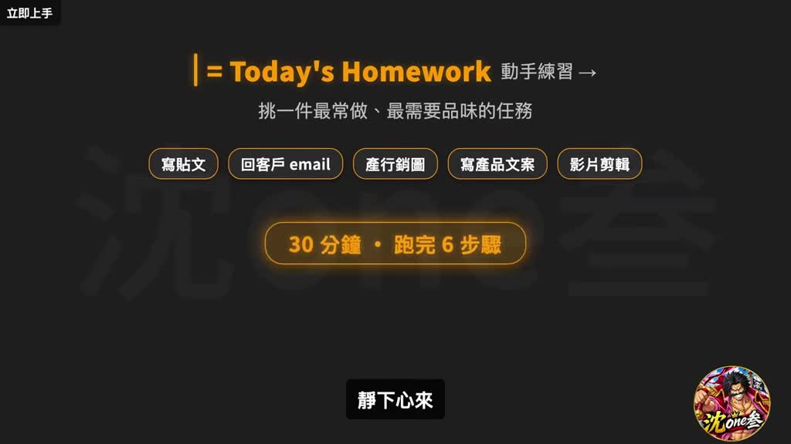

**重點：** 挑一件你最常做、又最需要個人品味的任務（貼文、客戶 email、行銷圖、產品文案、影片剪輯），花 30 分鐘走完六個步驟，看能否讓 AI 的產出更穩定、更貼近預期。

還有領取提示詞，看完這支影片後，我給你的小練習是，挑一件你最常做，又最需要你個人品味的任務，可能是寫貼文，回客戶email，做行銷圖，寫產品文案，又或者是影片剪輯，靜下心來，花30分鐘去跑以上6個步驟，試試看能不能讓AI的產出更穩定，更貼近你的預期，那以上就是今天的內容，各位喜歡的話，記得幫我按贊追蹤加分享。

## 已知轉錄錯誤

| 時間 | 聽成 | 應為 |
|---|---|---|
| 全片 | Go／go | /goal（投影片標題為 /goal，已依投影片改） |
| 全片 | Cloud / Cloud Code | Claude / Claude Code |
| 04:14 | 沒什麼大災問 | 沒什麼大學問（推測） |
| 09:26 | 創意月籤 | 創意躍遷（推測，字幕畫面出現「躍遷」意涵） |
| 06:46 | 偏向直化的工作 | 偏向主觀／質化的工作（推測，投影片為「質化」） |
| 07:11 | 滿滿的機油味 | 滿滿的 AI 味（推測） |
| 07:46 | 兼具 | 間距（推測，依上下文與投影片） |
| 11:03 | AI採購的地雷 | AI 踩的地雷（推測） |
| 12:03 | 歷史不是 | 第四步是（依投影片 Step 4/6） |
| 09:19 | 反骨復生 | 反骨附身（推測，投影片為「梵谷附身」類比） |

## 補充資料連結

- 補充資料檔：[supplement.md](supplement.md)（與本報告同資料夾；內容已收錄於上方〈補充資料〉）
- 思維導圖：[mindmap.png](mindmap.png)、文字大綱：[mindmap.md](mindmap.md)（與本報告同資料夾）
