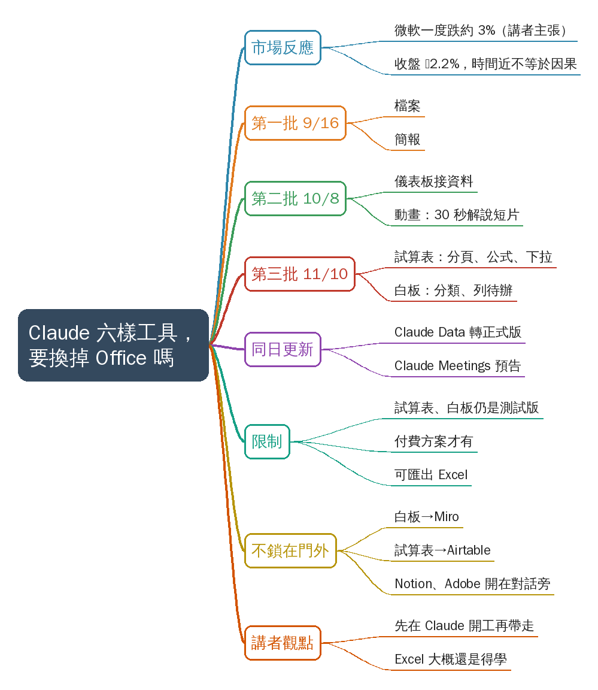
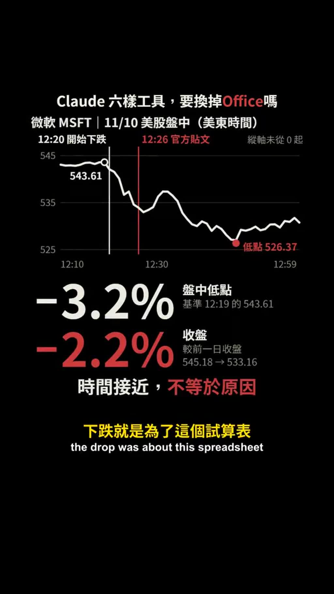
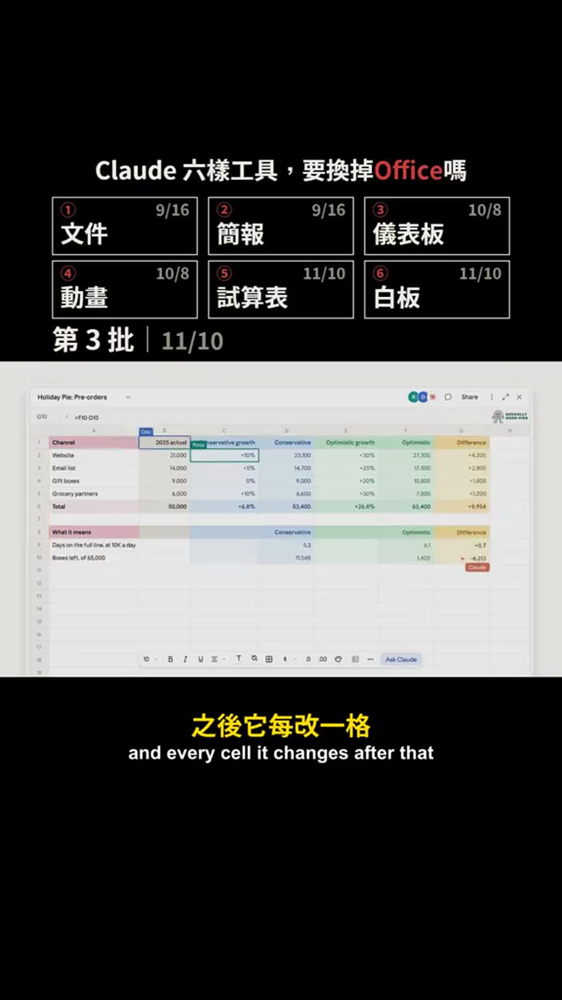
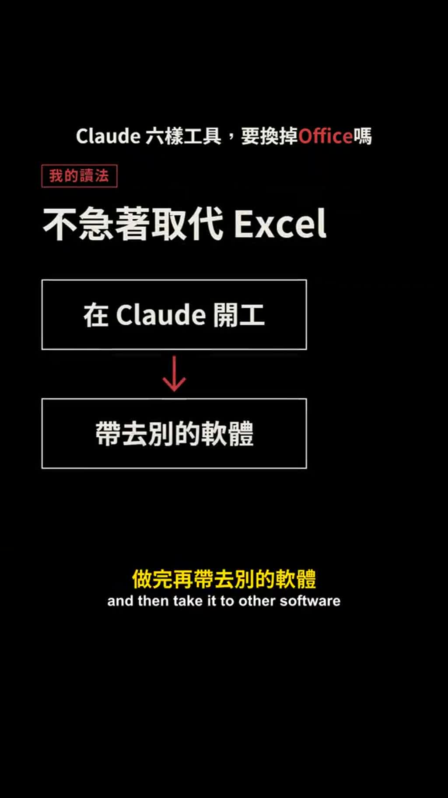

# Claude 推出試算表與白板：Anthropic 六批工具一次看

- 來源：https://vt.tiktok.com/ZSpm6wBFV/
- 平台 / 上傳者：TikTok / fox8899
- 長度：02:13 (133.2s)
- 逐字稿來源：whisper (groq)
- 更新日期：2026-11-11
- **關鍵字：** #claudecode #Claude Sheets #Claude Whiteboards #Anthropic #試算表 #白板 #Excel #微軟股價 #Claude Data #Claude Meetings

## 摘要與名詞說明

**一句話重點**：講者「狐說八道」（Fox）整理 Anthropic 在 11 月 10 日推出 Claude 試算表（Sheets）與白板（Whiteboards）的消息：微軟股價同日下跌被連結成「Excel 完了」，但講者認為 Anthropic 並非急著取代 Excel，而是想讓人先在 Claude 裡開工、再帶去別的軟體（講者主張，未查證）。

- 來源：TikTok 短影音，上傳者 `fox8899`（畫面頻道名「狐說八道」），約 2 分 13 秒。
- 逐字稿：Groq Whisper 轉錄（自動偵測中文），依畫面字幕校正多處產品名與公司名（見下）。
- 領域：`AI`。使用者給的「claudecode」已存為關鍵字；本片談 Claude 的文件／簡報／試算表等產品，不是以 Claude Code 為主角，所以沒有歸入 `AI/claude-code`。

## 重點表

| 時間 | 重點 |
|---|---|
| 00:00 | Claude 宣布試算表與白板那天中午，微軟股價半小時內一度跌約 3%，X 上有人喊「Excel 完了」；但 Anthropic 公告自己寫試算表目前只有簡單功能；微軟官方貼文前幾分鐘就開始跌、收盤跌 2.2%，時間接近不等於原因 |
| 00:25 | 第一批（9/16）：檔案與簡報——講需求給 Claude，它交出檔案或投影片，你再接手修改 |
| 00:37 | 第二批（10/8）：儀表板與動畫——接公司資料、白話提問做圖表且隨資料更新；動畫把報告變成 30 秒解說短片 |
| 00:48 | 第三批（11/10）：試算表（有分頁、公式、下拉選單，改格會框出）與白板（開會貼想法，Claude 分類並列待辦） |
| 01:07 | 同日：儀表板改名 Claude Data 並由測試版轉正式版；Claude Meetings 僅預告（讓 Claude 加入線上會議做筆記） |
| 01:16 | 六樣聽起來像要換掉 Office，但試算表與白板仍是測試版、付費方案才用得到；公告寫需要完整功能可匯出 Excel 或用 Claude for Excel |
| 01:32 | 不把別的軟體關在門外：白板可帶去 Miro、試算表可帶去 Airtable；Notion、Adobe 等可整個開在 Claude 對話旁 |
| 01:47 | 講者讀法：Anthropic 不急著換掉 Excel；熱門留言說拒學 Excel 終於有回報，講者認為 Excel 還是得學；問觀眾會先教 AI 哪一樣 |

## 名詞與縮寫

- **Claude Sheets／Whiteboards**：Claude 的試算表／白板（11/10，測試版、付費方案；講者主張，未查證）。
- 六樣工具（畫面代號）：文件 Claude Docs、簡報 Claude Slides、儀表板 Claude Dashboards→改名 Claude Data、動畫 Claude Motion、試算表 Claude Sheets、白板 Claude Whiteboards；預告 Claude Meetings（S3）。
- **Claude for Excel**：公告原文寫的在 Excel 內使用 Claude 的方式（S1）。
- **Miro、Lucid**：白板軟體；**Airtable、Asana、monday.com、Smartsheet**：試算表／協作工具（S2）。

## 轉錄校正備註

- 依畫面字幕修正：CLAUDE／Cloud／CLAU→Claude、Entropic→Anthropic、Nexx→X、Mirror→Miro、CLAUDATA→Claude Data、CLAUMeetings→Claude Meetings、儀表版→儀表板、代辦→待辦；AI 的「他」改「它」。
- 原稿 01:01 一行混了兩句，依畫面字幕拆成 01:01 與 01:07 兩行。明細見 `meta.json.known_asr_errors`。
- 未去除語助詞（非講座類影片）。

## 備註

- 所有日期、產品功能、股價數字都是講者或影片自製圖表的主張，未經查證（見補充資料 S4）。
- 「微軟下跌與試算表無關／有關」影片只說無人能證明，不是結論。

## 補充資料（影片未呈現的資訊）


### S1｜畫面遺漏：Anthropic 公告原文（Claude Sheets）
- 來源：影片畫面（標「Anthropic 官方公告 2026-11-10」，01:27–01:31；也出現在 00:11–00:15 的前半句）；取得日期：2026-11-11；取得方式：從放大截圖抄錄
- 為何需要補充：講者只口述摘要；畫面是公告英文原文；對應 `slide_01`、`slide_06`
**原文（逐字）**
```
Claude Sheets
（中略）
adding more. When you need the full functionality of Excel, you can export your file to .xlsx or CSV, or use Claude for Excel. You can also continue working in
```
（畫面以紅底標出 "When you need … Claude for Excel." 一句；`（中略）` 為畫面原有；末句在畫面中被截斷。）
00:11–00:14 另露出較前面的一句（畫面以紅底標出）：
```
For now, sheets have simple spreadsheet functionality, but we are working on adding more.
```
**Claude 的對照分析**
- 與影片一致：「目前只有簡單的試算表功能」；「需要完整功能可匯出 Excel 或直接在 Excel 裡用 Claude」。
- 畫面直接寫明（影片沒唸的）：匯出格式為 .xlsx 或 CSV；Excel 內的用法名稱為「Claude for Excel」；公告還有一句 "You can also continue working in …"，後面被截斷，內容不明。
**備註**
- 公告為畫面節錄，未查證原網頁；標註日期 2026-11-10。

### S2｜畫面遺漏：「做完可以帶去」與同日整合工具清單
- 來源：影片畫面（01:35–01:41 及 01:41–01:46）；取得日期：2026-11-11；取得方式：放大截圖抄錄
- 為何需要補充：講者只舉 Miro、Airtable、Notion、Adobe；畫面列了更多；對應 `slide_07`
**原文（逐字）**
```
做完可以帶去
白板 →　　　Miro、Lucid
試算表 →　　Airtable、Asana
　　　　　　monday.com、Smartsheet

11/10 另一項更新
Notion、Adobe、Atlassian、Box
整個開在對話旁邊
```
**Claude 的對照分析**
- 與影片一致：白板→Miro；試算表→Airtable；Notion、Adobe 可整個開在 Claude 對話旁。
- 畫面直接寫明（影片沒唸的）：Lucid；Asana、monday.com、Smartsheet；Atlassian、Box。
**備註**
- 這張清單是影片製作者的整理，不一定等於官方公告的完整清單，未查證。

### S3｜畫面遺漏：六樣工具對照表
- 來源：影片畫面（00:26 起逐格出現，01:07–01:16 完整版）；取得日期：2026-11-11；取得方式：放大截圖抄錄
- 為何需要補充：講者口述批次與日期，畫面把英文產品名與日期放在同一張表；對應 `slide_02`～`slide_05`
**原文（逐字）**
```
① 文件　Claude Docs　　　　　　9/16
② 簡報　Claude Slides　　　　　9/16
③ 儀表板　Claude Data　　　　　10/8　［正式版］（改名前畫面小字為 Claude Dashboards）
④ 動畫　Claude Motion　　　　　10/8
⑤ 試算表　Claude Sheets　　　　11/10
⑥ 白板　Claude Whiteboards　　　11/10
［預告］Claude Meetings　　　　尚未推出
（畫面標題：Claude 六樣工具，要換掉 Office 嗎；第 1 批 9/16、第 2 批 10/8、第 3 批 11/10；後段出現「測試版・付費方案」紅標貼在試算表／白板，以及「6 樣｜55 天」）
```
**Claude 的對照分析**
- 與影片一致：三批的日期與內容、儀表板改名 Claude Data 並轉正式版、Claude Meetings 為預告。
- 畫面直接寫明（影片沒唸的）：各工具的英文名稱；「文件」畫面用 Claude Docs（講者口述為「檔案」）。
**備註**
- 全部名稱與日期為影片主張，未查證。

### S4｜畫面遺漏：微軟股價圖與社群引文
- 來源：影片畫面（00:03–00:24 股價圖；00:08 X 貼文；01:52–02:00 熱門留言）；取得日期：2026-11-11；取得方式：放大截圖抄錄
- 為何需要補充：講者口述「半小時內一度跌約 3%」「收盤跌 2.2%」；畫面給出時間與價格；對應 `slide_01`、`slide_08`
**原文（逐字）**
```
微軟 MSFT｜11/10 美股盤中（美東時間）
12:20 開始下跌　　12:26 官方貼文　　縱軸未從 0 起
543.61（12:19 基準）　　低點 526.37
−3.2%　盤中低點　基準 12:19 的 543.61
−2.2%　收盤　較前一日收盤 545.18 → 533.16
時間接近，不等於原因
```
```
X 上的說法　@alex_prompter
RIP Excel
```
```
熱門留言　@0x0SojalSec
All those years of
refusing to learn Excel,
Word and PowerPoint
is about to pay off.
```
**Claude 的對照分析**
- 與影片一致：一度跌約 3%（畫面 −3.2%）、收盤 −2.2%、微軟在官方貼文前就開始跌（畫面 12:20 開始下跌、12:26 官方貼文）。
- 畫面直接寫明（影片沒唸的）：具體價格與時間；X 貼文帳號與「RIP Excel」；留言帳號與英文原句。
**備註**
- 股價圖為影片製作者繪製，來源與資料未註明；數字、帳號與引文皆未查證。縱軸未從 0 起，視覺上跌幅會被放大（畫面自己有標註）。

## 思維導圖



- 原圖：[mindmap.png](mindmap.png)；文字大綱：[mindmap.md](mindmap.md)（與本報告同資料夾）

## 圖文對照（畫面 + 逐字稿）

### 投影片 1：開場：Claude 宣布試算表與白板，微軟股價下跌（00:00–00:25）



**重點：** 講者說 Claude 宣布推出試算表和白板的那個中午，微軟股價半小時內一度跌約 3%，X 上有人喊「Excel 完了」；但 Anthropic 公告自己寫明試算表目前只有簡單功能，微軟在官方貼文前幾分鐘就開始跌、收盤跌 2.2%，沒有人能證明下跌是因為這個試算表（畫面圖表為講者／影片自製，數字未查證）。

**標籤：** #微軟股價 #RIP Excel

AI助理Claude宣佈推出試算表和白板的那個中午，做Excel的微軟股價在半小時內一度跌了大約3%，X上不少人把這兩件事連在一起喊Excel完了，可是做出Claude的公司Anthropic在公告裡自己寫了，這個試算表目前只有簡單的功能，微軟那天是在官方貼文發出前幾分鐘就開始跌的，收盤跌了2.2%，兩件事時間很近，但沒有人能證明下跌就是為了這個試算表。

### 投影片 2：第一批（9/16）：檔案與簡報（00:25–00:37）


**重點：** 試算表和白板是 Anthropic 55 天裡推出的第三批工具。第一批在 9 月 16 日，是檔案和簡報：把需求講給 Claude 聽，它直接交出一份檔案或一套投影片，你再接手修改（講者主張，未查證）。

**標籤：** #檔案 #簡報 #9/16

試算表和白板已經是Anthropic 55天裡推出的第三批工具，第一批在9月16日是檔案和簡報，你把需求講給Claude聽，它直接交出一份檔案或一套投影片，你再接手修改。

### 投影片 3：第二批（10/8）：儀表板與動畫（00:37–00:48）


**重點：** 第二批在 10 月 8 日，是儀表板和動畫。儀表板接上公司資料，用白話問一個問題，它就把圖表做好，資料更新圖表也跟著更新；動畫則把一份報告變成 30 秒的解說短片（講者主張，未查證）。

**標籤：** #儀表板 #動畫 #10/8

第二批在10月8日是儀表板和動畫，儀表板接上公司的資料，你用白話問一個問題，它把圖表做好，資料更新圖表也跟著更新，動畫則是把一份報告變成30秒的解說短片。

### 投影片 4：第三批（11/10）：試算表與白板（00:48–01:07）



**重點：** 第三批就是 11 月 10 日的試算表和白板。說要一份招募預算，它交出一張有分頁、有公式、有下拉選單的表，每改一格都會把那一格框出來；白板給開會用，大家貼上想法，Claude 幫忙分類並替每個人列出待辦事項（講者主張，未查證）。

**標籤：** #試算表 #白板 #11/10

第三批就是這一次11月10日的試算表和白板，你說要一份招募預算，它交出一張有分頁、有公式、有下拉選單的表，之後它每改一格都會把那一格框出來，白板是給開會用的，大家把想法貼上去Claude幫忙分類再替每個人列出待辦事項。

### 投影片 5：同日更新：Claude Data 正式版、Claude Meetings 預告（01:07–01:16）


**重點：** 同一天，第二批的儀表板改名叫 Claude Data，從測試版變成正式版；另有一項只是預告的 Claude Meetings，讓 Claude 加入線上會議做筆記（講者主張，未查證）。

**標籤：** #Claude Data #Claude Meetings

同一天，第二批的儀表板改名叫Claude Data，從測試版變成正式版，還有一樣只是預告，叫Claude Meetings，讓Claude加入線上會議做筆記。

### 投影片 6：六樣數下來：但都還是測試版、付費才有（01:16–01:32）


**重點：** 檔案、簡報、儀表板、動畫、試算表、白板六樣數下來，聽起來像要把 Office 整套換掉。但試算表和白板都還是測試版，付費方案才用得到；公告也寫需要完整功能時可匯出成 Excel 檔，或直接在 Excel 裡用 Claude（畫面為公告原文，見補充資料 S1）。

**標籤：** #測試版 #付費方案 #匯出 Excel

檔案、簡報、儀表板、動畫、試算表、白板，六樣數下來聽起來像要把Office整套換掉，可是試算表和白板都還是測試版，付費方案才用得到，公告也寫了，需要完整功能的時候可以匯出成Excel檔，或者直接在Excel裡用Claude。

### 投影片 7：不把別的軟體關在門外（01:32–01:47）


**重點：** 白板做完可以帶去 Miro 這類白板軟體，試算表可以帶去 Airtable 接著做；同一天另一項更新，Notion、Adobe 等工具可以整個開在 Claude 的對話旁邊，自己改或叫 Claude 幫你改（畫面標示支援的工具清單，見補充資料 S2）。

**標籤：** #Miro #Airtable #Notion #Adobe

Anthropic也沒有把別的軟體關在門外，白板做完可以帶去Miro這類白板軟體，試算表可以帶去Airtable接著做，同一天還有另一項更新，Notion、Adobe這些工具可以整個開在Claude的對話旁邊，你自己動手改，或者叫Claude幫你改。

### 投影片 8：講者觀點：不急著取代 Excel（01:47–02:13）



**重點：** 講者的讀法是 Anthropic 沒有急著換掉 Excel，它要的是你先在 Claude 裡開工、做完再帶去別的軟體。官方貼文熱門留言說「這些年拒絕學 Excel、Word、PowerPoint 終於要有回報了」，講者認為 Excel 大概還是得學；最後問觀眾：檔案、簡報、試算表只能先教 AI 一樣，會先教哪一樣？

**標籤：** #不急著取代 Excel #熱門留言

所以我的讀法是，Anthropic沒有急著換掉Excel，它要的是你先在Claude裡開工，做完再帶去別的軟體，官方貼文底下有一則熱門留言寫著，這些年一直拒絕學Excel、Word和PowerPoint，終於要有回報了，看完公告，Excel大概還是得學，如果檔案、簡報、試算表只能先教一樣給AI，你會先教哪一樣？我是Fox，喜歡這支影片的話，請追蹤、按讚、分享。

## 已知轉錄錯誤

| 時間 | 聽成 | 應為 |
|---|---|---|
| 全片 | CLAUDE／Cloud／CLAU | Claude（畫面字幕；「在 Excel 裡用 Cloud」「在 Cloud 裡開工」皆指 Claude） |
| 00:10 | Entropic／Entropic55天 | Anthropic／Anthropic 55 天（畫面「Anthropic 官方公告」） |
| 00:07 | Nexx上 | X 上（畫面「X 上的說法」） |
| 01:08 | CLAUDATA,從測試版 | Claude Data，從測試版（畫面「第二批的儀表板改名叫 Claude Data」） |
| 01:11 | CLAUMeetings,讓CLAU加入 | Claude Meetings，讓 Claude 加入（畫面「Claude Meetings」預告） |
| 01:32 | Mirror | Miro（畫面「白板 → Miro、Lucid」） |
| 01:07 | （原稿 01:01 一行含兩句） | 把「同一天，第二批的儀表板改名…」拆成獨立一行；01:07 依畫面字幕「同一天」出現的時間（字幕與講話同步，時間仍屬估計） |
| 全片 | 儀表版／代辦事項 | 儀表板／待辦事項（畫面字幕） |

## 補充資料連結

- 補充資料檔：[supplement.md](supplement.md)（與本報告同資料夾；內容已收錄於上方〈補充資料〉）
- 思維導圖：[mindmap.png](mindmap.png)、文字大綱：[mindmap.md](mindmap.md)（與本報告同資料夾）
