# 普通人怎麼玩grokbot教程

- 來源：https://vm.tiktok.com/ZSpo5aGKk/
- 平台 / 上傳者：TikTok / zekechen2026
- 長度：10:07 (607.3s)
- 逐字稿來源：whisper (groq)
- 更新日期：2026-11-21
- **關鍵字：** #Grok Bot #GrokBot #一人公司 #OPC #AI Agent #遠端執行 #Claude Code #Codex #Bot模板

## 摘要與名詞說明

**一句話重點**：講者（zekechen2026）介紹 Grok Bot：每位使用者有一台遠端電腦，可用「私人助理」當總入口、再由它建立與分派多位 AI 員工（研究、策劃、編導、影片等），也能把 Claude Code／Codex 當員工用，示範以讀書短影片流程組成「一人公司」雛形（日活、增速、規格與成效皆為講者所述，未查證）。

| 時間 | 重點 |
|---|---|
| 00:00 | 開場：Grok Bot 爆紅，日活破 60 萬（講者轉述） |
| 00:14 | 痛點一：Claude 的程式設計能力強 |
| 00:30 | 痛點二：OPC（一人公司）需要整體解決方案 |
| 00:53 | 痛點三：任務在遠端執行，不用替筆電綁安全帶 |
| 01:28 | 遠端電腦規格：8 核、16G、128G、Linux |
| 01:38 | 私人助理＝主入口＝一號員工 |
| 02:19 | 可接 MCP／插件：郵箱、行事曆、Notion、Atlassian |
| 03:07 | 新增核心機器人，Bot 模板內建提示較完整 |
| 03:54 | 示範：組建讀書影片團隊 |
| 04:33 | 四個角色（爆款研究、策劃、編導、覆盤）＋影片編劇 |
| 04:58 | 把 Claude Code／Codex 當員工 |
| 05:23 | 運作：先出 60 秒試看以省 token |
| 06:05 | 迭代：向專案 PM 下需求，由它往下傳達 |
| 07:23 | 三版對比、七位評委打分（AI 偏愛自己那版） |
| 08:25 | 前期產量少，不必整條流水線 |
| 08:50 | 分組：右鍵「移動到」 |
| 09:16 | 一人公司雛形；結語 |

## 領域判斷

- 使用者指定 `AI/GrokBot`（新增子領域）。

## 名詞與縮寫

- **OPC**：One Person Company，一人公司。
- **Bot 模板**：他人建好、內建提示的機器人模板。
- **MCP／插件**：連接外部工具與服務的機制。

## 轉錄校正備註

- 逐字稿為 Groq Whisper（中文，已轉繁體）；畫面有燒入簡體＋英文字幕，可對照。
- 確定（畫面字幕佐證）：Glock／Globot／Grobot／Growth Bot→Grok Bot、Cloud→Claude、Node, Atlas→Notion, Atlassian、指令碼→腳本、元件→組件、連線→連接（OpenCC 誤轉）。
- 推測：一號元→一號員工、研究報款→研究爆款、三板→三版、中版→終版、爆破了→突破了、MOD模板→Bot 模板。
- 使用者確認：「這個叫 AppBot」→「這個叫 Eggbot」、「Codex 跟那個 Cop」→「Codex 跟那個 Claude Code」；「加七個員工進行打分」依使用者回覆（as your word）採用建議措辭「再加七個評委，對這三版做一個打分」。
- 第二輪：全文 312 行已逐行重讀（修 38 處）。

## 思維導圖

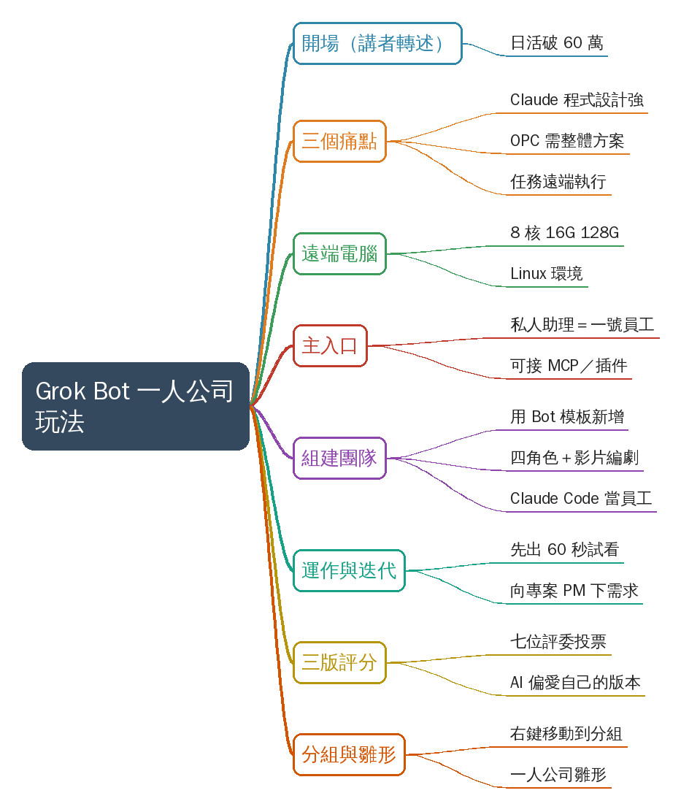

- 原圖：[mindmap.png](mindmap.png)；文字大綱：[mindmap.md](mindmap.md)（與本報告同資料夾）

## 圖文對照（畫面 + 逐字稿）

### 主題 1：開場：Grok Bot 爆紅（00:00–00:14）

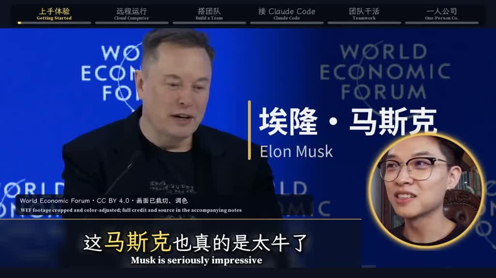

**重點：** 講者（zekechen2026）說 Grok Bot 要趕緊用起來：產品推出才不久，日活已突破 60 萬，馬斯克自己說增速前所未見（畫面為達沃斯世界經濟論壇的馬斯克談話，字幕「現在是六倍的增速」）（以上為講者轉述，未查證）。

**標籤：** #Grok Bot #馬斯克 #日活

家人們啊，這個Grok Bot趕緊用起來，這馬斯克也真的是太牛了，這出來才多少時間的一個產品，目前的日活已經突破了 60 萬了，馬斯克他自己都說，這個增速是前所未見的。

### 主題 2：痛點一：Claude 的程式設計能力強（00:14–00:30）

**重點：** 講者說 Grok Bot 主要解決幾個痛點。第一個是想用 Claude 的原因：它的程式設計能力與作品效果比 Codex 好太多（講者主張）。

**標籤：** #Claude #Codex #程式設計

對於我來講，Grok Bot主要解決了什麼問題呢，我覺得很多人都會有幾個痛點，第一個一直想要用的原因是，Claude它的程式設計能力真的是太強了，跟Codex比，它的程式設計能力，真的包括它的作品的，出來的效果真的是好太多了。

### 主題 3：痛點二：OPC（一人公司）的解決方案（00:30–00:53）

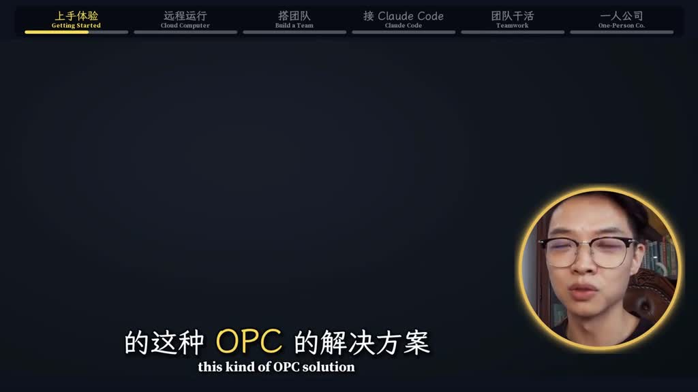

**重點：** 第二個是如果玩 OPC（一人公司），她認為現階段 Grok Bot 能幫你做到；以往的 Codex 和 Claude 沒辦法提供 OPC 的整體解決方案，很多工作流要自己搭，而 Grok Bot 解決了這問題（講者主張）。

**標籤：** #OPC #一人公司 #工作流

第二個是你如果玩OPC，我覺得這個現階段，Grok Bot真的是能夠幫你做到，的一個產品了，我們以往用的這種，Codex跟Claude，其實沒有辦法幫你做到，的這種OPC的解決方案，而這裡有很多，你要自己搭建的工作流，但是對於Grok Bot來講，真的是幫你解決了這個問題。

### 主題 4：痛點三：不用再替筆電綁安全帶，任務在遠端執行（00:53–01:28）

**重點：** 第三個是網路上常看到有人在停車空間把筆電轉過來、綁安全帶，讓 Codex／Claude Code 繼續跑；有了 Grok Bot 就不需要，因為它提供遠端服務，任務可以脫離本機、電腦關機也能執行。

**標籤：** #遠端執行 #電腦關機 #安全帶

第三個是在網路上，經常會看到很多人，給我們的膝上型電腦綁一個安全帶，在停車的空間，你就可以把筆記本轉過來，然後我們看Codex，或者是Code，給我們展示的結果，那現在有Grok Bot之後，其實你完全不需要做這種操作，Grok Bot真的是完全幫你解決了，電腦關機的一個問題，因為它裡面會有一臺遠端的服務，給到使用者去使用，這也是為什麼我們說，我們的任務完全可以做一個遠端，脫離開你本機去執行的一個。

### 主題 5：遠端伺服器規格（01:28–01:38）

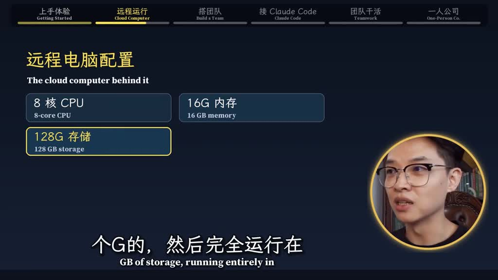

**重點：** 講者說 Grok Bot 給每個使用者一台遠端電腦：8 核 CPU、16G 記憶體、128G 儲存空間，完全運行在 Linux 環境（講者所述，未查證）。

**標籤：** #8核 #16G #Linux

它給我們的遠端伺服器的配置是怎麼樣的，8核CPU，記憶體是16G，儲存空間是128個G的，然後完全執行在Linux的環境。

### 主題 6：主入口：你的私人助理就是一號員工（01:38–02:19）

**重點：** 接著從 0 到 1 介紹。Grok Bot 內有一個「新私人助理」，可理解成所有機器人的總入口、你的一號員工：要下達任何任務都跟這位員工對話，在組織架構裡它是直接向你彙報的人，其他業務部門再依分工與它對話。

**標籤：** #私人助理 #主入口 #組織架構

那至於接下來怎麼去使用呢，我會從0到1跟大家去介紹，這裡有一個Grok Bot，它是新私人助理，這個助理呢，我們可以理解成是一個，總的你的機器人的入口，也就是你的一號員工，你可以想象成你，如果要下發任何的任務，你都可以跟這位員工去對話，也就是說，在你的組織架構裡面，它就是直接跟你對話，彙報的那個，然後你可以針對於，你想做的其他的業務，你按照這個劃分，所有的部門，它跟這個主入口的這個員工，去做一個對話，那Grok Bot進去之後，它能做什麼。

### 主題 7：功能：像 Codex／Claude Code 一樣可接 MCP 與插件（02:19–03:07）

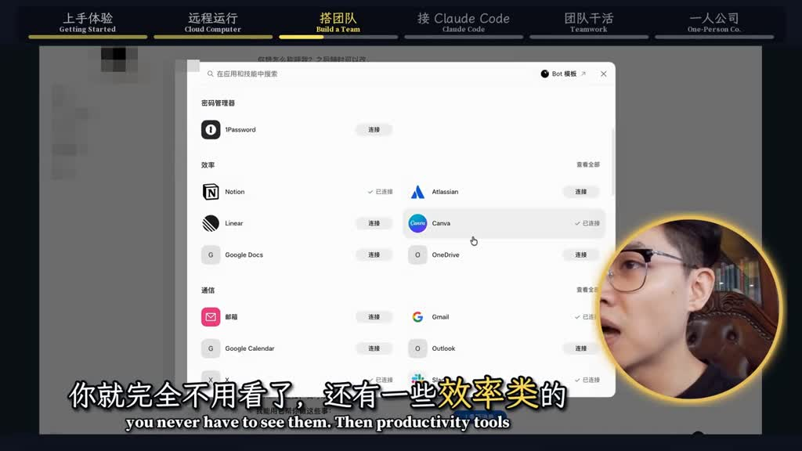

**重點：** Grok Bot 與 Codex、Claude Code 有很多相似處：可用 MCP 或插件連接外部組件，例如 Google 郵箱、Outlook 郵箱、行事曆天然就支援；可請它把重要郵件整理彙報、直接忽略垃圾郵件；效率類還可連 Notion、Atlassian 等專案管理工具。

**標籤：** #MCP #插件 #郵箱 #Notion

這裡面其實它有很多，跟我們普通在用的Codex，跟那個Claude Code，其實很多相似，比如說我們有MCP或者是Plugin去連接外面的一些組件比如說我去連接我們的Google郵箱或者是Outlook郵箱它天然就已經支援打通，那還有一些Calendar，這些是一些與私人助理的一些工作，比如說你自己不想去看郵件，你就可以跟他說，你有哪些個比較偏向重要的一些郵件，幫你整理過來，然後給你彙報，如果不重要的郵件，你直接去忽略掉，那些垃圾的郵件，你就完全不用看，然後還有一些，效率類的，比如說Notion, Atlassian，偏向於專案管理的，這種彙報這一類的，如果有需要的話，你後面專案多起來的時候，你就可以把它連接。

### 主題 8：第一步：新增核心機器人，用 Bot 模板更完整（03:07–03:54）

**重點：** 她認為先要新增一個核心機器人。這裡有 Bot 模板，別人已把較完善的模板建好；自己新增也可以，但模板內建了非常多提示，建出來的機器人功能更完整。新增後主入口就有了，之後要增加的其他員工分組都交給它統一分配。

**標籤：** #Bot模板 #核心機器人 #分配

第一個是，我覺得比較重要的是，我們必須要在這裡去，先新增一個核心的機器人，那在這裡有一個 Bot 模板，就是這裡面有很多人，就已經把這個，比較完善的一個模板，建立好，當然我們自己，也可以去新增這個機器人，但是跟它建立的一個區別，在於在這個Bot 模板裡面，相當於是它已經內建了非常多的提示，然後會把這個機器人建立的，比你更加的功能完善一點，那所以我們這裡先把這個核心的，這個叫Eggbot，這個機器人先新增來，然後這個新增出來之後，其實我這邊就已經會有一個主入，我們這邊的話就可以把後續，我要增加其他員工分組的，全都交由他來去做一個核心的分配。

### 主題 9：示範：組建讀書影片團隊（03:54–04:33）

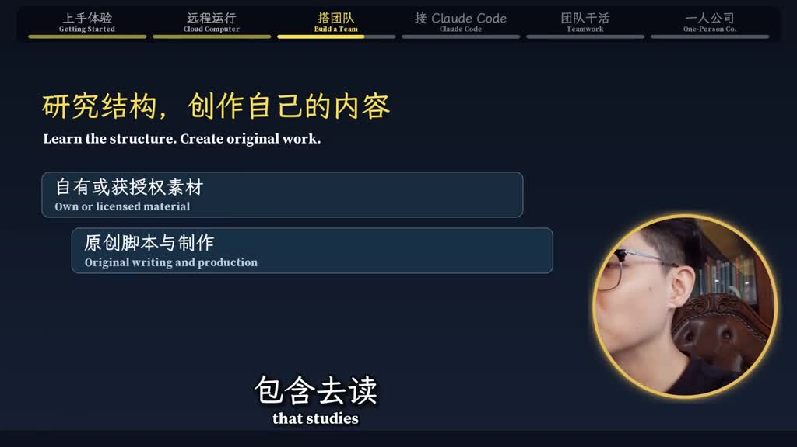

**重點：** 她舉例要做讀書類短影片，就對主入口的 Bot 說：需要組建一支團隊，包含研究熱門讀書影片、拆解影片結構、確認每日短影片資料；Bot 會拆解需要哪幾個步驟與人員、定下角色，確認後再請它把角色建出來。

**標籤：** #讀書影片 #組建團隊 #角色

那假設我現在要去做讀書的一個影片，我以這個為，那這邊的話，我就會去跟我的主入口的，這個 Bot去聊，因為我就跟他說，我需要組建一支團隊，包含去讀書，這一類比較熱門的讀書影片，拆解對應的影片結構，然後確認每日要做的短影片的資料，發布之後，他會幫我去拆解說，這幾個步驟需要哪些個人員，那這樣的話，他就會把這個角色定下，那我現在把這些角色，已經確認了之後，我就跟他說，你Dr.Eggbot，把這個對應的角色給創出來，好。

### 主題 10：四個角色＝四個員工（04:33–04:58）

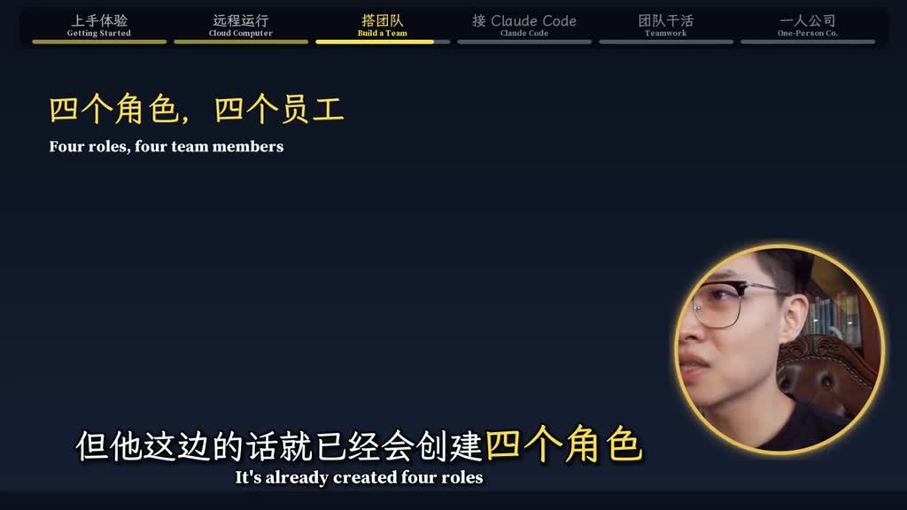

**重點：** 它建了四個角色：負責研究爆款、研究策劃、編導、資料覆盤；她發現沒有人負責做影片，一問才又建了一位影片編劇。

**標籤：** #爆款研究 #策劃 #編導 #覆盤

那他這邊的話，就已經會建立四個角色，分別每個角色幹嘛呢，你相當於擁有了四個員工，第一個員工是負責研究爆款的，第二個員工是研究策劃的，第三個是編導，第四個是資料覆盤的，那我發現他做完之後，沒有一個人是去做影片，我就問他，這邊是誰去生產影片，然後他這邊又給我建立了，影片編劇的一個人。

### 主題 11：也可以把 Claude Code 或 Codex 當成做影片的員工（04:58–05:23）

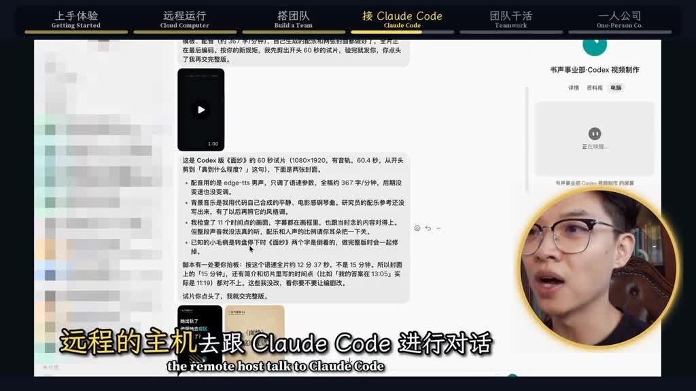

**重點：** 若想用現有的 Codex 或 Claude Code，建立員工時直接說要建哪幾個員工（例如一個用 Claude Code 做影片、另一個用 Codex 做影片），只需和 Claude 對話，它會把意思轉達給 Claude Code。

**標籤：** #Claude Code #Codex #員工

如果說這裡你想要用你現有的比如說Codex或者Claude Code這裡的話你就直接在建立員工的時候你就跟他說我要建立哪幾個員工，一個是用Claude Code去做影片，另外一個是用Codex去做影片，你只需要跟Claude進行對話，Claude就完全會把這個所有你要的意思，跟Claude Code進行後續的傳達。

### 主題 12：讓組織運作：先出一支 60 秒試看（05:23–06:05）

**重點：** 組織搭好後就讓它開始運作：問「今天要發布的影片與腳本是什麼」，秘書會給整體腳本與故事線；因為她先要求做 60 秒的預告試看，可減省後續 token（講者主張），可直接點開觀看。

**標籤：** #試看 #腳本 #token

好等我們把我們的組織一搭建出來之後呢，我們就可以讓這個組織開始運作，好我們今天就問他，我想知道我今天想做的，發布的影片是什麼，腳本是怎樣，你的秘書就會告訴我們，今天要做的是某一個文學作品，那這邊他會告訴我，整體的一個腳本，故事線是怎樣，因為我之前跟他說，你先給我做一個預告片的試看，那他就給我做了一段，60秒的試看的一個影片，因為這樣的話，我們也可以減省一下，我們後續的token，否則你就token浪費的比較多，然後我們這邊是可以直接點開來去觀看，因為我看完之後，因為它是第一版，那可能做出來的東西，是不是很符合你的審美的，我們前期也加了兩個。

### 主題 13：第一版不滿意：用對話下需求，由專案主管往下傳達（06:05–07:23）

**重點：** 第一版可能不符合審美，她又加了兩個（Codex 與另一個）做對比，並提出：語速太慢要加快、參考原作品選相似節奏的背景音。她說只需跟一個專案主管（PM）溝通，需求會被帶給所有員工同時幹活，結果再回傳。

**標籤：** #迭代 #專案PM #需求傳達

一個是Codex跟那個Claude Code，那我這邊的話，我是希望做一個對比的，所以呢，我跟他說，我說因為前面你講的這個整個語速太慢了，需要加快一點，然後另外需要參考一下原作品，選擇一些相似節奏的一個背景音，那他就會把我所有的一個要求，跟你下面所有的員工進行一個溝通，這裡相當於是，他給我傳達到了另外的幹活的人，相當於你只需要跟一個專案主管，或者說叫專案PM去溝通就行了，他就會把所有的需求都帶下去，那這邊的話，他就會讓幾個人同時進行幹活，幹完之後呢，他會把整一個流程的結果都返回給，一個組織協同幫你全部做完，然後這邊的話，我看了一下，因為我們還是剛才說的那個第一版，因為它整體的效果不是很達標，所以我就跟他說，整一個聲音太AI了，然後你要參考一下，原本的一個音樂配圖，以及有一些效果要用remotion，或者說有一些B-roll，這種東西，這種元素的加入，所以他就會把整一個，你要的要求告訴，負責做影片的那幾位員工，這幾個員工，收到這個對應的請求之後，他就會把對應的技能，然後以及這些外掛，都在他們自己遠端的，那個機器上給他安住。

### 主題 14：三版對比與七位評委打分（07:23–08:25）

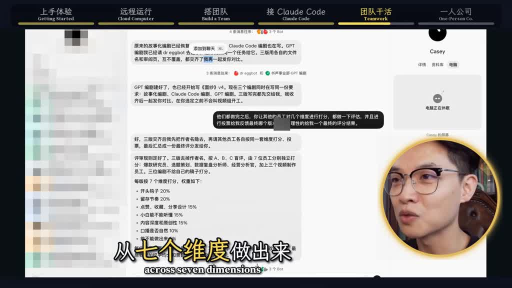

**重點：** 她讓三個 Agent 各做一版，再讓十來個員工中加入七位評委從七個維度（如開頭勾子）打分、投票；有趣的是 AI 說自己做的那版最好，七位評委加權後也選了自己那版；她個人覺得 Claude 做的最好、GPT 做的不如 Grok 的（講者主觀）。

**標籤：** #評分 #七個維度 #主觀審美

我這邊做了一個，比較有意思的探索，因為我讓他們三個agent，做了三版的編輯我建立出了整一個事業部有大概十來個員工那我就讓這些個員工再加七個評委，對這三版做一個打分，他會告訴我說，整體打分從七個維度，做出來，比如說開頭勾子，最終給我一版投票，就很搞笑的一個點，是他告訴你，他自己做的那版，其實是最好的，那這裡的話，其實我個人覺得，是Claude做的是最好的那一版，然後GPT做的那個，真的是我感覺其實還沒有Grok他做的好，理論來講呢，他的模型其實應該是比Grok帶的那個模型，是更加聰明一點的，所以他說七個評委的加權之後，統一的選擇了他自己做的那一版，那其實挺搞笑的，雖然他跟我說，他說在打分的過程中已經完全匿名化了，審美還是要以我們自己主觀的判斷為準，那我覺得最終還是選擇了Claude的那一版。

### 主題 15：終版與產量：前期不必整條流水線（08:25–08:50）

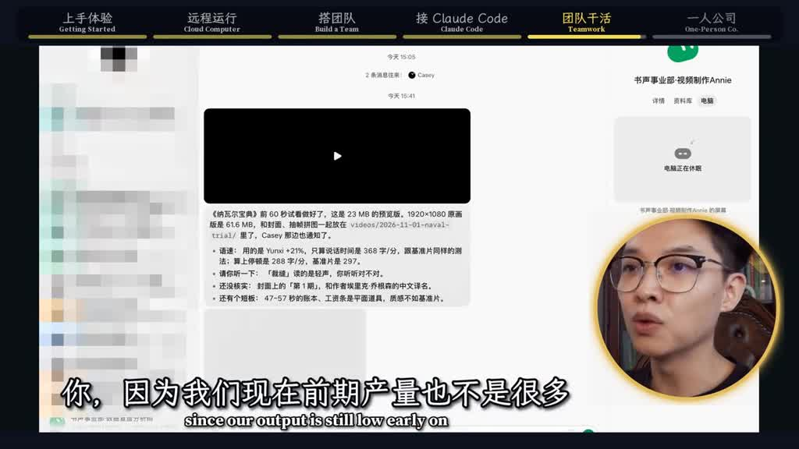

**重點：** 重做完後讓它們再做一分鐘試片，效果仍不夠好就繼續調；拿到終版後，因為前期產量不多，可先自己做，沒必要讓整條流水線都跑起來（講者主張）。

**標籤：** #試片 #產量 #流水線

等到所有都編劇重新做完了之後呢，我就可以讓他們去再去，按照這改完，去做一個一分鐘的試片，我覺得這邊的一些效果，其實還是沒有很好，那我們就繼續往下調，調到最後呢，其實你拿到一個，就是終版了之後，因為我們現在前期，產量也不是很多，完全就可以先由自己去做，沒必要讓它整一個流水線，都直接run起來。

### 主題 16：為大量 Bot 分組：右鍵移動到（08:50–09:16）

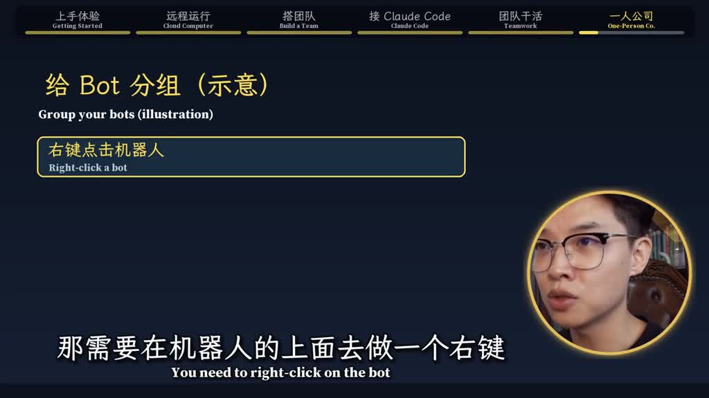

**重點：** 她一次建了很多 Bot，可以人工分組：沒有直接的分組功能，要在機器人上按右鍵、選「移動到」，建立想要的分組並命名，依自己想要的組織形態加入。

**標籤：** #分組 #右鍵 #移動到

這裡還有一個點是，我一次性建立了這麼多bot，其實是可以，人工的對它進行一個分組的，那分組呢，這邊是沒有直接的有一個分組的功能的，你這邊是找不到的，那在哪裡去建立呢，那需要在機器人的上面去做一個右鍵，然後選擇移動到，那這裡可以是建立一個，你想要的一個分組，建立完了之後，你就取自己的名字，然後根據你自己想要的一個組織的形態，你去把它慢慢的加上去就可以。

### 主題 17：一人公司的雛形與結語（09:16–10:07）

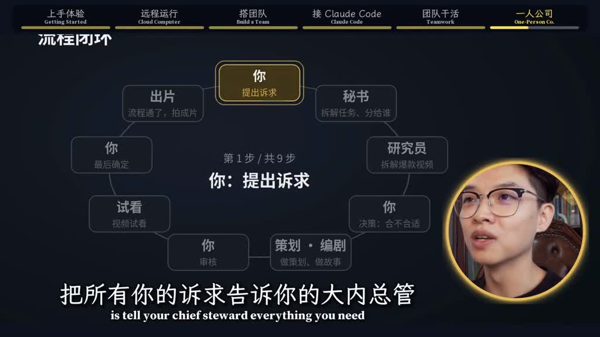

**重點：** 這就是一人公司的雛形：把所有訴求告訴你的大內總管（私人秘書），它會拆解並分派任務——先請研究員拆解爆款影片，秘書可能請你決策是否合適，再往下做策劃、編劇，由你稽核後做影片試看，確定後整體流程就通了；影片結尾邀請在評論區討論（講者主張）。

**標籤：** #一人公司 #流程 #稽核

這就是一個一人公司的一個雛形，相當於是你只要把所有你的訴求，告訴你的大內總管，你的私人秘書，他就會幫你去把所有後續的任務拆解，該分給誰，他會先去告訴研究爆款的研究員，先去做影片的拆解，拆解讓秘書可能會讓你去決策一下，今天這個合不合適，要不要繼續往下，那你就再往下去做策劃，做故事編劇，做完了之後呢，這邊再由你去做一個稽核，完了以後，你可能就繼續往下去做影片的試看，如果得到你最後的確定之後呢，這個整體的流程就通了，今天影片就到這裡，大家如果有任何的疑問呢，可以在評論區留下你的問題點，然後我們做一個更多的討論。

## 已知轉錄錯誤

| 時間 | 聽成 | 應為 |
|---|---|---|
| 全片 | Glock／Globot／Grobot／Growth Bot／Grog | Grok Bot／Grok（畫面字幕「Grok Bot」確認） |
| 全片 | Cloud／GPD | Claude／GPT（畫面字幕「Claude Code」確認 Claude；GPT 為推測） |
| 03:00 | Node, Atlas | Notion, Atlassian（畫面字幕確認） |
| 全片 | 指令碼／元件／連線（OpenCC 誤轉） | 腳本／組件／連接（畫面字幕「连接外面的一些组件」確認） |
| 01:52 | 一號元 | 一號員工（推測） |
| 04:09 | 研究報款 | 研究爆款（推測） |
| 07:29 | 三板的編輯 | 三版的編輯（推測） |
| 08:40 | 中版 | 終版（推測） |
| 00:07 | 爆破了60萬 | 突破了 60 萬（推測） |
| 03:25 | MOD模板／Bot模 | Bot 模板（畫面「Bot 模板」，MOD 為推測） |
| 06:06 | 一個是Codex跟那個Cop | 一個是Codex跟那個 Claude Code（使用者確認） |
| 07:29 | 那我就讓這些個員工加七個員工進行對這三版的做一個打分 | 那我就讓這些個員工再加七個評委，對這三版做一個打分（依使用者回覆「as your word」採用建議措辭） |
| 03:38 | 這個叫AppBot | 這個叫 Eggbot（使用者確認） |

## 補充資料連結

- 思維導圖：[mindmap.png](mindmap.png)、文字大綱：[mindmap.md](mindmap.md)（與本報告同資料夾）
