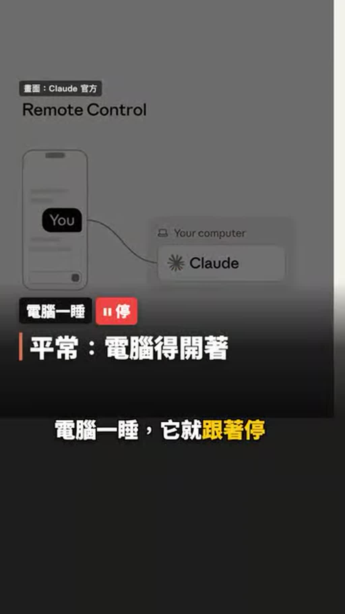
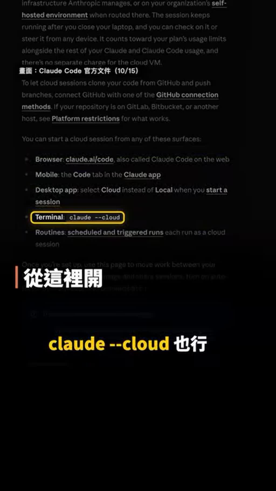
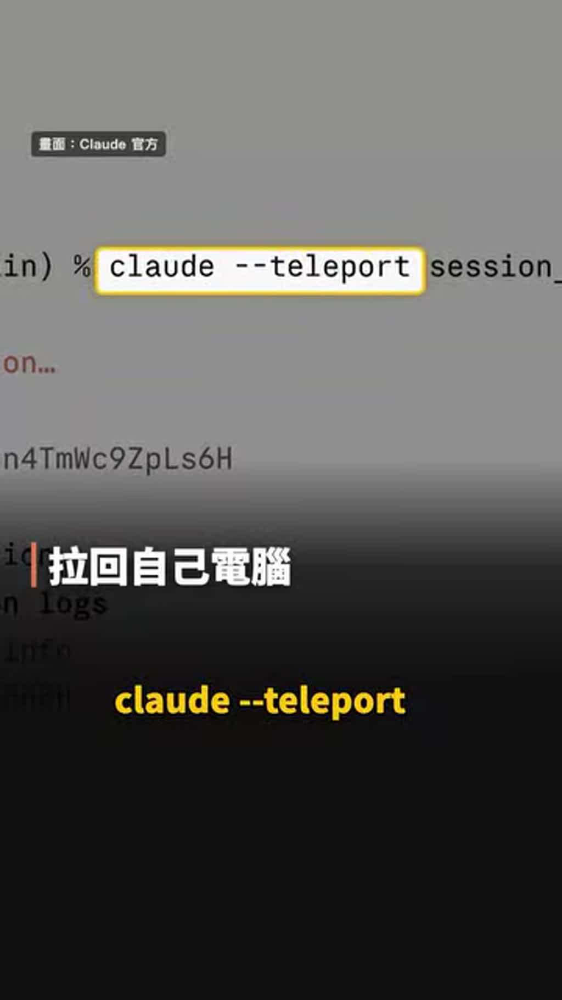

# Claude Code 雲端 session：筆電蓋上也能繼續跑

- 來源：https://www.instagram.com/reel/DeontLSj5Uj/?cplk=MTFkZDN3c3dtY2tmaQ==
- 平台 / 上傳者：Instagram / AI懶人報
- 長度：00:47 (47.1s)
- 逐字稿來源：whisper (groq)
- 更新日期：2026-10-21
- **關鍵字：** #Claude Code #雲端 session #Remote Control #claude --cloud #claude --teleport #GitHub #Create PR #diff #多 session 平行

## 摘要與名詞說明

**一句話重點**：講者介紹 Claude Code 的「雲端 session」——把專案從 GitHub 複製到雲端虛擬機器、用自己的 branch 在背景工作，筆電蓋上也不中斷，並可用手機審查、再 teleport 回本機（以下皆為講者主張，未查證）。

| 時間 | 重點 |
|---|---|
| 00:00 | 開場：筆電蓋起來 Claude 仍在寫，拿起手機它還會問問題 |
| 00:05 | 本機 Claude Code 電腦一睡就停，手機遙控（Remote Control）也要電腦一直開著 |
| 00:12 | 雲端 session：專案從 GitHub 複製到雲端虛擬機器，開自己的 branch；下班前丟大重構，隔天看結果 |
| 00:20 | 網頁、手機 App、桌面 App 都能開；終端機用 `claude --cloud`；第一次先接 GitHub |
| 00:29 | 在手機看 diff、在程式碼旁留言讓它修改，沒問題按 Create PR |
| 00:33 | 想回電腦接著做：終端機 `claude --teleport`，對話與 branch 一起拉回 |
| 00:38 | 可一次開多個 session，各有自己的 branch、互不干擾 |

## 名詞
- **雲端 session**：Claude Code 在雲端虛擬機器執行的工作階段，不依賴本機開機。
- **Remote Control**：用手機遙控本機上的 Claude Code，本機仍須開機。
- **teleport**：`claude --teleport` 把雲端 session 的對話與 branch 拉回本機。

## 轉錄校正備註
- 轉錄來源 Whisper（Groq），語言 zh（影片為中文）。
- 「中端機」→「終端機」（已加入 claude-code 詞典）；「DIF」→ diff；兩處指令依畫面字幕校正為 `claude --cloud`、`claude --teleport`（逐字稿原文聽成「CLAUDE、CLAUDE」「CLAUDE://teleport」）。
- 片尾 00:43–00:44 為頻道「AI 懶人報」宣傳。

## 圖文對照（畫面 + 逐字稿）

### 投影片 1：本機 vs 雲端 session（00:00–00:20）

**重點：** 本機 Claude Code 電腦睡著就停、手機遙控也要電腦開著；雲端 session 把 GitHub 專案複製到雲端虛擬機器，開自己的 branch 做事，可下班前丟大重構、隔天看結果。

**標籤：** #Remote Control #雲端虛擬機器 #branch

筆電蓋起來，Claude 還在幫你寫，拿起手機，欸？他還在跑，還跑來問你問題，這是Claude Code的雲端 session，平常Claude Code跑在你自己的電腦上，電腦一睡，它就跟著停，就算用手機遙控，電腦也得一直開著，雲端 session不一樣，它把你的專案從GitHub複製到雲端一臺虛擬機器，開一條自己的Branch做事，下班前丟一個大重構給它，隔天早上起來看結果就好。

### 投影片 2：開啟方式、接 GitHub、手機審查（00:20–00:34）

**重點：** 網頁、手機 App、桌面 App 都能開，終端機用 claude --cloud；第一次先接 GitHub；完成後在手機看 diff、程式碼旁留言讓它改，沒問題按 Create PR。

**標籤：** #claude --cloud #GitHub #diff #Create PR

人在外面突然想到一個點子，也能直接用手機開一個，網頁、手機App、桌面App都能開，終端機打 claude --cloud 也行，第一次，先把GitHub接上，做完在手機上看diff，在程式碼旁邊留個言，它就照著改，沒問題就按Create PR，想回電腦接著做。

### 投影片 3：teleport 拉回電腦與多 session 並行（00:34–00:47）

**重點：** 終端機打 claude --teleport 把對話與 branch 一起拉回本機；可同時開多個雲端 session，各有自己的 branch、互不干擾。

**標籤：** #claude --teleport #多 session

終端機打 claude --teleport，對話跟Branch一起拉回來，最厲害的是，你可以一次開好幾個，每個都有自己的Branch，各跑各的，互不幹擾哦，追蹤AI懶人報，每天帶你看一個值得用的AI工具。

## 已知轉錄錯誤

| 時間 | 聽成 | 應為 |
|---|---|---|
| 00:25 | 中端機打CLAUDE、CLAUDE也行 | 終端機打 claude --cloud 也行（依畫面字幕） |
| 00:34 | 中端機打CLAUDE://teleport | 終端機打 claude --teleport（依畫面字幕） |
| 00:29 | DIF | diff（依畫面字幕） |
| 00:41 | 互不幹擾哦 | 互不干擾（推測：語氣詞／用字） |
