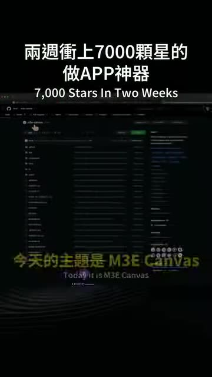
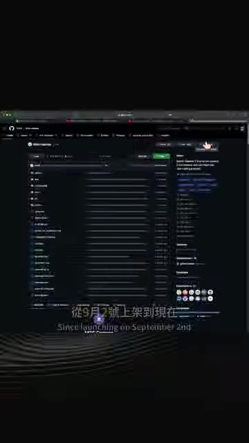

# 兩週衝上7000顆星的做APP神器 M3E Canvas

- 來源：https://www.instagram.com/reel/DddPhkuxDUo/?utm_source=ig_web_copy_link&cplk=NTc4MTIwNjQ2YQ==
- 平台 / 上傳者：Instagram / 傅子傑
- 長度：01:02 (62.1s)
- 逐字稿來源：whisper (groq)
- 更新日期：2026-10-21
- **關鍵字：** #M3E Canvas #Material 3 Expressive #Vibe Coding #拖拉設計 #UI 轉 prompt #Claude Code #Codex #開源 MIT #GitHub

## 摘要與名詞說明

**一句話重點**：講者介紹開源工具 M3E Canvas——在瀏覽器裡用拖拉元件畫出 App 畫面與流程，一鍵轉成 prompt，貼給 Claude Code 或 Codex 生成程式，讓 AI 不必猜設計細節。

> 影片中的數字與主張（7000 顆星、兩週、9/2 上架、Trendshift 當日第一、免費／MIT、資料只存瀏覽器）皆為**講者主張，未查證**。

## 重點表

| 時間 | 重點 |
|---|---|
| 00:00 | 開場：工具上線兩週、GitHub 超過 7000 顆星（講者主張，未查證）；主題 M3E Canvas |
| 00:07 | 痛點：Vibe Coding 靠自然語言描述畫面；此工具改用更直接、更精準的視覺方式 |
| 00:16 | 在瀏覽器拖拉畫出畫面：按鈕、導航列、卡片、清單、對話方塊，皆為 Google Material 3 Expressive 真實元件 |
| 00:27 | 把畫面與畫面連線，自動畫出整個 App 的流程箭頭 |
| 00:32 | 按一個按鈕，整份設計輸出成一段 prompt；複製後貼到 Claude Code 或 Codex，AI 照設計做、不用再猜 |
| 00:43 | 免費、開源、授權 MIT；免安裝、開網站即用；設計存在瀏覽器、無伺服器、免註冊（皆講者主張，未查證） |
| 00:53 | 9/2 上架至今逾 7000 顆星、上過 GitHub Trendshift 當日第一（講者主張，未查證） |
| 00:59 | 行動呼籲：留言「M3」會傳連結（連結影片未呈現） |

## 名詞與縮寫

- **M3E**：Material 3 Expressive，Google Material Design 3 的 Expressive 設計語言（字幕寫 Google Material 3）。
- **Vibe Coding**：用自然語言描述需求、由 AI 生成程式的開發方式。
- **Trendshift**：追蹤 GitHub 熱門專案的排行榜網站（ASR 原作 TrendShift，已依官方寫法校正）。
- **Claude Code／Codex**：影片中的 prompt 貼上目標（AI 寫程式的 CLI 工具）；本影片主角是 M3E Canvas，Claude Code 僅是使用場景。

## 轉錄校正備註

- 轉錄來源：Groq Whisper，語言自動偵測為中文，無重複幻覺或整段漏轉。
- 已校正：遊覽器／浴纜器→瀏覽器（畫面字幕為「瀏覽器」）、授權 MAT→MIT、賬號→帳號、TrendShift→Trendshift（前四項已入 `glossary/common.json`）。
- 講者語助詞未去除（非講座類）。
- 影片未呈現專案網址與 repo 名稱，需另查；見使用者確認事項。

## 圖文對照（畫面 + 逐字稿）

### 投影片 1：開場：M3E Canvas 與 Vibe Coding 的痛點（00:00–00:16）

**重點：** 工具上線兩週、GitHub 逾 7000 顆星（講者主張，未查證）；主題 M3E Canvas，以視覺方式取代純自然語言描述

**標籤：** #M3E Canvas #Vibe Coding #GitHub

這個工具上線到現在兩個禮拜的時間，在Github上已經超過了7000顆星，今天帶你看一個工具，今天的主題是M3E Canvas，現在Vibe Coding是讓我們把腦袋裡抽象的畫面，用自然語言的方式告訴AI，但現在這個工具可以讓你用更直接、更精準的方式來完成它。

### 投影片 2：瀏覽器拖拉畫面，連線成 App 流程（00:16–00:32）

**重點：** 拖拉按鈕、導航列、卡片、清單、對話方塊等 Material 3 Expressive 真實元件，畫面連線自動產生流程箭頭

**標籤：** #Material 3 Expressive #拖拉設計 #流程箭頭

你可以直接在瀏覽器裡面用拖拉的方式把畫面畫出來，按鈕、導航列、卡片、清單、對話方塊，全部都是Google Material 3 Expressive的真實元件，絕對不是隨便亂畫的方塊，你只需要將畫面跟畫面連線起來，它會幫你畫出整個app的流程箭頭。

### 投影片 3：一鍵轉 prompt 貼給 Claude Code／Codex，免費開源（00:32–01:02）

**重點：** 設計轉成一段 prompt 貼進 Claude Code 或 Codex；免費、MIT、免安裝、存瀏覽器、免註冊；9/2 上架（講者主張，未查證）

**標籤：** #Claude Code #Codex #MIT #Trendshift

最後按一個按鈕，它把你畫的整個設計直接變成一段prompt，你複製這段prompt，貼到Claude Code或是Codex，你畫的每個細節，AI完全不用再猜，直接照你說的做，這工具完全免費、開源、授權 MIT，不用裝任何東西，開啟網站就能使用，你的設計全部儲存在瀏覽器裡面，沒有伺服器，不用註冊帳號，從9月2號上架到現在已經超過了7000顆星，還上過GitHub Trendshift的當日第一名，如果你也想玩玩看，留言M3,我把連結傳給你啦。

## 已知轉錄錯誤

| 時間 | 聽成 | 應為 |
|---|---|---|
| 00:16 | 遊覽器 | 瀏覽器 |
| 00:49 | 浴纜器 | 瀏覽器 |
| 00:43 | 授權MAT | 授權 MIT（推測，依常見開源授權） |
