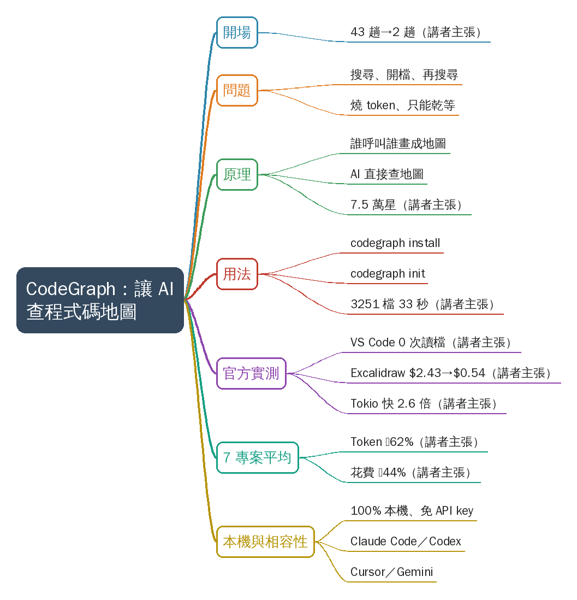
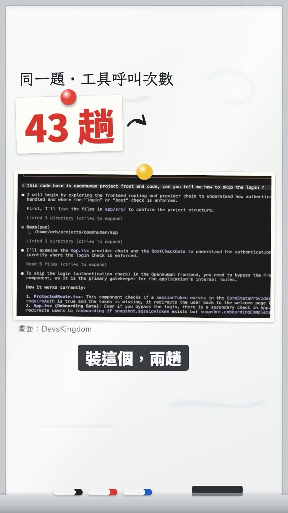
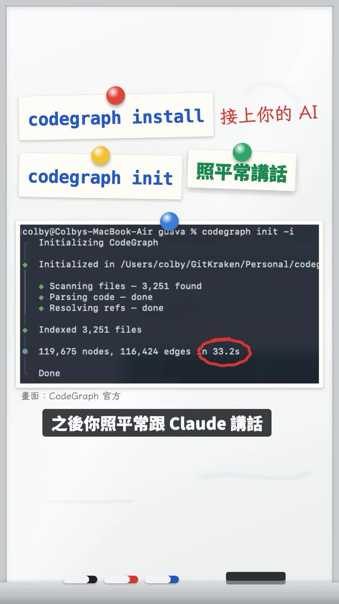
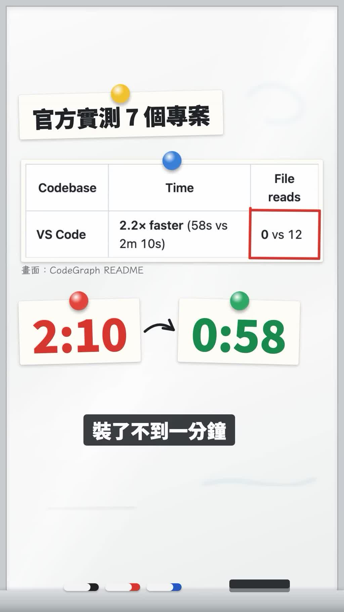
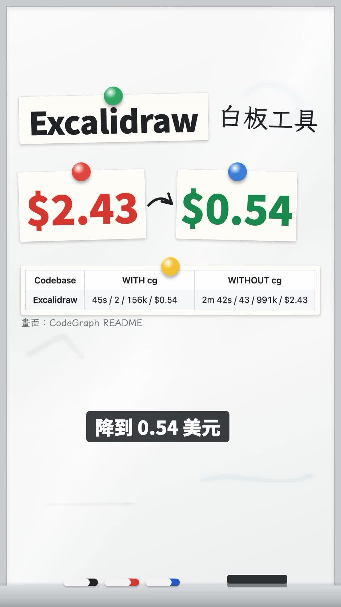
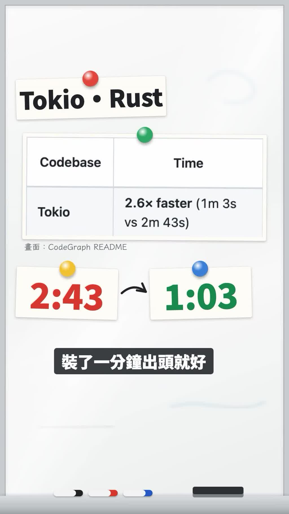
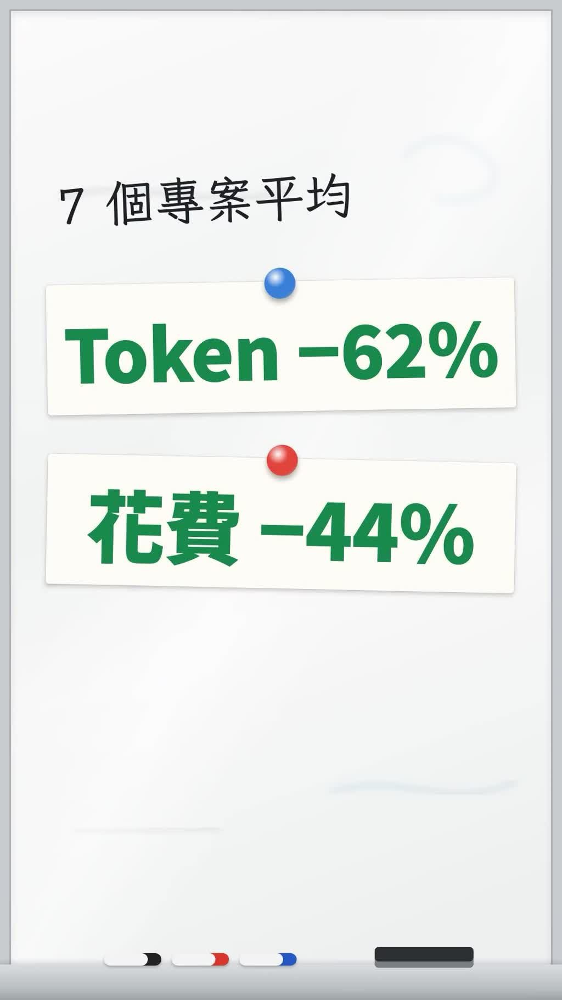

# CodeGraph 讓 Claude Code 查程式碼地圖

- 來源：https://www.instagram.com/reel/DfUMThQE3fc/
- 平台 / 上傳者：Instagram / AI懶人報
- 長度：00:53 (53.5s)
- 逐字稿來源：whisper (groq)
- 更新日期：2026-11-09
- **關鍵字：** #claudecode #CodeGraph #程式碼知識圖譜 #MCP #token 節省 #Claude Code #Codex #Cursor #本機執行 #開源工具

## 摘要與名詞說明

**一句話重點**：開源工具 CodeGraph 先在本機把整個專案的「誰呼叫誰」建成程式碼知識圖譜，Claude Code 等 AI 寫程式工具查詢時直接查圖，不必反覆搜尋、開檔，講者主張可大幅減少工具呼叫次數、token 與花費（講者主張，未查證）。

- 來源：Instagram Reel，頻道「AI懶人報」（ai.lanrenbao），約 53 秒。
- 逐字稿：Groq Whisper 轉錄（自動偵測為中文），已依畫面字幕校稿。

## 重點表

| 時間 | 重點 |
|---|---|
| 00:00 | 同一題，Claude 找程式碼要呼叫工具 43 趟；裝 CodeGraph 後 2 趟（講者主張，未查證） |
| 00:03 | 問題：AI 在大專案裡「搜尋→開檔→再搜尋」，一直燒 token，使用者只能乾等 |
| 00:08 | 原理：CodeGraph 先把專案的呼叫關係畫成一張地圖，AI 直接查地圖；開源不到 10 個月破 7.5 萬顆星（講者主張，未查證） |
| 00:15 | 用法：`codegraph install` 接上 AI 工具 → 專案資料夾 `codegraph init` 建索引；示範 3,251 個檔約 33 秒建好；之後照常跟 Claude 對話即可 |
| 00:24 | 官方 7 個開源專案實測之一：VS Code 架構問題 2 分 10 秒、讀 12 個檔 → 58 秒、0 個檔（講者主張，未查證） |
| 00:31 | Excalidraw：同一題花費 2.43 美元 → 0.54 美元（講者主張，未查證） |
| 00:36 | Rust 的 Tokio：2 分 43 秒 → 1 分 3 秒（講者主張，未查證） |
| 00:40 | 7 個專案平均：token 少 62%、花費少 44%（講者主張，未查證） |
| 00:43 | 100% 本機執行、不需另申請 API key；Claude Code、Codex、Cursor、Gemini 都能接 |
| 00:49 | 片尾：追蹤 AI 懶人報 |

## 名詞與縮寫

- **CodeGraph**：預先建立程式碼知識圖譜（code knowledge graph）的開源工具，程式碼變動時自動同步；畫面 GitHub 為 `colbymchenry/codegraph`（倉庫名依畫面，未查證）。
- **工具呼叫（tool call）**：AI 代理每次執行搜尋、讀檔等動作；呼叫越多，耗時與 token 越多。
- **Excalidraw**：開源白板繪圖工具；**Tokio**：Rust 的非同步執行環境。兩者都是實測用的開源專案。
- **with cg／without cg**：畫面表格欄名，cg＝CodeGraph。

## 轉錄校正備註

- 依畫面字幕修正：CLAUDE→Claude、Cograph／cograph→CodeGraph／codegraph、「每一樁要翻」→「沒裝要翻」、Excaladra→Excalidraw、「RUS的Tokyo」→「Rust的Tokio」；半形逗號改全形。明細見 `meta.json.known_asr_errors`。
- 未去除語助詞（非講座類影片）。

## 備註

- 影片中所有倍數、時間、金額、星數都是講者／CodeGraph README 的主張，未經查證；畫面表格原文見補充資料 S1–S3。
- 這支以「讓 Claude Code 更省 token」的第三方 MCP 類工具為主角，但工具本身也支援其他 AI 寫程式工具。

## 補充資料（影片未呈現的資訊）


### S1｜畫面遺漏：CodeGraph README 實測表格（VS Code／Excalidraw／Tokio）
- 來源：影片畫面（畫面標「CodeGraph README」）；取得日期：2026-11-09；取得方式：從原始解析度截圖抄錄
- 為何需要補充：講者只唸重點數字，畫面表格有完整欄位；對應 `slide_05`～`slide_07`（00:27–00:39）
**原文（逐字）**
```
Codebase | Time                          | File reads
VS Code  | 2.2× faster (58s vs 2m 10s)   | 0 vs 12        （畫面以紅框標 0 vs 12）

Codebase    | WITH cg                   | WITHOUT cg
Excalidraw  | 45s / 2 / 156k / $0.54    | 2m 42s / 43 / 991k / $2.43

Codebase | Time
Tokio    | 2.6× faster (1m 3s vs 2m 43s)
```
**Claude 的對照分析**
- 與影片一致：VS Code 2:10→0:58、0 個檔；Excalidraw $2.43→$0.54；Tokio 2:43→1:03。
- 畫面直接寫明（影片沒唸的）：Excalidraw 的耗時 45 秒對 2 分 42 秒、工具呼叫 2 對 43 次、token 156k 對 991k。
- 據此推定（非畫面直接寫明）：開場「43 趟→2 趟」與 Excalidraw 列的 2／43 次相同，可能是同一組實測；開場截圖另標出處 DevsKingdom，兩者是否同一題未確認。
**備註**
- 全部數據為 CodeGraph README 的主張，未查證；欄位「45s / 2 / 156k / $0.54」的順序解讀（時間／呼叫次數／token／花費）是 Claude 推測。

### S2｜畫面遺漏：`codegraph init` 終端機輸出
- 來源：影片畫面（標「CodeGraph 官方」）；取得日期：2026-11-09；取得方式：原始解析度截圖抄錄
- 為何需要補充：講者只說「3000 多個檔案，30 幾秒」；對應 `slide_04`（00:22）
**原文（逐字）**
```
colby@Colbys-MacBook-Air g（被圖釘遮住）va % codegraph init -i
  Initializing CodeGraph
  Initialized in /Users/colby/GitKraken/Personal/codeg（畫面截斷）
  ◆ Scanning files — 3,251 found
  ◆ Parsing code — done
  ◆ Resolving refs — done
  Indexed 3,251 files
  119,675 nodes, 116,424 edges in 33.2s      （畫面以紅圈標 33.2s）
  Done
```
**Claude 的對照分析**
- 與影片一致：3,251 個檔、33.2 秒建好。
- 畫面直接寫明：指令實際帶 `-i` 參數；圖譜規模 119,675 個節點、116,424 條邊。`-i` 的作用影片未說明。
**備註**
- 示範專案與機器效能未說明，建圖時間僅供參考（講者主張，未查證）。

### S3｜畫面遺漏：CodeGraph 說明文字（100% 本機）
- 來源：影片畫面；取得日期：2026-11-09；取得方式：原始解析度截圖抄錄
- 為何需要補充：講者只列 4 個工具，畫面原文列了更多；對應 `slide_09`（00:44–00:49）
**原文（逐字）**
```
Pre-indexed code knowledge graph,
auto syncs on code changes, for
Claude Code, Codex, Gemini, Cursor,
OpenCode, AntiGravity, Kiro, CoPilot,
and Hermes Agent — fewer tokens,
fewer tool calls, 100% local          （畫面以紅圈標 100% local）
```
**Claude 的對照分析**
- 與影片一致：本機執行；支援 Claude Code、Codex、Cursor、Gemini。
- 畫面直接寫明（影片沒唸的）：程式碼變動時自動同步；另支援 OpenCode、AntiGravity、Kiro、CoPilot、Hermes Agent。
**備註**
- 支援清單與功能為工具自述，未查證；GitHub 截圖倉庫名 `colbymchenry/codegraph`、Star 76k（00:14），開場終端機出自 DevsKingdom，皆未查證。

### S4｜畫面遺漏：開場的 Claude Code 對話（43 趟的示範）
- 來源：影片畫面（標「DevsKingdom」）；取得日期：2026-11-09；取得方式：原始解析度截圖抄錄（下半截斷）
- 為何需要補充：說明「43 趟」是在問什麼樣的問題；對應 `slide_01`（00:00–00:02）
**原文（逐字）**
```
> this code base is openhuman project front end code, can you tell me how to skip the login ?
● I will begin by exploring the frontend routing and provider chain to understand how authentica（截斷）
  handled and where the "login" or "boot" check is enforced.
  First, I'll list the files in app/src/ to confirm the project structure.
  Listed 1 directory (ctrl+o to expand)
● Bash(pwd)
  └ /home/web/projects/openhuman/app
  Listed 1 directory (ctrl+o to expand)
● I'll examine the App.tsx provider chain and the BootCheckGate to understand the authentication（截斷）
  identify where the login check is enforced.
  Read 5 files (ctrl+o to expand)
● To skip the login (authentication check) in the OpenHuman frontend, you need to bypass the Pro（截斷）
  component, as it is the primary gatekeeper for the application's internal routes.
  How it works currently:
  1. ProtectedRoute.tsx: This component checks if a sessionToken exists in the CoreStateProvide（截斷）
     requireAuth is true and the token is missing, it redirects the user back to the welcome page（截斷）
  2. App.tsx (Onboarding Gate): …（看不清）
```
**Claude 的對照分析**
- 據此推定：後面「地圖」畫面上的 App.tsx、BootCheckGate、ProtectedRoute、CoreState 節點，即取自這段對話涉及的檔案／元件，是示意圖，不是 CodeGraph 實際輸出。
**備註**
- 這段畫面看起來是 Claude Code 的終端介面（`ctrl+o to expand`），但未標示是否為裝 CodeGraph 前的版本；「43 趟」的計數方式未說明（講者主張，未查證）。

## 思維導圖



- 原圖：[mindmap.png](mindmap.png)；文字大綱：[mindmap.md](mindmap.md)（與本報告同資料夾）

## 圖文對照（畫面 + 逐字稿）

### 投影片 1：開場：找程式碼 43 趟 → 2 趟（00:00–00:03）



**重點：** 開場用對比吸睛：同一題，Claude 找程式碼原本要呼叫工具 43 趟，裝了 CodeGraph 只要 2 趟（講者主張，未查證；畫面引自 DevsKingdom）。

**標籤：** #43 趟 #2 趟

Claude找程式碼要跑43趟？裝這個，兩趟。

### 投影片 2：問題：AI 在大專案裡反覆搜尋（00:03–00:08）


**重點：** 叫 AI 看大專案時，它會「搜尋→開檔→再搜尋」不斷循環，光找東西就在燒 token，使用者只能乾等。

**標籤：** #搜尋 #開檔 #燒 token

你叫AI看一個大專案，它一直搜尋、開檔、再搜尋，光找東西就在燒Token，你也只能乾等。

### 投影片 3：CodeGraph 原理：先畫一張專案地圖（00:08–00:15）


**重點：** CodeGraph 先把整個專案「誰呼叫誰」建成一張地圖（程式碼關係圖），AI 要找東西時直接查地圖，不必一路翻檔。講者說開源不到 10 個月破 7.5 萬顆星（畫面字卡「7.5 萬★」，GitHub 截圖顯示 Star 76k；講者主張，未查證）。

**標籤：** #呼叫關係 #專案地圖 #GitHub 星數

CodeGraph先把整個專案裡誰呼叫誰畫成一張地圖，AI要找東西，直接查地圖，開源不到10個月就破7.5萬顆星。

### 投影片 4：用法：install 接上 AI、init 建圖（00:15–00:24）



**重點：** 兩個指令：先 `codegraph install` 接上你的 AI 工具，再到專案資料夾 `codegraph init` 建索引；示範 3,251 個檔案約 33 秒建好。之後照平常跟 Claude 講話，它會自己去查地圖。

**標籤：** #codegraph install #codegraph init

用法很簡單，先打codegraph install接上你的AI，再到專案資料夾打codegraph init，3000多個檔案，30幾秒就建好，之後你照平常跟Claude講話，它就會自己去查地圖。

### 投影片 5：實測一：VS Code 架構問題（00:24–00:31）



**重點：** 官方拿 7 個開源專案實測。問 VS Code 一個架構問題：沒裝要讀 12 個檔、2 分 10 秒；裝了 58 秒、0 次讀檔（官方 README 數據，講者主張，未查證）。

**標籤：** #VS Code #2.2x faster

官方拿7個開源專案實測，問VS Code一個架構問題，沒裝要翻12個檔案，跑2分多鐘，裝了不到1分鐘，一個檔案都沒開。

### 投影片 6：實測二：Excalidraw 花費（00:31–00:36）



**重點：** 白板工具 Excalidraw 同一題花費從 2.43 美元降到 0.54 美元（講者主張，未查證）。

**標籤：** #Excalidraw #$2.43→$0.54

白板工具Excalidraw更誇張，同一題的花費從2.43美元降到0.54美元。

### 投影片 7：實測三：Rust 的 Tokio（00:36–00:40）



**重點：** Rust 非同步框架 Tokio：本來要等 2 分 43 秒，裝了 1 分 3 秒（2.6 倍快；講者主張，未查證）。

**標籤：** #Tokio #Rust #2.6x faster

Rust的Tokio本來要等快3分鐘，裝了1分鐘出頭就好。

### 投影片 8：7 個專案平均（00:40–00:43）



**重點：** 7 個專案平均下來 token 少 62%、花費少 44%（講者主張，未查證）。

**標籤：** #Token −62% #花費 −44%

7個專案平均下來，Token少6成多，花費少4成多。

### 投影片 9：100% 本機、多種 AI 工具都能接（00:43–00:53）


**重點：** CodeGraph 整個在本機執行，不用另外申請 API key；Claude Code、Codex、Cursor、Gemini 都接得上。片尾為頻道「AI 懶人報」的追蹤呼籲。

**標籤：** #100% local #Claude Code #Codex #Cursor #Gemini

而且CodeGraph整個在你電腦上跑，不用另外申請API Key，你用Claude Code、Codex、Cursor還是Gemini都接得上，追蹤AI懶人報，每天帶你看一個值得用的AI工具。

## 已知轉錄錯誤

| 時間 | 聽成 | 應為 |
|---|---|---|
| 00:00 | CLAUDE | Claude（畫面字幕「Claude 找程式碼」） |
| 00:08 | Cograph | CodeGraph（畫面標題） |
| 00:16 | cograph install／cograph init | codegraph install／codegraph init（畫面指令） |
| 00:27 | 每一樁要翻12個檔案跑2分多鐘 | 沒裝要翻12個檔案，跑2分多鐘（畫面字幕 00:28「沒裝要翻 12 個檔案」） |
| 00:31 | Excaladra | Excalidraw（畫面標題） |
| 00:36 | RUS的Tokyo | Rust的Tokio（畫面「Tokio・Rust」） |

## 補充資料連結

- 補充資料檔：[supplement.md](supplement.md)（與本報告同資料夾；內容已收錄於上方〈補充資料〉）
- 思維導圖：[mindmap.png](mindmap.png)、文字大綱：[mindmap.md](mindmap.md)（與本報告同資料夾）
