# 什麼是Harness

- 來源：https://www.facebook.com/reel/26612799381718386/?mibextid=rS40aB7S9Ucbxw6v
- 平台 / 上傳者：Facebook / AI/GitHub-實驗室
- 長度：07:57 (476.7s)
- 逐字稿來源：whisper (groq)
- 更新日期：2026-11-19
- **關鍵字：** #Harness Engineering #AI Agent #Prompt Engineering #Context Engineering #執行編排 #獨立評估 #雙Agent #OpenAI

## 摘要與名詞說明

**一句話重點**：講者說 Harness Engineering（馭韁工程）是繼提示詞工程、上下文工程之後的第三層：圍繞大模型搭一整套執行與控制系統，讓 Agent 在真實環境裡持續可靠地完成任務；公式是 AI Agent＝大模型＋Harness，並拆成六層（上下文管理、工具、執行編排、狀態記憶、獨立評估、約束恢復）。以下起源（OpenAI 2026 年 2 月提出）與成效數字皆為講者主張，未查證。

| 時間 | 重點 |
|---|---|
| 00:00 | 定義：工程師設計環境、明確意圖、構建反饋迴路；不是流行詞 |
| 00:50 | 提示詞工程：解決指令表達 |
| 01:24 | 上下文工程：召回、壓縮、組裝，資訊供給 |
| 02:29 | 長任務會跑偏，需要第三層 |
| 03:15 | Harness＝馬具；模型想、Harness 管；三層巢狀；公式 |
| 04:43 | 第 1 層：結構化上下文管理 |
| 05:03 | 第 2 層：工具系統 |
| 05:21 | 第 3 層：執行編排 |
| 05:39 | 第 4 層：狀態和記憶 |
| 05:51 | 第 5 層：獨立評估 |
| 06:11 | 第 6 層：約束和恢復 |
| 06:26 | 六層合體；帶團隊比喻 |
| 07:02 | 實例：成功率 60%→90%、雙 Agent 模式（講者轉述） |
| 07:32 | 結語：三層遞進，缺一不可 |

## 名詞與縮寫

- **Harness（馬具）**：圍繞模型的執行與控制系統。
- **上下文工程**：在對的時間給對的資訊（召回、壓縮、組裝）。
- **雙 Agent 模式**：一個做事、一個獨立檢查（類似 QA）。

## 轉錄校正備註

- 逐字稿為 Groq Whisper（中文，已轉繁體）。
- 已校正：Harness Agent愛馬仕→Hermes Agent（愛馬仕）、馬距→馬具、執行股價→執行骨架（畫面確認）；調題試詞→調提示詞、當前繪畫→當前會話、亂為資訊→雜亂資訊、提示詞加下文→提示詞加上下文、如果的agent→如果你的agent 為推測；第二輪另修几→幾、正規化→範式、資訊質量→資訊品質。

## 思維導圖

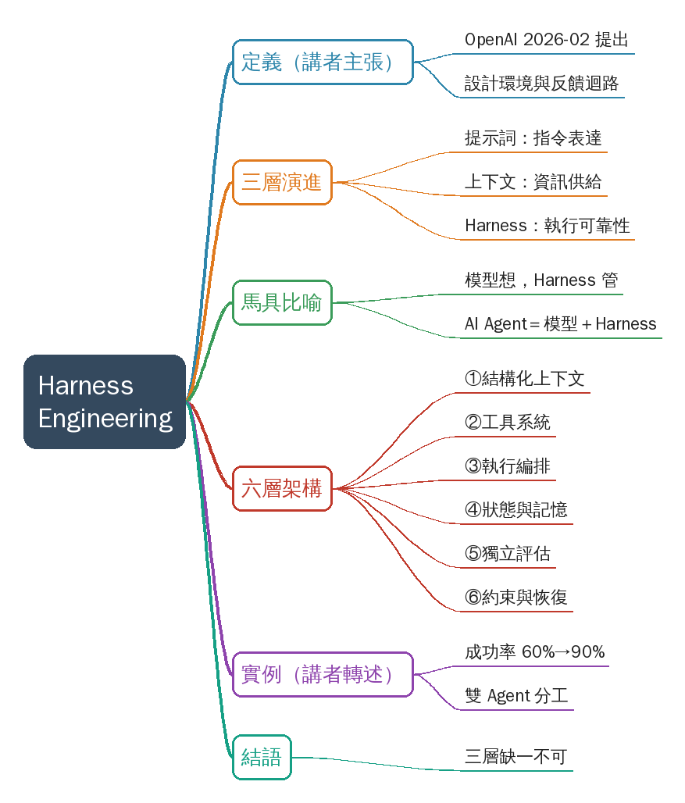

- 原圖：[mindmap.png](mindmap.png)；文字大綱：[mindmap.md](mindmap.md)（與本報告同資料夾）

## 圖文對照（畫面 + 逐字稿）

### 主題 1：開場：什麼是 Harness Engineering（00:00–00:50）

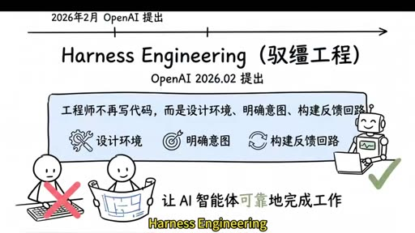

**重點：** 講者說 Harness Engineering（馭韁工程）是 OpenAI 在 2026 年 2 月提出的工程範式：工程師不再寫程式碼，而是設計環境、明確意圖、構建反饋迴路，讓 AI 智慧體可靠地完成工作（講者主張，未查證）。他提醒別和 Hermes Agent（愛馬仕）搞混，並指出它不是曇花一現的流行詞：Agent 能不能靠譜跑起來，關鍵往往不在模型多強，而在模型外面那整套工程架構。

**標籤：** #Harness Engineering #OpenAI #AI Agent

什麼是Harness Engineering?理解了它，你就理解了AI Agent的底層工作原理。才短短幾天，這個詞就刷遍了各種AI社群、技術部落格和開發者討論區，很多人會把它和Hermes Agent（愛馬仕）搞混。Harness Engineering是OpenAI在2026年2月提出的工程範式，工程師不再寫程式碼，而是設計環境，明確意圖，構建反饋迴路，讓AI智慧體可靠地完成工作。在AI這個圈子裡，隔三差五就蹦出來一個新名詞，新範式新工具，大家早就習慣了，不過Harness Engineering，跟那些曇花一現的流行詞不太一樣，它戳中了一個越來越沒法迴避的事實，一個AI Agent最終能不能靠譜的跑起來，穩定的完成任務，關鍵往往不在模型有多強，而在模型外面那一整套工程架構做的怎麼樣。

### 主題 2：第一層演進：Prompt engineering（說話方式）（00:50–01:24）

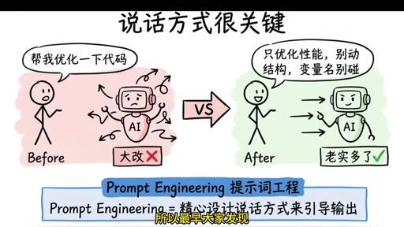

**重點：** 大語言模型的底層邏輯是根據輸入猜下一個詞，猜得好不好取決於給它的資訊品質。所以最早大家發現說話方式很關鍵：「幫我最佳化程式碼」只會得到大概，「只最佳化效能、別動結構、變數名別碰」就老實多了；這種精心設計說話方式來引導輸出的做法叫提示詞工程。

**標籤：** #提示詞工程 #下一個詞

我們往回倒一下，大語言模型這個東西，你別被它花裡胡哨的應用迷惑了，它的底層邏輯其實特別簡單，就是根據你給它的輸入，猜下一個詞該接什麼，對就是猜，猜的好不好，完全取決於你給它的資訊品質，所以最早大家發現，你跟模型說話的方式很關鍵，比如你說幫我最佳化一下程式碼，它可能給你來個大概，但你要是說只最佳化效能，別動結構，變數名別碰，它就老實多了，這種精心設計說話方式，來引導輸出的做法，叫prompt engineering，提示詞工程。

### 主題 3：第二層演進：Context engineering（資訊供給）（01:24–02:29）

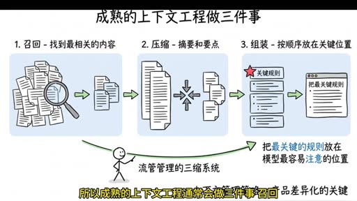

**重點：** 光說清楚還不夠：修 bug 要看到報錯日誌、相關程式碼、專案結構與依賴版本；處理客訴要知道使用者是誰、買了什麼、退貨政策。上下文工程的核心不是資訊越多越好，而是在正確的時間給正確的資訊；成熟做法有三件事：召回、壓縮、組裝，並把最關鍵規則放在模型最容易注意的位置。講者說兩個產品用同一個模型效果卻天差地別，往往比的是上下文工程。

**標籤：** #上下文工程 #召回 #壓縮 #組裝

但很快大家發現光說清楚還不夠，你讓AI修個bug，它至少得看到報錯日誌，相關程式碼，專案結構，依賴版本吧，你讓AI處理客戶投訴，它至少得知道使用者是誰，買了什麼，退貨政策是什麼吧，這些資訊不是提示詞，但直接決定模型答的好不好，於是context engineering來了，上下文工程，核心不是資訊越多越好，而是在正確的時間給正確的資訊，因為模型的上下文視窗有限，塞太多他會失憶前面定好的規矩後面就忘了所以成熟的上下文工程通常會做三件事召回壓縮組裝先從大量資訊裡召回與當前任務最相關的內容，再把過長的檔案摘要或歷史對話壓縮成要點和關鍵資訊，最後按照特定順序組裝進上下文裡，把最關鍵的規則和指令放在模型最容易注意的位置，這也是為什麼兩個產品即使底層呼叫的是同一個模型，只要上下文管理策略不同，效果也可能天差地別，很多人以為自己在比較模型，實際上比的往往是上下文工程。

### 主題 4：為什麼需要第三層：長任務會跑偏（02:29–03:15）

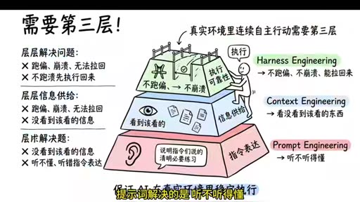

**重點：** 現在的場景是讓 AI 自己寫程式碼、跑測試、修 bug、做決策，一連串可能幾十步甚至上百步：它寫了程式碼卻不會自己跑測試、規劃了步驟卻跳過關鍵環節、越跑越偏反覆試錯無限循環，甚至一本正經胡說八道。講者歸納：提示詞解決聽不聽得懂、上下文解決看沒看到該看的東西，連續自主行動還需要第三層，保證它不跑偏、不崩潰、出錯能拉回來。

**標籤：** #長任務 #跑偏 #第三層

你想想，如果你只是問AI一個問題，讓他寫一段話，提示詞加上下文確實夠用，但現在的場景，早就不是簡單的問答問題了，現在都是讓AI自己去寫程式碼，自己跑測試，自己修bug，自己做決策，一連串下來，可能要跑幾十步，甚至上百步，這時候問題就炸了，他寫了程式碼，但不會自己跑測試，他規劃了步驟，但中間突然跳過關鍵環節，他在長任務裡越跑越偏，開始反覆試錯，無限迴圈，甚至一本正經的胡說八道，提示詞解決的是聽不聽得懂，上下文解決的是，看沒看到該看的東西，但當AI要在真實環境裡，連續自主行動的時候，你還需要第三層，怎麼保證他不跑偏，不崩潰，出了錯還能拉回來。

### 主題 5：Harness 是什麼：馬具比喻、閉環與三層巢狀（03:15–04:43）

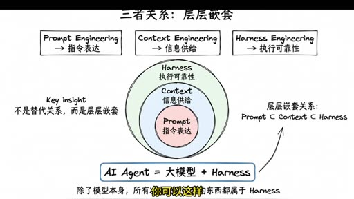

**重點：** Harness 原意是馬具、韁繩：不是讓馬變聰明，而是套上韁繩、裝上馬鞍、圍好欄杆、修好路，讓十匹馬同時安全地跑。對應到 AI：模型負責想、生成、決定下一步，Harness 負責管、檢查、確保幹完能過關；例如模型寫排序函式後，系統在沙箱跑測試，沒過就把錯誤日誌送回讓模型改，形成想—做—看結果—再想的閉環。三者是層層巢狀（Prompt 屬於 Context、Context 屬於 Harness），公式是 AI Agent＝大模型＋Harness。

**標籤：** #馬具 #閉環 #沙箱 #巢狀

這就是Harness Engineering要乾的事，Harness這個詞，英文原意是馬具，韁繩，你評評這個比喻，它不是讓馬變聰明，而是給馬套上韁繩，裝上馬鞍，圍好欄杆，修好路，讓十匹馬能同時安全的跑，放到AI領域，Harness Engineering，就是圍繞大模型搭建的，一整套執行和控制系統，模型負責想，Harness負責管，模型負責生成，Harness負責檢查，模型負責下一步幹什麼，Harness負責確保幹完了能過關，舉個具體的例子，你讓AI寫一個排序函式，模型生成程式碼之後，系統自動在沙箱裡跑測試，沒過錯誤日誌送回模型模型改程式碼再測過了就繼續下一步沒過就繼續改這個想做看結果再想的閉環，就是agent的工作方式，而讓這個閉環穩定轉起來的，不是模型，是外面那層harness，你可以這樣理解三者關係，prompt engineering，解決的是指令表達，context engineering，解決的是資訊供給，harness engineering，解決的是執行可靠性，它們不是替代關係，而是層層巢狀的關係，Prompt是Context的一部分，Context又是Harness的一部分，甚至可以用一個很直觀的公式來總結，AI Agent等於大模型加Harness，換句話說，一個Agent系統裡，除了模型本身之外，幾乎所有決定它是否能穩定交付的東西，都屬於Harness Engineering。

### 主題 6：第 1 層：結構化的上下文管理（04:43–05:03）

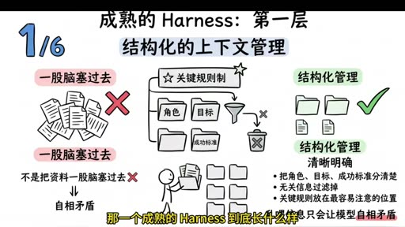

**重點：** 不是把資料一股腦塞過去，而是把角色、目標、成功標準分清楚，過濾無關資訊，把關鍵規則放在模型最容易注意的位置；雜亂的資訊只會讓模型自相矛盾。

**標籤：** #上下文管理 #角色 #成功標準

那一個成熟的Harness到底長什麼樣，我把它拆成六層來講，第一層，結構化的上下文管理，不是把資料一股腦塞過去，而是把角色，目標，成功標準分清楚，無關資訊過濾掉，關鍵規則放到模型最容易注意的位置，雜亂資訊只會讓模型自相矛盾。

### 主題 7：第 2 層：工具系統（05:03–05:21）

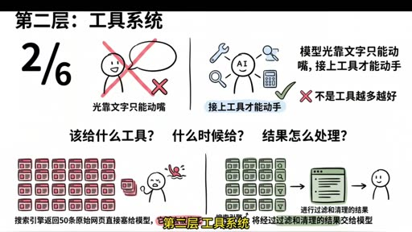

**重點：** 模型光靠文字只能動嘴，接上工具才能動手，但不是工具越多越好，關鍵是給什麼工具、什麼時候給、工具返回的結果怎麼處理。例如搜尋引擎返回 50 條原始網頁直接塞給模型，只會把它淹死。

**標籤：** #工具 #結果處理

第二層工具系統，模型光靠文字只能動嘴，接上工具才能動手，但不是工具越多越好，關鍵是該給什麼工具，什麼時候給，工具返回的結果怎麼處理，搜尋引擎返回50條原始網頁，直接塞給模型，他只會被淹死。

### 主題 8：第 3 層：執行編排（05:21–05:39）

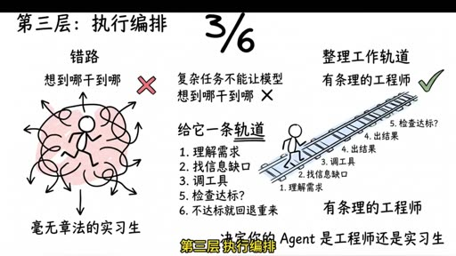

**重點：** 複雜任務不能讓模型想到哪幹到哪，要給它一條軌道：先理解需求、再找資訊缺口、再調工具、再出結果、再檢查達不達標，不達標就回退重來。這決定了你的 Agent 是有條理的工程師還是毫無章法的實習生。

**標籤：** #編排 #軌道 #回退

第三層，執行編排，複雜任務不能讓模型想到哪幹到哪，你得給他一條軌道，先理解需求，再找資訊缺口，再調工具，再出結果，再檢查達不達標，不達標就回退重來，這決定了你的agent是像個有條理的工程師，還是個毫無章法的實習生。

### 主題 9：第 4 層：狀態和記憶管理（05:39–05:51）

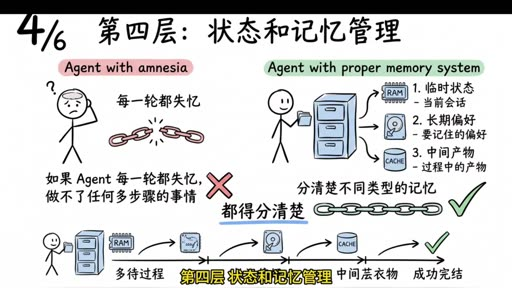

**重點：** 如果 Agent 每一輪都失憶，就做不了任何需要多步驟的事。要分清楚哪些是當前會話的臨時狀態、哪些是要長期記住的偏好、哪些是中間產物。

**標籤：** #狀態 #記憶 #失憶

第四層，狀態和記憶管理，如果你的agent每一輪都失憶，他就做不了任何需要多步驟的事情，哪些是當前會話的臨時狀態，哪些是要長期記住的偏好，哪些是中間產物都得分清楚第五層獨立評估這層特別關鍵很多agent系統最大的坑是它會做事但不會判斷自己做的好不好你得有獨立的評估機制來檢查輸出是否合格。

### 主題 10：第 5 層：獨立評估（05:51–06:11）

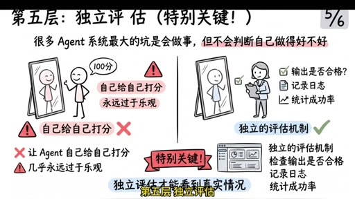

**重點：** 很多 Agent 系統最大的坑是會做事但不會判斷自己做得好不好，所以要有獨立的評估機制檢查輸出是否合格、記錄日誌、統計成功率；講者說讓 Agent 自己給自己打分幾乎永遠過於樂觀（講者主張）。

**標籤：** #獨立評估 #日誌 #成功率

記錄日誌，統計成功率，讓agent自己給自己打分，幾乎永遠過於樂觀。

### 主題 11：第 6 層：約束和恢復（06:11–06:26）

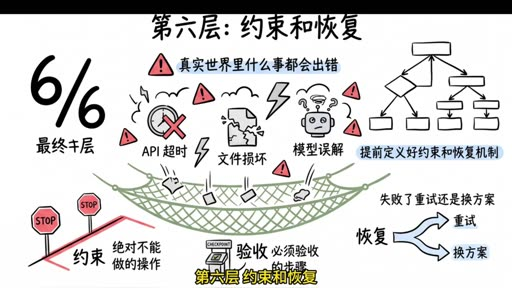

**重點：** 真實世界什麼事都會出錯：API 超時、檔案損壞、模型誤解。要提前定義哪些操作絕對不能做、哪一步必須驗收、失敗了是重試還是換方案。

**標籤：** #約束 #恢復 #驗收

第六層，約束和恢復，真實世界裡什麼事都會出錯，API超時，檔案損壞，模型誤解，你必須提前定義好，哪些操作絕對不能做，哪一步必須驗收，失敗了是重試還是換方案。

### 主題 12：六層合起來＝完整 Harness；帶團隊比喻（06:26–07:02）

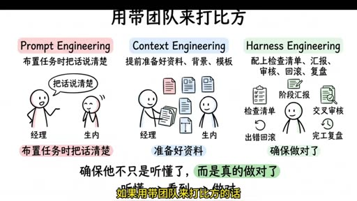

**重點：** 六層加在一起就是完整的 Harness，公式是 AI Agent＝大模型＋Harness：除了模型本身，所有決定 Agent 能不能穩定交付的東西都歸 Harness 管。講者用帶團隊比喻：Prompt 是把任務說清楚，Context 是提前備好客戶背景、會議紀要與參考模板，Harness 是配上檢查清單、階段彙報、交叉稽核、出錯回滾、完工覆盤，確保他不只聽懂而是真的做對。

**標籤：** #公式 #帶團隊 #檢查清單

這六層加在一起，就構成了一個完整的Harness，你可以用一個更直覺的公式來理解，AI Agent等於大模型加上Harness，除了模型本身以外，所有決定Agent能不能穩定交付的東西，都歸Harness管，如果用帶團隊來打比方的話，Prompt Engineering是你給實習生布置任務時，儘量把話說清楚，Context Engineering是你提前把相關資料，客戶背景，會議紀要，參考模板都準備好，而Harness Engineering，是你給他配上檢查清單，階段彙報，交叉稽核，出錯回滾，完工覆盤，確保他不只是聽懂了，而是真的做對了。

### 主題 13：實例：重構執行骨架與雙 Agent 模式（07:02–07:32）

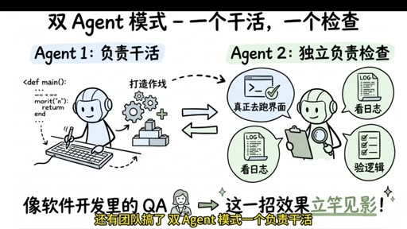

**重點：** 講者說越來越多頂尖團隊把重點從調提示詞、換模型，轉向重構整套執行骨架：有團隊沒換模型，只重新設計任務拆解、狀態管理、結果校驗與反饋閉環，任務成功率從 60% 幾拉到 90% 幾；也有團隊用雙 Agent 模式，一個負責幹活、一個像 QA 獨立檢查（真正去跑介面、看日誌、驗邏輯），效果立竿見影（以上為講者轉述，未查證）。

**標籤：** #執行骨架 #雙Agent #QA

也正因為如此，越來越多頂尖團隊，開始把重點從，調提示詞和換模型，轉向重構整套執行骨架，有團隊根本沒換模型，就是把任務拆解，狀態管理，結果校驗和反饋閉環，重新設計了一遍，agent的任務成功率直接從60%幾拉到90%幾，還有團隊搞了雙agent模式，一個負責幹活，一個獨立負責檢查，像軟體開發裡的QA一樣，真正去跑介面，看日誌，驗邏輯，這一招效果立竿見影。

### 主題 14：結語：三層遞進，缺一不可（07:32–07:57）

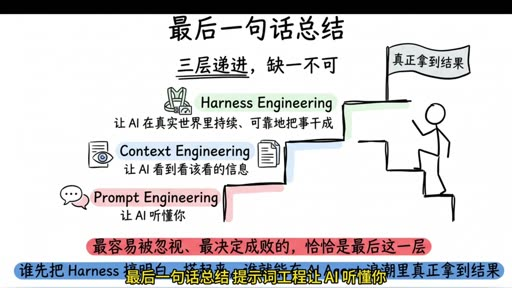

**重點：** 提示詞工程讓 AI 聽懂你，上下文工程讓 AI 看到該看的資訊，Harness 工程讓 AI 在真實世界裡持續可靠地把事幹成；三層遞進缺一不可，而最容易被忽視、最決定成敗的恰恰是最後一層，誰先把 Harness 搭起來，誰就能在 AI Agent 浪潮裡拿到結果（講者主張）。

**標籤：** #三層遞進 #Harness

最後一句話總結，提示詞工程讓AI聽懂你，上下文工程讓AI看到該看的資訊，Harness工程讓AI在真實世界裡持續可靠的把事幹成，三層遞進，缺一不可，而最容易被忽視，最決定成敗的，恰恰是最後這一層，誰先把harness這套東西搞明白，搭起來，誰就能在AI agent這波浪潮裡，真正拿到結果。

## 已知轉錄錯誤

| 時間 | 聽成 | 應為 |
|---|---|---|
| 00:06 | Harness Agent愛馬仕 | Hermes Agent（愛馬仕）（對照畫面「別和 Hermes agent 搞混」） |
| 03:18 | 馬距 | 馬具 |
| 07:08 | 執行股價 | 執行骨架（對照畫面「重構整套執行骨架」） |
| 07:06 | 調題試詞 | 調提示詞（推測） |
| 05:46 | 當前繪畫 | 當前會話（推測） |
| 00:06 | 几 | 幾（漏轉繁體，第二輪發現） |
| 00:15/00:30 | 工程正規化／新正規化 | 工程範式／新範式（OpenCC s2twp 把「范式」轉成「正規化」，與摘要用語一致；第二輪發現） |
| 02:33 | 提示詞加下文 | 提示詞加上下文（推測，漏字） |
| 05:42 | 如果的agent | 如果你的agent（推測，漏字） |
| 05:01 | 亂為資訊 | 雜亂資訊（推測） |
| 01:03 | 資訊質量 | 資訊品質（台灣用語） |

## 補充資料連結

- 思維導圖：[mindmap.png](mindmap.png)、文字大綱：[mindmap.md](mindmap.md)（與本報告同資料夾）
