# 淨土安心法門(三)

- 來源：https://www.youtube.com/live/uGeglEasD60?si=pcw7yh3adpgdtbEz
- 平台 / 上傳者：YouTube / 臺中蓮社
- 長度：50:25 (3025.0s)
- 逐字稿來源：whisper (groq)
- 更新日期：2026-10-23
- **關鍵字：** #淨土安心法門 #真實心 #辨真偽 #內懷虛假 #貪瞋邪偽 #奸詐 #惡性難侵 #默擯 #不名真實業 #自利真實 #利他真實 #明兩利 #制捨 #如面佛天 #想同菩薩 #淨行品 #增上緣 #饒益有情 #弘一大師

## 摘要與名詞說明

**一句話重點**：台中蓮社講座第三講，接續帶讀雪公（李炳南老居士）〈淨土安心法門〉的至誠心。先把昨天「夾雜惡性」的第二、三條講完（內懷虛假貪瞋邪偽、奸詐百端惡性難侵），再以「不名真實業」收束「辨真偽」；接著進入「明兩利」與丙一「制捨自他諸惡」（真實心中制捨、行住坐臥想同菩薩），最後開始丙二「勤修自他凡聖等善」的第一條「饒益有情不惱眾生」。

> 以下是講者的講述與詮釋（宗門內的教學觀點）；人物事蹟、經論出處、數字與歷史細節都是講者主張，未查證。

## 重點（含時間戳）

| 時間 | 重點 |
|---|---|
| 01:11 | 承接昨天，研讀三心中的至誠心。雪公把至誠心分兩大段，第一段「辨真偽」：照真實心中作就得清淨功德，內外明暗不一就是偽、得的是有漏功德。 |
| 03:35 | 內懷虛假貪瞋邪偽：內心與外相不協調。講者舉例：與人較量念佛數量是起瞋心（修羅道）；念佛後仍遇橫逆而懷疑因果是起癡心；進而認為不必認真念佛、只要有信願，與善導大師不同（講者說善導大師一天念三萬聲，講者主張，未查證）。 |
| 07:46 | 蕅益大師所見：明末有人學佛參禪滔滔不絕，卻不為生死大事，只是裝模作樣、記幾則公案、辨幾句名相，以為佛法盡此（講者引述）。 |
| 09:57 | 奸詐百端：奸是不忠誠（早晚課時做時不做），以曹操挾天子以令諸侯為喻；詐是做善事卻不幹一點真事，要反省自己念佛是否真為往生。 |
| 12:42 | 惡性難侵：明知殺盜淫妄酒是壞事偏不改，是最大的惡事。遇到這種人不爭吵，學佛對六群比丘、闡陀的「默擯」；講者說闡陀後來有慚愧心、改過證阿羅漢果（講者主張，未查證）。 |
| 16:05 | 不名真實業：「真」是離迷情、「實」是絕虛妄。引善導大師「欲迴此雜毒之行……此必不可也」；阿彌陀佛因中三業都是真實心中作，四十八願皆有「不取正覺」。 |
| 20:18 | 明兩利：真實有自利真實與利他真實。辨真偽講自利要真實，明兩利講自己得好處後要讓大家也得好處，「以身證法」才能引人念佛。 |
| 23:20 | 兩利的界限：講者說十信、十住、十行、十迴向（十迴向以前）利他都是為了破自己的顛倒煩惱；初地以上自利修行都是為利他（講者主張，未查證）。 |
| 25:24 | 丙一 制捨自他諸惡：制捨＝控制、捨去，如《論語》克己復禮；「真實心中制捨諸惡」。 |
| 27:15 | 誠心淨意、如面佛天（印光大師）：不論內外明暗都如面對佛天；舉頭三尺有神明、佛有天眼天耳他心通，並引曾子「十目所視、十手所指」。 |
| 30:23 | 行住坐臥想同菩薩：想教化人，自己先像菩薩般莊嚴；胎卵濕化一切眾生都看作菩薩；引孔子教季康子「臨之以莊則敬」。 |
| 34:05 | 淨行品：文殊菩薩教人觀念一轉就想同菩薩，如「見修園圃，當願眾生，五欲圃中，耘除愛草」「見樂著人……以法自娛」；講者說共 141 則偈（講者主張，未查證）。 |
| 36:54 | 自利利他：五乘（人、天、聲聞、緣覺、菩薩）中，聲聞只利自己、緣覺一半利己一半利人，菩薩把自得好處全給人。 |
| 39:01 | 迴向功德：迴向給親人也要給仇人；自利是破自心的顛倒煩惱（捨不得就是貪戀），利他是為眾生做增上緣、增長善根；雪公以「搖動埋在土裡的大石頭」比喻迴向漸漸見效。 |
| 43:07 | 丙二 勤修自他凡聖等善（下有三條），第一條「饒益有情不惱眾生」：對胎卵濕化眾生要豐厚；講者舉憐蛾不點火、輕放碗盤免驚擾餓鬼等生活小事。 |
| 46:52 | 四種利益眾生：布施（財、法、無畏）、愛語、利行、同事；以葛繁每天找善事做為例（昨天所講）。 |
| 48:59 | 弘一大師以身示範：怕蚊子就掛蚊帳、捉到蚊蟲放到空曠處、坐竹椅先搖一搖讓蟲離開（講者主張，未查證）。結語：能時時自利利他，休息十分鐘。 |

## 名詞說明

- **內懷虛假貪瞋邪偽**：外表賢善精進，內心貪、瞋、癡、邪偽，是雪公特別提出的一條（講者說四帖疏裡沒有）。
- **惡性難侵**：明知是惡而不改，雪公稱為「大惡」。
- **默擯**：不爭吵、不指責，暗中拒絕、不與他說話，由他自己反省（講者說法）。
- **闡陀、六群比丘**：佛世僧團中的搗亂者（講者說法）。
- **不名真實業**：真＝離迷情，實＝絕虛妄；夾雜迷惑煩惱、虛假的都不算真實業。
- **明兩利**：自利真實與利他真實並明；利益眾生就是利益自己。
- **制捨**：控制並捨去自己與他人的諸惡。
- **如面佛天**：誠心淨意，不論內外明暗，都如面對佛與天。
- **想同菩薩**：行住坐臥都想自己與菩薩相同，並把一切眾生看作菩薩。
- **淨行品**：《華嚴經》文殊菩薩教人在日常生活中起願的偈頌。
- **增上緣**：迴向給眾生，使他們的善根得以增長的助緣。
- **五乘**：人、天、聲聞、緣覺、菩薩。
- **四攝／四種利益眾生**：布施、愛語、利行、同事。

## 轉錄說明

- 逐字稿來自 Groq Whisper，已自動偵測為中文並轉繁體；為口語講座，已去除語助詞（`transcript.raw.md` 保留原話）。
- Groq 有 5 段約 30 秒整段漏轉（01:26–01:58、01:58–02:33、08:27–08:58、15:56–16:28、35:13–35:43），自動補漏沒偵測到，已單獨重送 Groq 補回。
- 瞋、癡兩字依語意改正（推測）。
- L170 依投影片「蕅祖」引文校正為「辨幾句名相，以為佛法盡此矣」。
- 仍存疑、保留原樣的地方（推測）：L207「要駁了這個名字」、L215「違約了君臣的界線」、L312「道印」、L944「佛殿下 明天 請勿用」、L959「宗宛」（講者自稱不太會講，下文說是烘碗機）；詳見 `meta.json` 的 `known_asr_errors`。
- 投影片文字的逐字抄錄見 `supplement.md`。

## 補充資料（影片未呈現的資訊）

> 以下逐字抄自投影片；內容屬講義，講者的詮釋見逐字稿。

### 內懷虛假 貪瞋邪偽（05:30、09:35）
- 虛假：內心與外相不調
- 內懷虛假：心起動專做假事情
- 貪瞋邪偽：起貪瞋癡，迷邪教，假裝真
- 不為生死大事，裝模做樣，詐現威儀，不真實學禪教律，徒記兩則公案，辨幾句名相，以為佛法盡此矣。（蕅祖）

### 奸詐百端 惡性難侵（12:10、15:20）
- 奸：不忠誠，像奸雄曹操。
- 詐：不幹一點真事
- 惡性難侵：明知是壞事，偏不改
- 惡人明知就不肯改，存心學壞，這是最大的惡事。
- 佛遇沒法治的人，就默擯，拒絕他，也不與他說話，不理他，由他去。

### 不名真實業（19:10）
- 真實：離迷情，絕虛妄。
- 欲迴此雜毒之行，求生彼佛淨土者，此必不可也。何以故？
- 阿彌陀佛因中行菩薩行時，乃至一念一剎那三業所修，皆是真實心中作。
- 不取正覺：諸願不滿，終不成佛。

### 明兩利（23:14、25:16）
- 真實有二種：自利真實，利他真實
- 辨真偽：誰修行誰得好處
- 明兩利：還使大家都得好處
- 你想利益他，自己必先要明白，利他自然就是利己，這叫兩利，這是大乘菩薩法門。

### 制捨自他諸惡（26:10、27:40、31:32）
- 制捨：控制捨去
- 真實心中制捨諸惡
- 誠心淨意的制捨諸惡（如面佛天）
- 行住坐臥想同菩薩
- 教化人，自己要先想同菩薩。
- 胎卵濕化，都看做是菩薩，主敬存誠恭敬他。

### 淨行品偈（34:40）
- 見修園圃，當願眾生，五欲圃中，耘除愛草。
- 見樂著人，當願眾生，以法自娛，歡愛不捨。

### 自利利他（故名兩利）（38:58、41:10）
- 利益自己是聲聞
- 一半益己一半益人是緣覺
- 菩薩是把自得好處全給人。
- 自利：修利他之行，能破自心顛倒煩惱
- 利他：能為眾生作增長緣

### 丙二 勤修自他凡聖等善（46:56、48:50）
- 饒益有情不惱眾生（益為加厚）
- 布施，愛語，利行，同事

## 思維導圖

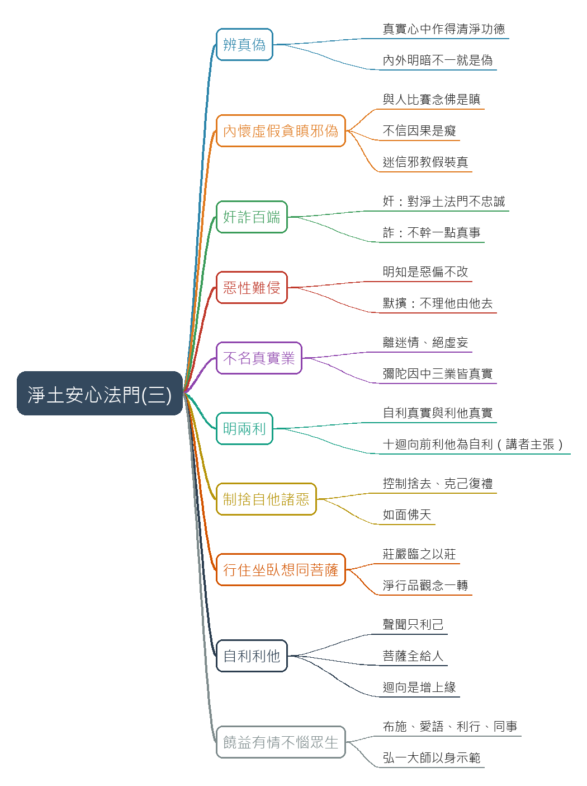

- 原圖：[mindmap.png](mindmap.png)；文字大綱：[mindmap.md](mindmap.md)（與本報告同資料夾）

## 圖文對照（畫面 + 逐字稿）

### 投影片 1：接續至誠心：辨真偽（01:11–03:35）

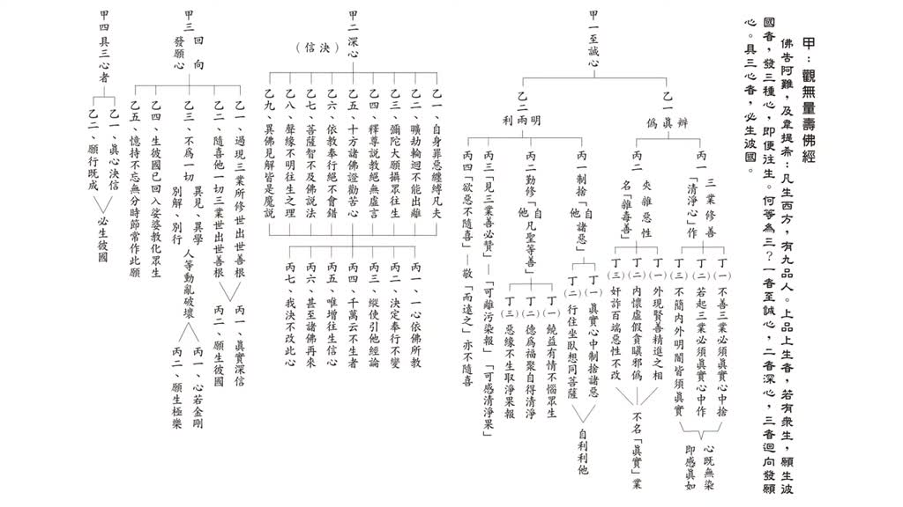

**重點：** 承上一講進入三心中的至誠心。雪公把至誠心分成兩大段，第一段「辨真偽」：修淨土法門時，哪一種修行是真、哪一種是偽。按真實心中作，得的是清淨功德；內外明暗不一樣就是偽，得的是有漏功德。三業修善要清淨心作，還是夾雜惡性，完全取決於個人意願。

**標籤：** #辨真偽 #清淨功德 #有漏功德

今天我們接著昨天的一個進度，我們來研讀三心當中的至誠心。至誠心當中雪公老師分成兩大段，一個叫辨真偽，辨真偽，就是我們在念佛修行淨土法門過程當中，怎麼樣的修行是真，哪一種修行是偽，那真和偽，為什麼要辨真偽，如果能夠按照真，真實心中作來做，那我們個人就，能夠得利，那如果不是真實心中作，不是真實心中作，內外明暗不一樣，那就是偽，偽的話自己怎麼樣，也能夠得，得的功，得的那個效果就是有漏，所以辨真偽，就是要來說明了，我們修功德的時候，修功，修這個修行的時候，修淨土法門，你得的功德，能夠是清淨的功德，還是有漏的功德，就看你真偽，三業修善是清淨心作還是夾雜惡性，這個都是完全取決於我們個人，我們個人要怎麼樣的清淨心作還是夾雜惡性做，那完全是按照個人的意願，那我們昨天有談到這個夾雜惡性當中的這個第一條外現賢善，外現賢善精進之相，這個第二條叫做內懷虛假貪瞋邪偽，你這個在四帖疏裡面看不到，這個是雪公老師特別，他應該是看到很多我們蓮友，很多的蓮友雖然也有信佛念佛，可是怎麼樣，就是外現賢善精進之相，但是內懷虛假貪瞋邪偽，所以念佛沒有效果，最後不能往生，你能怪誰。

### 投影片 2：內懷虛假：貪瞋癡與迷信邪教（03:35–07:46）

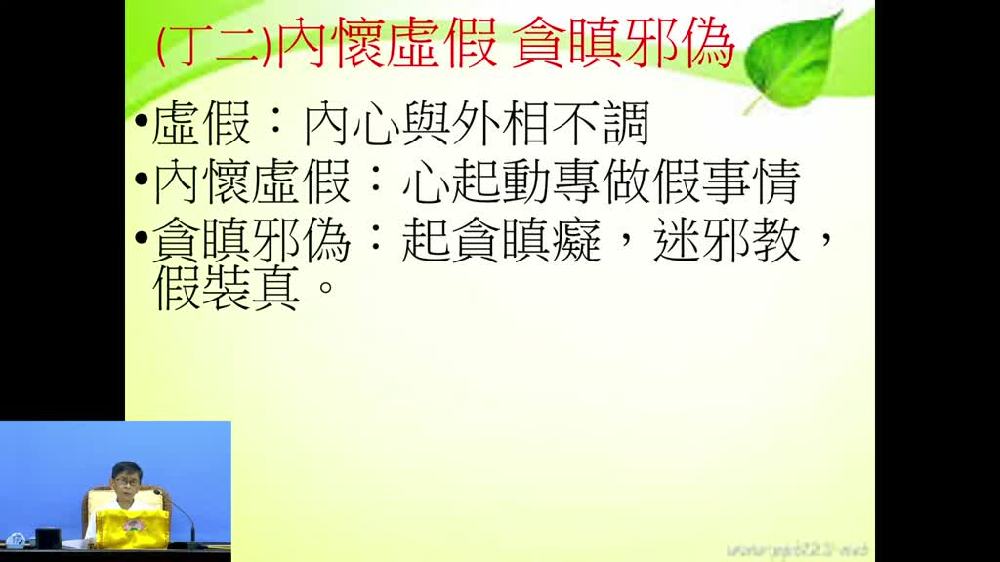

**重點：** 夾雜惡性的第二條「內懷虛假貪瞋邪偽」，講者說這是雪公特別加的，四帖疏裡沒有。虛假是內心念頭與外相不協調：外相賢善精進，心裡卻是另一回事。講者舉例：貪名聞利養；與人比誰念得多是修羅道的瞋；念佛後遇到橫逆就不信因果是癡（講者說其實是重報轉輕報）；進而迷信邪教，以為只憑信願、不必認真念佛。講者並說這與善導大師一天念三萬聲不同。

**標籤：** #內懷虛假 #貪瞋邪偽 #重報轉輕報 #善導大師

那我們來看內懷虛假貪瞋邪偽，這個虛假，所謂虛假就是你的內心的念頭和你表現出來的外相是不協調的，外相是賢善而且精進，很賢德很善良看起來很精進，但是內心裡面是另外一回事，所以叫做虛假，我們來看什麼叫做內懷虛假，就起心動念，專做假的事情，就是起心動念，每個人都會起心動念，你做任何事情都要起心動念，但是起心動念，怎麼叫虛假，也都有做，也都能夠做這個修行，修這個善行，但是，專做假事情，你雖然都有做這些功德 有念佛 但是做假的 做假的事情，那怎麼會做假的事情 因為內心當中怎麼樣 有貪 有瞋 有邪偽，貪瞋邪偽 就內心裡面起了貪戀 可能是名聞利養，內心裡面瞋什麼 像阿修羅一樣 阿修羅一樣就是，輸人不輸陣，我就是要贏過別人。你念佛念五千聲我就念七千聲，你拜佛拜了一千聲我就拜一千五百聲，這不是為了要念佛消業障開智慧，而是怎麼樣跟人家拼，這個就是一種修羅道，修羅道瞋心的，確實有這樣念佛做功德有這種比賽的，這個叫瞋，你雖然也有念佛但是怎麼樣，念佛以後 沒有達到你原來設定的目標，然後心裡面就怎麼樣 怎麼我還 我念佛念了這麼久，怎麼還有這麼多的意外的橫逆，還有這麼多的業障，我們心裡面開始癡 癡就是不相信因果，其實你如果能夠相信因果就知道說，你越念佛然後越這樣出來那是好事情，你念佛以後反而怎麼樣，重報轉輕報，未必是壞事，但是我們就沒有這個智慧，以為念佛以後怎麼還這麼多業障就是起瞋心，所以起貪瞋癡，然後甚至還怎麼樣覺得念佛沒有什麼效果，表面雖然是有念佛但是漸漸漸漸就走上怎麼樣，歪路上面去，迷信這個邪教，迷信什麼邪教？像我們在臺灣就很容易的，好像怎麼樣？我只要慢慢的，我只要慢慢的發現，不一定要念佛，也不要一定要認真念佛，只要怎麼樣，有信願就可以往生，我相信阿彌陀佛就可以往生，是沒錯，你相信阿彌陀佛有願力往就可以往生，但是怎麼證明你有相信，證明你怎麼證明你有願力，那就是要在念佛上面，你不在念佛上面來驗證，你怎麼能夠，你的信心你的願力是落空的，就是說不需要念佛這麼認真，像古德這樣日課多少萬聲不需要，只要秉持信願就可以往生，像這個都是不合乎善導大師的，這和善導大師講的是不一樣，我們昨天有講過善導大師為了註解觀無量壽經，他一天念幾聲佛，三萬聲佛，你說他沒念佛嗎？怎麼可能？但是一般人就是開始，慢慢慢慢就是迷信邪教，假的裝真的，假的慢慢的，明明就是一種假的然後裝成什麼？真的，這個是當年雪公老師講的貪瞋邪偽。

### 投影片 3：蕅益大師所見：裝模作樣的學佛人（07:46–09:57）

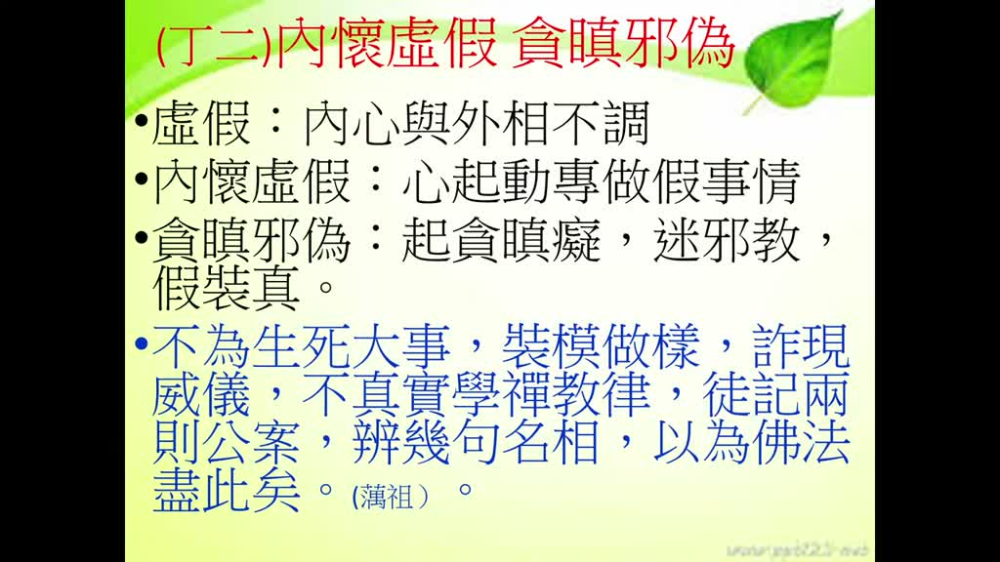

**重點：** 講者說蕅益大師在明末就看到一批人：學佛參禪滔滔不絕、什麼名相都懂，卻不為生死大事，只是裝模作樣、乍現威儀。不真實學禪、學教、學律，只記幾則公案（指月錄）、幾句名相，逢人就談，以為佛法不過如此。這樣學佛不可能往生了生脫死，也沒人能要求，要靠自己警覺。

**標籤：** #蕅益大師 #乍現威儀 #指月錄 #名相

那個這個蕅益大師，他在明朝末年他就看到有一批人，有一批人就是這樣，你說他學佛、參禪，嘴巴裡面說的怎麼樣滔滔不絕，你什麼名相也都懂，他就說但是完全沒有真修實煉，他說不為生死大事，不為就是你學佛念佛不是為了生死大事，只是怎麼樣裝模作樣，這是蕅益大師當年他就這樣講，裝個模做個樣，然後乍現威儀，表面看出來有模有樣，乍現威儀，然後不真實學禪學教學律要注意要真實，不是真實的心來學教，你真實心學教就要很虛心的把教理天台教理怎麼樣，天台教理唯識教理怎麼樣，你用心的去背用心去讀用心去演，不是只是怎麼樣，這個過水，不真實的學禪不真實的學教不真實的學律，然後徒記兩則公案，就是你如果參禪的人就是記得那個那個，那個，指月錄裡面 指月錄裡面很多公案，記得幾則公案以後 逢人 逢人就是談公案，因為你一談公案人家就認為說你這個就是老修行人，不然就怎麼樣 你學教的人也不是按照教怎麼樣來教來觀，來修 按照教理來觀心 來念佛觀心，反而怎麼樣 辨幾句名相，記了幾句名相，跟人家說的時候，也能夠說得滔滔不絕，辨幾句名相，以為佛法盡此矣，以為佛法就這樣，像這種人這樣學佛怎麼可能往生，怎麼可能了生脫死，所以這個要內懷虛假貪瞋邪偽，這個也都是個人的，這個也沒有人沒辦法要求的，個人你自己沒有這樣的一個警覺就會落入這樣，就是這個內懷虛假貪瞋邪偽。

### 投影片 4：奸詐百端：奸與詐（09:57–12:42）

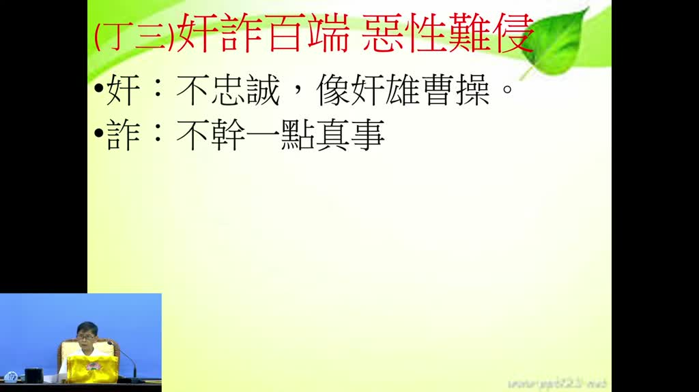

**重點：** 表現出來的行為是「奸詐百端、惡性難侵」。奸＝不忠誠：修淨土卻早晚課有一天沒一天；講者以曹操「挾天子以令諸侯」為例，不篡位卻掌控朝政。詐＝不幹一點真事：念佛只是應酬、看大家念就跟著念，不是真為往生。講者要我們看自己、不要看別人。

**標籤：** #奸 #詐 #曹操 #早晚課

然後接下來講雪公老師進一步的講，表現出來的行為是什麼，奸詐百端 惡性難侵，這個大概也是老師 雪公老師看到的一個狀況，好像都有幾十年的信佛念佛，但是 做的事情是奸詐百端 惡性難侵，這個奸詐百端 奸詐百端，這個老師用比喻，奸就是什麼？不忠誠，就是你明明是修淨土法門的，但是對淨土法門並不忠誠，不忠誠什麼，早課有沒有每天都做完，晚課有沒有每天都做完，這是基本要求的，如果偶爾做偶爾不做，這個就不夠忠誠了，所以這個，奸在中國歷史上最奸的就是曹操，他怎麼奸，他沒有篡位，他並沒有把漢獻帝的那個地位把他拔掉 沒有篡位，沒有篡位 他不篡位，但是他挾天子以令諸侯 把持朝政，所以你也抓不到他的把柄 他沒有篡位，但是整個漢朝的上上下下都是他來怎麼樣掌控的，他也沒篡位 所以你也不能說他是怎麼樣，什麼亂臣賊子，所以他就是要駁了這個名字，你不能說我是亂臣賊子 我沒有篡位，對 這個雪公老師就以曹操來講，曹操就是一種奸雄，這個就是雖然是做得好像怎麼樣，也看也有君也有臣，君臣之間好像都有，但是內心當中可不是如此，完全是違約了君臣的那個界線，第二個 詐，詐是什麼，就是也有做很多的善功德，但是不是真在 真做，不幹一點真事，很多的真的事情並不願意做，所以像這種都是我們很容易犯的，雖然也忙忙碌碌了，做很多善功德也有念佛，但是我們自己反省自己，我們自己可以反省自己，我這個念佛是為了求往生極樂世界嗎，我這個念佛是為，只是看到大家一起念佛，我就一起念佛，是應酬的，還是說不得已才念的，我是這樣我做這一堂功課我真的是為了往生，如果不是那就是詐，那就是詐，所以你這個也不要，要看別人你就看自己，看自己這個，這個叫詐。

### 投影片 5：惡性難侵：明知故犯與默擯（12:42–16:05）

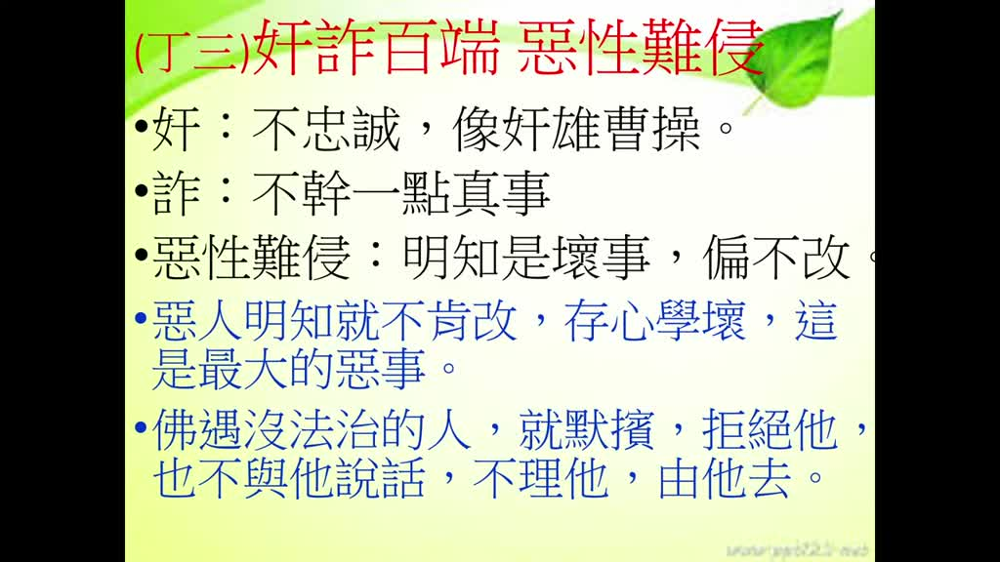

**重點：** 惡性難侵：明知殺、盜、淫、妄、酒是壞事卻偏不改，是最嚴重的惡事（雪公講表上標「大惡」）。不懂佛法的人不能怪，有佛法常識還犯就是大惡。遇到這種人，不要吵架指責，要像釋迦牟尼佛對六群比丘與闡陀那樣「默擯」：不理他、由他去；有慚愧心的人會自己反省，闡陀後來改過並證阿羅漢果（講者主張）。

**標籤：** #惡性難侵 #大惡 #六群比丘 #闡陀 #默擯

奸詐百端，奸詐百端怎麼樣，奸詐百端然後惡性難侵，這個惡性難侵，惡性難侵要注意這個雪公老師這麼樣講明明知道是壞事，比如說殺生、偷盜、邪淫，我們稍微有佛法常識的人都知道，殺盜淫妄酒這根本就是壞事，為什麼？因為這個是會傷害眾生的，殺生、偷盜、邪淫、妄語、飲酒都會傷害眾生，那明明知道是壞事 但是偏不改，偏不改 這個就是叫做惡性難侵，所以這個難侵這兩個字，這個是最嚴重的惡事，最嚴重的惡事大惡，所以這種是最大的惡事，所以雪公老師在他的講表上面就提這兩個字大惡，就是沒有比這個惡還大的，你說外面的人殺盜淫妄酒，因為他不懂，他沒有學過佛法，他去殺盜淫妄酒我們不能怪他，他不知道，但是我們有佛法常識的人，還殺盜淫妄酒，然後怎麼偏不改，這個就是最大的惡事，所以這個叫奸詐百端，惡性難侵，所以那怎麼辦，你遇到這種人怎麼辦，你一定很容易遇到這種人，那雪公老師教我們，你遇到這種人，你也不要跟他去吵架，你也不要去怎麼樣，跟他指責，你就怎麼樣，佛像釋迦牟尼佛一樣，遇到那個沒法治的人，六群比丘，在僧團裡面調皮搗蛋的，還有那個當年釋迦牟尼佛時代，那個闡陀，當年陪釋迦牟尼佛出家的那個車夫，那個闡陀那也是作亂的，到後來都是在僧團裡面作亂，佛是沒辦法治他的，因為佛沒辦法，佛法沒有的，沒有刑法，沒有刑法，不能說打你一頓對不對，或者把你砍掉不能這樣，佛法沒這一套，所以只好怎麼 默擯，默擯 就是暗暗的怎麼樣，把它摒除 就是拒絕他，也不要跟他說話，不要跟他說話 不理他 由他去，人如果有慚愧心，看到大家都這麼樣做，你就會自己就會警覺，所以後來那個闡陀，闡陀雖然是很惡性 惡性難侵，但是他後來有沒有 證得阿羅漢果，所以為什麼他就是有慚愧心，為什麼大家都拒絕我，他自己就反省，改過後來也證得阿羅漢果，所以遇到這種人，雪公老師的生活經驗他的多年的閱歷，他告訴我們遇到奸詐百端惡性難侵的人，你用這個方式，比較能夠不會傷到，我們的，不會傷到那個道印，好 這是，這三種外現賢善精進之相，內懷虛假貪瞋邪偽，奸詐百端惡性難侵。

### 投影片 6：不名真實業：阿彌陀佛因中真實（16:05–20:18）

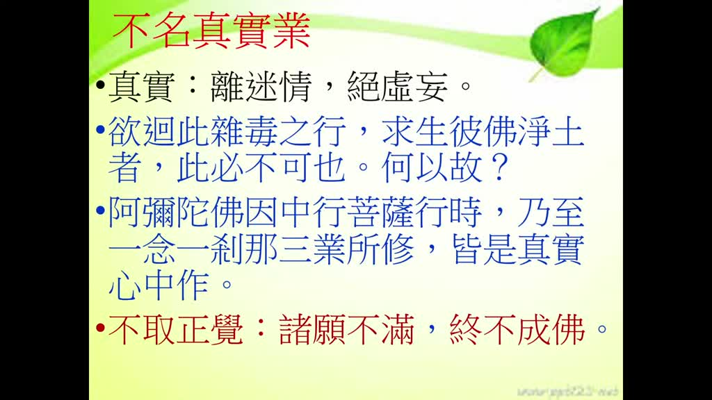

**重點：** 結論：這些都「不名真實業」。真＝離迷情（迷惑、煩惱），實＝絕虛妄。善導大師說想回此雜毒之行求生淨土「此必不可也」。因為阿彌陀佛因中行菩薩道，一念一剎那的三業都是真實心中作；四十八願每一願都有「不取正覺」，諸願不滿終不成佛。虛偽虛假的人不可能生到真實的極樂世界。

**標籤：** #不名真實業 #離迷情 #絕虛妄 #不取正覺 #四十八願

下面有一個標題，一個結論，不名真實業，不名真實業，真實是什麼，什麼叫真實，凡是迷惑，情，情就是煩惱，迷惑煩惱，夾雜的都不真，你做任何事情，如果有迷惑夾雜的情感煩惱的，多不容易，這不是真，所以這個真是要離迷情，離開迷惑 離開煩惱，離開迷惑 離開煩惱，這個才是真，那實是什麼 絕虛妄，完全把那種虛妄的，虛假 作假 不真實的那一套，把它絕除掉，那就是實，所以你有這個上面，外現賢善精進之下，內懷虛假 貪瞋邪偽，奸詐百端 惡性難侵，這個都不叫做真實業，所以這個善導大師就說欲迴此雜毒之行，求生彼佛淨土者，此必不可也，你想要說我現這個假裝這個賢善精進之相，然後內懷虛假然後又奸詐百端惡性難侵，想要往生極樂世界沒這回事，我沒這回事，為什麼沒這回事，你看這個祖師就說了，正由因為阿彌陀佛他就是因中行菩薩道的時候，阿彌陀佛在因中行菩薩道的時候，乃至於一念一剎那修的三業，所修的那個三業，都是真實心中作，因為阿彌陀佛祂做的種種的功德都是真實心中作，都是怎麼樣，和佛性是如絲絲相扣的，所以我們這種虛假貪瞋邪偽，奸詐百端的人，怎麼可能往生到極樂世界去，這個很實在，你這種內心裡面都是表面和內心裡面不一樣的人，不可能生到那種真實的世界，極樂世界就是每樣一花一草，佛境界就是真實的，那種虛偽虛假的怎麼可能能夠有機會伸到那個地方去，所以這個是阿彌陀佛他本身就是這樣做，所以所以看四十八願當中，四十八願當中每一願他的最後都有這四個字，叫什麼字，不取正覺，我沒有達到這樣，我就不取正覺。四十八願當中每一條都這樣，如果沒有能夠讓眾生離三惡道我不取正覺，沒有讓眾生怎麼樣能夠往生極樂世界不取正覺，這個不取正覺這四個字就可以看出來，阿彌陀佛他做任何事情都是真實的，你看諸願不滿終不成佛，如果四十八個願如果都沒有圓圓滿滿的話，不滿的話我就我就怎麼樣，我就下決心不成佛，意思就是說，四十八願每一個願都能夠要怎麼樣，真真實實的落實把它怎麼樣，圓滿了我才成佛，所以阿彌陀佛現在成佛，成佛的話你就可以證明說，阿彌陀佛發的四十八願，每一個願對眾生有利益的，做的善事那都是真真實實的，所以我們如果我們在娑婆世界，我們念佛修行修淨土法門，是這麼樣的虛假不實怎麼可能往生到極樂世界去，這個是不名真實業，這個我們要辨真偽的地方，辨真偽就是來你看看我們所做的所修行的，是不是夠得上叫做真和實，下面講真實。

### 投影片 7：明兩利：自利真實與利他真實（20:18–23:20）

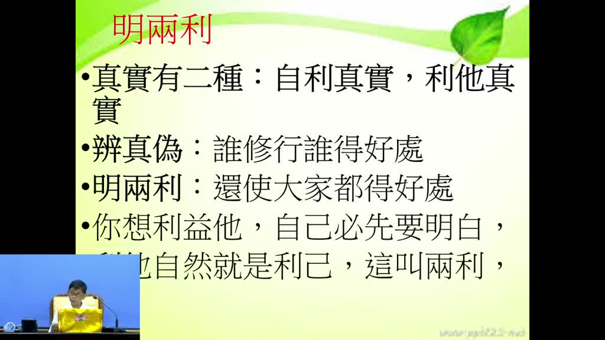

**重點：** 第二大段「明兩利」是雪公獨立從四帖疏特別立的。真實有兩種：自利真實與利他真實；利他同樣不能敷衍了事。辨真偽講自利要真實，誰真實修行誰得真實好處；明兩利則是自己得了好處還要讓大家得，自己有好處別人看得出來，這就是昨天講的「以身證法」。

**標籤：** #明兩利 #自利真實 #利他真實 #以身證法

下面我們要介紹這個明兩利，明兩利，這個是雪公老師，獨立特別從這個四帖疏當中，明兩利我們來看這個明兩利，明兩利的意思明兩利就是我們講真實，真實有兩種一個是自利真實一個是利他真實，就是我們學佛就是你自己修行自己要真實心中作，那麼利益眾生 利他也一樣，不能夠敷衍，不能夠敷衍了，敷衍了事那不是真實心中作，所以真實就是有這個兩種，一個是自利真實，一個利他的真實，利他的真實，自利真實利他真實，所以真實，所以前面這個第一大段辨真偽，辨真偽雪公老師就是這樣特別講，誰修行誰得好處，誰能夠真實修行，誰得真實好處，如果你是裝模作樣的那就得不到好處，辨真偽就是要告訴我們自利要真實，自利要能夠真實 辨真偽，那明兩利，這個明兩利，明兩利就是要能夠，你要利益，你要利益眾生，你要自己，自己怎麼樣才能夠利益眾生，一定是自己得了好處，自己得了好處以後還要讓大家得好處才叫明兩利，所以自己如果沒有得到什麼念佛的好處，你說怎麼樣能夠讓別人來怎麼樣，來引領別人來念佛，別人不會信對不對，別人不會信，如果你自己在念佛上面得到很大的功德，很多很大的善根很大的福德，別人用看也看出來，不必說你看也看出來，所以你自然而然怎麼樣，昨天我們講這個叫以身證法，以身證法，你用親身來證明怎麼樣，證明就是說我念佛真是有利益，所以念了有利益以後不要自己只得自己利益，還要讓大家能夠得利益，所以這個叫做明兩利，所以你從這個明兩利當中，明兩利當中你就可以想，你想要利益他要注意，我們很多人都說發大心熱心要利益眾生，但是一定要先明白有個先決條件，這三個條件一定自己要怎麼樣，佛法的學理你一定修行上面，解行上面自己要明明白白，你才能夠真正利益眾生，所以我們說利他，那麼你利益眾生就是在怎麼樣，利益自己，利益眾生就是利益自己，這個叫兩利。

### 投影片 8：兩利的界限：十迴向以前與初地以上（23:20–25:24）

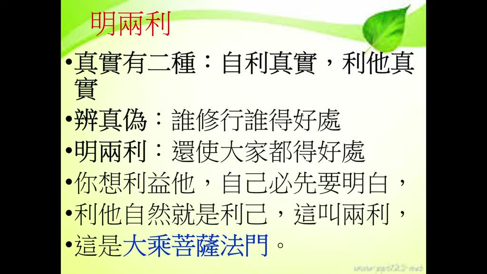

**重點：** 講者說在佛門中兩利很特別：十信、十住、十行、十迴向四個階位都是自利，再怎麼弘法度眾生，目的都是破自己的顛倒煩惱；從初地以上，所有自利修行都是為了利益眾生。這個界限就是為什麼淨土法門是大乘菩薩法門：利益別人之前，先把自己弄得明明白白。

**標籤：** #十迴向 #初地 #自利 #利他

這個在佛門當中這個很特別，為什麼很特別，我們昨天有講菩薩有十信位、十住位、十行位、十迴向，十信、十住、十行、十迴向，這四個階位都是自利，因為你還沒成佛，都是要自己怎麼樣來用功念佛、學佛，是自利，所以這個時候你可能還有一點利益眾生的機會，比如說你有緣跟眾生結緣、佛法，但是再怎麼樣利益眾生都是為了自利，所以在十迴向以前的，在十迴向以前你怎麼樣利益眾生，但是唯一的目的就是破自己的顛倒煩惱，所以不要認為說真的在利益眾生，十迴向以前你怎麼樣的，怎麼樣的弘法，怎麼樣度眾生，都是為了破自己的顛倒煩惱，都是為了自利，但是從初地以上，初地以上初地二地三地，初地以上，你所有的自利，都是利他，這不一樣，因為你在初地以上也是要怎麼樣，也是要深信三寶，念佛念法念僧，也是要念佛念法念僧，但是初地以上所有的自利修行都是怎麼樣，能夠為了利益眾生，所以這兩個這有一個界限，所以十迴向以前的，你再怎麼樣弘揚佛法都是為了自利，斷自己的、破自己的顛倒煩惱，所以這個我們說雪公老師說利他自然就是利己，所以我們修淨土法門為什麼，這個叫大乘菩薩法門，修淨土法門就是大乘菩薩法門，他的原理就在這邊，因為你要利益別人之前，你要把自己怎麼樣，自己先能夠弄得明明白白，弄得明明白白，這個是明兩利。

### 投影片 9：丙一制捨自他諸惡：克己復禮（25:24–27:15）

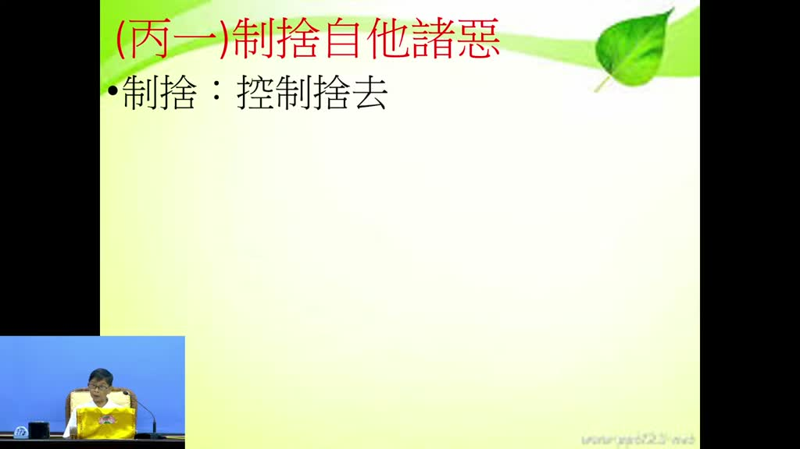

**重點：** 丙一「制捨自他諸惡」：制＝控制，捨＝捨去，對象是自己和別人所有的惡行。講者以《論語》克己復禮為仁說明：先剋制降伏自己的煩惱，再按正常的禮去行，就是利益眾生。真實心中制捨諸惡的做法，雪公沒多講，印光大師有講得很清楚。

**標籤：** #制捨 #克己復禮 #印光大師

明兩利下面我們看丙一，丙一叫做制捨自他諸惡，制捨自他諸惡，制捨這兩個字，制捨這兩個字比較少聽到，制捨是什麼意思，第一個控制，第二個捨去，自他諸惡，就是自己和別人的所有的惡行，我們要能夠控制，控制，然後控制以後，然後把它捨去，捨去，這個就是論語裡面講的，克己，克己復禮的克己，克己就是剋制自己的煩惱，能夠把自己的煩惱能夠剋制降伏，然後復禮怎麼樣，能夠按照正常的該有的禮來行，這個就是利益眾生，這個叫仁，克己復禮為仁，所以什麼叫仁，就是第一個你要能夠剋制自己的煩惱情緒，所以這邊叫制捨，控制捨去，控制捨去自他諸惡，那控制捨去自他諸惡，你看這個第一條叫真實心中，真實心中制捨諸惡，真實一樣要真實心，真實心中制捨諸惡，你說怎麼樣能夠在心裡面很真實的控制，捨去我們種種的惡業，這個雪公老師沒有多講，但是在印光大師文章裡面，他有講得很清楚，要能夠很真實的把我們內心當中，我們的身口意的三業的拔掉的話，去除掉。

### 投影片 10：誠心淨意：如面佛天（27:15–30:23）

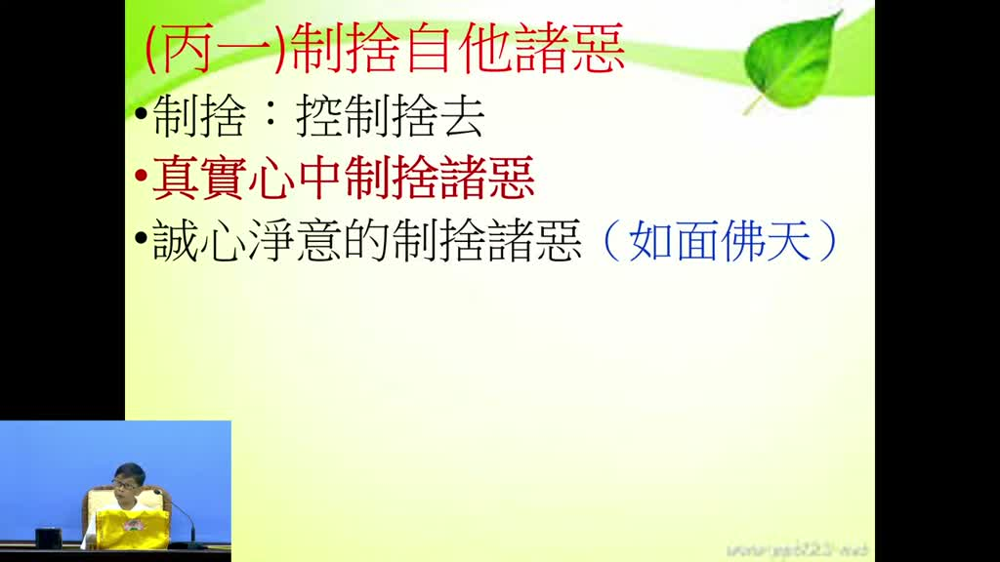

**重點：** 印光大師的方法叫「誠心淨意」：不檢內外明暗，都如面對佛天。講者以「舉頭三尺有神明」、佛有天眼通天耳通他心通說明沒人看到的地方也瞞不過佛，並以孫悟空翻不出如來掌的故事比喻。又引《大學》曾子「十目所視，十手所指」，勸人連上網看不三不四的東西也不敢，因為佛菩薩就在旁邊。

**標籤：** #誠心淨意 #如面佛天 #舉頭三尺有神明 #十目所視

有一個印光大師他有個方法叫做，誠心淨意，要很誠心很親近的意思來制捨諸惡，他有個形容叫做，你隨時隨地不檢內外明暗，不檢內不檢外不檢明不檢暗都怎麼樣，如面佛天，如面佛天就是你不管是沒人看到的地方，有人看到的地方都是怎麼樣，面對佛天，我們說人的頭上都有怎麼樣，有一片天，舉頭三尺有神明，你如果心中有這樣的念頭，舉頭三尺有神明，你敢幹壞事嗎，我們就不敢幹壞事，因為舉頭三尺有神明，那如果我們學過佛法，我們都知道佛有什麼通，佛有天眼通、佛有天耳通、佛有他心通，所以你在哪個地方幹壞事，佛知不知道，瞭若指掌，所以你說為什麼孫悟空，孫悟空說他那個翻了筋斗，翻了好幾個筋斗，十萬八千里，好像就能夠脫離了，那個如來佛的那個手掌，不可能，還在怎麼樣，那五指山上面還怎麼樣，還在那邊撒一泡尿，說證明說我這個老孫曾經來過，那後來他認為他已經脫離瞭如來佛的手掌，那佛說你聞聞看我的手指，還有什麼味道，還有你的尿騷味，可見怎麼樣，你孫悟空翻了十萬八千里，也沒有離開怎麼樣，佛的如來掌，如來佛掌，但這個是比較通俗的講法，其實你瞭解佛法的常識就有，佛有他心通、佛有天眼通、佛有天耳通，你在這個地方念佛，佛聽得到嗎，你在這個地方用心念佛，佛看得到嗎，當然看得到，這瞞不過，所以叫如面佛天，這個是佛法的一個基本的，你學過唯識就有這個教理，所以你如果有這樣的一個概念，舉頭三尺有神明，佛菩薩都有這些神通，我們大概就不太敢，在沒人看到的地方就有一套，別人看到的地方又另外一套，這樣就能夠叫誠心淨意，我們中國《大學》裡面曾子就有講，十目所視，十手所指，十目所視，十手所指，其嚴乎，十目就是十個人，不是五個人，十個人看著我們，十個人指著我們，我們哪能敢，你怎麼敢上網看一些不三不四的東西，佛菩薩就在旁邊，我們怎麼能夠看那些不三不四的東西，如果你能夠有這樣的一個概念，就是能夠真實心中制捨諸惡。

### 投影片 11：行住坐臥想同菩薩：臨之以莊（30:23–34:05）

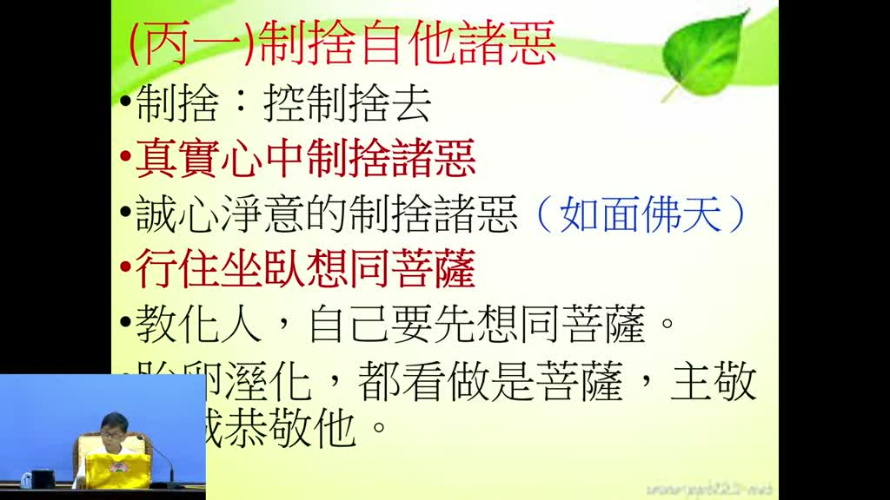

**重點：** 丙一的第二條「行住坐臥想同菩薩」：走路、坐、臥都像菩薩一樣莊嚴，沒有一尊菩薩走路歪歪扭扭或躺得不堪入目。還要把胎卵濕化一切眾生（包括貓、狗、蚊子、蟑螂）都看作菩薩，主敬存誠。雪公引孔子教季康子「臨之以莊則敬，孝慈則忠，舉善而教不能則勸」說明以莊嚴的行為感化人。

**標籤：** #想同菩薩 #胎卵濕化 #主敬存誠 #臨之以莊

下面講，行住坐臥想同菩薩，行住坐臥，你走路的時候 坐著的時候 躺下來的時候，睡覺的時候 站著的時候，行住坐臥 想同菩薩，怎麼樣想同菩薩，想同菩薩的話就是，就是你想要教化人家，想要教化人家自己要先想，自己像個菩薩一樣，你看哪一尊菩薩走路是走得歪歪扭扭的，哪一尊菩薩躺的是什麼，躺得不堪入目，每一尊菩薩的莊嚴相，你就可以知道菩薩他要教化人一定怎麼樣，自己表現出來的行住坐臥，那就是非常莊嚴的所以這個叫做 胎卵、濕化都把他看作是菩薩我們講的眾生這個眾生不是隻有人，胎生的，人也是胎生，但是雞、鴨、鵝，乃至於牛、羊，這些胎生，都把他看作菩薩，濕生，雞、鴨、鵝這個是卵生的，雞、鴨、鵝這是卵生的，但是牛、羊這個都胎生的，所以你看這些眾生的時候想成菩薩，甚至濕在那個陰溝裡面，能夠會長出來的蚊子、蟑螂這些也是看成菩薩，化就是化身的，化身的都看成菩薩，能夠主敬存誠恭敬祂，這個確實要學起來，要慢慢的練習，能夠把所有的眾生，這個不容易，你看到人你可能會主敬存誠，你看到一隻貓你會主敬存誠嗎，你看到一隻狗你會主敬存誠嗎，可能不一樣，但是學佛以後慢慢就要改了，貓也是眾生，也有佛性，狗也有佛性，慢慢的就要主敬存誠對他們，所以這個地方，雪公老師就說要臨之以莊，臨之以莊，這是孔子教季康子的，季康子曾經問說使民敬忠以勸，就是怎麼樣能夠讓人民聽話，能夠讓人民忠心，讓人民能夠改善，使民敬忠以勸，那孔子就教他，第一個臨之以莊則敬，你面對老百姓的時候不能嬉皮笑臉，行住坐臥有模有樣，要能夠很莊嚴，那老百姓看到你這樣，他就會尊敬，臨之以莊則敬，孝慈則忠，你能夠自己，自己能夠對自己的爸爸媽媽能夠孝順，對自己的國君能夠忠心，老百姓就能夠忠心，孝慈，人家就不敢不忠心，舉善而教不能則勸，讓那個優秀的人，善好的人來教那個不善的人，他就能夠改變了，所以臨之以莊，臨之以莊則敬，所以我們如果說要能夠把自己的一些惡業，要能夠去除掉的話，要行住坐臥，行住坐臥想同菩薩，這個行住坐臥想同菩薩。

### 投影片 12：淨行品：觀念一轉就想同菩薩（34:05–36:54）

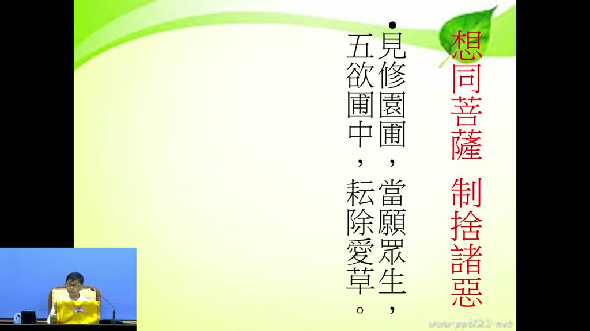

**重點：** 文殊菩薩教人修《華嚴經》淨行品，講者說共 141 則偈（講者主張，未查證）。例如見修園圃，當願眾生，五欲圃中，耘除愛草（五欲財色名食睡）；見樂著人，當願眾生，以法自娛，歡愛不捨：看到人吃喝玩樂，轉念希望眾生以讀經、念佛、拜佛、研討為最大娛樂。生活中觀念一轉，就是想同菩薩。

**標籤：** #淨行品 #文殊菩薩 #耘除愛草 #以法自娛

我們來看看，文殊菩薩，文殊菩薩，他教人家修淨行品，淨行品，淨行品就是文殊菩薩教眾生怎麼樣能夠建立佛法的對真如本性的一個信心，他總共列了141條的那個偈子，像平常我們看，大小便利，當願眾生，棄貪瞋癡，蠲除罪法，那個就是文殊菩薩教人，你看他還有教其他的，他說見修園圃，你看，哇，你在外面看人家怎麼樣，哎，這個草長得太高了，就把它修齊。你看到人家在剪樹木、修草皮的時候，你不要認為無事，你不要認為說，這沒什麼和我沒有關係，不要。你如果善於學習的人，就要做如是觀：見修園圃，當願眾生，五欲圃中，耘除愛草。耘除愛草，五欲財色名食睡，我們這個也一樣，我們心裡面如果，我們的心裡面長草，長什麼草，財色名食睡，這種草，雜草，雜草長出來以後，我們也怎麼樣，耘除愛草，這愛就貪愛，貪愛就是草，所以你看到人家修，修草坪的時候，剪樹的時候，就做如是想，還有你看，見樂著人，哇，你看有些人很貪圖怎麼樣，吃喝玩樂，對看到那個很貪吃貪喝貪玩貪樂的人，你看到的時候怎麼想，這也就是一樣，想同菩薩，怎麼樣想同菩薩，你看到的時候你要這樣想，當願眾生，希望所有眾生也能夠樂著，但是不是樂著吃喝玩樂，是以法自娛，能夠以學習佛法來當作最大的娛樂，以法自娛，歡愛不捨，那個多好對不對，如果你能夠把讀佛經來念佛，甚至拜佛，甚至來學習研討，能夠把這個東西當作最愛的，如果這樣的話，你看看到人家吃喝玩樂的時候，你能夠這樣一轉，這個叫想同菩薩，所以觀念當中一轉就想同菩薩，這個在生活當中，這個在淨行品，這個華嚴經淨行品，總共有141則，每一則都是這樣，都教人家行住坐臥想同菩薩，好這個。

### 投影片 13：自利利他：五乘與聲聞、緣覺、菩薩（36:54–39:01）

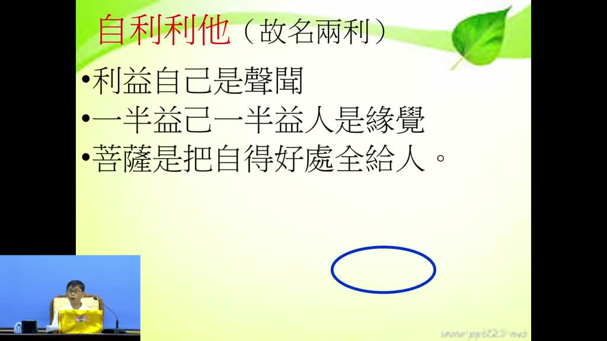

**重點：** 能制捨自他諸惡、想同菩薩，就是自利利他，也就是「明兩利」。雪公以五乘（人、天、聲聞、緣覺、菩薩）分析：人天不能明兩利；聲聞斷見思惑，卻只想享受涅槃、不再來三界，只利益自己；緣覺連習氣也斷了，一半利己一半利人；只有菩薩把自己所得的好處全部給別人，這才是菩薩道。

**標籤：** #五乘 #聲聞 #緣覺 #菩薩道

然後我們再看最後一個結論，如果能夠制捨自他諸惡，叫自利利他，自利利他，這個就是能夠真實心中制捨諸惡，行住坐臥、想同菩薩，你就能夠自利利他，自利利他所以叫兩利，明兩利的兩利，這個地方雪公老師有分析一下，一般我們佛法講，我們五乘佛法，五乘佛法就是人、天、聲聞、緣覺、菩薩，人、天、聲聞、緣覺、菩薩，人、天就不必說了，因為他沒辦法什麼明兩利，聲聞是斷了見思惑的，聲聞是斷了見思惑，他能不能利益眾生？不能。為什麼？聲聞他雖然能夠斷掉自己的煩惱，但是他沒有利益眾生的心，他覺得說我自己的煩惱斷了以後，我就開始享受，享受什麼？ 涅槃，涅槃裡面就是沒有煩惱的極盡的境界，我要享受那個，我再也不要到娑婆世界來了，我再也不要到三界六道輪迴來了，永不 永不 永不，這種人叫做什麼 利益自己 所以聲聞只能夠利益自己 不能夠明兩利，緣覺 緣覺就是因為他不僅斷了煩惱見思惑 而且斷了煩惱習氣，連習氣都斷了 這種人一半利益自己 一半利益別人，他雖然斷了見思惑、習氣，但是他利益自己，他利益自己之外，有緣的時候他還是會利益眾生。所以一半利益別人，一半利益自己。只有菩薩。菩薩才怎麼樣？這個確實這個我們也是要學習，把自己所得的好處，不要佔為己有，完全給別人。

### 投影片 14：迴向功德：自利與利他（增上緣）（39:01–43:07）

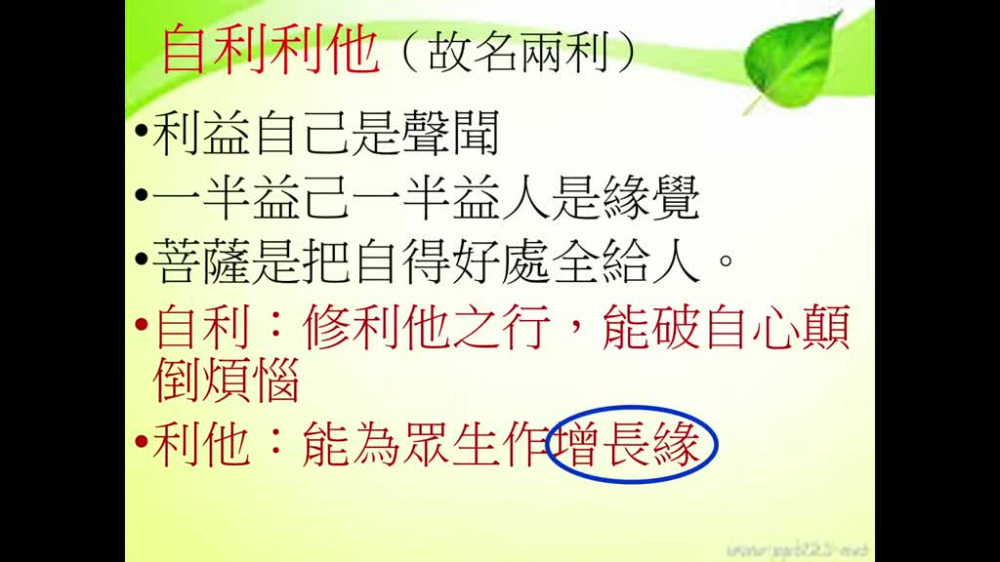

**重點：** 把功德迴向給別人，連仇人也要迴向，有人會捨不得。自利是破自心的顛倒煩惱：功德若捨不得就是貪戀，能捨才是破貪。利他是為眾生做「增上緣」，讓他們善根增長。雪公比喻：迴向像把埋在土裡幾十年的大石頭慢慢搖動，肉眼看不到效果，但終有一天會鬆動滾下來，迴向功德不可思議。

**標籤：** #迴向 #增上緣 #自利 #大石頭比喻

這個就是菩薩道。菩薩道就是把所有自得的好處，全部都給別人。全給別人，你說把自己的好處，自己辛辛苦苦，自己辛辛苦苦做的功德，念的佛法都迴向給別人，會不會有人捨不得，確實會有些人會捨不得，我念了一天的佛，為什麼還要把這個佛迴向給人，不僅你要迴向給自己的親人，阿公、阿嬤、爸爸、媽媽那沒話說，還要迴向給誰？仇人，哦 那個心裡面開始就糾結了，其實 這個就是不對了，什麼人都應該要迴向，把功德都迴向 這個才是行菩薩道，那你說把這個功德都能夠迴向給別人做什麼用？第一個是自利，剛才我們剛才跟他解釋，修利他之行，你就是能夠把所有的功德，能夠把好處給別人，就是要能夠破自心的顛倒煩惱，因為你做的功德，布施也好、持戒也好、忍辱，所做的念佛，所做的功德如果有那麼一點捨不得，那就是貪戀，那就是貪心貪戀，那學佛以後怎麼還會增長貪戀，所以捨得，能夠捨得給別人，那就是破自心的顛倒煩惱，所以你看為什麼人家菩薩捨得，甚至我們看那個經典裡面講，不僅布施錢財，連頭、眼睛都可以捨給別人，我們當然做不到，但是我們都可以知道，他們就是要破自心的顛倒煩惱，這個是自利，然後利他，利他是什麼，能夠為眾生做增上緣，要特別這三個字，增上緣，增上緣就是說，因為你把很多的念佛的功德、學佛的功德、研經的功德迴向給別人，那眾生怎麼樣？他可以增長，什麼增長？善根可以增長，善根，他的善根就增長，所以你為什麼要很勤快的每天都念佛迴向給你的親朋好友，念佛功德，迴向給一切眾生，上報四重恩，下濟三塗苦，那就是為了讓他們怎麼樣，得增上緣，這個有效，你不要認為說沒有效，你會說，我迴向了半天耶，我迴向了好幾年了，怎麼看起來沒效果，不是這樣，這個雪公老師有個比喻，這個迴向的功德，這迴向功德就好像怎麼樣，那個大石頭，埋在土裡面，這個大石頭埋在土裡面，你要把這個大石頭搬出來，就像把別人的業障拔掉一樣，你不可能一下就拔掉，這個石頭埋在土裡面埋了可能幾十年幾千年，你一下拔掉不可能，但是迴向就是什麼，迴向就開始搖動，就是讓這個大石頭怎麼樣，慢慢的搖慢慢動慢慢搖慢慢動，所以你看見怎麼樣，經過了幾年還是在那邊，那不是有經過搖有經過動以後，這個石頭慢慢怎麼樣，開始鬆動，鬆動哪一天他就滾下來了，所以迴向不要認，這個迴向的迴向不可思議，迴向功德不可思議，因為你我們凡夫肉眼，你看不，你只能看起，眼前的好像沒效，但是久了以後，佛法力量的出現，所以，我們說利他是能夠為眾生做增上緣，好，這個是為什麼，哎，我們要學這個好，哎，念佛修行，要能夠制捨自他諸惡明兩利，這是第一段。

### 投影片 15：丙二勤修自他凡聖等善：饒益有情不惱眾生（43:07–46:52）

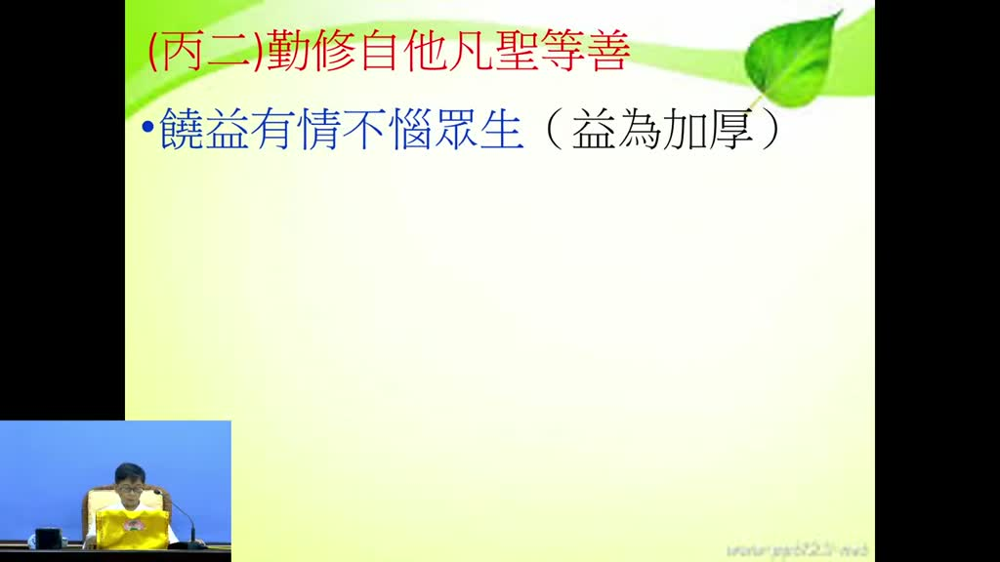

**重點：** 進入第二段丙二「勤修自他凡聖等善」，下有三條，第一條「饒益有情、不惱眾生」。講者舉生活小事：古人「憐蛾不點火」怕飛蛾撲火；晚上餓鬼道眾生特別飢餓，聽到碗盤碰撞聲會飢火中燒，所以放碗盤要輕輕放。講者說這些小事做了就有功德，懂得的人才會做。

**標籤：** #丙二 #饒益有情 #不惱眾生 #憐蛾不點火

第二段我們看丙二，丙二叫勤修自他凡聖等善，勤修，勤修自他凡聖等善，就是自己的善，還有眾生的善我們要勤修自他凡聖等善，勤修自他凡聖等善下面有三條，三條，要注意這個第一條叫，饒益有情不惱眾生，饒益有情，你說怎麼樣勤修，凡聖等善，聖人的善，凡夫的善，聖人的善法，凡夫的善法不一樣，等一下我們來介紹，第一條這個就是，這個凡夫的善法，饒益有情不惱眾生，第一條你就要做到這個，饒益有情有情眾生，這個有情眾生就剛才講的胎卵、濕化，對所有的胎卵、濕化的眾生我們怎麼樣，不要薄要豐要厚，要豐要厚，所以像這些地方我們如果沒有學佛，佛殿下 明天 請勿用，古代的人他們用那個什麼油燈，為了愛惜這個為了怕這個飛蛾撲火，所以為憐蛾不點火就是怕那個飛蛾撲到這個油燈上面就燒死了，所以有一些人他憐蛾不點火，不點火，就是為了愛惜眾生，還有我們說晚上我們像這個晚上我們這個吃完飯用完餐，用完餐了以後要注意，那個碗和筷子，碗筷放在那個那個洗碗，那個什麼，我也不太會講，我們家沒有那個東西，我們家是比較簡陋的，宗宛，我們家沒有這個，所以我也不知道什麼，烘碗機，你把那個碗盤放在烘碗機裡面的時候，一定要輕輕放，這個沒有學佛的人不知道，為什麼要輕輕放？我們說洗碗就丟進去，洗碗就丟，不行這樣，要怎麼樣？就是你如果能夠瞭解佛法，因為晚上哪一類眾生特別飢餓？餓鬼道眾生，餓鬼道眾生，餓鬼道眾生到晚上就特別飢餓，要吃吃不到，但是聽到你那個碗盤的聲音，那個飢火中燒，飢火中燒以後，所以一般我們如果能夠饒益有情的眾生，饒益有情的人，他就會怎麼樣，輕輕的把碗盤放到那個烘碗機裡面，就是怕驚擾了，讓餓鬼道眾生，心，像這些小事情，這個是小事情你在生活當中，你做就有功德，你不做就沒有功德，這個完全看自己要不要做，你懂得的人就會做，懂得的人就有功德，你不懂得就沒有功德，所以這個，這個叫饒益有情不惱眾生。

### 投影片 16：四種利益眾生：布施、愛語、利行、同事（46:52–48:59）

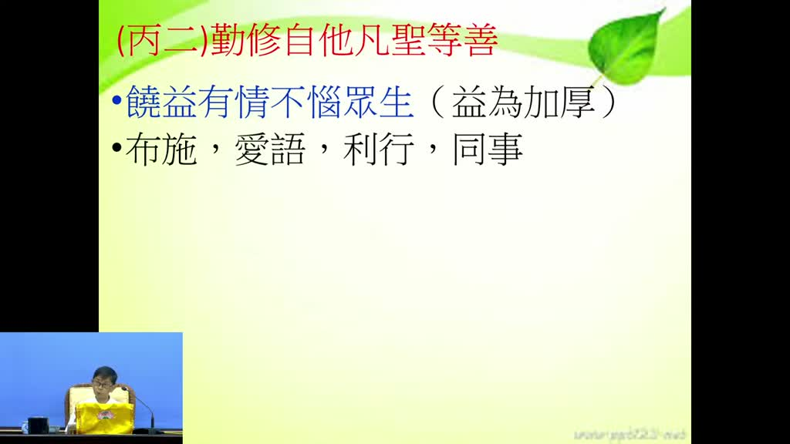

**重點：** 饒益有情有四大類：布施（缺錢給財布施、愚癡給法布施、害怕給無畏布施）、愛語（鼓勵的話，有時比財物更有幫助）、利行（他做善事不足處幫助他）、同事（跟他一起工作）。每個人都有不足，隨時可做，如昨天講的葛繁每天想盡辦法找善事做。

**標籤：** #財布施 #法布施 #無畏布施 #愛語 #利行 #同事

這個饒益有情不惱眾生，我們先看第一個，饒益有情，怎麼樣饒益有情，就是很基本基本就是有四大類，第一個布施，法布施，財布施，無畏布施，他缺錢的時候財布施，如果愚癡的時候就法布施，要給他佛法給他學問，那麼如果他害怕就是無畏布施，那這個就是饒益有情的布施，饒益有情，這個在我們生活當中，我們生活當中哪一個人會覺得不需要幫助，每一個人都有欠缺，每一個人都有怎麼樣，有自己不足的地方，所以你看到這些不足的地方，你就怎麼樣，能夠財布施、法布施、無畏布施，所以隨時都可以做，像我們昨天介紹的，介紹葛繁，葛繁為什麼能夠得到閻王的尊敬，他就是每天都想盡辦法找善事做，所以光是布施就可以，第二個叫愛語，愛語就是一種不要怎麼樣，愛語就是鼓勵的話，如何鼓勵的話，這個有時候比什麼，比實質的財物還有幫助，你一句很溫暖的問候，很溫暖的一種讚嘆，很溫暖的一個跟他稱許，他可能怎麼樣，心裡面就那種勇氣全部都出來了，所以這個是愛語，第三個叫利行，跟他一起工作，看到人家忙什麼事情的時候，跟他一起做，這個會讓人得到很大的鼓舞，利行，然後同事，利行，同事才是跟他一起工作，利行就是能夠幫助他，他做善事的時候，哪個地方不足，我們能夠幫助他，能夠幫助他，這個叫做，這個是我們佛法常常講的，這個四種利益眾生的。

### 投影片 17：弘一大師以身示範與結語（48:59–50:25）

**重點：** 講者說弘一大師對「饒益有情、不惱眾生」以身示範：怕蚊子就掛蚊帳，捉到蚊子、蟑螂放到空曠處，坐竹椅前先搖一搖讓裡面的蟲驚醒離開。懂得生活細節就會做得圓滿，時時做這種功德，就能明兩利、隨時自利利他。講到此休息。

**標籤：** #弘一大師 #掛蚊帳 #搖椅子 #明兩利

我們看弘一大師，弘一大師對這些事情，饒益有情不惱眾生，他那個就是以身示範，比如說你怕蚊子，你不要說蚊子叮到以後就打一下，他說你既然怕蚊子就掛蚊帳，掛蚊帳，掛蚊帳也是，甚至如果捉了蚊子以後，把它放到空曠的地方去，有時候你捉了一些蚊子或者蟑螂，你就放在空曠的地方去，然後你看他人家坐在，以前就坐竹子的椅子，竹子的椅子常常會住蟲，所以為了他怕坐下去會壓到蟲，我們不懂的人，我們就坐下去，但是他坐的時候都要搖一搖，搖搖 搖搖 椅子 為什麼 讓裡面的蟲怎麼樣 能夠 能夠驚醒 能夠離開，不要傷害到眾生 像這些生活當中的細節 生活當中細節 如果你懂得的話 你就會做 做得非常的圓滿，然後時時都能夠做這種功德 能夠明兩利 隨時都能夠自利利他 我們先休息一下，一、二。

## 已知轉錄錯誤

| 時間 | 聽成 | 應為 |
|---|---|---|
| 01:26–01:58、01:58–02:33、08:27–08:58、15:56–16:28、35:13–35:43 | Groq 長音訊整段 30 秒漏轉（自動補漏未偵測到） | 單獨重送 Groq 補回，再套簡轉繁、詞典、去語助詞 |
| L170 | 遍己俱名相以為佛法盡此意 | 辨幾句名相，以為佛法盡此矣（依 05:30–09:35 投影片「蕅祖」引文校正；講者前文已說「辨幾句名相」） |
| L207 | 要駁了這個名字 | 推測：語意不明，保留 |
| L215 | 違約了君臣的界線 | 推測：語意不明，保留 |
| L312 | 道印 | 推測：可能為他字，保留 |
| L944 | 佛殿下 明天 請勿用 | 推測：語意不明，保留 |
| L959 | 宗宛 | 推測：類似洗碗機／烘碗機之類的電器，講者自稱「我也不太會講」，保留 |
| L87、L93 | 嗔／癡 | 依語意改為瞋／癡（推測） |

## 補充資料連結

- 補充資料檔：[supplement.md](supplement.md)（與本報告同資料夾；內容已收錄於上方〈補充資料〉）
- 思維導圖：[mindmap.png](mindmap.png)、文字大綱：[mindmap.md](mindmap.md)（與本報告同資料夾）
