# 會性法師-大佛頂首楞嚴經-第104集

- 來源：https://youtu.be/OcQc8e9m-v8
- 平台 / 上傳者：YouTube / 會性法師-講經集
- 長度：1:12:13 (4333.2s)
- 逐字稿來源：whisper (groq)
- 更新日期：2026-10-24
- **關鍵字：** #楞嚴經 #圓通 #耳根圓通 #觀世音菩薩 #光瑞齊現 #文殊選圓通 #覺海性澄圓 #歸元性無二 #方便有多門 #佛經講座

## 摘要與名詞說明

**一句話重點**：講完第六卷「結顯圓通名號」（觀世音菩薩的名號由來）與「光瑞齊現」（佛放光、天雨寶蓮華），進入第七科「文殊選圓通」：說明佛為何要請文殊為阿難揀選法門（簡機不簡聖、簡情不簡法），並開始解說文殊偈頌的頭幾句「覺海性澄圓…迷妄有虛空…空生大覺中…歸元性無二，方便有多門」，結尾用吃飯比喻說明法門平等，下次再講「怎麼選」。（影片是講經，經文與古註的詮釋皆為講者主張，未查證。）

- 來源：YouTube（上傳者「會性法師-講經集」）；片長 1:12:13；講課實際結束於 70:21，之後約 1 分鐘為講者簡介畫面。
- 逐字稿：Whisper（Groq），已用燒入字幕 OCR 逐行比對校正；影片畫面為佛像背景、直排科判與經文及逐句字幕。
- 畫面上的科判與完整經文、偈頌見 `supplement.md` S1。
- 語助詞（呢、啊、啦等）已去除，`transcript.raw.md` 保留原話。

## 重點表

| 時間 | 重點 |
|---|---|
| 00:36 | 更正「母陀羅」，進入第六卷「結顯圓通名號」 |
| 02:00 | 經文：佛問圓通，我從耳門圓照三昧 |
| 04:30 | 緣心自在與三摩提 |
| 05:49 | 因入流相、得三摩提：三昧與三摩地用字 |
| 07:13 | 成就菩提，斯為第一 |
| 08:16 | 觀世音名號的由來 |
| 11:11 | 由我觀聽十方圓明，故觀音名遍十方界 |
| 12:30 | 科判：光瑞齊現 |
| 14:34 | 經文：爾時世尊於師子座，五體同放寶光 |
| 15:55 | 師子座的意思與寫法 |
| 17:45 | 五體放光：表六根六塵六識七大皆圓通 |
| 19:15 | 光灌十方諸佛與菩薩頂 |
| 21:25 | 十方諸佛亦放光灌頂：佛佛道同 |
| 23:21 | 林木池沼皆演法音 |
| 24:38 | 交光相羅，如寶絲網 |
| 26:04 | 是諸大眾，得未曾有，一切普獲金剛三昧 |
| 27:10 | 天雨百寶蓮華：四色表四十位 |
| 28:34 | 虛空成七寶色，國土合成一界 |
| 30:08 | 第六科完結，進入第七科：文殊選圓通 |
| 31:51 | 為什麼要由文殊來選 |
| 33:31 | 經文：汝今觀此二十五無學…我今欲令阿難開悟 |
| 36:06 | 二十五聖者修行無優劣前後 |
| 39:42 | 既然沒有差別，為什麼還要文殊來選 |
| 41:20 | 「兼我滅後此界眾生」：兼為末法眾生 |
| 43:37 | 佛不能自己選，要旁人選 |
| 44:43 | 簡機不簡聖、簡情不簡法 |
| 46:52 | 文殊領旨：即從座起，頂禮佛足，說偈對佛 |
| 48:37 | 「承佛威神」的兩種解釋 |
| 51:42 | 《楞嚴經》偈頌的特點：先顯眾生佛性平等 |
| 53:04 | 「海」不是比深廣，而是比味道 |
| 56:07 | 圓澄覺元妙：澄靜不動的覺性 |
| 57:13 | 元明照生所，所立照性亡 |
| 59:12 | 迷妄有虛空，依空立世界 |
| 61:30 | 漚滅空本無：無明除則空與三有皆無 |
| 62:41 | 不能說「從真起妄」 |
| 65:24 | 歸元性無二，方便有多門 |
| 67:47 | 吃飯的比喻：法門平等，怎麼選待下次 |

## 名詞與說明
- **結顯圓通名號**：觀音廣說耳門的第三段，總結並顯示所得圓通的名稱「耳根圓通」。
- **圓照三昧／緣心自在**：「圓照」是從果地說耳根圓通的妙用；「緣心自在」是不再用攀緣思慮心，而是徹底圓證本有法性（講者依《楞嚴經文句》）。
- **光瑞齊現**：佛從五體放光、灌十方諸佛與菩薩頂，天雨百寶蓮華、虛空成七寶色，大眾得金剛三昧；講者依蕅益大師《楞嚴經文句》解說，各家看法不同。
- **師子座**：佛的法座；講者說寫作「師子」不是「獅子」，也不是「師父的兒子」。
- **簡機不簡聖、簡情不簡法**：講者主張，文殊選圓通是為了揀選阿難的根機，不是揀選聖者的高低，也不是在法門上分高下。
- **承佛威神**：文殊已成佛卻「承佛威神」，講者的兩種解釋：事相上是示現菩薩應當客氣；理上佛佛道同，也是稟承自己所成佛的威神。
- **覺海性澄圓**：偈頌首句。講者特別主張「海」比的是海水同一鹹味（覺性平等），不是比深廣；並說這個講法其他註解很少這樣說（講者主張，未查證）。
- **從真起妄**：講者不同意「本來是真、後來才起妄」的看法，認為真如與無明一向並存，修行是去除煩惱、恢復本有清淨心。
- **歸元性無二，方便有多門**：講者提醒不是「歸元無二路」；並引天台六即頌「究竟即」說明成佛是恢復本有、不是新得。

## 轉錄校正備註
- 逐字稿與畫面字幕差異以字幕為準；字幕 OCR 本身有簡繁／同音誤判（竟→競、遍→編、薩→隆、從→筱、眾→罪、祂→弛、偈→偶），已排除，只取差異處用字，不整句覆蓋。
- 主要校正：歐南／翁南／臥難→阿難；始方／史方→十方；無體→五體；句頌／句誦→偈頌；眾山→眾生；根本無名→根本無明；圓心自在→緣心自在；光瑞起仙→光瑞齊現；絕海信成淵→覺海性澄圓；巴士→八識；偶伊大師→蕅益大師；穆劍蓮→目犍連 等，完整清單見 `meta.json` 的 `known_asr_errors`。
- 補回 23:25–23:58 約 30 秒整段漏轉（Whisper 只轉出「哦」），改以音訊單獨重送轉錄補入。
- 刪除片頭「The」與 70:40 以後的片尾音樂幻覺（「演唱／詞曲 李宗盛」「全片以 Google Pixel 4 拍攝」等）。
- 推測項（標「推測」，已在 `meta.json` 記錄）：07:20「倒駕慈航」、24:44「交光真鑑」、26:54「五蘊、十八界」、29:37「深入內心」、32:23 長句、53:59 一段、55:57「六祖」句、65:09「這個真是眾生本有」、67:39「天然自性」、69:42「很妙」。

## 補充資料（影片未呈現的資訊）


### S1｜畫面遺漏：科判與經文原文（逐字）
- 來源：影片畫面（會性法師講述《大佛頂首楞嚴經》第104集；畫面為直排文字，由右至左閱讀）；取得日期：2026-10-26；取得方式：從影片截圖逐字抄錄，並以逐字稿核對。
- 為何需要補充：講者只唸經文與口述科判，畫面上的科判標題層級與完整經文、偈頌逐字稿沒有條列；對應截圖 `frames/slide_01.jpg`、`slide_02.jpg`、`slide_06.jpg`、`slide_09.jpg`、`slide_13.jpg`、`slide_17.jpg`、`slide_19.jpg`、`slide_20.jpg`、`slide_21.jpg`、`slide_24.jpg`、`slide_28.jpg`、`slide_30.jpg`、`slide_32.jpg`、`slide_33.jpg`、`slide_36.jpg`。
- 兩處畫面與字幕／逐字稿不同、已以畫面為準：經文「由我觀**聽**十方圓明」（字幕與逐字稿原作「觀十方圓明」）。

**科判（00:36–02:00，`slide_01.jpg`）**
```
辰二　觀音廣說耳門（分三）
　巳一　略敘最初修證
　巳二　廣明成就功德
　巳三　結顯圓通名號
```

**經文：結顯圓通名號（`slide_02.jpg`、`slide_06.jpg`）**
```
佛問圓通，我從耳門圓照三昧，緣心自在，因入流相，得三摩提，成就菩提，斯為第一。

世尊！彼佛如來歎我善得圓通法門，於大會中授記我為觀世音號。
由我觀聽十方圓明，故觀音名遍十方界。
```

**經文：光瑞齊現（`slide_09.jpg`、`slide_13.jpg`、`slide_17.jpg`）**
```
爾時，世尊於師子座，從其五體同放寶光，遠灌十方微塵如來，及法王子諸菩薩頂。

彼諸如來亦於五體同放寶光，從微塵方來灌佛頂，並灌會中諸大菩薩及阿羅漢。
林木池沼皆演法音，交光相羅如寶絲網，是諸大眾得未曾有，一切普獲金剛三昧。

即時天雨百寶蓮華，青黃赤白間錯紛糅，
十方虛空成七寶色，此娑婆界大地山河俱時不現，
唯見十方微塵國土合成一界，梵唄詠歌自然敷奏。
```

**科判：子二（30:08–33:31，`slide_19.jpg`、`slide_20.jpg`）**
```
子二　詳示圓通境令選一門深入（分八）
　丑四　證六根即真妄元，密令選根門圓通
　丑五　借結巾明六解一亡，即漸解而喻修圓通倫次
　丑六　敕眾聖說餘門同證，廣耳門而密授圓通本根
　丑七　由文殊代當機，選耳門為圓通本根
　丑八　敘阿難洎大眾聞法主說圓通利益
```
（畫面直排為分欄呈現，丑四～丑六的斷句依欄位推定；「洎」為畫面字樣。）

**經文：文殊選圓通（`slide_21.jpg`、`slide_24.jpg`、`slide_28.jpg`）**
```
於是如來告文殊師利法王子：
『汝今觀此二十五無學諸大菩薩及阿羅漢，各說最初成道方便，皆言修習真實圓通；彼等修行，實無優劣、前後差別。
我今欲令阿難開悟，二十五行誰當其根？兼我滅後，此界眾生入菩薩乘，求無上道，何方便門得易成就？』

文殊師利法王子，奉佛慈旨，即從座起，頂禮佛足，承佛威神，說偈對佛：
```

**偈頌：覺海性澄圓（`slide_30.jpg`、`slide_32.jpg`、`slide_33.jpg`、`slide_36.jpg`）**
```
覺海性澄圓，圓澄覺元妙；
元明照生所，所立照性亡；
迷妄有虛空，依空立世界；
想澄成國土，知覺乃眾生。
空生大覺中，如海一漚發；
有漏微塵國，皆依空所生；
漚滅空本無，況復諸三有？

歸元性無二，方便有多門；
聖性無不通，順逆皆方便；
初心入三昧，遲速不同倫。
```

### S2｜片尾畫面：講者簡介（71:25 後）
- 來源：影片最後約 1 分鐘的古紙背景文字卡（直排）；影片沒有配音，Whisper 轉出的「演唱／詞曲 李宗盛」「Google Pixel 4」等為片尾音樂的幻覺，已刪除。
- 畫面為對講者的生平簡介（含年份、過世日期等），文字細小、斷行交錯，未逐字抄錄，也不在報告內引用；講者生平與年份未查證。

### 更新原本的推測
- 偈頌「聖性無不通，順逆皆方便」等後段偈文，講者本集未唸到，只在畫面出現，已抄入 S1。

## 思維導圖

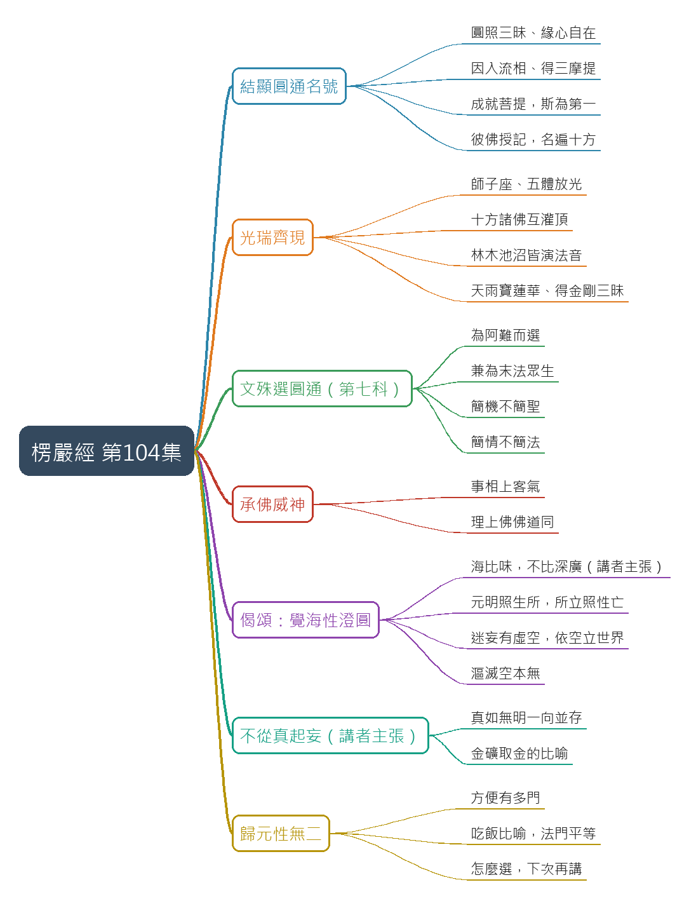

- 原圖：[mindmap.png](mindmap.png)；文字大綱：[mindmap.md](mindmap.md)（與本報告同資料夾）

## 圖文對照（畫面 + 逐字稿）

### 投影片 1：更正「母陀羅」，進入第六卷「結顯圓通名號」（00:36–02:00）

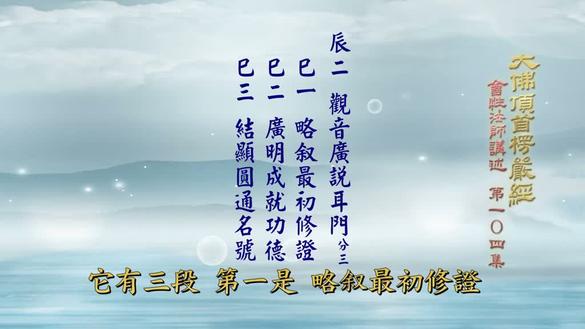

**重點：** 先更正上一集：「母陀羅」是梵語，翻成「印」（印章的印），因為菩薩現八萬四千手臂、每隻手都有手印。接著進入第六卷的科判：第三結「顯圓通名號」，觀音廣說耳門圓通共三段，前面「略敘最初修證」「廣明成就功德」（三十二應、十四無畏、四不思議）已講完，現在總結並顯示圓通的名稱：耳根圓通。

**標籤：** #母陀羅 #結顯圓通名號 #耳根圓通

各位善知識，大佛頂首楞嚴經第六卷，這是結顯圓通名號，在這之前，我先更正上次講的，八萬四千母陀羅臂，母陀羅翻成中國話是印，印章的印，因為菩薩現八萬四千的手臂，每一個手都有手印，所以母陀羅是翻成印，現在我們正式講的經文，就是第三結顯圓通名號，這個科判是從開頭的觀音廣說耳門，關於觀世音菩薩廣說耳門圓通，它有三段，第一是略敘最初修證，第二是廣明成就功德，廣明成就功德就是三十二應、十四無畏、四不思議，這些都已經講過了，所以現在總結上文，顯示所得的圓通的名稱，就是耳根圓通。

### 投影片 2：經文：佛問圓通，我從耳門圓照三昧（02:00–04:30）

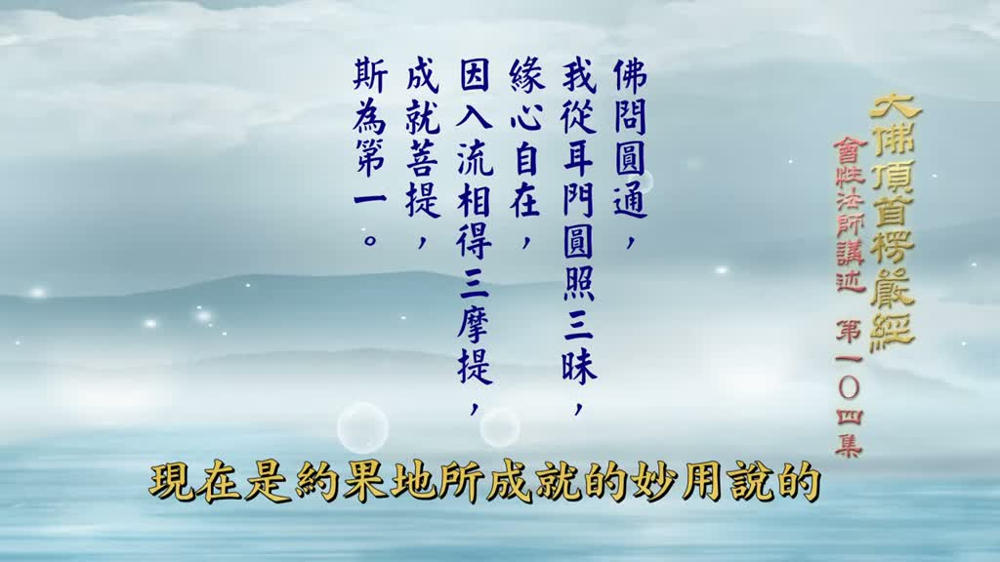

**重點：** 經文「佛問圓通，我從耳門，圓照三昧，緣心自在，因入流相，得三摩提，成就菩提，斯為第一」。這是先答覆佛問的圓通名稱；觀世音是二十五位聖者中最後一位說的，也說得最詳細。「耳門」就是耳根，以「反聞聞自性」為所修法門；「圓照」是從果地說的妙用，因為修成後有三十二應、十四無畏、四不思議。

**標籤：** #圓照三昧 #耳門 #反聞聞自性

經文說，佛問圓通，我從耳門圓照三昧，緣心自在，因入流相，得三摩提，成就菩提，斯為第一，這是先答覆名稱，佛問圓通，開頭的時候，二十五位聖者，還沒有說話之前，佛在當時大會上，給當機作參考，所以佛有問各人修證圓通的情況，現在觀世音菩薩是二十五圓通的最後一位說話，說得最詳細，所以佛所問，我們大家怎樣子證到圓通。我觀世音菩薩自稱，我從耳門，耳門就是耳根，以耳根、反聞聞自性為所修的法門，所以叫做耳門，圓照就是圓通，為什麼圓通又叫做圓照，現在是約果地所成就的妙用說的，圓表示耳根圓通已經修到圓滿的境地，得到究竟圓滿。照顯示得到耳根圓通的妙用，本來是通，現在說成照，就是它的德用。因為觀世音菩薩修成之後，有能起三十二應、十四無畏、四不思議種種微妙的功用，所以叫做照。三昧就是定，由此成就斷了生死、成佛道的定境，由此成就究竟最圓滿的定功，由此開發智慧，斷煩惱，果德究竟已經證到。所以叫做圓照三昧。

### 投影片 3：緣心自在與三摩提（04:30–05:49）

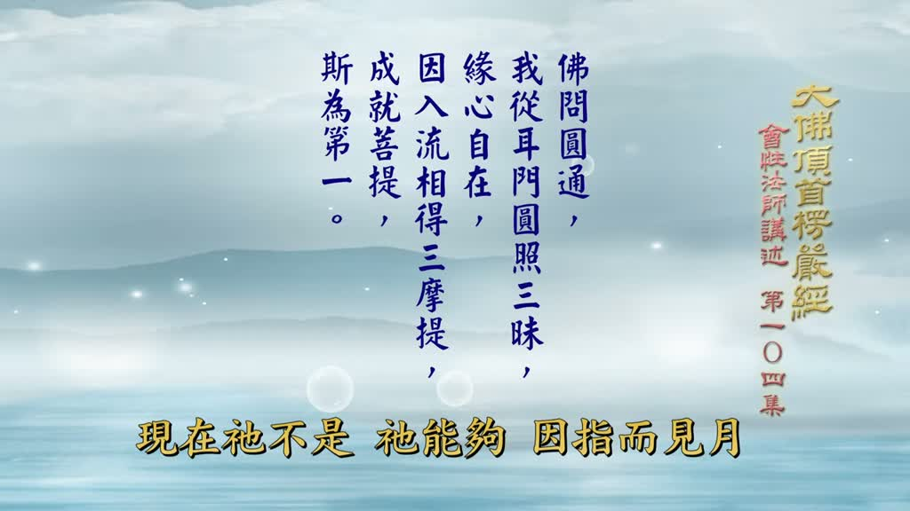

**重點：** 「三昧」是定，由此斷生死、成佛道，開發智慧、果德究竟。「緣心自在」：凡夫能緣的心都不自在，菩薩證到耳門圓通才究竟自在；《文句》解釋不是以因緣、攀緣、思慮心去聽法，而是徹底圓證本有的法性，證入圓、通、常三種妙法，所以能生起三十二應、十四無畏、四不思議等妙用（只是舉例，實際無窮無盡）。

**標籤：** #緣心自在 #文句 #三十二應

緣心自在，我們凡夫能緣的心都不夠自在，菩薩證到耳門圓通，到了究竟自在，為什麼叫做緣心自在，在《文句》裡面解釋說，現在不是像一般人聽法的那個方式，以因緣、攀緣、思慮心去聽法，現在不是能因指而見月，他能夠徹底圓證本有的自在的功用，所謂親見法性，親自證到本有的法性，從此證入圓、通、常，這三種的妙法，所以叫做圓照三昧，緣心自在就是解釋那個圓照三昧，所謂自在，它能生起種種妙用，三十二應、十四無畏、四不思議，這些都是自在中顯現出來的妙用，這只是舉個例子，實際上是無窮無盡不可思議的。

### 投影片 4：因入流相、得三摩提：三昧與三摩地用字（05:49–07:13）

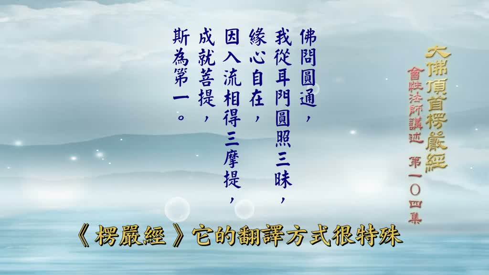

**重點：** 「入流」指開頭所修的「入流亡所」，預入法性之流，由此證到耳根圓通的三昧。講者說《楞嚴經》翻譯方式特殊，名詞順著文法隨時變動，不拘新譯舊譯：前面「圓照」用三昧，這裡用三摩提／三摩地，原因是文字要配合句子、念起來調順。

**標籤：** #入流亡所 #三摩提 #新舊譯

因入流相，得三摩提，入流就是指開頭所修的，預入於法性之流，楞嚴經它的翻譯方式很特殊，所有的名詞順著它的文法而有所隨時變動。他沒有既定於新舊的名詞，三昧本來是舊譯，新譯叫做三摩地。現在它是混合起來用的，前面圓照，不叫三摩地，叫三昧。現在因入流相，得三摩提，它不叫做三昧，叫三摩地。原因就是它的文字要配合，每一個句子都念起來很調順。

### 投影片 5：成就菩提，斯為第一（07:13–08:16）

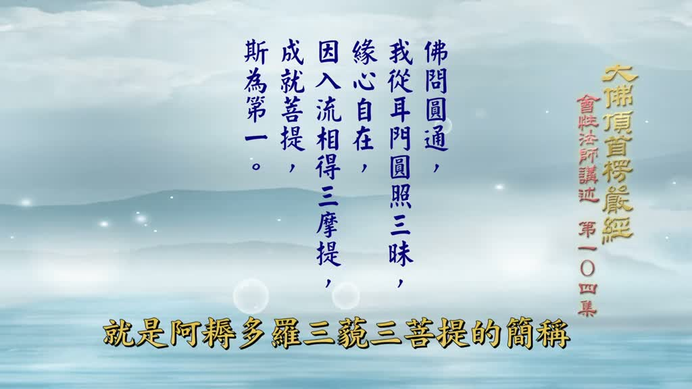

**重點：** 「菩提」是阿耨多羅三藐三菩提的簡稱：觀世音由耳門圓通一直修行成就到究竟果位。講者說觀世音其實早已成佛，倒駕慈航示現菩薩身度化眾生（講者主張，此處聽寫不確定）。「斯為第一」是說：想斷煩惱、了生死、成佛道，跟我修耳門圓通最好；每位聖者說完都認為自己的法門最第一，觀音也不例外。

**標籤：** #無上菩提 #斯為第一 #倒駕慈航

由此成就菩提，菩提呀，就是阿耨多羅三藐三菩提的簡稱。觀世音菩薩由耳門圓通而一直修行，成就到究竟果位無上菩提。因為觀世音菩薩已經成佛，倒駕慈航返過來，示現以菩薩身來做度化眾生的方便，所以已經究竟成就無上菩提。斯為第一，這個是最第一，意思就是說，你如果想要修行、斷煩惱、了生死、成佛道，跟我學習修耳門圓通，這個最好，是第一。每一位聖者說完了，都認為他的是最第一。現在觀世音菩薩也不例外了。說到這裡，我的這個法門最第一。

### 投影片 6：觀世音名號的由來（08:16–11:11）

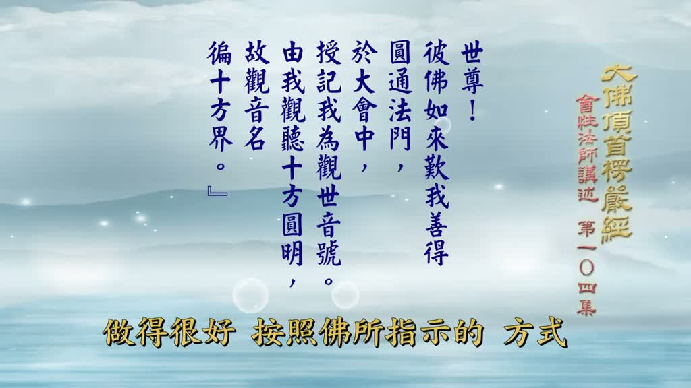

**重點：** 經文「世尊，彼佛如來歎我善得圓通法門，於大會中授記我為觀世音號」。「彼佛」指觀音最初發心時所親近、教他修耳門圓通的觀世音佛，為如來十號之一；當時佛讚歎他、在大會中授記他叫「觀世音」。以前叫什麼名字，經中沒有說，不得而知。

**標籤：** #彼佛 #觀世音佛 #授記

接下去，他要說明，他的名字會叫做觀世音，這個緣由。所以經文說，世尊，彼佛如來歎我善得圓通法門，於大會中授記我為觀世音號。由我觀聽十方圓明，故觀音名遍十方界。說明他的名字叫做觀世音的原因。觀世音菩薩對釋迦牟尼佛說：世尊，彼佛，這個彼佛就是指從前他初發心的時候，接受修學耳門圓通的那一尊佛，不要忘掉，在前面最初開始，他所親近的就是觀世音佛，那麼彼觀世音佛就是如來，為十種通號之一，他讚嘆我，這個我就是觀世音菩薩自稱，當時觀世音佛讚嘆我觀世音，那個時候可能不叫做觀世音，不曉得叫做什麼名字，經裡面沒有說出來，不得而知。那個時候佛讚他觀世音菩薩的當時，善的圓通法門，善很會修，做得很好，按照佛所指示的方式，從頭到底把它完成了。說他善能修學這個耳門圓通的法門，在當時的法會的大會之中，授記我，觀世音，就是授記我叫做觀世音的名號，我的觀世音的名號，就是從那個地方，當時觀世音佛，授給我的，所以，觀世音佛，希望世間多幾位觀世音，那麼因此他把他的名字就授給當時的觀世音菩薩，修耳門圓通成就，因為這個觀世音三個字，是觀世音佛授記給他，才叫做觀世音的。以前叫做什麼名字，那我們就沒有辦法知道，因為經文裡面沒有說。那麼當時佛跟他授記，你就叫做觀世音吧。從此之後，他就叫做觀世音菩薩。

### 投影片 7：由我觀聽十方圓明，故觀音名遍十方界（11:11–12:30）

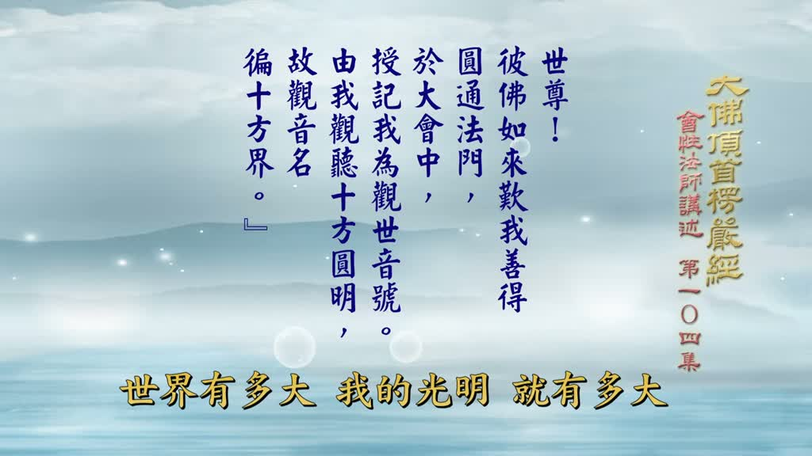

**重點：** 觀音自述：我以耳門反聞聞自性，證到圓通，圓照三昧的光明照遍十方世界，世界多大光明就多大，所以名號也遍於十方，家家都知道有觀世音菩薩，不只娑婆世界，而是盡十方、遍法界。至此觀世音要說的話已全部說完，耳根圓通的經驗與二十五圓通都已詳細說明。

**標籤：** #觀音名遍十方界 #圓明 #普遍

這個修法，我由耳門的聽，不是聽外聲，而是反聞聞自性。由此證到耳門圓通，十方世界究竟圓滿，我徹底證到諸法的理性。因為我這個圓照三昧，普照於十方世界，世界有多大，我的光明就有多大，普遍照耀，沒有一點遺缺，那麼因此之故，光照十方，名也就遍於十方，而實際證到的境界是普遍十方，所以祂的名字也就遍於十方，因此之故，我觀世音的名字，就遍於十方世界。所以家家觀世音，沒有人不知道的，大家都知道有觀世音菩薩。那麼這個觀世音菩薩不但是娑婆世界普遍，盡十方遍法界，無處不遍。所以叫做觀音的名字，周遍於十方法界。

### 投影片 8：科判：光瑞齊現（12:30–14:34）

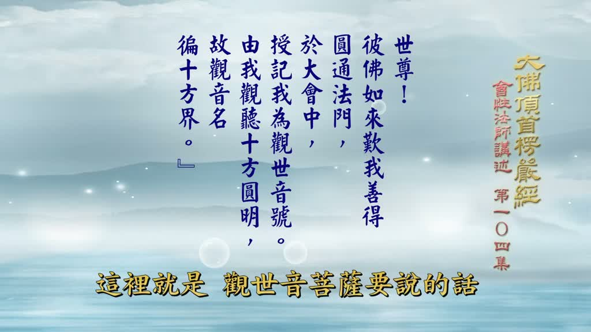

**重點：** 接著佛現瑞相，科判叫「光瑞齊現」（卯字下第三）。講者說明科判來源：「世尊敕眾聖說最初悟門」分三科──世尊普敕、眾聖各陳（即二十五圓通）、光瑞齊現；眾聖各陳又分兩段：略說餘門（到大勢至菩薩念佛圓通為止的二十四門）與觀音廣說耳門（辰字下第二），這一段到「遍十方界」為止已說完。

**標籤：** #光瑞齊現 #世尊普敕 #眾聖各陳

那麼這裡就是觀世音菩薩要說的話已經說完了，也就是把耳根圓通的境界已經很詳細的說出來了，然後二十五圓通都說清楚了，然後的情況就是佛現瑞相，所以下面的科判叫做光瑞齊現，卯字下第三光瑞齊現，光瑞齊現的這個科從哪裡來，世尊敕眾聖說最初悟門，它分有三科，第一是世尊普敕，第二是眾聖各陳，眾聖各陳就是二十五圓通，一一詳細說明，眾聖各陳裡面分兩段，第一是眾聖略說餘門，到大勢至菩薩的念佛圓通為止，二十四門的圓通就是餘門，除掉耳門之外，其他二十四門的圓通，在前面一一已經說過了。現在第六卷開始，就是辰字下第二，觀音廣說耳門，現在這裡就是觀世音菩薩廣說耳門，這廣說耳門的這個道理已經說了，到了剛才這個結文為止，到遍十方界就是已經說完，那麼然後，就是二十五圓通說完之後，就是卯字下第三，光瑞齊現，就是當時二十五圓通說完之後，佛放光，現種種的瑞相，這些瑞相通通都在當時法會中顯現出來。

### 投影片 9：經文：爾時世尊於師子座，五體同放寶光（14:34–15:55）

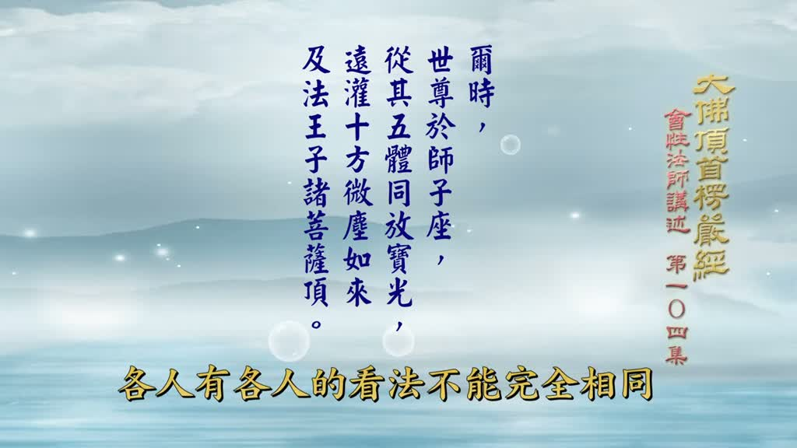

**重點：** 經文「爾時世尊，於師子座，從其五體同放寶光，遠灌十方微塵如來，及法王子諸菩薩頂」。講者說佛放光當時的現瑞情況各家看法不同，這裡依蕅益大師《楞嚴經文句》。「爾時」指觀音說完耳門圓通之後；世尊是教主釋迦牟尼佛，坐在師子座上。

**標籤：** #師子座 #五體 #蕅益大師 #文句

爾時，世尊，於師子座，從其五體同放寶光，遠灌十方微塵如來，及法王子諸菩薩頂。佛放光，關於這個光瑞齊現的這一科文，佛放光當時的現瑞情況，它這個表達的意義，各家有各家的看法，各人有各人的看法，不能完全相同，我們只能根據一種來說。我們根據蕅益大師的《楞嚴經文句》裡面的解釋，我們依他的方式、他的說法來做參考。爾時，就是二十五圓通說完那個時候，最後觀世音菩薩詳細去說耳門圓通說完之後，世尊就是教主釋迦牟尼佛，於師子座，他坐在座位上，師子座的師子是比方。

### 投影片 10：師子座的意思與寫法（15:55–17:45）

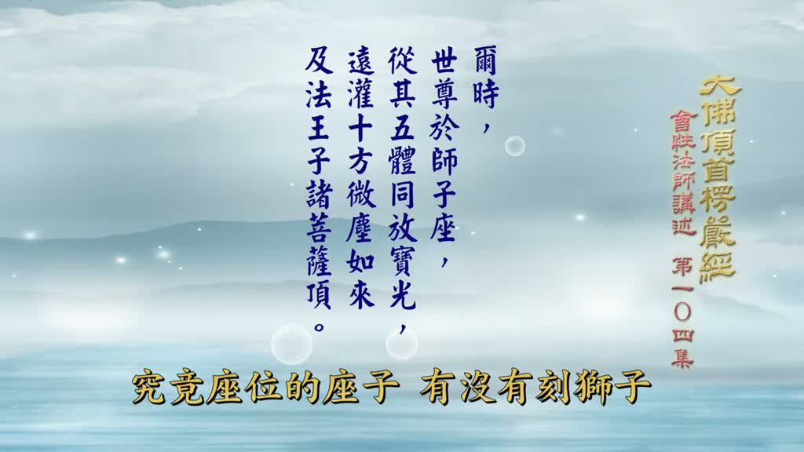

**重點：** 佛說法如獅子吼、無所畏，獅子為萬獸之王，佛法有四無畏，所以佛的法座叫師子座。講者說「獅」字加犬字旁是動物，經中通用「師長的師」寫成師子座，不是「師父的兒子」；至於實際座位有沒有刻獅子並不重要，佛坐的地方就叫師子座。

**標籤：** #師子座 #獅子吼 #四無畏

比方佛說法呀，好像獅子吼，獅子為萬獸之王，獅子一吼，萬獸潛藏。佛說法好像獅子吼，無畏說。說法有得四無畏，種種的殊勝功德，所以祂的法座就叫做師子座。師子的師，如果是動物的獅，旁邊加一個爪子的那個樣子，就是犬字旁，但是，佛的師子座，不一定要用那個字，就是用師長的師可以同時通用。所以，寫作師子座，不是說師父的兒子的座位，不要這樣解釋。就是好像萬獸之王的獅子，只要是佛坐的地方，就叫做師子座。現在這個師子座就是指佛的座位，他坐在這個說法的法座上。究竟座位的這個座子有沒有刻獅子？那沒有什麼關係，假如想看，就把歷史倒過來，兩千幾百年前，我們沒有這個能力，只是尊重認為佛坐的座位就是師子座就對了。

### 投影片 11：五體放光：表六根六塵六識七大皆圓通（17:45–19:15）

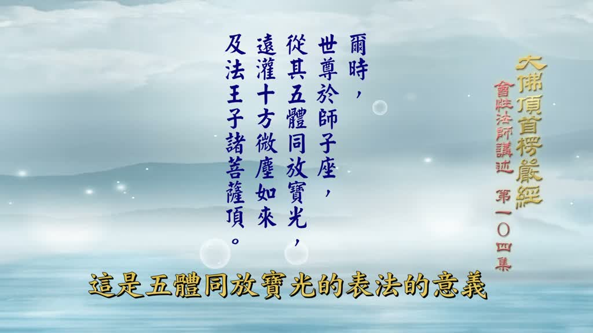

**重點：** 「五體」就是頭、手、腳，包含全身，佛從全身同時放光。《文句》說「表根、塵、識，皆是圓通法門」：全身放光表示六根、六塵、六識、十八界與七大，共二十五種修法、包含八萬四千法門，每一門都可證圓通，依法修學都能成就。

**標籤：** #五體 #根塵識 #七大 #八萬四千法門

佛坐在法座上放光了，從其五體同放寶光，五體全身了。五體就是頭、手、腳，包含全身，所以叫做五體，佛從祂的全身同時放光，全身同時放光。五體同放寶光，在《文句》裡面說，表根、塵、識，皆是圓通法門也。五體同放寶光，就是表示無論是六根、六塵、六識、七大，通通都是圓通法門。前面說過的二十五圓通，就是不離這些，所以顯示全身，都不離根、塵、識、十八界，包含這個七大。二十五種修法，包含八萬四千法門，顯示門門都是可以證圓通的。依法修學都能成就圓通，這是五體同放寶光的表法的意義。

### 投影片 12：光灌十方諸佛與菩薩頂（19:15–21:25）

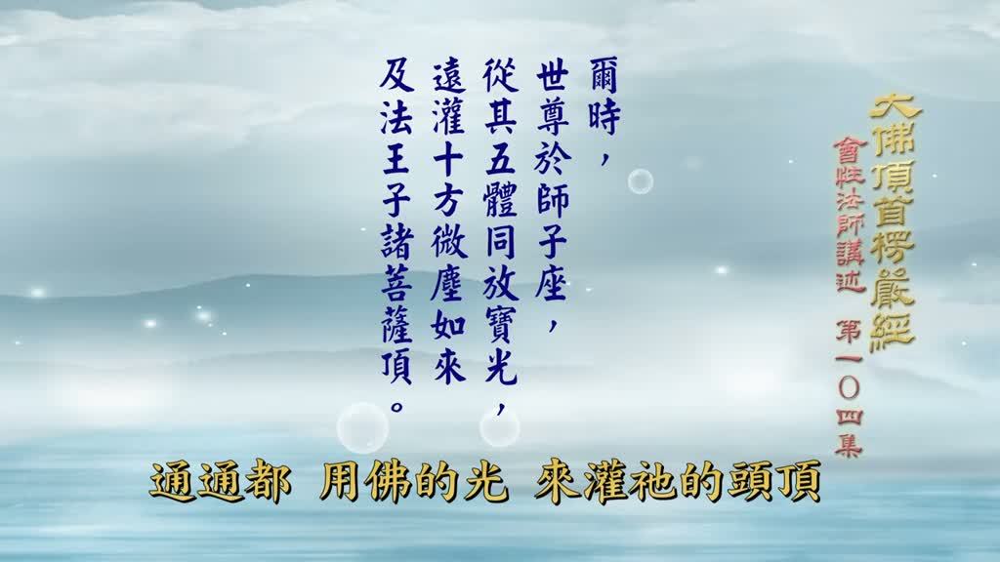

**重點：** 佛的光明從五體放出，照遍東西南北四維上下十方世界，灌到十方諸佛的身上，也灌到大菩薩（法王子，指等覺、住行向地等菩薩位）的頭頂。《文句》說這是表示每一種圓通都是無上大佛頂法，如來以之為密因，菩薩依之修萬行；佛由此證到究竟果，菩薩也依此從因地修到果地圓滿。

**標籤：** #灌頂 #法王子 #大佛頂

遠灌十方微塵如來，及法王子諸菩薩頂，他的光放出來到哪裡去，他的光放出來之後，就周遍照到十方世界，東西南北四維上下所有的世界，凡是有佛說法的地方，有佛的弟子菩薩，法王子就是菩薩，所有的法王子的地位就是指大菩薩，等覺，諸菩薩是住行向地等菩薩位，那麼佛的光明，五體放出來的光明，照到十方世界，這個光灌到十方世界諸佛的身上，也灌到十方世界的大菩薩，乃至住行向地所有的菩薩，通通都用佛的光來灌他的頭頂，那麼這是說佛放出來的光，照到十方世界，灌到十方諸佛的頭頂，也灌到諸菩薩的頂上，那麼這個表法的意思，《文句》裡面說，表一一圓通，皆是無上大佛頂法，如來以之為密因，菩薩依之修萬行也。這是表法說，每一種圓通，二十五圓通的每一種圓通，都是無上大法，都是大佛頂的大法。佛是由此而證到究竟果的，菩薩也是要以這個方法，從因地修行到果地圓滿，而到究竟成就。顯示，所有十方世界乃至過去現在未來，一切諸佛、一切菩薩，都是依這二十五圓通而修行而成就的，門門平等，隨他個人的因緣修一宗法門而到究竟成就。

### 投影片 13：十方諸佛亦放光灌頂：佛佛道同（21:25–23:21）

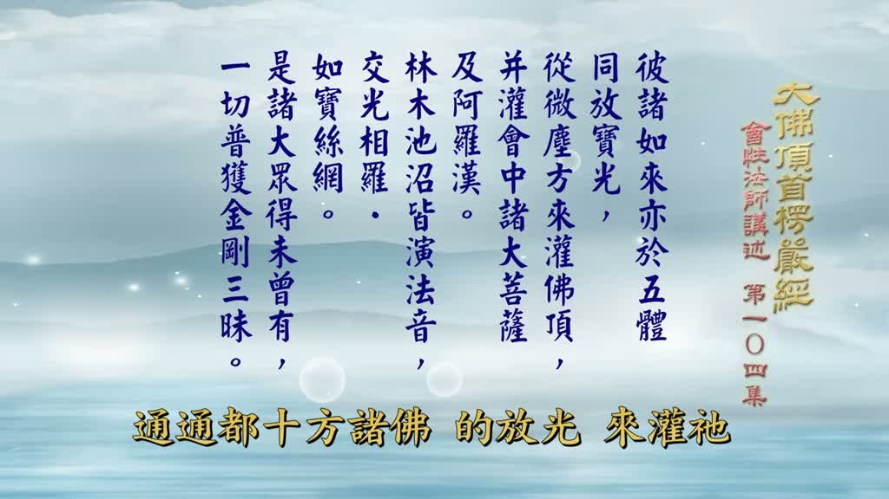

**重點：** 經文「彼諸如來，亦於五體同放寶光，從微塵方來，灌佛頂，並灌會中諸大菩薩及阿羅漢」。十方諸佛也同樣放光來娑婆世界，灌釋迦牟尼佛頭頂，也灌楞嚴法會上所有菩薩與證果的阿羅漢，表示佛佛道同、因果一致：果地的佛如此證，因地的菩薩也這樣修，無論哪一個法門都能成就究竟佛果，沒有前後優劣。

**標籤：** #佛佛道同 #因果一致 #灌頂

經文說，彼諸如來，亦於五體同放寶光，從微塵方來，灌佛頂，並灌會中諸大菩薩及阿羅漢。十方諸佛由釋迦牟尼佛的光灌到他的頭頂，而十方諸佛同時也放光。十方諸佛也放光來娑婆世界，來灌在釋迦牟尼佛的頭頂，也灌到這個楞嚴法會上所有的大菩薩，一切菩薩，乃至所有證果的阿羅漢，證阿羅漢果的這些比丘們，通通都同時灌頂，諸佛同時五體放光，跟釋迦牟尼佛一樣，也是同樣全身放光，這是表示佛佛道同，釋迦牟尼佛如此證，十方諸佛也是如此，所以顯示釋迦牟尼佛五體放光，十方諸佛也是五體放寶光。也從十方世界微塵數世界，放出光明來灌到娑婆世界的釋迦牟尼佛頭頂，同時佛的光也灌到這個楞嚴法會上所有的大菩薩，所有的菩薩，像文殊、普賢、觀世音等諸菩薩，通通都是十方諸佛放光來灌祂，同時也灌到，大比丘，證阿羅漢果的這些聖者，這是表因果一致，果地的佛如此證，因地的菩薩也是這樣修，而到究竟成佛，都是不可思議的妙法，沒有前後優劣，平等平等。

### 投影片 14：林木池沼皆演法音（23:21–24:38）

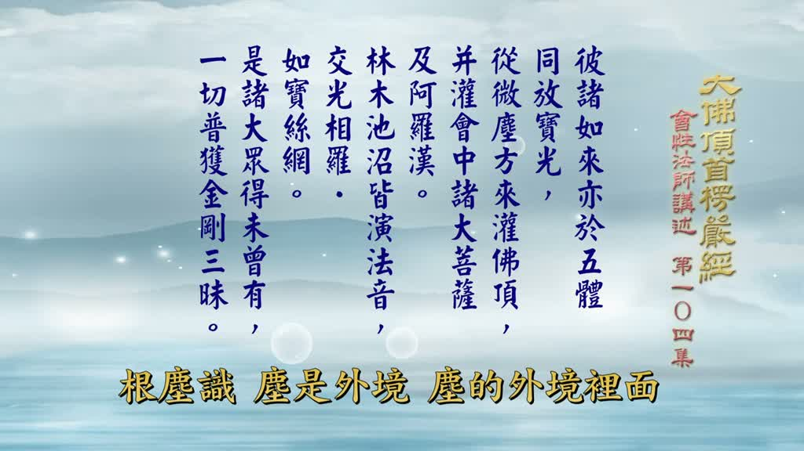

**重點：** 經文「林木池沼，皆演法音」：那時祇園（給孤獨園）周圍的樹木、水池、草花等無情之物，通通都會演說妙法，和極樂世界一樣。講者說這表示有情無情同一圓通性，根、塵、識及外境色聲香味觸，都不離圓通之性。

**標籤：** #林木池沼 #無情說法 #圓通性

無論哪一個法門都能成就到究竟佛果，林木池沼，皆演法音，非常非常殊勝，那個時候在給孤獨園周圍的樹木，池沼也是水池，所有有水的地方，有木頭，有樹木，有草，有花，所有的這個無情之物，通通都會說法，皆演法音，跟極樂世界一樣，所有的無情之物通通都會演說，演出妙法的聲音來，這是表示有情無情同一圓通性，這些草木、花、水是無情的東西，可是它也一樣的不離佛、菩薩所修所證的圓通，所以一一皆具圓通之性，根、塵、識，塵是外境，外境裡面就包含外面的色聲香味觸等，所以它們通通不離圓通。

### 投影片 15：交光相羅，如寶絲網（24:38–26:04）

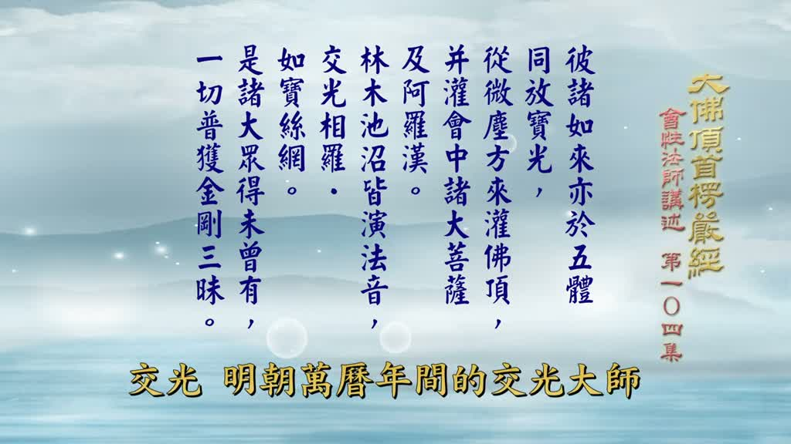

**重點：** 經文「交光相羅，如寶絲網」。講者介紹明朝萬曆年間的交光大師（交光真鑑，著《楞嚴正脈》；此處姓名聽寫為推測）以「交光」為號。意思是佛菩薩的光明彼此交織，像大梵天王的羅網、寶絲編成的網一樣殊勝，表示每一種圓通法門各各互遍互攝、重重無盡。

**標籤：** #交光 #寶絲網 #梵天網

交光相羅，如寶絲網。交光，是明朝萬曆年間的交光大師，交光真鑑大師，他著的《楞嚴正脈》，他用的名字就是用這兩個字，這是他的號。他就把它拿著來做他的字號，這裡文字上的意思，有聽無聽，同時都有光，佛菩薩同時都放光，那麼彼此交織，眼睛閉起來用頭腦想一想，這些光明彼此交織，非常非常的美，非常莊嚴，相羅，羅是羅網，好像大梵天王的羅網一樣，互相交織，非常好看。所以像如寶絲網，眾寶的絲，絲好像線，編織起來的羅網一樣，非常非常的殊勝。這是表示每一種圓通法門，各各互遍互攝，一種法門遍於各種法門，各種法門互相周遍，好像重重無盡的梵天網。

### 投影片 16：是諸大眾，得未曾有，一切普獲金剛三昧（26:04–27:10）

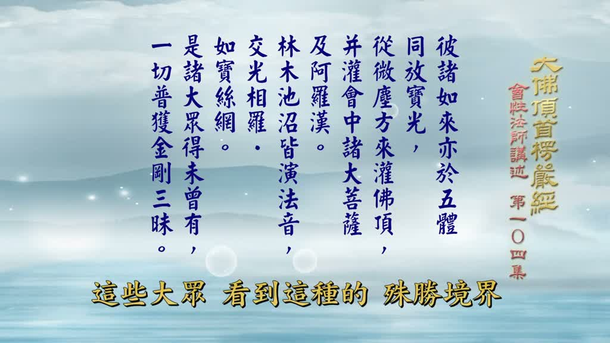

**重點：** 大眾見到前所未見的殊勝境界，「是諸大眾，得未曾有，一切普獲金剛三昧」：全楞嚴法會的聽眾都得到金剛三昧，顯示五蘊、十八界、七大（此處聽寫為推測）都是如來藏妙真如性、不可破壞如金剛，也顯示人人都能依二十五圓通法門修行成就。

**標籤：** #得未曾有 #金剛三昧 #如來藏

那麼這是當時佛放光現瑞的情況，是諸大眾，得未曾有，一切普獲金剛三昧，這些大眾，看到這種的殊勝境界，從來不曾看過，現在現出這種微妙的這個情況，尤其那個光明非常殊勝，不曾看過，第一次見到，所以叫做得未曾有，一切普獲金剛三昧，一切是指大會所有的大眾，聽眾們各個普遍獲得金剛三昧，太好了，全楞嚴法會的聽眾們通通都得到金剛三昧，這顯示五蘊、十八界、七大，通通都是如來藏妙真如性，顯示人人都依二十五圓通的法門來修行，到成就。

### 投影片 17：天雨百寶蓮華：四色表四十位（27:10–28:34）

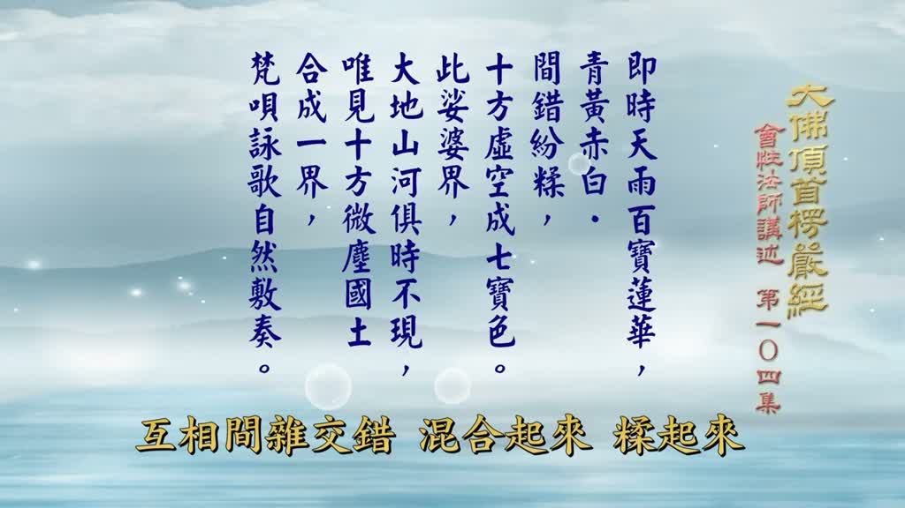

**重點：** 經文「即時天雨百寶蓮華，青黃赤白，間錯紛糅」。天空落下眾寶所成的蓮華，青黃赤白四色，表示修二十五圓通能從十住、十行、十迴向、十地這四十個菩薩位，到等覺而成佛；四色互相間雜交錯，看起來非常莊嚴，表示法會上四十位菩薩通通具備。

**標籤：** #百寶蓮華 #十住十行十迴向十地 #四十位

即時天雨百寶蓮華，青黃赤白，間錯紛糅。那麼同時從空中落下很多的天華，是眾寶所成的，所以叫做百寶的蓮華，華，蓮華最貴、最莊嚴、最殊勝，所以空中落下種種的蓮花，顏色有青的、有黃的、有赤色的、就是紅色的、有白色的，這四色蓮華從空中落下來，這是表示修二十五圓通，能夠從住、行、向、地這四十個位，而到究竟等覺，成佛。這青黃赤白四色，就表示十住、十行、十迴向、十地，這四十個菩薩位，由此修證而到等覺，到成佛，間錯紛糅，就是這些不同的顏色，互相間雜交混合起來，糅起來，看起來非常的莊嚴，所以法會上四十位的菩薩，通通都具備。

### 投影片 18：虛空成七寶色，國土合成一界（28:34–30:08）

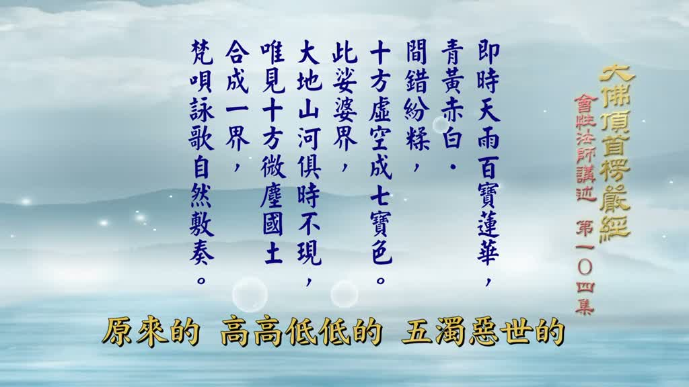

**重點：** 經文「十方虛空成七寶色，此娑婆界大地山河，俱時不現，唯見十方微塵國土，合成一界」。原來高低不平的五濁世界都變成清淨莊嚴的琉璃寶地，十方世界與娑婆世界合成一個世界，表示眾生平等、普遍證入。接著「梵唄詠歌，自然敷奏」：空中自然奏出清淨的讚歎歌詠，使人聽了深入內心（此句為推測）。

**標籤：** #七寶色 #合成一界 #梵唄詠歌

十方虛空成七寶色，那麼當時的虛空都成為七寶的顏色，非常非常的莊嚴，因此大家看到這種的情境都是非常的歡喜，此娑婆界大地山河，俱時不現，原來的高高低低的五濁石的山河大地，那個時候都不現出來了，都成為清淨莊嚴的琉璃寶地，唯見十方微塵國土，合成一界，把十方世界跟娑婆世界合成為一個世界，顯示眾生平等普證，梵唄詠歌，自然敷奏，這是說明樂音，空中好像在那裡唱偈，非常莊嚴。梵唄呀，就是我們平常唱讚都叫做梵唄，就是佛法裡面唱的讚偈，都是很清淨莊嚴的，使人聽到會深入內心，所以叫做梵唄詠歌，詠歌就是唱歌，好像唱歌一樣，表現出殊勝的妙音來，自然而然敷演展開，奏出樂音來，就是天空中現出種種的妙音。

### 投影片 19：第六科完結，進入第七科：文殊選圓通（30:08–31:51）

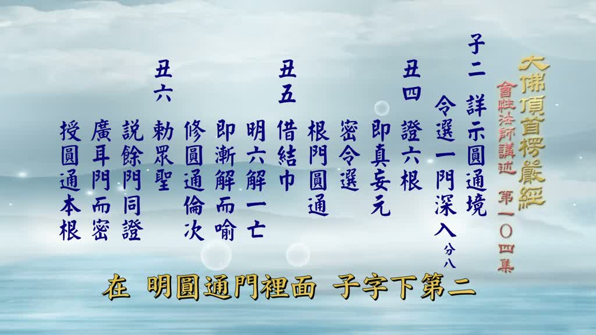

**重點：** 講者小結：這一段「光瑞齊現」以《文句》為根本大致如此，其他註解不同的不一一細究。至此子字下第二「詳示圓通境，令選一門深入」的八個大科已講完第六，接著第七科（丑字下）：佛請文殊菩薩來選圓通，選出一門給阿難和跟阿難相同根機的人修學，即「由文殊代當機，選定耳門為圓通本根」。

**標籤：** #詳示圓通境 #令選一門深入 #文殊

這就是光瑞齊現的經文，表達的意義各有各的看法，我們只是根據《文句》為根本，大致如此。如果你看到其他的解釋不同的，我們現在不去一一細究，只是按照一種說法，大概能夠明白就可以了，那到這裡為止，在明圓通門裡面，子字下第二，詳示圓通境，令選一門深入，這個大科判分出八科，前面講已經講到第六，就是到剛才的這個自然敷奏為止說完了，接下去是佛請文殊菩薩來選圓通，選出一門來給阿難跟相同的根機的人修學，所以丑字下第七，由文殊代當機，選耳門為圓通本根，那麼這就是第七，這個大科有八，現在是講完第六，第七就是現在要講的，選圓通的用意，主要是為阿難。

### 投影片 20：為什麼要由文殊來選（31:51–33:31）

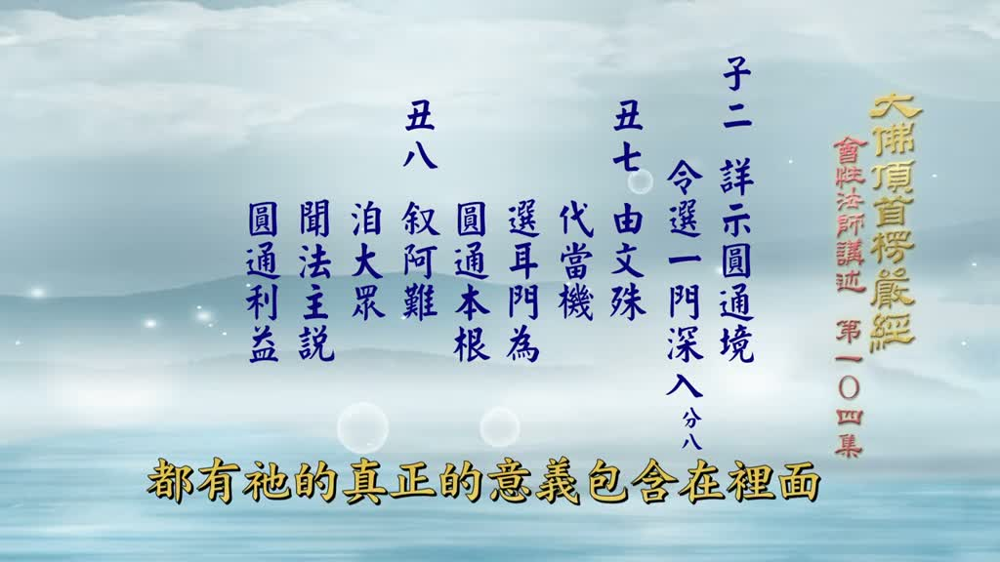

**重點：** 選圓通主要是為阿難，因為這部經的當機是阿難，他是多聞第一，該修哪一門？佛不會偏為某一人專說某一種法門（佛是普對一切眾生），所以由文殊代當機來「揀選」。講者稱文殊在楞嚴會上是「選法眼」，並說前人把這段看作多餘「葛藤」是不對的。

**標籤：** #當機 #阿難 #選法眼 #葛藤

這一部經的當機就是阿難，阿難的根機，他是多聞第一，它該修哪一門，佛老早就已經有暗示，明說的時候，佛不會自己偏為某一人定某一種法門，佛是普對一切眾生根性，不能偏為某一人專說某一種法門，不可能這樣子，所以因此之故，要由文殊來選，所以文殊在楞嚴會上叫做選法眼，選擇的選，以他的智慧來選，阿難該修哪一種法門，與阿難相同的根性，所以這是對機來選，不能跟前面《講義》所說的「葛藤」，把它看作多餘，這是不對的。這必定是所說的話每一句都有它的真正的意義包含在裡面，這就是由文殊菩薩來代當機，當機就是阿難，代阿難當機，選定耳門為他所修的法門，做他成就圓通的根本的修法，叫做圓通本根，就是還是要經過佛的說明，現在我要叫文殊菩薩來選圓通的法門，來給阿難好好地修學。

### 投影片 21：經文：汝今觀此二十五無學…我今欲令阿難開悟（33:31–36:06）

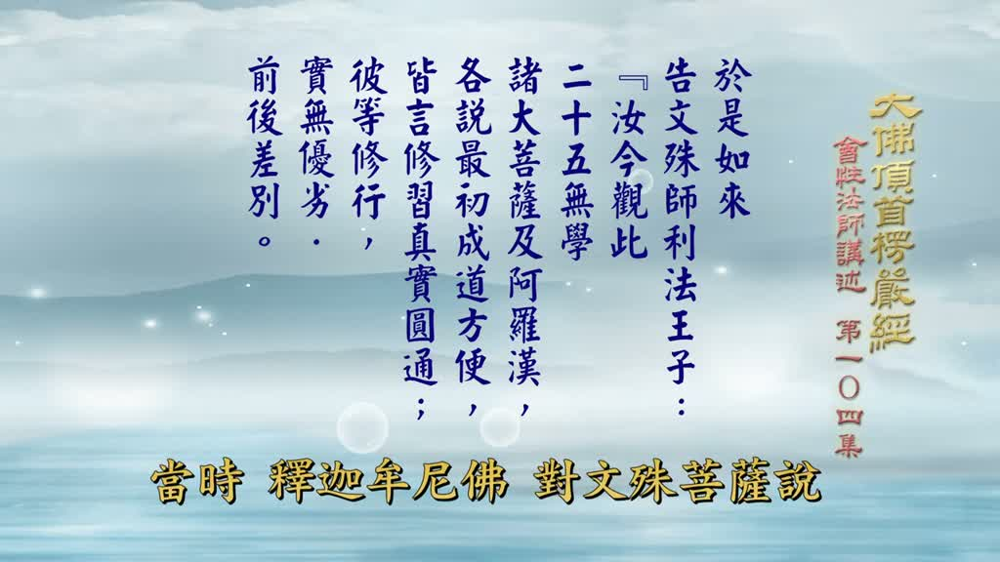

**重點：** 經文：「於是如來告文殊師利法王子：汝今觀此二十五無學諸大菩薩及阿羅漢，各說最初成道方便，皆言修習真實圓通。彼等修行，實無優劣、前後差別。我今欲令阿難開悟，二十五行，誰當其根？兼我滅後此界眾生，入菩薩乘，求無上道，何方便門得易成就？」講者先解釋「於是」是承上文而啟下文，如來即教主釋迦牟尼佛，文殊是智慧第一、菩薩的首領。

**標籤：** #於是 #二十五無學 #誰當其根

所以經文開頭就說，於是如來告文殊師利法王子，汝今觀此二十五無學諸大菩薩及阿羅漢，各說最初成道方便，皆言修習真實圓通。彼等修行，實無優劣、前後差別。我今欲令阿難開悟，二十五行，誰當其根？兼我滅後此界眾生，入菩薩乘，求無上道，何方便門得易成就？這是佛請文殊來選定這個根門，讓阿難好修。於是如來告文殊師利法王子，前面這個放光現瑞之後，那麼釋迦牟尼佛就對文殊菩薩說話，所以「於是」是承上文而啟下文，如來就是教主釋迦牟尼佛，釋迦牟尼佛對文殊菩薩說下面的話，文殊師利是智慧第一的大菩薩，現在在這個法會中，他以菩薩的身分，法王子，就是菩薩的首領，他領導許多菩薩，同時也在楞嚴會上聽釋迦牟尼佛講楞嚴大法，那麼當時釋迦牟尼佛對文殊菩薩說，汝今觀此二十五無學，汝指文殊，你現在你看到了，前面有二十五位，已經成就果地的無學的菩薩，跟阿羅漢，無學。

### 投影片 22：二十五聖者修行無優劣前後（36:06–39:42）

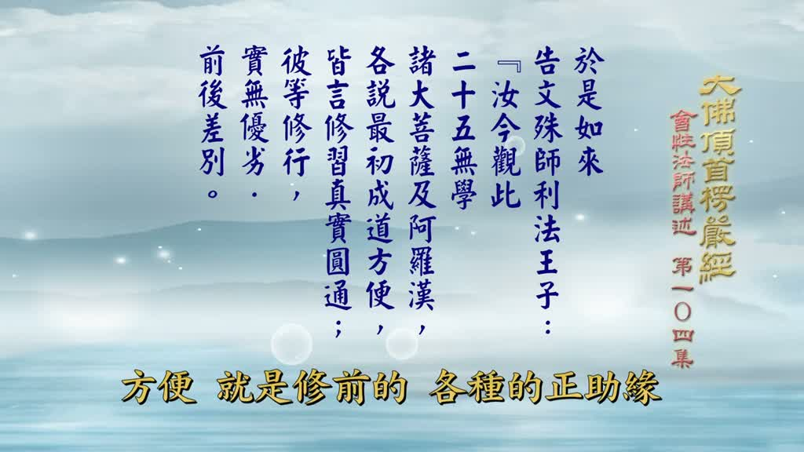

**重點：** 二十五位聖者已是無學（見思惑斷、生死了了；等覺菩薩只剩一分生相無明）。他們各自說最初修行下手的功夫與成就果地，所說的都是真實圓通，大致不出六根、六塵、六識、七大。他們的修證平等、沒有淺劣優劣，也無所謂前後；結集時依「塵、根、識、七大」的次序編排，是結集者的安排，當時並不一定這樣說。

**標籤：** #無學 #方便 #無優劣前後差別

不必再學，生死了了，見思惑斷了。那麼菩薩，如果是到等覺的話，只剩下一分生相無明，生相無明一斷就成佛了。前面這二十五位聖者當中，有大菩薩，像普賢等，有阿羅漢，像舍利弗、目犍連等，祂們各各說他最初修行下手功夫，而到現在成就果地。所以叫做各說最初成道方便。方便就是修前的各種的正助緣，那麼能夠修成某一種圓通，由什麼方式而入門？他們這二十五位聖者呀，通通都自己說，修證得到真實圓通。所以經文說，皆言修習真實圓通。每一位都說，我所修的是真真實實的圓通法門。那都是已經證到圓通了，彼等修行，實無優劣、前後差別，這二十五位聖者所修的彼就指這二十五位聖者，等於還有其他菩薩阿羅漢等修，大致也不出這二十五的範圍，他們所修的行門，無論是六根、六塵、六識、七大，每一種修法實際上是平等的，沒有說是哪一種比較優勝，哪一種比較淺劣，沒有這個優劣的分別，大家平等，都是一樣，就是無論是走哪一門，究竟都證到圓通，祂們也無所謂前後，不是誰排在前誰排在後，當時話不能頓時而說，當然是一位說完了再換一位，那麼當時說的時候，是不是就照這個前文所說的次第而說？這不得而知。但是結集編寫的人，必定要按照根、塵、識，十八界的次序，先講六塵，其次講六根，當中因為耳門是最後的，法留在後邊，所以六塵講過了，就是五種根，除掉耳根之外，眼、鼻、舌、身、意的五根，根、六識，還有七大，祂們的修證也沒有前後，祂們都是平等的，沒有差別，沒有說誰比較殊勝、誰比較好、誰比較差。

### 投影片 23：既然沒有差別，為什麼還要文殊來選（39:42–41:20）

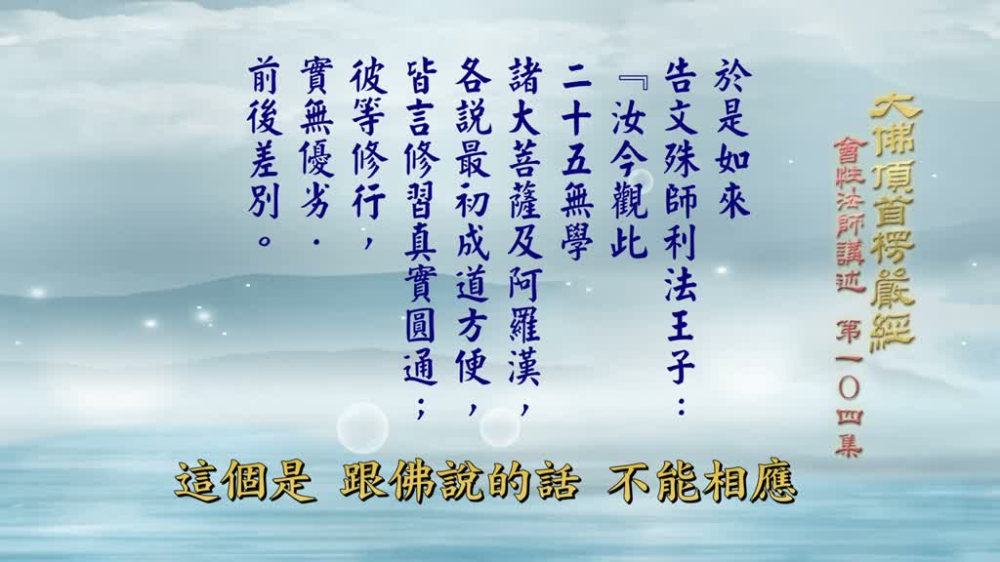

**重點：** 有些註解拿二十五聖去分別誰優勝，講者認為與佛所說「無差別」不相應。文殊選圓通，是為了「我今欲令阿難開悟」：不是分別聖者的高低，而是選出合乎阿難根性的法門給他修，不合的放一邊，總要找出一個理由讓阿難相信自己該修哪一門，使他依法修證、斷煩惱了生死到成佛。

**標籤：** #我今欲令阿難開悟 #根性 #合機

所以有些註解，以二十五聖去分別哪一個優勝，這個是跟佛的話不能相應。佛已經說過祂們沒有差別，平等，通通都到了究竟的果位。那麼既然沒有差別為什麼要文殊來選，我今欲令阿難開悟，這一句最重要，下文，文殊選圓通就是為了這個，為了要選給阿難修的，不是去分別祂們的高低，而是要選給阿難能修的，合乎阿難根性的，這就是優勝了，不合乎阿難根性的，就是另外放在一邊，總要找出一個理由來，讓阿難相信他應當修哪個法門，所以釋迦牟尼佛自己現在要使令阿難開悟，要阿難依法修證，而斷煩惱、了生死，到成佛，在阿難的根性當中，文殊你看看，在前面講過的二十五位聖者所修的法門，六根、六塵、六識、十八界跟七大，這二十五門，哪一門是合乎阿難的根性。

### 投影片 24：「兼我滅後此界眾生」：兼為末法眾生（41:20–43:37）

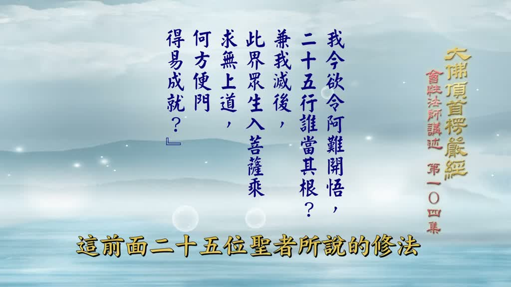

**重點：** 「二十五行誰當其根」指阿難的根性適合哪一門；「兼我滅後此界眾生」是兼顧跟阿難根性相同、佛滅後正像末法時期想入菩薩乘求無上道（阿耨多羅三藐三菩提，正等正覺，佛的果位）的娑婆眾生，希望選出入門方便、比較容易成就的法門。《文句》也說就修法而論法法皆妙、無可選擇，選的是適合初機的根。

**標籤：** #兼我滅後 #正像末法 #容易成就

所以說二十五行誰當其根，其指阿難，這前面二十五位聖者所說的修法，是哪一種才能合乎阿難的根性，讓阿難修行能夠成就？現在我要文殊就選這個，同時兼帶，兼我滅後此界眾生，入菩薩乘，求無上道，何方便門得易成就？兼，是兼為跟阿難相同的根性，尤其我們娑婆世界，等到釋迦牟尼佛入滅之後，想要入於菩薩道這一乘的修法，想要斷了生死而到成佛，他們求無上道，無上菩提道，無上就是指阿耨多羅三藐三菩提，正等正覺，就是佛的果位，正像末法的當中，所有眾生，他想要修行菩薩道而到成佛，他們要修哪一個修法為他入門的方便，而比較容易成就的，他要文殊選，就是選這一點，所以關於這個道理，在《文句》裡面他有詳細的說明，如果論是修法，法法皆妙，實無可選，每一法都是很妙，都很好，沒有可以選的地方。現在選的目標是選根，選的哪一種法門是給初機，就是以阿難為當機，合乎阿難的根性的，才選出來給他修。

### 投影片 25：佛不能自己選，要旁人選（43:37–44:43）

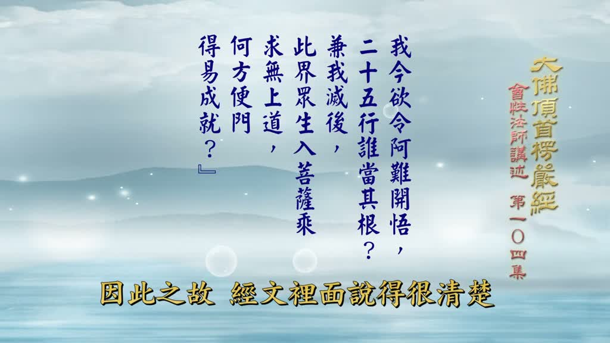

**重點：** 講者說因為佛度眾生平等，不能直接對阿難說「你修這一門」，也不能專為某一人定下某一種法門；要選的話必須由旁邊的人（文殊）代為揀選，所以經文說得很清楚是「我今欲令阿難開悟」，後文文殊選圓通要記住：「簡機不簡聖、簡情不簡法」。

**標籤：** #簡機不簡聖 #簡情不簡法 #佛度眾生平等

因為佛不可以直接對阿難說，你修哪一個法門，這個法門就是合乎你的根性，你就這樣做吧，佛不能這樣說，為什麼？佛度眾生是平等的，不能專為某一人定下某一種法門，要選的話，佛自己不能選，要旁邊有人幫他選，所以佛是普遍為一切眾生，所以不會勉強要你修某一種法門，不能偏為某一人給他某一種法門修法，因此之故，經文裡面說得很清楚，我今欲令阿難使他開悟，那麼這個用意就是，簡機不簡聖，簡情不簡法，後邊文殊菩薩選圓通，我們要注意記住這句話。

### 投影片 26：簡機不簡聖、簡情不簡法（44:43–46:52）

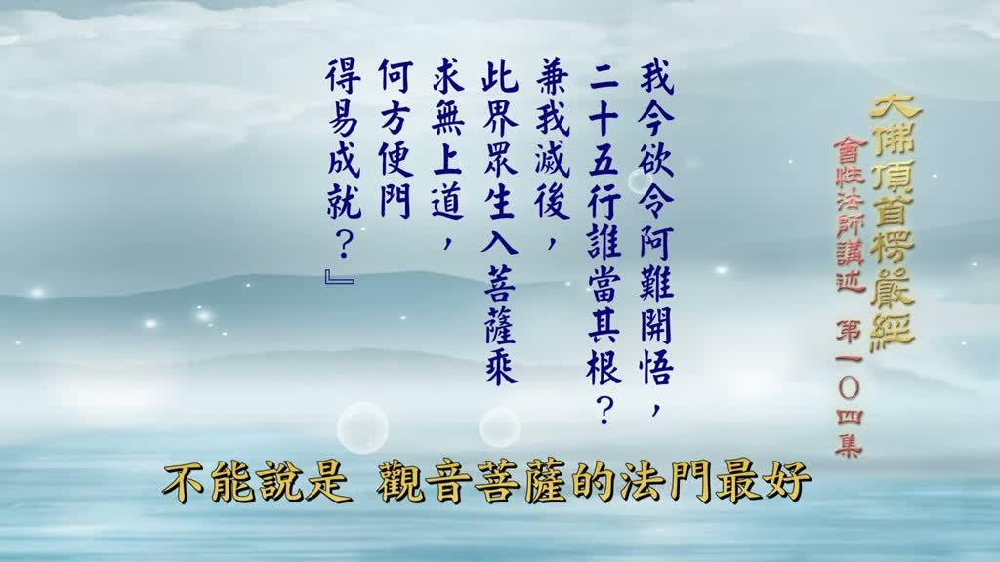

**重點：** 講者強調：選圓通是為了當機的根機，不是揀選聖賢的地位，不能說觀音的法門最好、其他不如；合乎阿難根機的就選、其他的放在一邊，不是分別高低。「簡情不簡法」是揀選眾生的根性心情，不是在法門上分高下。《文句》說為阿難而選，不必人人皆爾；兼帶娑婆世界眾生，所以偈頌說「此方真教體，清淨在音聞」，不是十方世界都如此。

**標籤：** #文句 #此方真教體 #音聞

是為了當機的根機，不是選聖賢的這個地位，不能說，觀音菩薩的這個法門最好，其他的不如，不是這個意思，是對於我，哪一種法門合乎他的根機，那麼合乎阿難根機的就選，就給他；其他不合乎他根機的，就把它放在一邊，不是分別聖賢的高低。不是，還有「簡情不簡法」，情是眾生的根性、心情，阿難他這一種根性，應當修哪一種法門，不能在法門上分高下。所以為了阿難而選的法門，《文句》說：為阿難，則不必人人皆爾。為阿難而選，並不是每一個人都這樣，不是每一個人都跟阿難一樣的根性。所以說到為阿難而選，不是為每一個人來選定這個法門，主要是為當時的阿難，言此界，兼帶為此娑婆世界眾生，那就不是十方都如此，只有我們娑婆世界的根性，合乎哪一種法門，所以後邊說，文殊菩薩選圓通的偈頌裡面就說，此方真教體，清淨在音聞，所以因此之故明白這個道理，文殊的遴選是完全為當機，兼為娑婆世界的眾生，不是十方世界都如此，關於這一點，我覺得《文句》的說法非常圓滿，可以做參考。

### 投影片 27：文殊領旨：即從座起，頂禮佛足，說偈對佛（46:52–48:37）

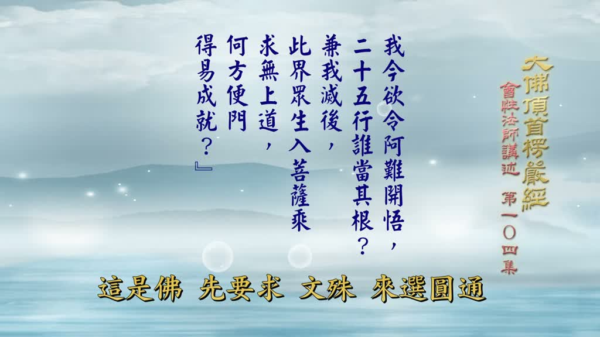

**重點：** 經文「文殊師利法王子，奉佛慈旨，即從座起，頂禮佛足，承佛威神，說偈對佛」。講者說：文殊稟奉佛慈悲的旨意，馬上從聽法座位起來，來到釋迦牟尼佛面前，因為要代佛辦事，先向佛頂禮、五體投地表示最恭敬，然後秉承佛的威德神通加被，說出下面選圓通的偈頌來答覆佛的問話。

**標籤：** #奉佛慈旨 #頂禮佛足 #說偈對佛

那麼這是佛先要求文殊來選這個圓通，然後下文就是文殊要真正照佛的意旨來選定圓通給阿難來修學了，所以接下去的文字就說，文殊師利法王子，奉佛慈旨，即從座起，頂禮佛足，承佛威神，說偈對佛。這是說明文殊在開始選了，文殊菩薩、法王子就是菩薩，現在稟奉釋迦牟尼佛慈悲的旨意，要來為阿難選圓通門，即從座起，佛要他選，他馬上就從他坐著聽法的這個座位起來，來到釋迦牟尼佛面前，因為要代佛辦事，就要先向佛頂禮表示尊敬，所以頂禮佛足，五體投地，頂禮到釋迦牟尼佛的足下，顯示最恭敬禮，承佛威神，說偈對佛，稟承佛的威德神通的加被，說了下面的偈頌，選圓通這個偈頌，來對，對就是答，答覆佛的問話，佛要他選，他就選。

### 投影片 28：「承佛威神」的兩種解釋（48:37–51:42）

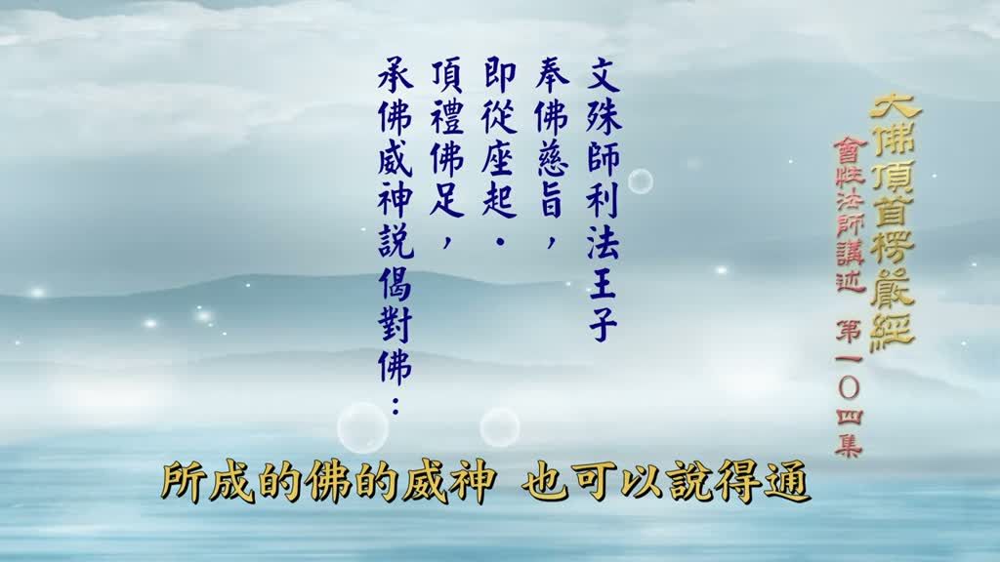

**重點：** 有人讀到「承佛威神」覺得奇怪：文殊已成佛，為何還要稟承釋迦牟尼佛的威神？講者的看法有兩種：一、以示跡（事相）說，釋迦是示現的佛、文殊是示現的菩薩，好比皇帝與大臣，雖然智慧一樣也要尊重皇帝意旨，在事相上要客氣；二、約理而說，文殊所成的佛與釋迦無二，稟承佛的威神也是稟承自己所成的佛的威神，佛佛平等無差別，不必計較。

**標籤：** #承佛威神 #示跡 #約理 #佛佛道同

有人讀到這裡，看到承佛威神四個字，就覺得有點奇怪，怎麼奇怪，因為文殊自己已經成佛了，為什麼還要稟承釋迦牟尼佛的威神，難道釋迦牟尼佛的威神要超過祂嗎，不是佛佛平等嗎，有人會這樣講，承佛威神這個話，以我的看法，有兩種意思，第一以示跡說，示現的應跡，現在示現的應跡，事相上釋迦牟尼佛是佛，他是教主，是佛，而文殊他是示現的菩薩，就是演戲，佛就是表演像皇帝的地位，那麼文殊就是示現皇帝座下的，例如說大臣之類，那當然，既然你是大臣，雖然你的智慧跟皇帝一樣，也要尊重皇帝的意旨來辦事，這是我的想法，因為在事相上，文殊他現在是示現以菩薩的身分，那麼既然你是菩薩示現的應跡上，佛是佛，菩薩是菩薩，所以應當要客氣的話，我稟承佛的意旨，稟承佛的威德神通，我來答覆下面的文字，這是事，約理而說，文殊已經成佛，那麼這個承佛威神也不妨，是承祂自己本身所成的佛，自己成佛了，就稟承我的佛果的威神，也可以說得通，你不要一定，是把這個佛就看作釋迦牟尼佛，文殊所成的佛與釋迦沒有兩樣，我這個稟承佛的威神，也是稟承文殊自己本身所成的佛的威神，也可以說得通，約理，佛佛道同，那麼因此之故，在表面上總得客氣一番，不能你也一樣大我也一樣大，那麼既然如此，王不見王，那就不該來了，所以因此之故，文殊在事相上客氣話，稟承佛的威神，在理上，佛佛平等無二，並沒有差別，所以不必去計較文殊的佛難道是比較小嗎？不是這樣子，現在文殊就按照佛的意旨來選圓通。

### 投影片 29：《楞嚴經》偈頌的特點：先顯眾生佛性平等（51:42–53:04）

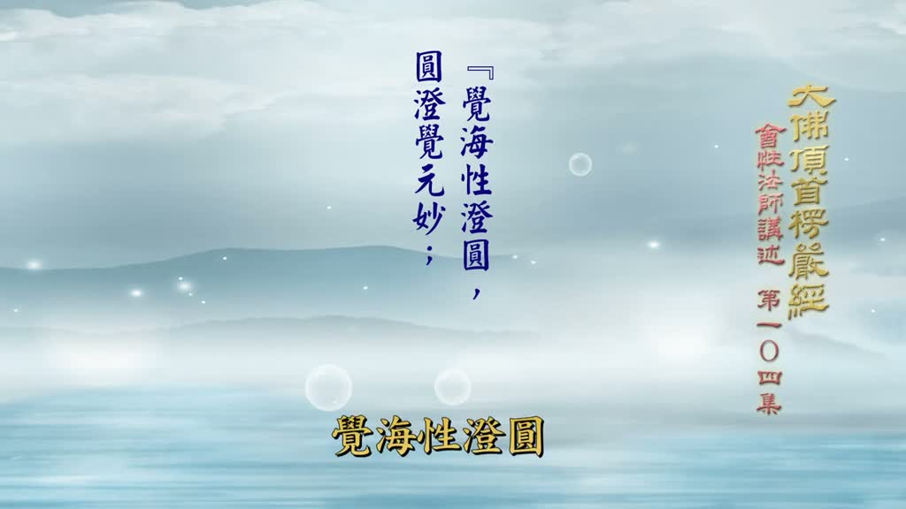

**重點：** 講者說《楞嚴經》每一段開始的文字，都先顯示眾生人人有圓滿的自性清淨心，只因為迷了才有現在的輪迴生死，所以文殊的開頭偈頌也先說明眾生自性清淨。偈頌的第一組：「覺海性澄圓，圓澄覺元妙，元明照生所，所立照性亡」。開頭兩句說明眾生自性清淨心是平等的；「覺」指本有的覺性，也就是自性清淨心、人人本有的佛性。

**標籤：** #覺海性澄圓 #圓澄覺元妙 #自性清淨心

《楞嚴經》的文字的特殊點，跟其他的經文不一樣的地方，它每一段開始的文字都先顯示眾生的佛性平等，人人都有圓滿的自性、清淨心，都要先顯示這個道理，因為眾生迷了，才會有現在輪迴生死的情況，所以一開頭，文殊菩薩還是先說明眾生自性清淨，開頭的偈頌，這個偈頌非常非常好，文字非常好，覺海性澄圓，圓澄覺元妙，元明照生所，所立照性亡，開頭兩句，就是說明眾生自性清淨心是平等的，覺海性澄圓，覺就是指本有的覺性，就是自性、清淨心，人人本有的佛性，平等平等，眾生本有的佛性，自他一切平等。

### 投影片 30：「海」不是比深廣，而是比味道（53:04–56:07）

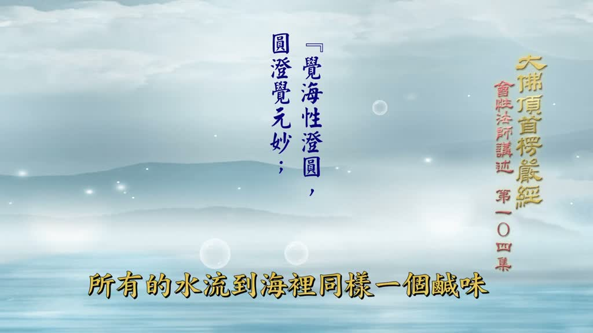

**重點：** 講者特別強調：偈頌用「海」比平等，不是比海水的深廣（海再深有底、再廣有邊岸），而是比海水的味道：《阿含經》說「四河入海，同一鹹味」，印度四大河的水流到海裡都是同一個鹹味。同樣，覺性一切眾生本來平等，像海味一樣；講者說這個講法其他註解很少這樣說，請大家自行查對。

**標籤：** #四河入海同一鹹味 #覺性平等 #阿含經

這個平等拿什麼來比？拿海來比，這個海，各位這裡特別要注意，這個海不是指海水的深廣，不是指海水的多深多廣，海水再深，有底的海還是有底，無論它多深，它還是有底，如果沒有底，水怎麼能夠安住？海再廣，也是有對岸的，也是有邊岸的，所以這個海字，你不要看作它的深廣，這裡不是拿深廣來比的，因為事相上的海再深也是有底，再廣也是有邊岸，那麼既然不是拿深廣來比，比什麼呢？比同一個海味，海水是鹹的，海水是一味。海水無論在哪一個地方，海水的味道是相同的，都是一樣的味道，不會有兩樣。所以《阿含經》說，四河入海，同一鹹味。印度有四個大河，不管它哪一條河的水，流到海裡，通通同一個鹹味。現在這個覺海性澄圓，這個海，拿海的味道來比，就是同一個海味，性平等。覺性平等，覺性，一切眾生本來平等，拿什麼來比喻它平等？像海味，海的鹹味，海的味全部平等的，所以大千世界所有的水流到海裡，同樣一個鹹味，那麼這是覺海性澄圓的海性，眾生的覺性，如海水的味道，同一個鹹味，說明眾生的清淨本性，大家平等，都是相同的，沒有差別，這一點，所有的註解很少這樣說的，各位如果有時間，你不妨去查對一下，我這個話，我說這個海現在不拿深廣來比，是拿海的味、水的味道來比，海水只有一個味道，這個味道平常說是鹹味，那麼還有一個味，就是指眾生的自性、清淨心，平等平等，如六祖所證到的、所開悟的時候，完全相同，人人平等。

### 投影片 31：圓澄覺元妙：澄靜不動的覺性（56:07–57:13）

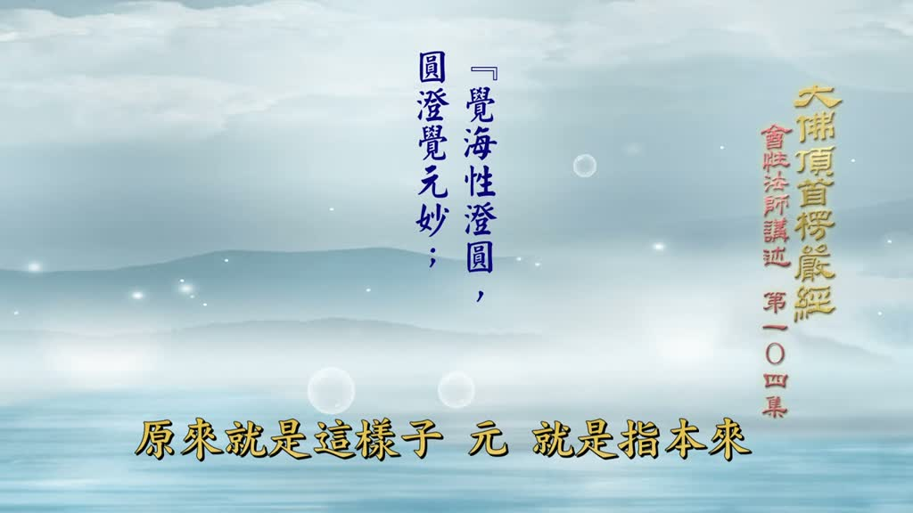

**重點：** 自性清淨心如果沒有風來吹，就是澄靜不動的；海水沒有風就不起波浪，到處圓滿平等，這是眾生本性本來如此，不會有差別。講者解釋「圓澄覺元妙」：圓滿澄靜的覺性，「元」是本來、微妙不可思議，每個人都一樣。（此段「本來如此」與「六祖所證」的句子聽寫不確定。）

**標籤：** #圓澄覺元妙 #澄靜 #六祖

那麼這個人人平等的自性清淨心，如果沒有風來吹，它是澄靜的，澄靜不動，海水如果沒有風吹，它不會起波浪，到處圓滿，都是平等圓滿，不會起波浪，這是指眾生本性本來如此，不會有差別，性體本來如是，所以圓澄覺元妙，這個圓滿澄靜的覺性，原來就是這樣子，元就是指本來，本來就是這微妙不可思議，本來就是這麼微妙不可思議，眾生的自性，它也空也不空也空不空，本來就是這麼微妙的，仍然如此，你也是這樣，我也是這樣，大家一樣，這個性平等平等沒有差別，這是說明本性自性清淨本來如此。

### 投影片 32：元明照生所，所立照性亡（57:13–59:12）

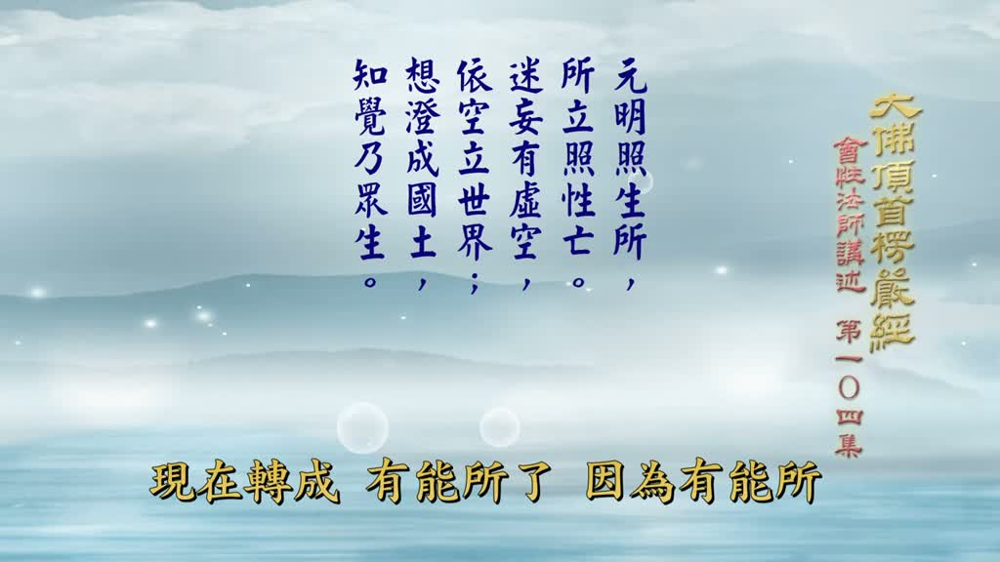

**重點：** 既然本來清淨，為什麼現在有六道輪迴生死的苦？「元明照生所」：本來自性光明、能普照，只因眾生有根本無明，由此緣起有八識（如來藏），轉成能所對待；「所立照性亡」：能所建立起來後，本來能圓滿普照的本性好像忘失了、顯現不出來，所以叫做「亡」。見分對相分的能見所見，就是輪迴生死的情況。

**標籤：** #元明照生所 #所立照性亡 #根本無明 #見分相分

元明照生所，既然本來清淨，為什麼現在現成有這個六道輪迴生死等苦的情況？所以說明，原來自性清淨是光明的，能夠普照的，可是，因為眾生有根本無明，由此緣起有八識，那麼由如來藏上，這個八識本來是能夠向自性普照的，現在轉成有能所了，因為有能所就顯出這個自性的功德顯現不出來，元明照生所，說明前面兩句話的本意，現在為什麼見不到？因為生所，就是有了八識，八識裡面顯現出有見分有相分，能見的見分對所見的相分，因為它生起，要有所見的相分，那麼就有能見的見分顯現出來，有能所、有對待了，就是有輪迴、有生死的情況，所以所立照性亡，能所建立起來了，本來能夠圓滿普照的本性，就等於忘失了，等於沒有了，顯現不出來，好像亡了，這是說自性本來清淨，為什麼顯現不出來？因為你有根本無明，被能所、能見、所見、能見的見分與所見的相分，由此眾生執著見這個相分，所以把本來能照的清淨自性顯現不出來，所以叫做亡，亡顯示它不能顯現出來的意思。

### 投影片 33：迷妄有虛空，依空立世界（59:12–61:30）

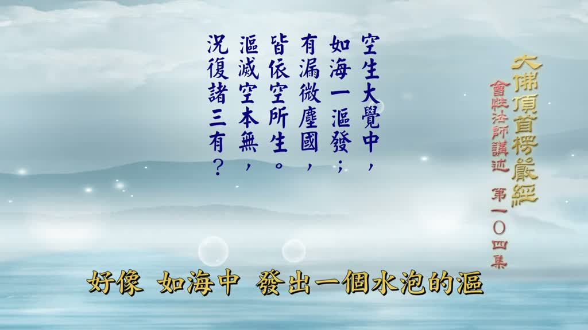

**重點：** 偈頌接著說：「迷妄有虛空，依空立世界，想澄成國土，知覺乃眾生」。眾生迷失本有真性、認取虛妄的能見所見，因此現出虛空，再從虛空建立依報世界（山河大地、宇宙萬有）；第八阿賴耶識轉成第七末那、前六識，把本來澄靜的自性演變成現在的國土與眾生相。「空生大覺中，如海一漚發」：虛空在大覺自性中，只像大海裡的一個水泡。

**標籤：** #迷妄有虛空 #依空立世界 #空生大覺中 #如海一漚發

接下去就說明眾生由此輪轉，迷妄有虛空，依空立世界，眾生迷了，有根本無明，迷失了，迷失了沒有認到本有的真性，而認到這個虛妄不實的能見所見，所以現出有這個虛空。我們現在眼睛看到的這個虛空，有了這個有虛空，有了虛空，從虛空中就建立依報的世界，依空建立依報的世界，就是山河大地、宇宙萬有。想澄成國土，想，第八阿賴耶識，轉成第七末那，轉成前六識，由此這個想的知見，把本有澄靜的自性，演變成為現在的有依報的國土，我們住的依報的國土，知覺乃眾生，有知有覺，這個知是妄知，覺也是妄覺，由此顯現出有現在的六道輪迴的眾生相。而我們自性本來是清淨的，空生大覺中，如海一漚發，現在看到的虛空，在我們的大覺自性之中，好像一個水泡而已，用海來比自性，用水泡比虛空，顯示虛空你看雖然很大呀，在我們自性中它是很小的，好像如海中發出一個水泡的漚，有漏微塵國，皆依空所生，所有有漏法的，微塵數的這個所有世界的國家，顯示十方世界國土無邊，像微塵數那麼多，這都是依這個虛空而建立，哪一個世界不在虛空中，離開虛空，哪裡還有世界呀？所以皆依空所生，統統都是依虛空而建立它的世界的生長。

### 投影片 34：漚滅空本無：無明除則空與三有皆無（61:30–62:41）


**重點：** 經文「有漏微塵國，皆依空所生，漚滅空本無，況復諸三有」。所有世界都依虛空而生，有生就有滅；水泡滅了，虛空也不可得，何況欲界、色界、無色界的「三有」（細分為四生九有、二十五有）。後文也說「一人發真歸元，十方虛空皆悉銷殞」。所以只要把根本無明煩惱除掉，本來的自性就會顯現。

**標籤：** #漚滅空本無 #三有 #發真歸元

有生就有滅，輪迴流轉。漚滅空本無，況復諸三有。如果海漚滅掉了，空也不可得。所以後文經文又說：一人發真歸元，十方虛空皆悉銷殞。等到你發真歸元，空也不可得，所以漚滅了，空也本來就無了，空尚且無了，哪裡還有三有？況復諸三有，三有就是三界，欲界、色界、無色界，這是最簡單的分類，這個三界當中都有輪迴、生死，所以叫做三有，中間分不是最詳細，不是最簡單，就是九有，四生九有，詳細就是二十五有，因此之故自性本來清淨，既然自性本來清淨，我們只要把這些根本無明消除，把煩惱除掉，無明煩惱除掉了，本來的自性就會顯現，這一段文，我用這種方式。

### 投影片 35：不能說「從真起妄」（62:41–65:24）

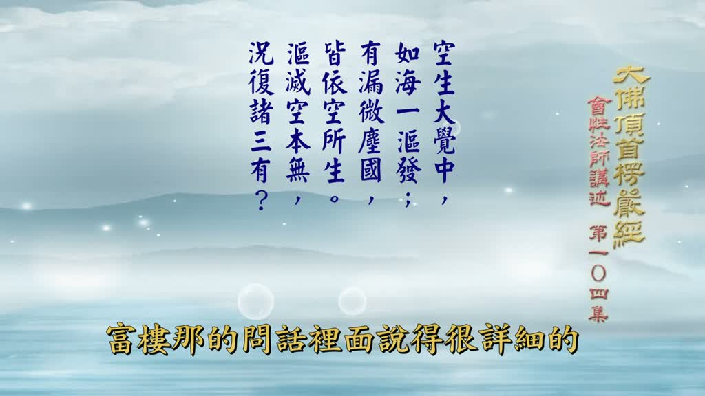

**重點：** 講者說有的註解主張「從真起妄」（本來是真，後來才有妄），他不同意：若先有真後有妄，成佛之後又會起妄，那就太糟糕了，佛不會是這樣。他說第四卷富樓那的問話已說得很詳細：真如與無明一向就彼此互相依靠，如金礦裡的金與沙土一向同時存在，只要把金取出、淘去沙土成為純金，就不會再回到礦中，眾生本有真，也本有無明煩惱，修行是把煩惱去掉，慢慢恢復原來的清淨真心。

**標籤：** #從真起妄 #真如無明 #金礦 #富樓那

很簡單的就把它看通了就行了，看註解很麻煩，看註解，他就說，從真起妄，本來是真的，後來有妄，這個說法不對，我認為不能這樣說，如果先有真後有妄的話，那你成佛了，又是真了，將來還是會起妄。第四卷，富樓那的問話裡面說得很詳細，不能這樣看，所以這裡是先說自性本來清淨，但是眾生自性清淨當中本來一向也有無明，真如與無明過去一向就是如此，彼此互相依靠，我們一向就是如此，並不是說先有真後有妄，在第四卷裡面說得很詳細了，金礦裡面的金，跟這個雜質沙土，你不能說先有金後有沙土，因為它們兩個是同時的，沙土與金是同時都在土裡面，一向就有的，現在你只要把金礦挖開來，把金取出來，把沙土淘汰清淨，成為純金以後，它就不會再重入礦中了，既然成為純金了，從此就是究竟了，那麼意思就是說，我們雖然有煩惱有無明，只要你修行把無明、把煩惱銷除了，就能夠恢復原來的清淨心，那個自性清淨的功德就會自然而然顯現出來，並不是說先有真後有妄，而從真起妄，那很糟糕。那成佛了，將來完全真了，過了一段時間又起妄了，那還得了嗎？絕對不是這個意思。那麼這種看法，認為從真起妄的這種看法，過去所有的疏，差不多都是這樣說，但是我就不願意這樣說。我覺得佛一定不是這樣說，假如是這樣子的話，那就變成將來佛也要再成眾生，因為沒有這個事情，所以這個真是眾生本有，但是眾生也本有無明，也是一向有煩惱，現在我們修的目標就是把煩惱去掉，那麼慢慢地就是恢復原來的清淨的真心。

### 投影片 36：歸元性無二，方便有多門（65:24–67:47）

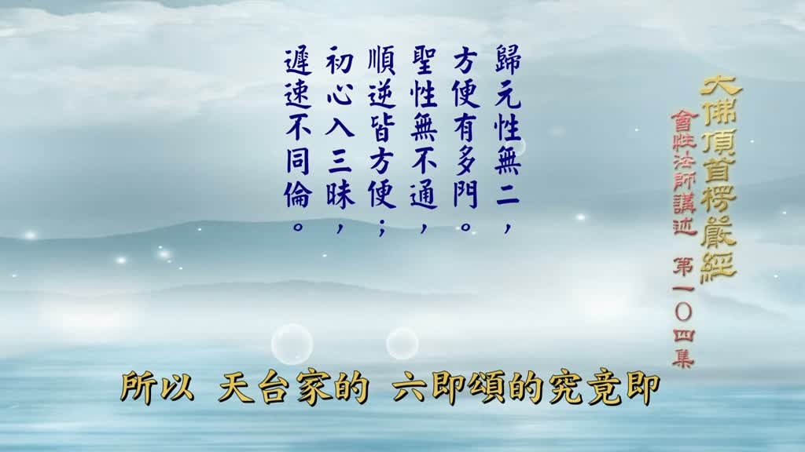

**重點：** 引出名句「歸元性無二，方便有多門」（講者提醒不是「歸元無二路」）：歸到自己本源的自性清淨心，眾生平等沒有兩樣，這也證明前面的「海」不是指深廣。天台六即頌的「究竟即」說：「從來真是妄，今日妄皆真，但復本時性，更無一法新」──成佛只是恢復本有自性，不是新得。但恢復本性的下手功夫（方便）就很多。

**標籤：** #歸元性無二 #方便有多門 #六即頌

那麼前面的意思應當大致是如此，接下去慢慢就要進入選圓通的用意了，歸元性無二，方便有多門，這兩句話我們平常是經常會引用，有的時候會講歸元無二路，應當是歸元性無二，歸到自己本源的自性清淨心，眾生平等，沒有兩樣。所以我說前面的那個海水不是指深廣，只看這一句就可以知道，前面那個海水一定不是指深廣，因為它是指歸元性無二，回到自己本元的清淨心的本體一樣，本來如是，沒有差別相。眾生平等一味，這是拿海水的味來做比方，就是一個鹹味，好像海水同一個鹹味，不是指它的廣大深，歸元，到了歸到本來的自性清淨心的本元，這個體性平等平等沒有差別，所以天台家的六即頌的究竟即：但復本時性，更無一法新，它前面兩句：從來真是妄，今日妄皆真，我們從來認不到真，不知道真，只有妄，所以從來真是妄，到了這個時候成佛了，妄通通成為真的，沒有另外新的，但復本時性，只把我們本有的自性清淨心恢復了，更無一法新，不是新得，成佛不是新得，就是親證本有的自性就對了，所以歸元，歸到自性本元，沒有兩樣，平等平等，一切眾生都是如此，只要你恢復本性，就是平等，就沒有兩樣，可是，你想要恢復原來的天然自性。

### 投影片 37：吃飯的比喻：法門平等，怎麼選待下次（67:47–1:12:13）

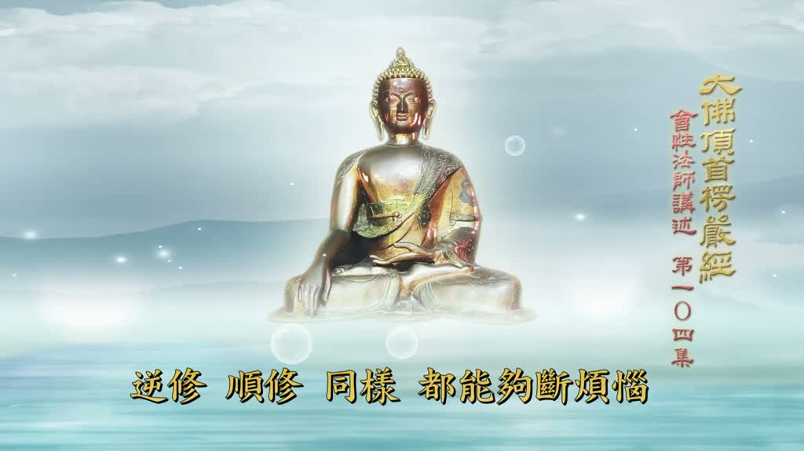

**重點：** 二十五個圓通門（六根、六塵、六識、十八界、七大）都是恢復自性的方便，要看自己是哪一種根性。講者用吃飯比喻：寧波人愛吃臭的、四川人愛吃辣的，北方人吃麵、南方人吃米飯，各人吃法不同卻都能吃飽；同樣無論逆修順修都能斷煩惱、了生死、成佛道。所以不要在法門上分別好壞，下次再講「怎麼選」。

**標籤：** #方便有多門 #根性 #法門平等

必定要有修法，修法的下手功夫那就多了，現在經裡二十五個圓通門，六根、六塵、六識、十八界，每一界都可以做下手功夫，還有七大，這二十五個門路就是多門，要恢復自性的開始的方便，開始的方便的門路很多，你是屬於哪一種根性就該修哪一種法門，就能夠恢復自己的本元，例如我們人要吃東西，有飯吃才能生存，但是每一個人的生活情況不一樣，寧波喜歡吃臭的，臭豆腐他最喜歡，四川人喜歡吃辣的，假如沒有辣的，你再好的菜擺在他面前，他就覺得不好吃。如果你把辣椒粉撒進去，他就高興了，他覺得很好吃。所以同樣能夠吃飽，個人的吃法不一樣。北方人吃麵，南方人吃米飯。所以臺灣人往往會說：我不是外省人，我要吃飯，不吃麵。為什麼？因為他生長在這個地方，一向是吃飯習慣的。吃飯長大的，不是吃麵的。那麼因此之故，各人的吃法不一樣，可是各各都能吃飽。無論你吃什麼，他照樣能夠吃飽。這個比方很妙，就說明無論你修哪一個法門，逆修順修，同樣都能夠斷煩惱，都能夠了生死，都能夠成佛道，所以方便有多門。既然方便有多門，我們不要在法門上去分別，這個好那個不好，不能這樣子分別，因為法門本來是平等的。既然是平等，何必去分別好壞優劣，不能這樣去分別。我們今天只講方便有多門。怎麼選？我們下次再來選。

## 已知轉錄錯誤

| 時間 | 聽成 | 應為 |
|---|---|---|
| 00:00 | The | 片頭幻覺，已改「（片頭音樂）」 |
| 70:40–72:08 | 340 月的花生／演唱 李宗盛／詞曲 李宗盛／全片以Google Pixel 4拍攝 | 講課在 70:21「我們下次再來選」結束，之後為片尾音樂與簡介畫面的幻覺，已刪除（transcript.raw.md 保留） |
| 23:25–23:58 | 哦（整段約 30 秒缺漏） | Whisper 整段漏轉；以音訊 23:20–24:00 單獨重送 Groq 補回（依第二次轉錄補入），再以字幕校正：林木池沼皆演法音、給孤獨園周圍的樹木等 |
| 全片 | （逐字稿與畫面字幕差異） | 影片燒入逐句字幕；2026-10-26 以 RapidOCR（PP-OCRv4 簡體為主模型，每 3 秒一張、1444 筆）抽出字幕與逐字稿比對，差異以字幕為準；OCR 簡繁／同音誤判（竟→競、遍→編、薩→隆、從→筱、眾→罪、祂→弛、偈→偶）已排除 |
| 多處 | 歐南／翁南／臥難／窩難 | 阿難（字幕確認） |
| 多處 | 始方／史方／此方（指十方） | 十方 |
| 多處 | 無體同放寶光／全神 | 五體同放寶光（經文）／五體全身 |
| 多處 | 句頌／句誦／俊松／偶頌 | 偈頌 |
| 00:36–01:19 | 各位參之善／極顯圓通明毫／穆陀羅背／線圓通明號 | 各位善知識／結顯圓通名號／母陀羅臂／第三結顯圓通名號 |
| 04:30–05:25 | 圓心自在／圓正本有／清淨法心 | 緣心自在／圓證本有的自在的功用／親見法性（字幕） |
| 12:52–14:15 | 光瑞啟現／光瑞起仙／光睿／毛字象／陳哲夏第二 | 光瑞齊現／卯字下第三／辰字下第二（字幕、畫面科判） |
| 15:15 | 偶伊大師的楞嚴經文記 | 蕅益大師的《楞嚴經文句》（字幕為「益大師」「《楞嚴經文句》」，蕅字為補） |
| 36:21 | 穆劍蓮 | 目犍連（推測，依經典人名） |
| 08:24 | 歎我善的圓通／由我觀十方圓明 | 歎我善得圓通法門／由我觀聽十方圓明（畫面經文為「觀聽」，字幕漏「聽」） |
| 52:22–58:32 | 絕海信成淵／圓成覺圓妙／圓名照生所／所立照性王／巴士 | 覺海性澄圓／圓澄覺元妙／元明照生所／所立照性亡／八識（畫面偈頌與字幕） |
| 59:48–62:17 | 相稱成國圖／知忘知／歐滅空本無／狂佛諸三有／二十五圓 | 想澄成國土／知是妄知／漚滅空本無／況復諸三有／二十五有 |
| 66:40–67:14 | 六基宋的舊晉之／但福本實性更無一法性 | 天台家六即頌的究竟即／但復本時性，更無一法新（字幕） |
| 07:20 | （字幕缺首字）的慈航返過來示現以菩薩身 | 倒駕慈航返過來示現以菩薩身（推測，字幕缺字） |
| 24:44 | 焦光真見大師／楞正服 | 交光真鑑大師／《楞嚴正脈》（交光為字幕，真鑑為依史實推測） |
| 26:54 | 五十八屆七大／字幕「悟十八界七大」 | 五蘊、十八界、七大（推測，字幕「悟」疑為「五」誤判） |
| 29:37 | 使人聽到會深功近心 | 使人聽到會深入內心（推測，字幕無此句） |
| 32:23 | 文殊在楞嚴會上叫做賊法嚴，選擇的賊 | 選法眼，選擇的選（字幕）；32:23 長句依字幕補入，部分字推測 |
| 53:59 | 那麼既然不是拿聲光來比它比什麼比同一個海的外道顯微海水是顯的吧海水是味 | 比什麼呢？比同一個海味，海水是鹹的，海水是一味（原文語意不通，依上下文整理，推測） |
| 55:57 | 五個合齊所表現出來的完全相通 | 完全相同，人人平等（字幕只有此句，推測） |
| 65:09 | 所以指狀真是眾生本有 | 所以這個真是眾生本有（推測） |
| 67:39 | 原來的天天自性 | 原來的天然自性（推測） |
| 69:42 | 這比方很甜 | 這個比方很妙（字幕截斷，推測） |
| 70:20 | 怎麼選呢？我們下次再來選／（音訊重送聽成「講」） | 怎麼選？我們下次再來選（字幕為準；講者下一集講「選圓通」） |

## 補充資料連結

- 補充資料檔：[supplement.md](supplement.md)（與本報告同資料夾；內容已收錄於上方〈補充資料〉）
- 思維導圖：[mindmap.png](mindmap.png)、文字大綱：[mindmap.md](mindmap.md)（與本報告同資料夾）
