# 淨土安心法門(四)

- 來源：https://www.youtube.com/live/4Lhp2A1kiZw
- 平台 / 上傳者：YouTube / 臺中蓮社
- 長度：49:50 (2990.0s)
- 逐字稿來源：whisper (groq)
- 更新日期：2026-10-24
- **關鍵字：** #淨土安心法門 #觀無量壽佛經 #至誠心 #深心 #利兩明 #勤修自他凡聖等善 #德為福聚 #惡緣不生 #見三業善必讚 #欲惡不隨喜 #決信 #雪公老師

## 摘要與名詞說明

**一句話重點**：續講《觀無量壽佛經》「至誠心」的第二段「利兩明（自他兩利）」——勤修自他凡聖等善的三條（饒益有情不惱眾生、德為福聚自得清淨、惡緣不生取淨果報），加上「見三業善必讚」與「欲惡不隨喜」；最後進入第二心「深心（決信）」，從「樹心眾德，深固難拔」說到「自身罪惡纏縛凡夫」。（臺中蓮社講座，講師引雪公老師〔李炳南〕科判，講者主張與故事均未查證。）

- 來源：YouTube 直播，臺中蓮社；片長 49:50；逐字稿：Whisper（Groq）。
- 投影片逐條原文見 `supplement.md` S1、科判總表見 S2。

## 重點表

| 時間 | 重點 |
|---|---|
| 00:00 | 更正：表上為「奸詐百端、惡性不改」，PPT 寫「難清」（惡性很難清除），講者建議改作「不改」。 |
| 01:05 | 第一條「饒益有情，不惱眾生」：一介螺蟻、萬聖覆援；過午稱「藥食」、碗盤輕放「輕身歸本處」，連針口鬼都不惱。 |
| 04:52 | 第二條「德為福聚，自得清淨」：福報靠修德不靠賺錢；《阿含經》修德三法之一「施福與貧」。 |
| 07:40 | 三法之二「以平等心」、之三「以智觀施」：不只救生命，更要教人出離三界、救慧命。 |
| 10:26 | 反省：念佛多年有沒有帶人？度一人、數人、百人與幫助往生的功德不同。 |
| 12:17 | 第三條「惡緣不生，取淨果報」：草繫比丘因怕傷草中蟲而不扯斷草；《禮記》「方長不折」。 |
| 16:24 | 「兩害為惡」：《道德經》治大國若烹小鮮；吳越國錢鏐不為爭天下讓百姓上戰場（講者主張，未查證）。 |
| 20:28 | 「見三業善必讚」：讚等自作，他的功德你得一半（講者主張）；《四十二章經》一炬之火。 |
| 23:51 | 「讚嘆一切眾生三業所為善」：《雜譬喻經》一穗葡萄；離污染報；會性法師與雪公老師婉拒表揚。 |
| 29:24 | 「欲惡不隨喜」：五欲（色聲香味觸／財色名食睡）、十惡；不自作、不教他。 |
| 32:15 | 不隨喜惡人（借梯給小偷、幫忙拉大魚）、不讚嘆惡法；敬而遠之、遠等勸戒；李晟與張延賞的故事。 |
| 36:30 | 網路演算法：財色名食睡的影片拒絕點閱。 |
| 37:47 | 至誠心小結：辨真偽、自他兩利；至誠心是修行的壓艙石。 |
| 39:10 | 第二心「深心（決信）」：深信如水深淺；「樹心眾德，深固難拔」；「決」如開會決議、決定不二。 |
| 43:19 | 念佛十大利益（諸天護法、二十五菩薩圍繞、諸佛攝受…）：能不雜一念地相信嗎？ |
| 46:09 | 九深信之首「自身罪惡纏縛凡夫」：三業所動皆是罪惡；纏縛＝煩惱綁住有情；凡夫＝不覺。下回續講。 |

## 名詞與說明

- **利兩明**：科判「乙二」名稱，指自利利他（逐字稿原聽寫為「明兩立」「明兩利」，依投影片表校正）。
- **勤修自他凡聖等善**：對自己、對他人勤修各種善。
- **德為福聚**：修德才能聚集福報；**功德為眾福聚處**。
- **惡緣不生**：沒有緣，惡因不會結成惡果；**兩害為惡**：害人又害己。
- **讚等自作**：讚嘆別人做的善，等於自己做（投影片：功德得一半）。
- **五欲／十惡**：色聲香味觸或財色名食睡；身三口四意三。
- **敬而遠之／遠等勸戒**：遇惡人保持恭敬但遠離，遠離本身就是一種勸戒。
- **深心（決信）**：深信之心；決定不二之信，不雜疑念。
- **罪惡纏縛凡夫**：九深信的第一條。
- **針口鬼**：餓鬼之一，喉嚨細如針、肚子大，聽到碗盤聲就更飢餓。

## 轉錄校正備註

- 詞典與人工替換：雪公老師、蕅益大師、會性法師、錢鏐（吳越國）、李晟、張延賞、針口鬼、色聲香味觸、財色名食睡、樹心眾德深固難拔等；推測者見 `meta.json` 的 `known_asr_errors`。
- Groq 轉錄漏掉 5 處約 7–30 秒人聲（18:10、23:57、25:16、29:35、37:09 起），已用單獨重送音訊補回。
- 已去除語助詞「呢」「啊」等（`transcript.raw.md` 保留原話）；刪除口吃與跨行重複，講者語意不通的片段（34:50 附近、24:23 幻覺）已刪並記入 `known_asr_errors`。
- 影片中的歷史故事、典故、數字與主張（草繫比丘、錢鏐、李晟與張延賞、一穗葡萄、十大利益、「功德得一半」等）皆為「講者主張，未查證」。

## 補充資料（影片未呈現的資訊）


### S1｜畫面遺漏：投影片條列原文（丙二～乙一）
- 來源：影片畫面（臺中蓮社直播的投影片）；取得日期：2026-10-24；取得方式：從影片截圖逐字抄錄
- 為何需要補充：講者口述時只唸部分條列，投影片上的科判標題、經句出處與括號註記（如「益為加厚」「德為恩惠」）逐字稿沒有；對應截圖 `frames/slide_02.jpg`、`slide_03.jpg`、`slide_04.jpg`、`slide_06.jpg`、`slide_07.jpg`、`slide_08.jpg`、`slide_09.jpg`、`slide_11.jpg`、`slide_12.jpg`、`slide_15.jpg`、`slide_17.jpg`。

**原文（逐字）**
```
（丙二）勤修自他凡聖等善          〔01:20–04:52 起〕
•饒益有情不惱眾生（益為加厚）
•布施，愛語，利行，同事
•德為福聚自得清淨（德為恩惠）
•功德為眾福聚處：
•(一)施福與貧　獲世出世福利
•(二)以平等心　獲眾生世出世福利
•(三)以智觀施　為出世之業

•惡緣不生取淨果報
•無緣不生，自不生惡：
•如草繫比丘，佛在世時，有比丘為賊以生草繫之。
•比丘恐壞其生草，而不解縛
•兩害為惡：雙方不害，自然得清淨果報。（治大國若烹小鮮）

（丙三）見三業善必讚
•贊等自作：他做好事，你讚歎，他的功德你得一半。
•譬如一炬之火，數千百人，各以炬來分取。
•讚歎一切眾生三業所為善（一穗葡萄）
•可離污染報：不好的事情，沾染不到身上。
•可感清淨果：功德愈感愈多

（丙四）欲惡不隨喜
•欲惡：五欲十惡
•不隨喜｛不自作，不教他
         不隨喜惡人，不讚歎惡法
•敬而遠之：遠等勸戒
（李晟 ⟷ 張延賞）

甲二 深心（決信）
•深心：深信之心。
•（樹心眾德，深固故難拔）
•如水分深淺，言心水之信：即是深信之心也。
•決信：決定不二之信
•不雜疑念之信心

（乙一）自身罪惡纏縛凡夫
•自身：胎卵濕化
•罪惡：三業所動皆是罪惡
•纏縛：煩惱纏縛有情而繫三界之獄
•凡夫：不覺凡夫
```

**Claude 的對照分析**
- 補充直接寫明（影片沒有的）：科判名稱（丙二「勤修自他凡聖等善」、丙三「見三業善必讚」、丙四「欲惡不隨喜」、甲二「深心（決信）」、乙一「自身罪惡纏縛凡夫」）；「功德為眾福聚處」三種（施福與貧、以平等心、以智觀施）；「樹心眾德，深固故難拔」。
- 與影片一致：講者依此條列逐條講解；逐字稿的「利兩明」「兩利」「布施、愛語、利行、同事」「草繫比丘」「兩害為惡」「李晟與張延賞」「敬而遠之／遠等勸戒」「決信」「胎卵濕化」均已依投影片校正。
- 據此推定（非補充直接寫明）：投影片「（樹心眾德，深固故難拔）」，講者引述的出處人名逐字稿為「深照大師」，推測為「僧肇大師」，投影片沒寫出處，未查證。

**備註**
- 畫面上的投影片文字為抄錄，未另查證原典；括號內註記為投影片原有。
- 乙一至乙九「九條深信」只有第一條在本講出現，其餘留待下一講。

### S2｜畫面遺漏：科判總表（甲一至誠心、甲二深心、甲三迴向發願心、甲四具三心者）
- 來源：影片畫面（講者開頭與 39:21 展示的科判表，同一張圖）；取得日期：2026-10-24；取得方式：從影片截圖（`frames/slide_01.jpg`）辨識
- 為何需要補充：講者開頭說「表上面和 PowerPoint 上面有一點不一樣」，指的是這張表；表中「乙二 利兩明」為本講多次提到的「利兩明（自他兩利）」。

**原文（逐字）**
```
甲：觀無量壽佛經
佛告阿難，及韋提希：凡生西方，有九品人。上品上生者，若有眾生，願生彼國者，發三種心，即便往生。何等為三？一者至誠心，二者深心，三者迴向發願心。具三心者，必生彼國。

甲一 至誠心
  乙一 偽真辨
    丙一 「清淨心」作
    丙二 名「雜毒善」
      丁(三) 奸詐百端惡性不改
      （不名「真實」業）
  乙二 利兩明
    丙一 制捨「自諸惡」
      （自利利他）
    丙二 勤修「他凡聖等善」
      丁(一) 饒益有情不惱眾生
      丁(二) 德為福聚自得清淨
      丁(三) 惡緣不生取淨果報
    丙三 「見三業善必讚」→「可離污染報」「可感清淨果」
    丙四 「欲惡不隨喜」→ 敬「而遠之」亦不隨喜
```
（畫面標：只抄錄與本講有關的部分；其餘細目（含丙一、丙二下的丁(一)(二)）與甲二以下未逐字抄錄。）

**Claude 的對照分析**
- 補充直接寫明：表上寫「奸詐百端惡性不改」，與講者說「雪公老師的表上是這樣」相符；PowerPoint 則寫「難清」。
- 與影片一致：「乙二 利兩明」與逐字稿「利兩明」「自他兩利」一致。
- 據此推定：逐字稿中的「明兩立／明兩利」應為「利兩明」的聽寫錯誤（推測）。

**備註**
- 表中部分小字在 1024px 縮圖中不易辨識，已略過未抄。

## 思維導圖


- 原圖：[mindmap.png](mindmap.png)；文字大綱：[mindmap.md](mindmap.md)（與本報告同資料夾）

## 圖文對照（畫面 + 逐字稿）

### 投影片 1：開場：表上「難清」的更正（00:00–01:05）

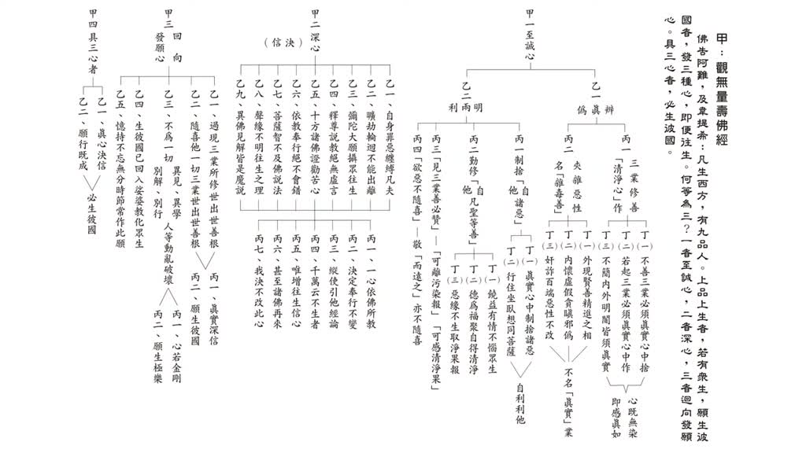

**重點：** 講師先說明投影片與雪公老師的表有一處不同：表上寫「奸詐百端，惡性難清」，講師認為改成「惡性不改」較容易懂。「難清」的意思是惡性很難清除。

請坐，好，我們剛才那個有個表上面和我們那個PowerPoint上面有一點不一樣，就是剛剛學院長有給我提醒一下，奸詐百端、惡性不改，這是雪公老師的表上面是這樣，我們那個 PPT 是寫難清，應該就是不改，要改成不改比較，比較容易懂，難清的意思就是說，這很難把它清除掉，很難清除掉，就惡性不改，很難，奸詐百端，惡性很難清除掉。

### 投影片 2：第一條：饒益有情，不惱眾生（01:05–04:52）

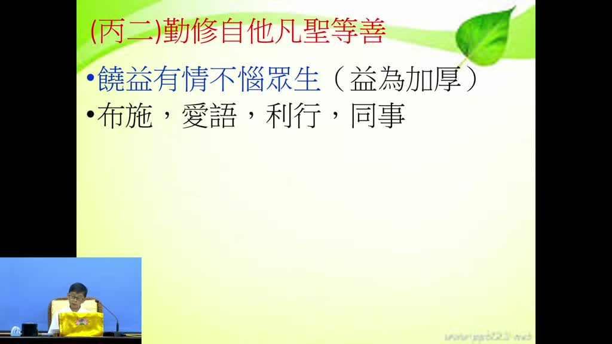

**重點：** 「勤修自他凡聖等善」的第一條是利益眾生、不惱害眾生。講師以「一介螺蟻，萬聖覆援」說明每個眾生都有佛性、受佛菩薩照顧；並以過午只吃「藥食」、輕放碗盤「輕心歸本處」為例，連餓鬼都不去惱它。

那我們接著看，勤修這個兩利能夠修淨土法門，能夠自利也能夠利他，那在利他的過程當中，勤修自他凡聖等善，這個地方，能夠非常勤奮的修學，那這個自他凡聖等善要怎麼樣分，剛才我們介紹第一條，饒益有情，不惱眾生，這是第一條能夠利益眾生的，能夠利益眾生，勤修諸善，所以我們在佛門裡面有一句話叫做，一介螺蟻，萬聖覆援，一介螺蟻，你看那一隻小螞蟻，我們不要認為說一隻小螞蟻好像是很微不足道，它什麼，萬聖覆援，它如果有困難的時候，萬聖，所有的聖人都來幫助它，一介螺蟻，萬聖覆援，所以可見每一個眾生，因為每一個眾生都有佛性，所以每一位佛菩薩，他對每一個眾生都是護佑有加的，所以我們如果有這樣的概念，當然不會去殺盜淫妄酒，不會去殺生，不會去偷盜這些，不會去造一些傷害眾生的事情，反而會饒益有情不惱眾生，剛才我們稍微介紹，如果我們有佛法的常識的話，你晚上吃飯，這個在佛法裡面不叫吃飯，它叫什麼，叫藥食，它這個道理就很好，因為晚上本來就是不應該吃飯的，那有些人晚上為什麼要吃飯，因為有病，什麼病，藥食就是病，要藥對不對，就是服藥，所以我們生了什麼病，餓，餓，太餓了，餓就是病，照理講如果真的學佛人晚上是不用的，因為有病，什麼病，餓，所以只好用一點，晚上吃一點東西，所以把那個東西不能當飯，當作正餐，要用藥食，所以我們說用完藥食以後，你的杯盤碗筷要輕輕地放，這個叫做輕身歸本處，針口不生愁，蕅益大師曾經把這個在叢林裡面一天當中的生活作息寫成二十首詩，其中有一條他從開始煮飯開始，你看人家也是會煮飯的，然後怎麼洗菜，煮飯，怎麼樣煮飯，寫了一首詩，怎麼洗菜也一首詩，怎麼燒火也寫了一首詩，其中這個吃完飯了，用完藥食要放回去的時候，他講輕身歸本處，輕身就是輕輕的把這個碗盤歸回到那個本處，原來的地方輕身歸本處，針口就是那個針口鬼，針口鬼，針就是他的喉嚨像針一樣那麼細，那個咽喉像針那麼細叫針口鬼但肚子非常大，這種人就是看到聽到碗盤的聲音就飢餓不堪，這個叫針口鬼，針口不生愁，所以我們如果碗盤輕輕的放回去以後，就能夠怎麼樣，能夠關懷到，關照到，連這個針口鬼我們都不要惱怒他，不惱怒他，這個叫饒益有情，不惱眾生。

### 投影片 3：第二條：德為福聚，施福與貧（04:52–07:40）

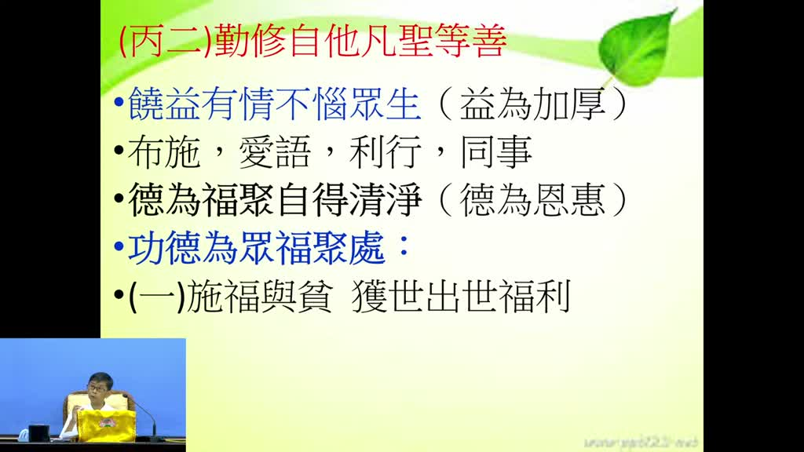

**重點：** 第二條「德為福聚，自得清淨」：福報要靠修德聚集，不是拼命賺錢；最簡單的修德是信願念佛。引《阿含經》修德的三種方法，第一種是把自己的福報施給貧乏人，得世間（富壽康寧）與出世間的福利。

好，下面講這個第二個，德為福聚，自得清淨，這個不一樣，這個德為福聚，就是這個德，就是修這個福德，這個福德是怎麼來，德，如果德為福聚，一個人要怎麼樣有福報，要修德，你不修德怎麼有福報，修德才會有福報，所以我們說一個人有福報，不是說你拼命賺錢就有福報，可能你這邊拼命賺錢，那邊怎麼拼命流失掉，不一定有福報，有福報人都是哪裡來，修德來的，所以德為福聚，你修德以後，就能夠把很多的福聚起來，那你說修德是怎麼叫修德，修德，你就剛剛講，布施、愛語、利行、同事都是修德，但是最簡單就是信願念佛，你信願念佛就是怎麼樣，最大的功德，如果能夠信願念佛，能夠所有的聚集的多善根多福德，德為福聚自得清淨，所以這個地方就是善導大師教我們，雪公老師按照這個意思教我們，我們如果要利益眾生，利兩明，利益眾生要修德，才能夠聚集福德，自得清淨，就能夠得清淨，那這個下面雪公老師引了這個阿含經裡面有三種修德的方法，第一種功德為眾福聚處，眾福聚處，就是你修功德以後，福就會聚攏過來聚攏過來，第一個，施福與貧，就是你得到很大的自己有很大的福報，自己有很大的福報以後，你這個福報不要自己獨享，怎麼樣，能夠施給貧乏人，能夠獲得世出世的福利，能夠獲得世間法的福利，還有出世間法的福利，世間法的福利就是，富壽康寧，就是財富，就是壽、富、康寧，第一個能夠長壽健康，第二個有財富，康寧，身心安樂、壽富康寧，這是世間的福利、福報利益，出世間能夠了生脫死，能夠斷見思惑，所以我們如果能夠捨得把自己的福報給貧乏人，這第一個能夠施福與貧。

### 投影片 4：平等心與智慧觀施（07:40–10:26）

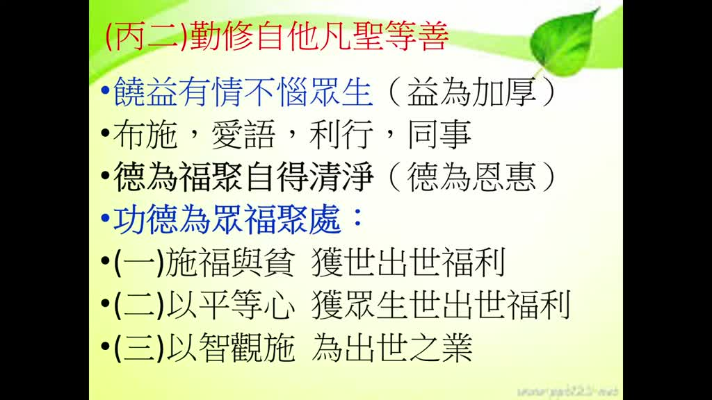

**重點：** 第二種是以平等心施福，不分親疏、凡有需要的眾生都給；第三種是以智慧觀察而施，除了濟助生活，還教人出離三界的方法，救慧命而不只救生命。講師舉蓮社的救濟、講經、念佛都是這個道理。

第二個，進一步要怎麼樣來做功德，第二個要用平等心，以平等心獲眾生世出世福利，前面那個施福與貧可能還是不一定是平等心，看有需要人或認識的人你才給他，心不一定平等，那第二個如果慢慢練習，不管怎麼樣是與不是，凡是需要人眾生哪一類眾生需要，我們都給他福報，施給他福報，這個平等心，那能夠施給他平等心，用平等心獲得的功德，平等福業，更大的功德，以平等心，以平等心來布施，來修福，更進一步，以智觀施，第三個，用智慧來配合你的布施，就是你布施的時候，用什麼，用智慧，智慧的話用布施叫什麼，這個智慧就是你能夠除了施給他福報之外，還能夠教他怎麼樣，出離三界的佛法，所以不是隻有給他福報，比如說有些地方，比如說莫三比克，缺錢、饑荒，我們去給他布施，我們臺灣有，很多人都這樣，但是你只是救他的貧，他只是生活上面，一時之間能夠得到怎麼樣，能夠得到紓困，但是不知道出離，不知道離開娑婆世界的方法，所以這個雪公老師這邊講，你修功德的時候，要修能夠第三個，除了布施這些財富福報之外，還能夠教他一些出離三界的方法，就是救他的慧命，不是隻是救他的生命，能夠救他慧命，其實我們蓮社，我們蓮社你看好像我們有救濟，每年都有冬令救濟，但是不是隻有冬令救濟，我們蓮社平常講經，講經還有上課還有念佛，這些就是教眾生怎麼樣，出離三界的方法，所以我們看起來我們蓮社這些，這些都是怎麼樣，看起來很平淡很平實，沒有什麼花樣，但是這些方法，你講經就是教人家出離三界方法，帶眾生念佛，能夠知道信願念佛，那麼大家就能夠往生極樂世界，這個才是真正的利益眾生，所以第三個這個才是以智觀施，能夠成為出世之業，才是真正的出世之業。

### 投影片 5：度人反省與幫助往生（10:26–12:17）

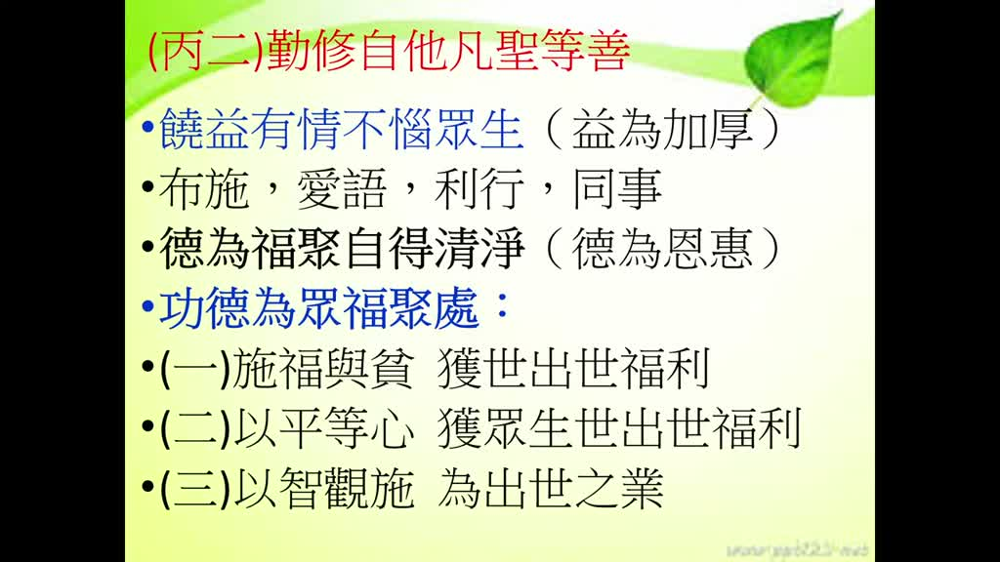

**重點：** 雪公老師要大家反省：學了多年念佛，有沒有人因我們而跟著念佛？度一人、兩三人乃至一百人，功德不同；若能幫助他往生，功德更大。沒有帶人，就表示沒有學到「德為福聚」。

所以這是第二條，德為福聚，自得清淨，所以這個雪公老師，他就教我們說，你學了淨土法門，知道這個當生成就的這一生就能夠成就這麼好，多麼好的法門，你自己修，能夠教另外一個人修，你就度化一個人，如果能夠度過兩三個人，你就是聲聞緣覺，如果你能夠度一百個人，教一百個人，然後能夠信願念佛，你就是阿彌陀佛，所以他就反問我們，我們學了這麼多年的信願念佛，你看有哪一個人跟著我們這樣的信願念佛，雪公老師要我們反省，你這麼多年的信願念佛，有哪一個人跟著你信願念佛，反省知道真的好像都沒有，前無古人後無來者，好像這孤零零的我們就一個人來，孤零零的幾十年都是自己信願念佛，可見怎麼樣，沒有怎麼樣，沒有學到德為福聚，沒有修以智觀施這一條，所以雪公老師講更進一步，如果你能夠教一個人不只信願念佛，還能夠幫助他往生，如果能夠幫助往生那更不得了，因為往生以後，因為你的關係他能夠到往生極樂世界，那功德更大，所以這叫德為福聚，德為福聚，自得清淨。

### 投影片 6：惡緣不生：草繫比丘（12:17–16:24）

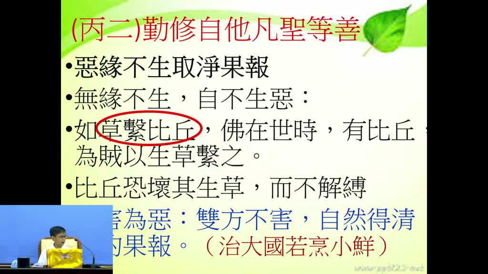

**重點：** 第三條「惡緣不生，取淨果報」：沒有緣，惡因就不會結成惡果。講師講《草繫比丘》：比丘被盜匪用青草綁住，因為怕傷害草裡的蟲而不敢扯斷；並引《禮記》「方長不折」說明護生。

我們看下面一條，《勤修自他凡聖等善》當中還有一條惡緣不生取淨果報，要讓這個緣，惡緣不要生出來，惡緣不生，取淨果報，因為我們任何東西都是無緣不生，沒有緣，雖然有因，但是它不會現行、不會活動，無緣不生，自不生惡，自然而然就不會產生惡果出來，所以只要把那個緣拔掉，把那個緣杜絕掉，把緣杜絕掉以後，自然而然，惡因就不會結成果，那惡因不結成果，我們看這個，這個，這條，這個，雪公老師這邊講，舉一個比喻叫草繫比丘，草繫比丘就是在佛那個時代，佛那個時代，有一群比丘在外面托缽，托缽的時候，當然身上就有托缽一些錢財的，一些米糧，結果被一群怎麼樣，被一群盜匪搶劫，那盜匪，怕這些比丘，去報官府，然後來捉他們，他們很想要怎麼樣，把這些比丘全部殺了，那其中有一個土匪，稍微有點佛法常識，他說我們不需要殺他們了，我們只要怎麼樣，我們只要用草，用那個草，因為荒野當中很多青草，用草怎麼樣，把他的手腳綁起來，他們就不會去報官府了，那有人說那個青草不是一扯就斷嗎，他不會，這些比丘，他們學過佛法都知道，青草上面有很多的蟲，所以你如果把草拔掉以後，這些蟲就會死，所以這些比丘他們懂得這些戒律，所以雖然被用草綁起來以後，他不敢怎麼樣把這個草扯斷，就是怕傷害眾生，所以這個叫草繫比丘，所以從這個地方，像雪公老師舉這個例子告訴我們，這些真正的修行人，他為了不要結什麼樣，殺業，殺的果報，殺生的果報，連草都不敢去扯斷，所以我們說，我們在禮記裡面講，方長不折，方長不折就是說，你在春天的時候，所有的草木欣欣向榮的時候，你不要怎麼樣，好玩就把它折一段下來，方長不折，像青草地，你看人家那修行人，青草地他不會踩過去，那就是一種護生，讓這個惡緣不生，惡緣不生，就能夠取淨果報，這個，這要注意，比丘恐壞其生草，而不解縛，所以不會解縛，這個，雪公老師說，什麼叫做惡，惡緣不生的惡就是兩害為惡，你做了一件事情害了對方又害了自己，那個就是惡了，比如殺生你又害了眾生的正報，又害自己怎麼樣，結了殺業造殺業，這個就是兩害為惡，所以雙方不害，所以這個是我們慢慢的在學佛過程當中慢慢要練習，做任何事情除了不要傷害自己之外，也不要傷害到對方，雙方不害，自然得清淨的果報。

### 投影片 7：兩害為惡：治大國若烹小鮮與錢鏐（16:24–20:28）

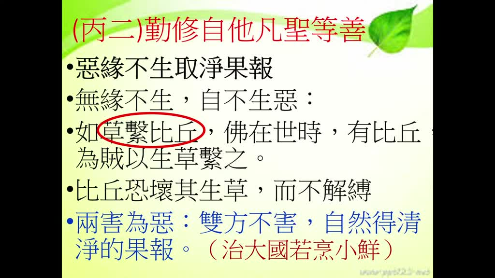

**重點：** 雪公老師把「惡」解釋為「兩害為惡」：做一件事既害人又害己。講師引《道德經》「治大國若烹小鮮」，並講五代吳越國王錢鏐不為爭天下而讓百姓上戰場，結果國家得以保全、後代興旺。

所以道德經裡面就有講，治大國若烹小鮮，烹小鮮是什麼，烹小鮮就是煎那個魚，煎那個小魚，我們不要說煎小魚，我們吃素人就煎豆包就好了，煎豆包的時候你要怎麼煎，才能夠煎到怎麼樣，不會破，那都很小心，對不對，很小心的慢慢的怎麼樣，慢慢的煎慢慢煎，才能夠怎麼樣，把那個豆包煎得非常漂亮，我們蓮社這些典座的學長他們很會這個，那個都要很小心的，生怕一不小心，一用重力了，就把他豆包怎麼樣，弄砸了，弄破了，所以治大國就是這樣，你用的手段太過激烈，太過於只偏重某一方就會害到另外一方，所以這個治大國的烹小鮮，他就是怕怎麼樣，所以治大國的人，要能夠好好照顧到很多層面，不要傷害到自己，我們五代唐朝末年，五代的時候天下大亂，蘇州、杭州、江蘇等地成立了一個國家，好像叫吳越國，吳越這個國家，一個叫錢鏐的人來治理這個國家，錢鏐是一個學佛有道的國君，在五代的時候我們都知道，梁唐晉漢周，梁朝是誰建立的，朱溫，朱溫就是滅掉唐朝的，所以那時候有人就建議這個錢鏐怎麼樣，這個鏐就是一個金字旁，廖，那個廖，把上面那個廣字頭拿掉，加一個金，那個叫鏐，他就是有人建議說，我們現在天下大亂，我們現在出兵來去打這個朱溫，打贏了天下就是我們，打不贏我們可以退回到江浙這個地方我們不會受傷害，這個很誘人，又能夠進可以攻退可以守，如果一般政客就會這樣，賭一賭賭一把就會這樣，但是錢鏐他是學佛的人，所以他說如果我現在出兵去打，倒黴的是誰？老百姓，對不對？老百姓就當兵了，對不對？你就調老百姓當兵，所以到時候死在戰場上面的就是老百姓，所以我絕對不會因為我自己建立要建我的天下，建立我的天下，所以怎麼樣，來傷害到老百姓的性命，所以他不聽這個話，他不聽這個建議，所以你看那個蘇州，那個吳越，吳越後來你看他一直維持到五代，在結束以後他都沒有發生戰爭，到北宋的時候也沒有發生戰爭，其他國家都被滅了他沒有被滅掉，所以你看現在我們大陸也好臺灣也好很多姓錢的，姓錢的都是他後代，而且是非常優秀的，非常優秀的人物那就是學佛人的後代，所以你說他為什麼不願意為了自己的天下來怎麼樣，來他就是怕到怎麼樣兩害為惡，你得了天下但是傷害了無數的眾生，那是一般的政客才會這樣，真正有道德、有學佛的人不會幹這種事情，要注意兩害為惡，所以這個是惡緣不生就是能夠取淨果報。

### 投影片 8：第四條：見三業善必讚（讚等自作）（20:28–23:51）

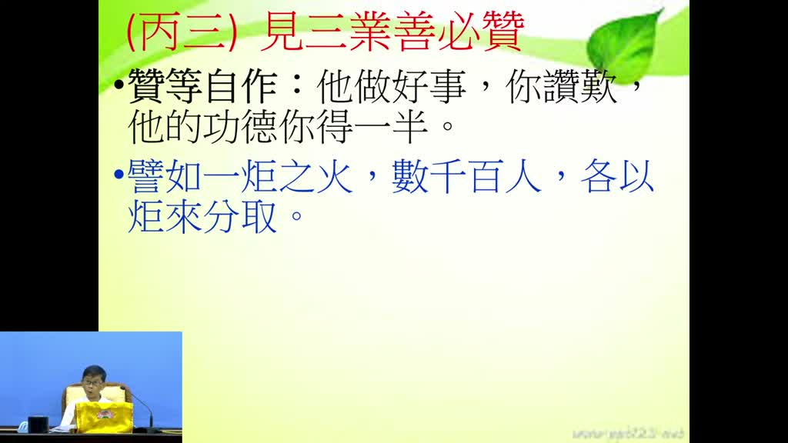

**重點：** 見到別人身口意三業修善，一定讚嘆，甚至協助。旁註「讚等自作」：他做好事你讚嘆，他的功德你得一半，這就是隨喜功德；嫉妒則是最不應該的隨煩惱。引《四十二章經》「一炬之火」說明功德越分享越光明。

這是第二條，勤修自他，凡聖等善，我們再看利兩明當中，除了饒益有情眾生，能夠修功德，能夠惡緣不生，能夠利兩明，第三條，見三業善必讚，見三業善，就是我們看見別人的身口意三業修善，我們一定怎麼樣，讚嘆有加，甚至能夠怎麼樣，能夠利行，能夠同事，那怎麼樣，這個地方雪公老師他做一個旁註叫讚等自作，就說你看別人的身口意修這個善法的時候，你能夠讚嘆，你能夠讚嘆的話，等於怎麼樣，自己做了這些善功德，說實在話，這個只有學佛人才會懂得這個方法，你一般沒學佛人，怎麼可能？他說明明是他做了善事，我怎麼可能我得到功德？這個就是佛法裡面講的隨喜功德，所以讚等自作，所以他做好事你讚嘆他，他的功德你得一半，這個你如果會算的話，你就不會怎麼樣？因為這個是要對治我們什麼心態？嫉妒，嫉妒是最不應該的那個小隨煩惱，因為我們看別人做善事的時候，不僅沒有讚嘆，反而嫉妒他，這個當然是不僅沒有功德，反而是自己造惡業，那讚等自作，見三業善必讚，雪公老師舉四十二章經裡面有一段經文是這樣，就是別人做善事功德的時候，你能夠讚嘆，你就能夠分得一半功德，這個就像什麼原理，譬如一炬之火，你拿了一根火炬，你只有你一個人手上這個火炬是亮的，所以那個光，那個光就怎麼樣，不大，光就是照在旁邊，這個幾公尺而已，這個時候，如果有數千百個人都拿火把來跟你點火，各以炬來分取，他們每一個人都用你的火炬來點火，一下子整個怎麼樣，全場都明亮，全場都亮了，這個意思就是說，所以你一個人做的功德，如果能夠分，大家都來分享，都來學習的話，最後得到的好處是誰，不是隻有你自己得到亮光來，讓整個看到的光明更為遼闊，更為大，所以後來你會發現不知不覺很意外的，你獲得意外的收穫，像這個也是因為你要學佛你才會知道這個道理，這個叫隨喜的功德。

### 投影片 9：一穗葡萄：心念供養的功德（23:51–27:32）

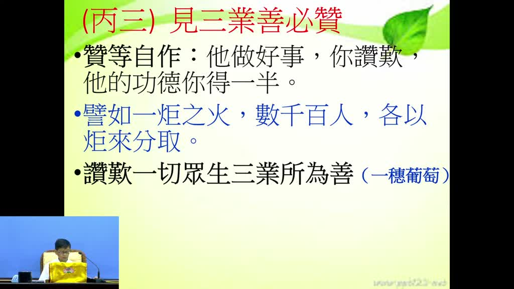

**重點：** 「讚嘆一切眾生三業所為善」，引《雜譬喻經》「一穗葡萄」：貧窮人家一個月來心心念念想供養有道人，國王卻包辦了當月四事供養；有道人讚嘆他，這一個月的心念已等同供養，功德不輸國王。

第二條叫讚嘆一切眾生三業所為善，我們讚嘆一切眾生，就是一切眾生身口意造的三業，我們都讚嘆他，我們都怎麼樣讚嘆？別人做善事，我們讚嘆。在佛經裡面，雜譬喻經裡面，曾經舉了一個例子，叫做一穗葡萄。有一個貧窮人家，家裡什麼都沒有，庭院裡面有一棵葡萄樹，長了一穗葡萄。這一穗葡萄，他聽說怎麼樣，我們最近這個地方出了一個有道的修行人，他很想怎麼樣，等我這個葡萄熟了、成熟了，我就要把葡萄剪下來，送給這個，供養這個有道的修行人，結果沒想到怎麼樣，當時國王也想要供養這個修行人所以國王當然力量大，他要供養我們哪能跟他拼，對不對，你們全部都排到後面去，我們窮人家都排到後面去，這國王怎麼樣，包辦這個月內的所有的修道人的四事供養，四事供養還記得吧，衣服、湯藥，還有什麼，四事供養，國王怎麼樣，一手包辦，這個月，別人都不能跟他搶，那這個貧窮人家，他說我這個葡萄，我就是快成熟，結果，一直經過了一個月，每天都看著葡萄，就想要供養這個有道人，那一直沒機會，那麼一個月後，他就把葡萄剪下來，去供養這個有道人，那有道人就讚嘆他，這個就是他做善事，有道人讚嘆他說：你的供養已經供養了一個月了，要注意，就是你已經供養了一個月，那你說我不是，我今天才把葡萄送來給這個您這個，來供養您，他說你這一個月來心心念念都想著供養，三業當中的身口意的意，心心念念，雖然你沒有拿來供養，但是你心心念念都要供養，這個就等同於供養，所以這個月來你心心念念，這個就是功德了，所以你的功德不會比國王還少，是你真正施食，你這個月這個功德就是已經供養一個月，所以我們說讚嘆一切眾生，三業所為是像我們說像這些地方都要心思要怎麼樣，很純厚，很細密，你才會做這些事情，心思如果是做假的，虛妄不實的，你做不來這些事情，所以三業讚嘆一切眾生，然後可離污染報，可離污染報就是不好的事情，沾染不到身上，所以我們如果常常能夠讚嘆別人的善業，然後能夠讚嘆別人身口意造的善業，慢慢我們自己也能夠怎麼樣，把一些不好的惡業慢慢遠離，所以你如果是嫉妒，嫉妒的話就沒辦法遠離這些惡報，所以慢慢的如果你能夠隨喜讚嘆的話，就會沾染不到我們的身上。

### 投影片 10：離染得清淨果：慧公與雪公婉拒表揚（27:32–29:24）

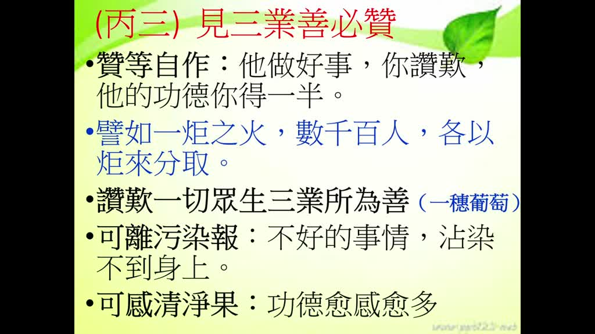

**重點：** 常讚嘆別人的善業，自己的惡業慢慢遠離，不好的事情沾染不到身上，還能感得清淨果報（功德愈感愈多）。講師舉慧公與雪公老師都婉拒政府表揚，最後都往生極樂，說明這種小事也感得親近的果報。

你看下面講，而且可感清淨果，自己的功德愈感愈多，這個都不是自己做善，是看到別人做善事，我們這麼樣隨喜讚嘆，至誠心、內心當中很真實的來隨喜讚嘆，就能夠怎麼樣？感得清淨果報，這個是多好的事情，我們如果不學我們就不知道這套方法，如果你知道的話，像雪公老師和會性法師，他們兩位，兩位都有一個共通的交集的，就不願意怎麼樣，他做了很多善功德，但是不願意怎麼樣，不願意給政府表揚，因為我們政府有時候就是會表揚這些公益團體，公益的人，會公他，會公和雪公老師都一樣，政府主動的，因為有人推薦，但是雪公老師和會公他們都，後來他們知道說那個表揚就是只是在上面表揚哪個匾回來而已，他後來覺得說做這些功德本來就是應該要做，本來就應該要做為什麼要人家表揚，表揚的就是我們昨天講的就是變成什麼德，就是揚德了對不對不是隱德了，所以後來就拒絕婉拒了，所以你看他們兩位因為他一生當中不願意這樣給政府怎麼樣表揚，但是你看兩位都往生極樂世界，這個叫感親近果，所以我們不要認為說這個是好像小事，但是這種小事就從可以看得出來，他最後能夠感得這個親近的果報。

### 投影片 11：欲惡不隨喜：五欲十惡（29:24–32:15）

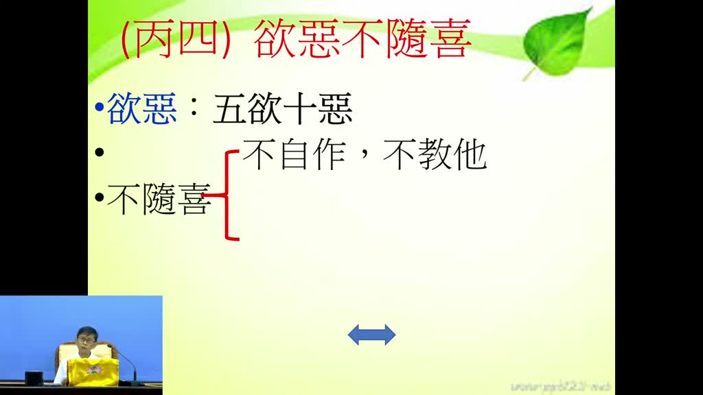

**重點：** 最後一條「欲惡不隨喜」。五欲有兩種：色聲香味觸，以及財色名食睡，生活中隨處都在貪著；十惡是身三、口四、意三。要做到不自作、不教他，並且不隨喜惡人、不讚嘆惡法。

好最後一條，我們要利兩明當中，除了隨喜讚嘆別人的善事之外，還要怎麼樣，欲惡不隨喜，欲惡，欲就是五欲，平常我們講的五欲有兩種，一個就是色聲香味觸，貪色、貪聲、貪香、貪味、貪觸，這個很普遍，很廣博，隨時隨地，可能我們都會犯這個，那麼講具體一點就是財色名食睡，這個是具體的，這也是很容易犯的，那惡是十惡，十惡，因為我們初學的人可能稍微要知道，十惡就是身口意，身三口四意三，身三就是殺盜淫，殺生偷盜邪淫，口就是妄語、惡口、兩舌、綺語，那意就是貪嗔癡，那這個五欲十惡，我們怎麼樣利益眾生，利兩明，利益眾生，凡是色聲香味觸引誘我們的時候，我們不要去怎麼樣，我們不隨喜，不去貪著，那有惡業要犯，犯惡業的時候，我們也不隨喜，欲惡不隨喜，所以這個不隨喜，怎麼樣不隨喜，第一個不自作，自己當然不能做這個，不要去貪色聲香味觸，不要去貪著色聲香味觸，這個只是說一句話，哎呀，實際上在生活當中，處處都是貪色、貪聲、貪香、貪味、貪觸，我們問自己，我們哪一個人不貪這些，你說天氣這麼熱，哪個人不貪觸，一定要吹冷氣才舒服，對不對，這個就是對觸上面的，在觸上面就是我們有貪著，吃東西也一樣香和味，哪一個人不喜歡吃自己合口味自己的，所以這些事實上是在我們生活當中，它已經融到我們生活當中習慣當中，我們是不知不覺的，不知不覺你就怎麼樣，是自作自己在貪著色聲香味觸，不自作。這個就是要警覺的，你貪著這些東西，以後會有後果。

### 投影片 12：不隨喜惡人、惡法與敬而遠之（32:15–36:30）

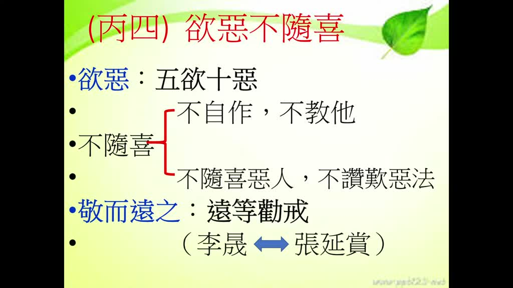

**重點：** 雪公老師舉兩例說明「不隨喜惡人」：借梯子給小偷、幫人拉大魚。對不讚嘆的惡法與惡人要「敬而遠之」，遠離就是一種勸戒；並以李晟與張延賞的故事說明：遇到記恨的人，只能敬而遠之。

第二個也不要教他人做，第三個叫做不隨喜惡人，雪公老師舉了兩個例子，比如說有一個人晚上做小偷，他就在你家旁邊怎麼樣，他要爬到隔壁家要偷東西，結果圍牆太高，你想這個做賊的太可憐了，你就把家裡面的梯子怎麼樣借給他用，這個叫做怎麼樣，隨喜惡人，有沒有這種人，可能真有這種人，有這種人，第二個，雪公老師舉一個例子，比如說有人釣魚，釣魚以後，釣魚這個怎麼樣，他釣的魚釣得太大，拉不上來，你在旁邊看了看不過去了，怎麼樣，幫他一起拉，好像怎麼樣，日行一善，這個就是隨喜惡人，所以不隨喜惡人，這是不隨喜的第三條，第四條，不讚嘆惡法，就是別人做這些惡事的時候，我們不要在旁邊拍手叫好，認為說確實是有人這樣犯了戒，犯了一些，做了一些事情，我們不僅沒有怎麼樣，沒有說莫比，反而怎麼樣，認為說這個人能夠懂得人情世故，能夠曲順人情，反倒是怎麼樣？跟他為伍，不要讚嘆惡法，所以不隨喜，雪公老師說遇到這種人怎麼辦，怎麼樣利兩明呀，敬而遠之，還是對他恭敬，但是我們遠離他，遠離他的話意思就不隨喜，遠等勸戒，遠離他等於就是怎麼樣，你遠離他就知道，如果他是聰明人，你就知道他為什麼這些好的人為什麼遠離我們，他就知道，這就是一種勸，勸他離開，然後戒，能夠戒，讓他能夠戒除，就是這個叫遠等勸戒，然後這個雪公老師舉了一個故事，這個故事是，就是說我們有一些人，唐朝，唐朝有一個將軍叫李晟，李晟是一個武人，武人然後對唐朝後代有一點貢獻，他曾經在朝堂上面，曾經和另外一位叫張延賞，張延賞是文人，為了一個政策辯論，辯論完畢以後就沒事了，後來那個李晟想要娶張延賞的女兒，他想張延賞是一個文人很有學問，娶他女兒回來，結果張延賞拒絕，雪公老師就舉這個例子，這個李晟後來才想到說，因為這兩家人都是門當戶對，門當戶對應該是很好的一門婚事，那李晟後來想到說，我就是在朝堂上面跟他爭論，爭論以後他怎麼樣，懷恨在心，所以他說我們武人，我們打戰的武人，事情過了我們就不會記在心裡面，但是這個文人不一樣，文人怎麼樣，文人不要隨便侵犯他，侵犯他以後表面是沒事，但是內心裡面是懷恨在心的，所以這種人我們怎麼樣，雪公老師就舉這個例子，像這種人你遇到的時候也沒辦法，就只好怎麼樣，敬而遠之，就不隨喜。

### 投影片 13：網路時代的遇惡不隨喜（36:30–37:47）

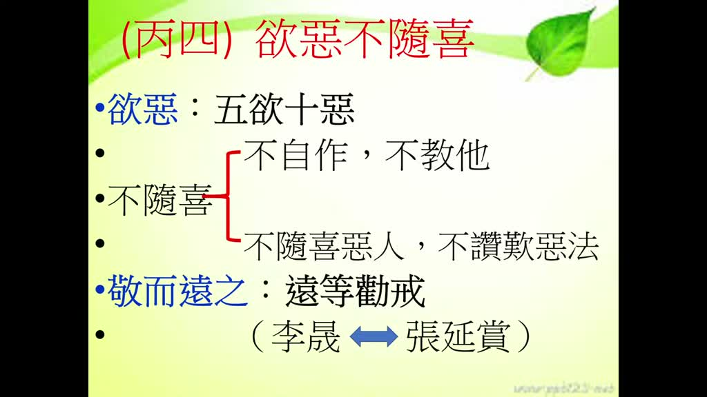

**重點：** 講師提醒網路演算法會依觀看習慣不斷推送相關影片：凡是有關財色名食睡的影片都要拒絕、不要點閱，點閱率低它就不再推送，也能慢慢去除壞習氣。

所以這一條我們要注意一下，敬而遠之，尤其我們現在很多的網路上面，網路上面怎麼樣遇惡不隨喜，很容易遇惡隨喜，網路上面因為他現在都是利用什麼，那個大數據的演算法，就是你常常看哪一種，常常看哪一種影片，他就怎麼樣自動自發的把那些影片怎麼樣，全世界相關的影片都是每天都發給你看，所以我們學佛人要慢慢的學習，凡是有關財色名食睡的影片，拒絕，因為你如果去點它一下，看它一下，慢慢的怎麼樣，這個社會上就瀰漫，這些不三不四的影片通通都出來，我們如果點閱率不高的話，慢慢的他就不會到我們的電腦來，不會上我們電腦來，慢慢的也能夠把這些壞習氣去除掉，因為這個本來就是一個社會現象。

### 投影片 14：至誠心小結：壓艙石（37:47–39:10）

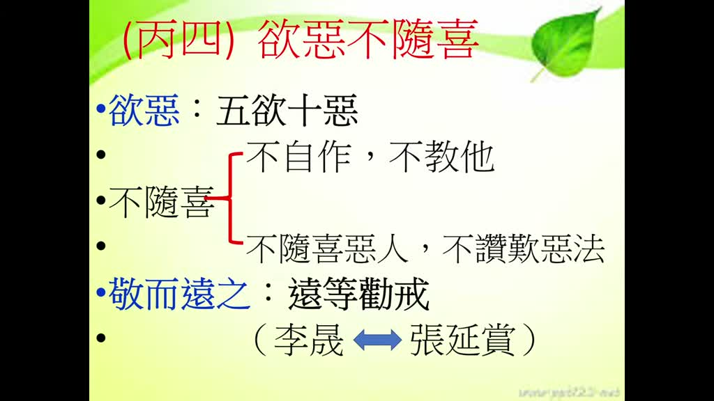

**重點：** 講師回顧「至誠心」分兩大段：辨真偽（真實修行才能感得真如本性），以及自他兩利。至誠心是修行的壓艙石，念佛拜佛都要當成真實，才能得到大利益。

好，這個是我們講，這個至誠心，雪公老師分成兩大段，第一個，辨真偽，就是我們修行淨土法門，我們到底是真心、真實修行，還是虛偽修行，真實修行就能夠感得真如本性，虛偽修行，你所修雖然也要修，但是不名真實業，這是第一個。第二，我們如果能夠很真實的來修行，就能夠兩利，自他兩利，自利也能夠利他。那自他兩利，這些細節，就是下面這個雪公老師列的細節，這些細節好好去體會一下，我們生活當中都能夠很容易用得上的。好，這個至誠心是我們修行上面的壓艙石，壓艙石是什麼？就是整個船要能夠穩固，整個船要能夠穩固要有壓艙石，所以我們修行的過程當中，要能夠真正得利益的一定要建基在至誠心，就真實心，就是你念佛就把佛號當真實，拜佛就把佛當真實，真真實實的來修淨土法門。

### 投影片 15：深心（決信）：深信與決定（39:10–43:19）


**重點：** 進入「甲二 深心（決信）」：深心是深信之心，如水有深淺。東晉的僧肇大師（講者提及，出處推測）解釋「樹心重德，深固難拔」，信心深就不會被外在風吹草動、親友議論動搖；「決」像開會作決議，決定不二、沒有絲毫懷疑。

那麼接下來你才能夠得到很大的利益，接下來我們看第二個叫深心，深心，這個深心，深心就特別，這個至誠心是信心，我們講信願行的信，是建立你那種對佛法的一種真實信心，有這個真實信心以後就要發願，要修行，發願修行，所以下面這個深心、迴向發願心，就是怎麼樣，就是發願和修行，深心，我們先看這個深心這兩個字，深心這兩個字，為什麼用深，深這個字，深當然就是深淺，所以這個就形容得非常好，這個深淺，就是你看旁邊有個兩個字，決信，所以我們有很多的學佛修淨土法門人，你說他的願力為什麼不真切，有些人的願力就是很真切很懇切，那有些人念佛這怎麼樣，念佛是不老實念佛的，那有些人就是很老實念佛的，怎麼會有這個差別，那就是關鍵都在這個地方，有沒有決心，也就是說你的心怎麼樣，深不深，你的信心夠不夠深，所以信心這個地方，雪公老師那邊講，就是深心就是你對這個淨土法門的那個信心，深，深，怎麼樣深，這個深的形容詞，怎麼深，這個僧肇大師，晉朝，東晉的時候，是鳩摩羅什的學生弟子，他曾經這麼解釋，他說，樹心眾德，深固難拔，樹心眾德就是我們把所有的種種的功德，在心中建立起來，樹就是建立，能夠把種種功德在我們內心當中能夠建立起來，所以深深的牢固，所以很難拔除掉，所以這個你說要怎麼樣才能夠深心？就是你念佛修行上面怎麼樣？要能夠深深的牢固，深深牢固以後就能夠很難拔除掉。也就是說不會輕易被外面的風吹草動，你就動搖信心了，不會被外面的親朋好友說一說，然後你念佛信心就沒有了，一定是深信不疑的，這個叫深信。所以深心，你看，就像水一樣，你看池塘有些地方是淺的地方，有些地方是深的地方，所以我們心裡面的水也是一樣，我們心裡面的水，這個信心就像心裡面的水一樣，也有的人是淺的信，也有人是深的信，淺的信心就很容易被搖動，很容易被搖動，也就是你修淨土法門、念佛法門，很容易被人家左右，很容易退轉，但是如果你的念佛法門的信心是深，非常的深入其中，那你這個念佛法門，你對念佛的信心都不會輕易被搖動，所以他是用深這個字來形容，那為什麼要決信，決這個字，它的意思就像開會一樣，我們一個會議當中，開完會討論完畢以後決議了，決議以後就不能夠改變，我們應該你有常識，你開完會決議以後就要執行，決議以後所以決定不二之心，就像開會一樣決定以後就不能夠改變，這個是我們講的決心。

### 投影片 16：念佛十大利益：你信不信（43:19–46:09）

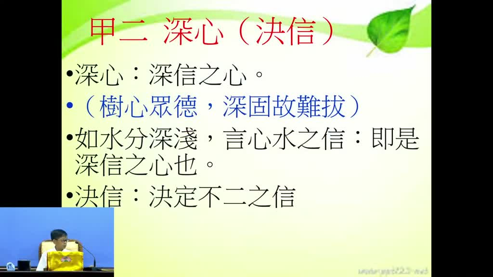

**重點：** 以念佛的十大利益（諸天護法、二十五菩薩圍繞、阿彌陀佛光明攝受…）反問自己：真的能不雜一念地相信嗎？若能深信不疑，就是「樹心重德，深固難拔」，確實能得利益。

所以這個時候這個信心，如果決定很深刻的這個信心就不雜疑念，沒有雜任何絲毫的懷疑，任何絲毫的懷疑都沒有，對阿彌陀佛、對極樂世界，那就是真的是相信，有世界名曰極樂，有佛號阿彌陀，然後你念佛就能夠蒙佛，蒙佛功德，不會有任何絲毫的疑念，所以這個有時候我們得反省，我們為什麼很多念佛人，我們說念佛有這麼多好處，十大利益，第一條利益是什麼，你如果念佛，第一條利益就是，諸天護法，左右，明當中、暗當中來保護，你問自己，你相不相信，你念佛的話，諸天、龍天護法，他旁邊怎麼樣，明的暗的地方都來保護，第二，你信不信？第二，你如果真的念佛的話，有二十五位菩薩圍繞保護，信不信？有二十五位菩薩，你還怕什麼新冠肺炎？你還怕什麼其他事情？有二十五位菩薩跟我們作伴？第三個，更高的，你念佛的時候，有諸佛攝受，有阿彌陀佛的光明照耀，你信不信，我跟大家講，我們雖然說，很多人說，說說而已，文字寫寫而已，這個不是，這個是遵式大師，北宋的遵式大師，他從經典當中對於淨土法門的念佛得十大利益，他這不是隨便寫，隨便的，這個遵式大師是有證果的，但是我們的文字是這樣寫，你也是這樣看，但是你真能這樣相信嗎，大概要能夠說不雜一念的，我們不要問別人，你問自己就好了，你能夠不雜一念嗎？如果哪一天真的能夠全身靠倒，能夠深信不疑，那就是這種心就是深的，那就是樹心眾德，深固難拔，這樣的功德這樣的信心就是很難拔除掉。

### 投影片 17：九深信之首：自身罪惡纏縛凡夫（46:09–49:50）

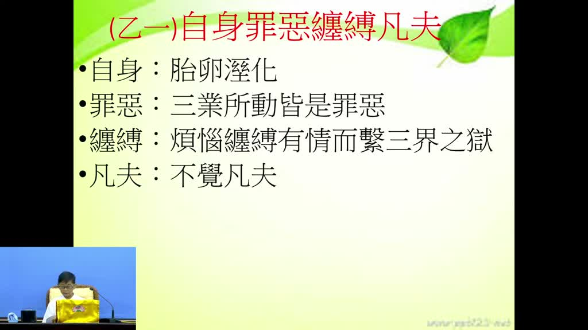

**重點：** 深心有九條，第一條是深信自身是「罪惡纏縛凡夫」：不念佛時，身口意三業所動皆是罪惡，連嬰兒呼吸都傷害空氣中的眾生；纏縛是煩惱像繩子綁住有情，凡夫則是不覺。更多留待下一次講。

那確實能夠得到利益，下面有九條，九條都是要深信的，這每一條都是可以怎麼樣，反觀自省，比如說第一條，要深信怎麼樣，自身罪惡，纏縛凡夫，這個第一條你就要怎麼樣，相信自己，我們自身是罪惡纏縛凡夫，這個自身，不是隻有人，胎卵濕化，胎生的、卵生的、濕生的、化生的，所有的眾生都要能夠相信，相信怎麼樣，我是罪惡纏縛凡夫，罪惡，什麼叫罪惡，什麼叫纏縛，罪惡就是說，我們要注意，我們要相信，我們平常生活當中只要不念佛，口裡說的，身體做的，心裡想的都是罪惡，三業所動皆是罪惡，無非是罪無非是業，我們只要嘴巴上面如果失念沒有念佛的話，你口裡面講的話，身體裡面做的事情，心裡面想的都是罪惡，你光這一條很多人都不相信，很多人說真的嗎我有這麼嚴重嗎，以前有一個老先生他後來來聽課，自身罪惡纏縛凡夫，他看到這個，他就不相信了，他說我哪有這麼嚴重，我都是好人，對不對，我也沒去傷害人，但是佛法講的，就是這麼樣細，雪公老師就講很明白，我們不要說我們大人，小孩子一出生，他就來造惡業，怎麼造惡業，你說小孩子出生，他手也不會打人，口也不會罵人，心裡也不會嗔恨人，怎麼會造惡業？雪公老師就講，他會不會呼吸？會不會呼吸？呼吸，空氣裡面就有很多眾生。你一呼一吸當中，你想，有多少眾生被你一呼一吸當中就沒有了。這個就是罪惡，所以我們說眾生三業所動，這個只要學佛有點常識，就不會懷疑了，這個沒有懷疑，身口意只要不念佛，三業所動皆是罪惡，然後纏縛是什麼，纏縛就是我們因為造了罪惡以後，就被生起的煩惱，煩惱纏縛有情，煩惱就像繩子一樣，綁住我們有情，有情就是我們眾生，煩惱就像這個繩子一樣把我們有情眾生綁得死死的，繫在了三界的牢獄當中，就是我們出不去，離不開，生生死死死死生生，離不開，然後怎麼樣，凡夫，凡夫是什麼，凡夫就是不覺，大家回想，我不是每天都很清清楚楚嗎，我怎麼不覺，但是就是不覺，到底不覺什麼東西，我們等下一次再跟大家報告。

## 已知轉錄錯誤

| 時間 | 聽成 | 應為 |
|---|---|---|
| 全片 | 明兩立／明兩利 | 利兩明（科判「乙二 利兩明」，投影片表可見）；「兩立」＝兩利 |
| 01:41 | 一介羅矣／萬聖復原 | 一介螺蟻，萬聖覆援（推測，講者未見文字） |
| 02:09 | 和富有加 | 護佑有加（推測） |
| 02:26 | 宗教教導教導 | 如果我們有佛法的常識的話（依單獨重送音訊） |
| 03:26 | 親身歸本處／悲盤婉快 | 輕身歸本處；你的杯盤碗筷要輕輕地放（依單獨重送音訊，詩句出處未查證） |
| 04:17 | 真業鬼／針葉鬼 | 針口鬼（講者解釋喉嚨像針一樣細）；「針口不生愁」原文存疑 |
| 10:14 | 聖殿佛 | 能夠知道信願念佛，那麼大家就能夠往生極樂世界（依單獨重送音訊） |
| 10:57 | 升文嚴舉 | 聲聞緣覺（推測，音近；後句「你就是阿彌陀佛」亦依原轉錄） |
| 13:48 | 詞詞曲曲 | 然後來捉他們（依單獨重送音訊） |
| 15:22 | 護身 | 護生（推測，兩次轉錄均為「護身」） |
| 17:44 | 蘇州／韓國、韓國、江蘇 | 蘇州、杭州、江蘇等地（推測；國名吳越、錢鏐依音及史實校正） |
| 18:26 | 料，把上面廠字頭拿掉 | 廖，把上面廣字頭拿掉，加金＝鏐（講者拆字，推測） |
| 24:23 | 提禮宗法師 | （幻覺，已刪；單獨重送為「庭院裡面有一棵葡萄樹」） |
| 26:27 | 是你真正施食 | 語意不明，保留原轉錄，存疑 |
| 28:09 | 慧宮／慧信法師／慧公 | 會公／會性法師（推測：與本專案已歸檔「會性法師—大佛頂首楞嚴經」同一系列） |
| 33:49 | 沒有說莫比 | 語意不明，兩次轉錄相同，保留，存疑 |
| 33:56 | 取順人情 | 曲順人情（推測） |
| 34:50 | 我們有一些人／你怎麼樣演繹／進哪演繹 | 講者語意不通，已刪（兩次轉錄均不成句） |
| 40:49 | 深照大師 | 僧肇大師（推測：東晉、鳩摩羅什弟子；投影片未寫出處，未查證） |
| 45:16 | 尊師大師 | 遵式大師（北宋，念佛十大利益；推測） |
| 48:09 | 心理業也不會驗證人 | 心裡也不會嗔恨人（推測） |
| 48:52 | 被會起的煩惱 | 被生起的煩惱（推測） |
| 00:46 | 彭會長是寫難清 | PPT 是寫難清（推測） |
| 補漏 | （轉錄缺漏） | Groq 轉錄漏掉 18:10–18:21、23:57–24:04、25:16–25:45、29:35–30:06、37:09–37:20 的人聲，已依單獨重送音訊補回（本次未見 refilled 訊息） |

## 補充資料連結

- 補充資料檔：[supplement.md](supplement.md)（與本報告同資料夾；內容已收錄於上方〈補充資料〉）
- 思維導圖：[mindmap.png](mindmap.png)、文字大綱：[mindmap.md](mindmap.md)（與本報告同資料夾）
