# 會性法師-大佛頂首楞嚴經-第097集

- 來源：https://youtu.be/-uzt7Pq7_sI
- 平台 / 上傳者：YouTube / 會性法師-講經集
- 長度：1:13:27 (4407.1s)
- 逐字稿來源：subtitle OCR (PP-OCRv5 mobile)
- 更新日期：2026-10-27
- **關鍵字：** #楞嚴經 #觀世音菩薩 #耳根圓通 #三十二應 #辟支佛 #十二因緣 #四諦 #天王 #不空三藏 #灌頂疏 #安西

## 摘要與名詞說明

**一句話重點：** 會性法師接續講《楞嚴經》卷六觀世音菩薩耳根圓通的「三十二應」，依序講完現佛身、辟支佛（獨覺、緣覺）、聲聞、梵王、帝釋、自在天、大自在天、天大將軍、四天王、四天王太子，並開始講現人王身；中間用約三十分鐘考證圓瑛法師《講義》所引不空三藏退寇故事，指出原文是「安西」不是「西安」。

## 重點時間表

| 時間 | 主題 | 重點 |
|---|---|---|
| 00:34 | 耳根圓通略敘 | 聞思修入三摩地，入流亡所，得人空、法空，生滅既滅而得無生忍；上合諸佛慈力、下合眾生悲仰 |
| 03:26 | 三十二應與現佛身 | 對照《法華經·普門品》，菩薩應機說法，不必一一硬配 |
| 06:09 | 現辟支佛身 | 獨覺（無佛之世自覺）與緣覺（佛世修十二因緣）；「寂靜妙明，勝妙現圓」 |
| 10:54 | 現獨覺身 | 秋觀黃葉落、春觀百花開；獨覺根性往往要修到第七世（講者主張，未查證） |
| 14:14 | 現緣覺身 | 佛世未另立緣覺乘，合併在聲聞；摩訶迦葉為例 |
| 16:07 | 十二因緣 | 流轉門（惑業苦三道、三世因果）與還滅門（斷無明） |
| 21:05 | 現聲聞身 | 四諦空：知苦、斷集、慕滅、修道；證偏真涅槃 |
| 23:54 | 聲聞與緣覺之別 | 聲聞只斷見思惑、習氣未斷；摩訶迦葉聽琴起舞的習氣 |
| 26:06 | 現梵王身 | 梵王的「解脫」只是超出欲界，與前四種真解脫不同 |
| 29:02 | 現帝釋身 | 忉利天即三十三天，勸修上品五戒十善 |
| 31:12 | 自在天與大自在天 | 欲界第六天與色界最高色究竟天；要修色界四禪 |
| 34:38 | 寄位天王 | 講者主張：四位天王的內涵是菩薩寄位修行，終要成佛 |
| 36:31 | 天大將軍 | 四天王的八大將，領導鬼神護持國土 |
| 39:28 | 四天王 | 持國、增長、多聞（毘沙門）等，對帝釋是臣、對下界是王 |
| 41:10 | 四天王太子 | 《大吉義經》：每位天王有九十一位太子（依經所載），哪吒為其一 |
| 43:00 | 不空三藏退寇故事 | 圓瑛法師《講義》引《灌頂疏》，講者逐字念出並開始考證 |
| 46:05 | 考證一 | 《灌頂疏》原文是「安西」，《講義》誤成「西安」並自行加字句 |
| 48:14 | 考證二 | 《宋高僧傳》〈不空三藏傳〉原文：大、石、康三國圍西涼府 |
| 50:00 | 不空作法 | 原文只說「誦仁王密語」；「可五百員」被後人改成確定的五百 |
| 53:03 | 毘沙門天王子 | 原文沒有「第二子」「獨健」；以「藥單抄三遍會喫死人」為喻 |
| 55:05 | 講者查書經過 | 《舊唐書》《新唐書》放大逐頁查無，後在《高僧傳》找到 |
| 58:56 | 正史為何不載 | 講者推測：怕人問為何不救安祿山之亂；不空當時已回印度（講者主張，未查證） |
| 60:41 | 結論 | 有《講義》者要把「西安」改成「安西」 |
| 63:00 | 護世四王 | 四天王太子護持世間，故稱護世四王 |
| 64:42 | 現人王身 | 菩薩不護持只想享受王位的野心家，幫助為公的有道明君 |
| 68:28 | 結語 | 感應記無可引證的記載；下次從人王以下的長者、居士、宰官講起 |

## 名詞說明

- **三十二應**：觀世音菩薩為度眾生所現的三十二種身；本集從現佛身講到現四天王國太子身，並開始講現人王身。
- **辟支佛（辟支迦羅）**：獨覺與緣覺的總稱；講者說「翻成中國話有兩種」。
- **十二因緣**：無明、行、識、名色、六入、觸、受、愛、取、有、生、老死；流轉門順數，還滅門逆滅。
- **見思惑**：見惑（八十八使）與思惑（八十一品），聲聞、緣覺斷盡才出三界（數字為講者所說）。
- **寄位天王**：講者主張，四位天王是菩薩寄位修行，並非單純的天福。
- **《灌頂疏》／《講義》**：前者指《楞嚴經》的注疏，後者指圓瑛法師的《楞嚴經講義》。
- **安西都護府**：唐代管理西域的機構（講者說是唐太宗貞觀年間設立，未查證）。

## 轉錄校正備註

- 本集逐字稿改用**畫面燒入的字幕（PP-OCRv5 mobile）**為底稿，時間戳以字幕時間加上與 Whisper（Groq）對齊後的局部偏移；字幕是編修過的書面語，講者的口誤與部分插話未收（約 40 句，原話見 `transcript.whisper.md`）。
- 字幕 OCR 的同音／形近字已批次校正（雨→兩、昆沙門→毘沙門、香鎮→香鑪、於闖→于闐、焉者→焉耆 等），詳見 `meta.json` 的 `known_asr_errors`。
- 以下五處為「推測」，待使用者聽音確認：11:32「變僕」→變遷、49:22「埼定」→奠定、54:40「甘道」→甘遂、56:50「族怪」→奇怪、08:54「寂靜妙明寂素」→寂靜妙明寂靜。
- 字幕漏掉的還滅門句（觸滅則受滅、受滅則愛滅、有滅則生滅）依講者念誦順序補入（18:52）。
- 片尾字卡亂碼與片頭的 Whisper 幻覺（`The`、`ありません`、「詞曲，李宗盛」）已刪除。
- 本集為講座，字幕稿無標點、沒有去語助詞步驟；影片中的數字與史事一律視為「講者主張，未查證」。

## 思維導圖

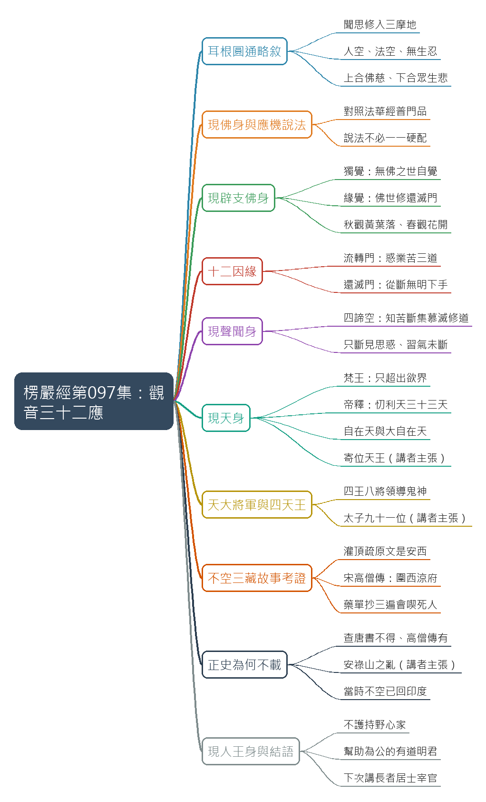

- 原圖：[mindmap.png](mindmap.png)；文字大綱：[mindmap.md](mindmap.md)（與本報告同資料夾）

## 圖文對照（畫面 + 逐字稿）

### 投影片 1：觀音耳根圓通：略敘最初修證（00:34–03:26）

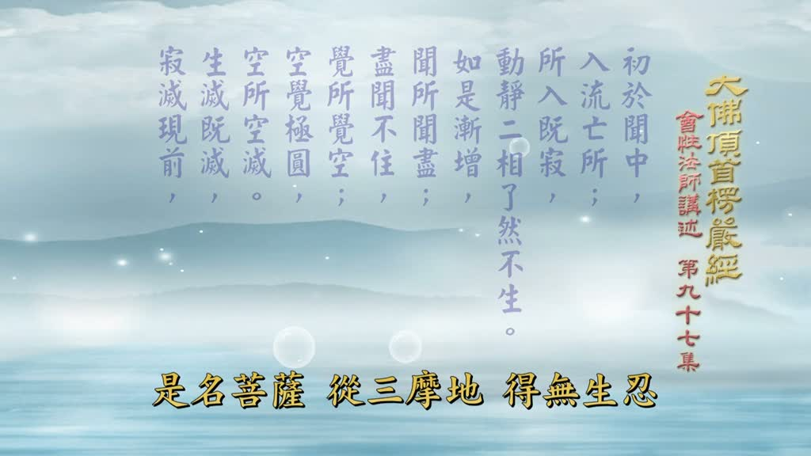

**重點：** 科判「觀音廣說耳門」三段中的第一段，略敘觀音最初修證：從聞思修入三摩地，入流亡所，先得人空、再得法空，生滅既滅、寂滅現前而得無生忍，並得上合諸佛慈力、下合眾生悲仰兩種殊勝。

**標籤：** #耳根圓通 #聞思修 #入流亡所 #無生忍

各位善知識，《大佛頂首楞嚴經》，第六卷剛剛開始，說明觀世音菩薩的耳根圓通，科判觀音廣說耳門有三段，第一，略敘最初修證，就說明觀世音菩薩，最初在觀世音佛前發菩提心，佛教祂修耳根圓通，就從聞思修入三摩地，由此初於聞中入流亡所，所入既寂動靜二相瞭然不生，這就是不入色聲香味觸法，斷見惑證初果的境界，這就是思惑斷了，此根初解先得人空，這個就是破我執，那麼斷見思惑超出三界，盡聞不住覺所覺空，這就是空性圓明成法解脫，空覺極圓空所空滅，這就是解脫法已俱空不生了，已經到了圓明的境界，所以生滅既滅寂滅現前就是，是名菩薩從三摩地得無生忍，從此之後就是等覺以上，忽然超越世出世間十方圓明，得兩種殊勝，第一是上合十方諸佛本妙覺心，與佛的慈力佛所具的慈力，菩薩同時具備，第二是下合十方一切六道眾生，眾生的悲仰看到眾生的苦惱，發生大悲心眾生仰慕菩薩，希望菩薩救度，所以後邊現十四無畏，上合十方諸佛的殊勝慈力，就是先說三十二應，後文第二廣明成就功德，說明這個道理，廣明成就功德分三段，第二是十四無畏。

### 投影片 2：三十二應總說與「現佛身」（03:26–06:09）

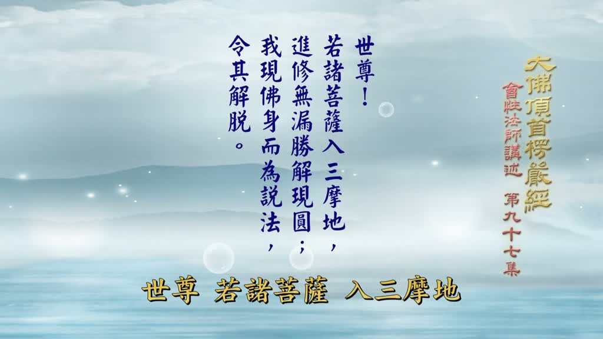

**重點：** 進入「廣明成就功德」下的三十二應，第一應是現佛身；講者對照《法華經·普門品》無盡意菩薩的問答，說明菩薩應機說法、不必一一硬配所說的法。

**標籤：** #三十二應 #現佛身 #普門品 #應機說法

世尊由我供養觀音如來，蒙彼如來授我如幻聞燻聞修，金剛三昧與佛如來同慈力故，令我身成三十二應入諸國土，就是與佛同慈力的緣故，成就三十二種應身，在十方世界度化所有眾生，這三十二應第一就是現佛身，世尊若諸菩薩入三摩地，進修無漏勝解現圓，我現佛身而為說法令其解脫，這上次就講到這裡現佛身，這在《法華經·普門品》裡，就是第二番問答，無盡意菩薩問佛，觀世音菩薩云何遊此娑婆世界，云何而為眾生說法，方便之力其事云何，佛就答覆說如果有眾生，應以佛身得度者，觀世音菩薩即現佛身而為說法，就跟這一段是相同的，是說菩薩果上的境界，這裡是菩薩自己說，說祂因地所證的圓滿功德，佛現佛身度眾說什麼法，都是順著現的身說的法，完全要配合起來說，這個實際上在菩薩度眾，不是那麼呆板的，現身可以說現什麼身現什麼身，說法在祂當時應機說法，隨機應變不是那麼死板的，對聲聞一定是四諦，對緣覺一定是十二因緣，這是一種通途的說法，菩薩祂隨時隨地都有所變通，應機說法不是呆板，所以我們在瞭解這個道理之後，每一位現身說的法，我們不必去分配不必一一分配，因為菩薩本來不是一定如此，用不著分配只說菩薩現身。

### 投影片 3：第二應：現辟支佛身（06:09–10:54）

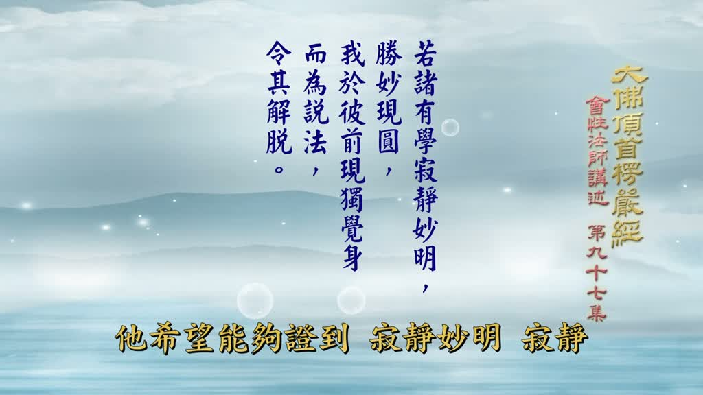

**重點：** 辟支佛（辟支迦羅）分兩類：出在無佛之世、自己觀無常而悟的是獨覺，出在佛世、聽佛說法修十二因緣還滅門而證的是緣覺；並解釋經文「若諸有學，寂靜妙明，勝妙現圓」的意思。

**標籤：** #辟支佛 #獨覺 #緣覺 #寂靜妙明 #勝妙現圓

必定有所說法接下來，就是現辟支佛身，只是現辟支佛，應以辟支佛身得度者，在這裡分成兩類，因為辟支迦羅印度話，翻成中國話有兩種，一種是獨覺一種是緣覺，這一種根性他如果是出現在，沒有佛出現世間的時候，他自己能夠觀無常而證悟，證到辟支佛果那個叫做獨覺，如果是出在有佛之世聽佛說法，然後依十二因緣的還滅門修行，證到辟支佛果那叫做緣覺，這裡就分開來先現獨覺身，然後現緣覺身所以經文說，若諸有學寂靜妙明，勝妙現圓我於彼前，現獨覺身而為說法令其解脫，這裡四聖到大梵天王，都是說解脫除掉大梵天王之外，佛裡面包含菩薩，辟支佛裡面的獨覺緣覺，再加上聲聞這是都能超出世間，得真解脫見思惑斷了生死了了，超出世間的真解脫，梵天不一樣講到那邊再說，經文所說的若諸有學，若不一定假定，假定有這一類眾生諸不只一位，他這一類眾生也許有很多，所以用諸字來說明有學，就是他發心想求證辟支佛果，自己斷煩惱自己了生死，沒有發菩提心這種有學的根性，他想要證辟支佛果的無學，他希望能夠證到寂靜妙明寂靜，這個寂靜妙明這裡的文字很多，跟這個圓最圓的境界，最高的境界的文字，很多相同的地方，要看他在哪裡說的，這裡在辟支佛說的這個妙明，就不是平常講的那個本覺妙明，不要搞錯，只是指眾生本有的靈明妙性，他這裡只是說他在辟支佛的境界，希望能夠成就可是他修法，必定要先得寂靜的境界，他這個寂靜就是，得因地法獨善其身的這種心，希望自己寂靜下來求證妙明，而這個妙明是指的辟支佛果，這裡的妙明是指的辟支佛，所以在這一種根性，他希望能夠勝妙現圓，殊勝微妙的辟支佛的境界，像這類文字都要看它當，所說的哪一類根性，這個勝妙是辟支佛的勝妙，殊勝而微妙，這個殊勝微妙只是指辟支佛，而不是指究竟果覺，現圓就是現前圓滿意思就是說，希望能證到辟支佛的果地獨覺，因為出在沒有佛的時候，世間沒有佛他要求證到獨覺。

### 投影片 4：現獨覺身：秋觀黃葉落、春觀百花開（10:54–14:14）

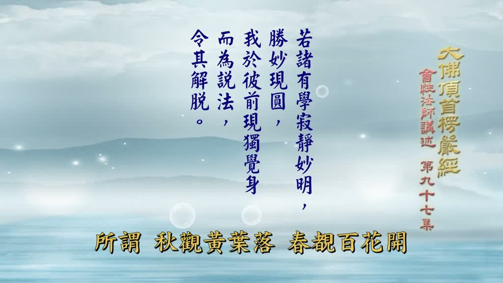

**重點：** 獨覺生在無佛之世，靠觀世間無常（秋葉落、春花開）自己覺悟；講者主張這類根性往往要修到第七世才證果，菩薩現同類身引導他觀無常、斷見思惑並去掉一部分習氣。

**標籤：** #獨覺 #觀無常 #見思惑 #習氣

那麼觀世音菩薩就，我於彼前現獨覺身而為說法，這個獨覺就是現跟獨覺的身分，相同的同類身來感化他幫助化，幫助想要證辟支佛果的人，而證到辟支佛果引導他，趣向於他的願望能夠圓滿，而為說法說的什麼，不必去硬性去支配，因為他是獨覺沒有佛出現世間，他必定要觀這個世間的無常變遷，所謂秋觀黃葉落春觀百花開，看著這世間依報變化的現象，到了秋天黃葉就落下來了，那麼只剩樹枝了到了春天，百花又開了這一種的無常變化，由此他是自己獨自覺悟，菩薩現身就是引導他趣向於，能夠獨自覺到這一種境界，由此證到辟支佛見思惑斷盡，也能去掉一部份的習氣，就可以得到辟支佛的解脫，解脫就是見思惑，見惑思惑都斷除了，三界內的煩惱完全斷盡，同時也把習氣能夠去掉一部份，由此得到解脫為什麼會有獨覺，世間上有一類獨覺根性，他第一生見到佛，第一生見到佛聞到佛說法，聽到這個十二因緣的修法，當生沒有辦法證到，辟支佛最利根也要四生，連著修四生纔能夠證到辟支佛果，獨覺往往要七生七生，這可能是第七世，要證辟支佛果了，因為佛沒有出現世間，那麼他必定自己能夠觀察，而自覺悟如是因如是果，修的工夫今生圓滿，自然就會成到辟支佛果，那麼菩薩要幫助他，就是使他能夠觀無常知變化，由此而體證辟支佛，這是現獨覺身就是第二種，第三若諸有學斷十二緣，緣斷勝性勝妙現圓我於彼前。

### 投影片 5：現緣覺身：摩訶迦葉的根性（14:14–16:07）

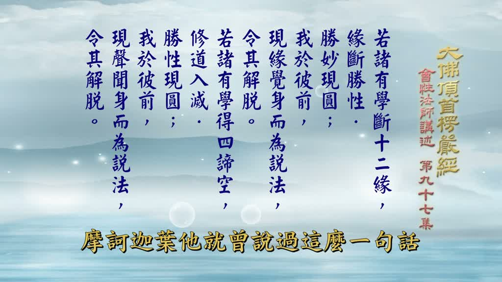

**重點：** 緣覺出在佛世，修還滅門而證果，但佛世時並未另立緣覺乘，合併在聲聞（阿羅漢）裡；講者舉摩訶迦葉為例，說他本有緣覺根性，今生遇佛聞十二因緣而證果。

**標籤：** #緣覺 #摩訶迦葉 #還滅門

現緣覺身而為說法令其解脫，這是緣覺緣覺就是出現有佛世，例如釋迦牟尼佛在世的時候，有緣覺根性，由此修還滅門而證果，釋迦牟尼佛世也有緣覺，不過祂的出家眾弟子當中，沒有另外分緣覺乘，就是有緣覺根性證辟支佛的，也合併在聲聞裡面，合併在阿羅漢聲聞裡面，例如摩訶迦葉，摩訶迦葉他就曾說過這麼一句話，他說他如果，今生如果沒有遇到佛，他也能夠獨自覺悟而證到辟支佛，所以像摩訶迦葉這一類根性，本來他就是緣覺根性獨覺根性，這很可能他這是最後一生，所以他能夠見到釋迦牟尼佛，聞十二因緣由此修還滅門，而證到辟支佛果，所以應當像摩訶迦葉這一類，是屬於緣覺的是辟支佛果，但是因為佛世沒有這樣分，通通收歸於跟阿羅漢同類，就是聲聞都是聞佛聲而悟道的，就是緣覺也是聞到十二因緣的法，所以合併在聲聞法裡面，沒有另外建立這個辟支佛。

### 投影片 6：十二因緣：流轉門（16:07–18:32）

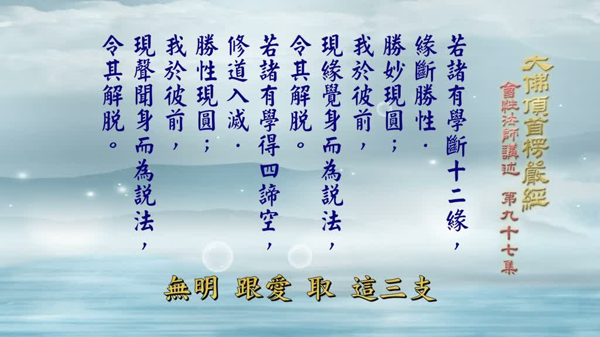

**重點：** 講「斷十二緣」前先說十二因緣的流轉門：無明緣行乃至生緣老死，分成惑、業、苦三道，過去二支、現在三支、未來二支的三世因果，眾生就這樣輪轉不息。

**標籤：** #十二因緣 #流轉門 #惑業苦 #三世因果

若諸有學跟前面一樣，斷十二緣十二緣就是十二因緣，有流轉門有還滅門，我們眾生就在流轉門中輪迴生死，無明緣行行緣識識緣名色，名色緣六入六入緣觸觸緣受，受緣愛愛緣取取緣有有緣生，這就叫做十二因緣，由無明的根本煩惱因緣，發生行的動作造業，所以無明是惑行是業，業力造成了就有識，所以無明愛取三煩惱，無明跟愛取這三支，都是屬於煩惱道，行有二支屬業道，行是造作有也造作纔有，所以這兩種就屬於業道，從識至受並生死，七支同名一苦道，識名色六入觸受這五支，跟後邊的生老死兩支，這七支通通屬於苦道，惑業苦正在受苦的時候，又起惑再造業，繼續受苦輪轉不停，這就是流轉門的十二因緣，過去二支因無明行，識名色六入觸受，現在三支因愛取有，未來二支果生老死，這樣輪轉不息未來的生老死，又是等於現在的識到受，眾生無量劫來就這樣輪轉，不曉得經過千萬億遍流轉門。

### 投影片 7：十二因緣：還滅門與「令其解脫」（18:32–21:05）

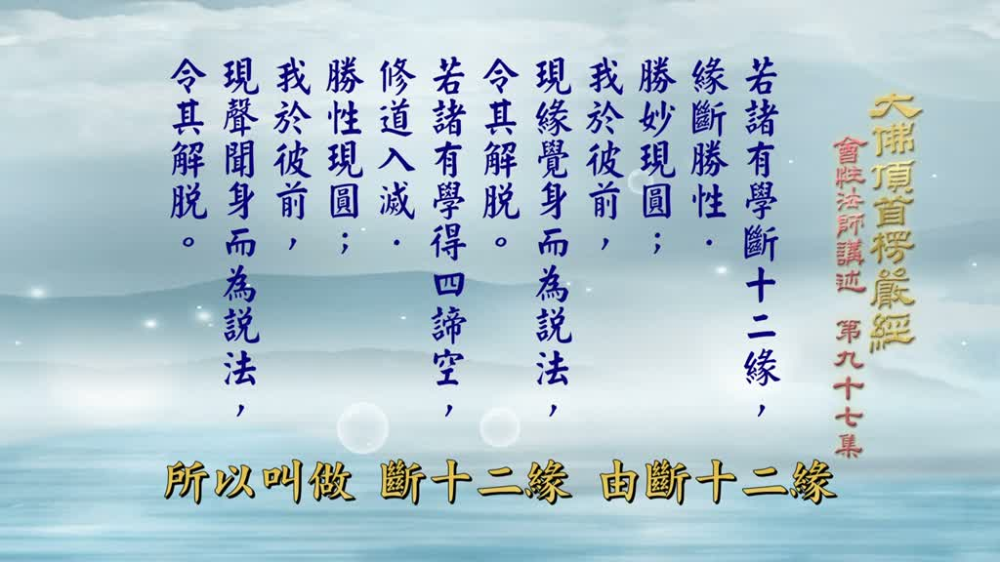

**重點：** 緣覺人根性利，從斷無明下手，無明滅則行滅，一路滅到老死憂悲苦惱滅，這是還滅門；菩薩現緣覺身為他說十二因緣，使他證辟支佛果而解脫。講者另推薦看斌宗法師《般若心經》註解。

**標籤：** #還滅門 #斷無明 #緣覺身 #斌宗法師

緣覺人他根性利，知道要了生死先破無明，所以從斷無明下手，因此他無明滅則行滅，行滅則識滅識滅則名色滅，名色滅則六入滅，六入滅則觸滅，觸滅則受滅受滅則愛滅，愛滅則取滅取滅則有滅有滅則生滅，生滅則老死憂悲苦惱滅，從無明先斷無明斷了生死就了，所以叫做斷十二緣由斷十二緣，就是還滅門的十二因緣，從無明先斷緣斷勝性，從十二因緣裡無明先斷，斷了之後十二因緣的生死都斷，還滅那麼殊勝的緣覺根性的，本有的智慧現前勝妙現圓，殊勝微妙還是指的辟支佛緣覺，現在得到圓滿，希望能夠現在得到圓滿，那麼他要成辟支佛，我於彼前現緣覺身而為說法，為他說十二因緣大致如此，但是也不一定應機說法，如果他能證辟支佛果，就能得到解脫所以令其解脫，這是屬於辟支迦羅，獨覺緣覺兩種，十二因緣經常講現在不細說，另外有專講十二因緣的經，就是《十二因緣經》，藏經裡面都有詳細的說明，如果您想要進一步研究，十二因緣大概的內容嗎，看《般若心經》的註解，斌宗法師的，他有詳細說明，也有表可以作參考，假如你想作進一步瞭解，看《般若心經》的註解，裡面都有說明我所知道的。

### 投影片 8：第四應：現聲聞身與四諦空（21:05–23:54）

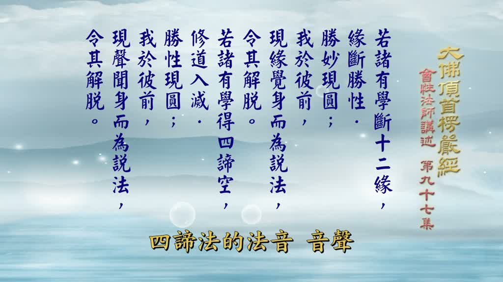

**重點：** 聲聞因聞佛說四諦法的音聲而悟道；經文「得四諦空」指知苦、斷集、慕滅、修道（戒定慧、三十七道品），證到偏真涅槃、阿羅漢果；菩薩現同類身為他說法。

**標籤：** #聲聞 #四諦空 #三十七道品 #偏真涅槃

裡面說得很清楚，接下來第四應聲聞身，就是知苦斷集慕滅修道，若諸有學得四諦空，修道入滅勝性現圓我於彼前，現聲聞身而為說法令其解脫，這是聲聞，叫做聲聞因為他聞佛所說的，四諦法的法音音聲，由此體悟到這個無生之理，證到阿羅漢果所以叫做聲聞，聞佛四諦聲而悟道，所以叫做聲聞，如果有這一類根性的眾生，若諸有學他希望得四諦空，四諦苦集滅道這四個名相，詳細在《心經要釋》裡面，有解釋可以自己去查出來，好好的下番工夫研究，因為聲聞人他要先知苦，然後斷集集就是煩惱跟業，慕滅修道簡單說戒定慧，詳細三十七道品，修三十七道品修戒定慧，滅是滅諦涅槃就是偏真涅槃，這四諦論空就證到偏真，偏真的空理由此入於涅槃，修道入滅道三十七道品，入滅就是滅諦涅槃，就是聲聞所證的偏空，所以叫做四諦空，偏於空的一邊的涅槃的境界，就是自己生死了了不發心度人，這一類眾生勝性現圓，還是指他的聲聞根性的殊勝，能夠現在得到圓滿證到阿羅漢果，我於彼前現聲聞身而為說法，現跟他同類身說法啟發他，如果他沒有回小向大的能力，就是使他先證阿羅漢果再說，見思惑斷了就出三界，生死就了了所以因此之故，使他能夠得到解脫。

### 投影片 9：聲聞與緣覺的差別：習氣未斷（23:54–26:06）

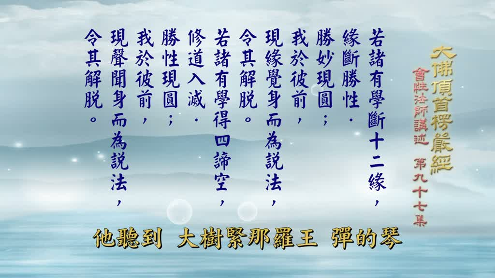

**重點：** 聲聞鈍根，只斷根本的見思惑（八十八使、八十一品），習氣還在；講者用杯子裝過茶的氣味、摩訶迦葉聽緊那羅王彈琴會跳舞為喻，說辟支佛能去掉一部分習氣，所以比聲聞利根。

**標籤：** #見思惑 #習氣 #摩訶迦葉 #緊那羅王

聲聞跟緣覺不同點，聲聞比較鈍根，他只能斷根本的生死煩惱，就是三界內的煩惱，見惑八十八使思惑八十一品，他能夠把這個根本惑斷除，可是習氣他斷不了，所以聲聞人還有習氣，例如畢陵伽婆蹉慢習，聲聞只是斷見思惑，生死是了了可是他習氣還在，例如我們杯子裝茶茶用掉了，可是杯子裡面茶的氣味還是存在，不曉得要洗多少遍纔能夠乾淨，聲聞人也是如此茶去掉了，就好像根本的見思惑已經斷了，沒有生死了可是他習氣還存在，摩訶迦葉修頭陀苦行頭陀第一，可是他聽到大樹緊那羅王，彈琴的聲音他會跳舞，這是他的習氣，不是他真正愛跳舞，可是他習氣還存在，他聽到大樹緊那羅王彈的琴，他自然而然他就跳起來了，穿上袈裟跳舞可能特別好看，我們沒有這個機會看到，所以聲聞人只是斷種子根本惑，見思煩惱習氣不斷，辟支佛他能夠去掉一部份習氣，要比聲聞人強一點，所以論根性聲聞是鈍根，辟支佛緣覺獨覺是比較利根，能斷一部份習氣不能完全斷除，就是洗個一遍兩遍而已，大概是如此這四種上面說的，都是屬於超出三界的。

### 投影片 10：第五應：現梵王身（26:06–29:02）

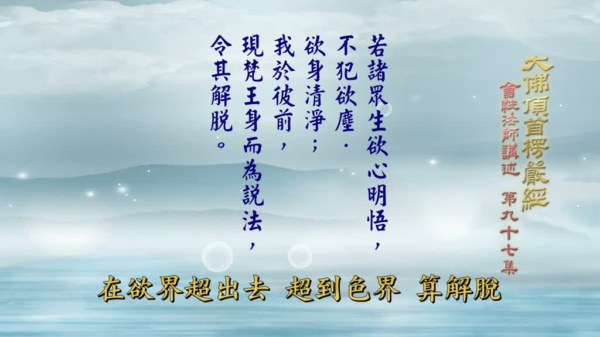

**重點：** 梵王的「解脫」只是超出欲界，與前四種超出三界的真解脫不同；經文「欲心明悟、不犯欲塵」指希望斷欲界五欲煩惱的人，要修初禪、近二禪的定力才能生大梵天。

**標籤：** #梵王身 #欲界 #初禪 #不犯欲塵

真正解脫沒有生死了，若諸眾生欲心明悟，不犯欲塵欲身清淨，我於彼前現梵王身，而為說法令其解脫，梵王還在三界內，為什麼叫做解脫這裡有分別，跟前面的解脫不一樣，前面的解脫是超出三界，這裡的解脫只出欲界，在欲界超出去超到色界算解脫，他這個解脫只是超出欲界而已，而且梵王如果沒有繼續修行的話，他這個欲界的解脫也只暫時的，因為將來梵王福享盡，他再下來還是要到欲界的，除掉是三果聖者，他希望心能夠有智慧，有光明能開悟悟到什麼，知道世間的男女之慾是不好的，那麼希望能夠斷掉這個煩惱，所以不犯欲塵，這個欲是欲界的五欲煩惱，希望不要在欲界裡面，受五欲的塵勞之苦，世人以為樂這類根性他以為苦，所以他不要去犯欲界的五欲的，塵勞的情況希望身體能夠清淨，希望這身心能夠清淨不犯欲塵，那麼這一種人觀世音菩薩，我於彼前就現梵王身而為說法，說生初禪天這個要修禪定，要修初禪的禪定成就才能生初禪，而且近於二禪的定力，才能生到大梵天，那麼得到這個欲界的解脫，色無色界還是存在沒有解脫，鼓勵眾生斷除欲界煩惱，欲界煩惱如果能夠除掉了，那麼再進一步超出出世間的境界，色無色界的煩惱，就比較容易下工夫，所以叫做解脫，接下去都是現在天身。

### 投影片 11：現帝釋身（29:02–31:12）

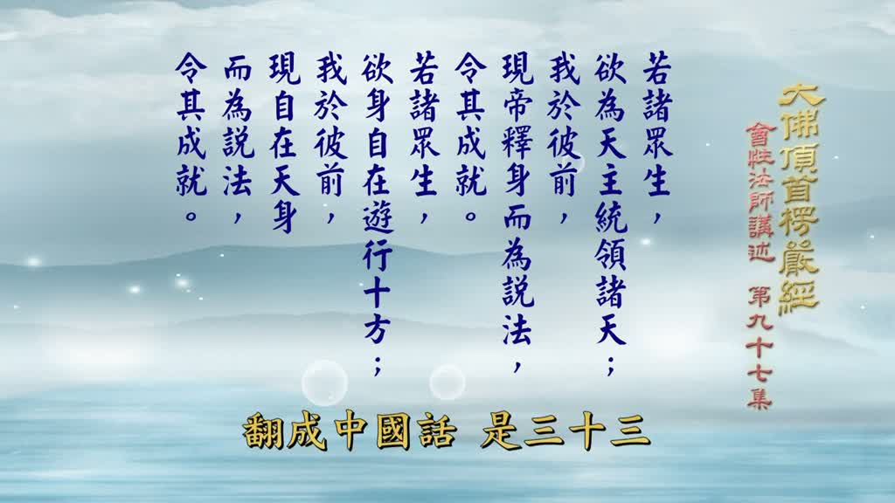

**重點：** 從這裡起進入現天身，成就的是「暫時滿願」；想做天主統領諸天的人，菩薩現帝釋天王（釋提桓因）身，勸他修上品五戒十善而生忉利天（三十三天）。

**標籤：** #帝釋天王 #忉利天 #三十三天 #五戒十善

除掉前面梵王是解脫之外，後邊都是成就了不一樣，這個成就是說你現在有這期望，我就使你滿願暫時滿願，好讓你先做帝釋天王，就是隨你所希望的，能夠現在得到滿願，若諸眾生欲為天主統領諸天，我於彼前現帝釋身而為說法，令其成就不一樣了成就，有些人他的根性就是希望生天，所謂帝釋天王就是釋提桓因，《阿彌陀經》裡面的釋提桓因下，就是忉利天忉利印度話，翻成中國話是三十三，因為它這個須彌山頂最高，地居天的最高的地方它有，四八三十二，中間帝釋天王住的善法堂天，合併起來就是三十三天，所以叫做三十三橫算三十三天，好像一個國家三十三省一樣，如果想要生到忉利天，做帝釋天王要統領諸天，做天主就是帝釋天王，統領諸天就是三十二天，為他所統領那麼觀世音菩薩，我於彼前現帝釋身而為說法，因為他想要當帝釋，就現他所希望的身讓他見到，而由此努力修五戒十善，要生天要修上品五戒十善，才能生天所以要加強他，生天的力量使他好好的用功，趣向於忉利天王的這個境界。

### 投影片 12：現自在天身與大自在天身（31:12–34:38）

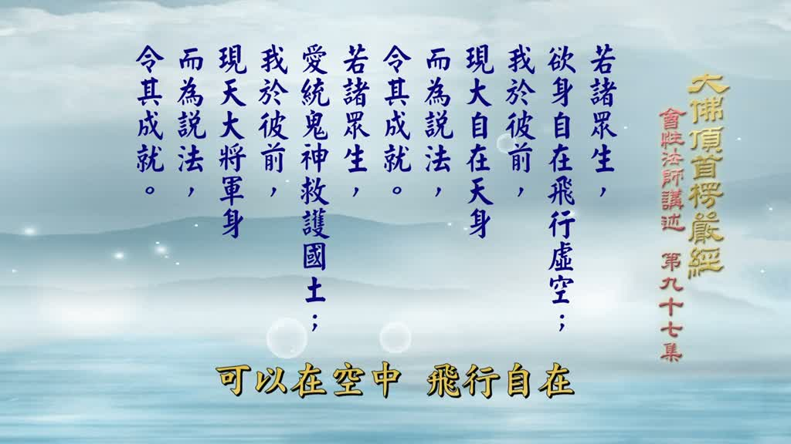

**重點：** 自在天是欲界第六天（他化自在天），欲界內往來自由；大自在天是色界最高的色究竟天，可飛行十方世界；講者引《大智度論》說他有三眼八臂騎白牛（講者主張），要修色界四禪才能生到。

**標籤：** #自在天 #大自在天 #色究竟天 #四禪

這是現帝釋身其次現自在天身，若諸眾生欲身自在遊行十方，我於彼前現自在天身而為說法，令其成就，這個自在天是欲界第六天，欲界的第六天如果有一類眾生，想要身體自由自在的遊行十方，這個十方只在三界內，例如在我們這個娑婆世界，娑婆世界的一個小世界裡面，欲界以下整個欲界天，就是欲界內他可以來往自由，他的身體在第六天，可以在欲界的六天自由自在來去，所以叫做遊行十方，不是整個十方世界，我於彼前現自在天身，現他化自在天的天王身，使他能夠成就生到自在天，就是他化自在天的天王，接下去還是一個大自在，名字相同意義不一樣，若諸眾生欲身自在飛行虛空，我於彼前現大自在天身，而為說法令其成就，這個大自在是色界最高天，叫做有頂天就是色究竟天，色界四禪最高的色究竟天的天王，色究竟天的天王，這個天王叫做大自在天王，根據《大智度論》說，他有三個眼睛八個手臂騎白牛，可以在空中飛行自在，那麼這個自在飛行就不一樣了，更殊勝可以到他方世界，所以說如果有一類眾生，想要做色究竟天的天王，希望身體能夠自在欲就是希望，身體能夠自在飛行於虛空，這個虛空就是十方世界，看《法華經》裡面說到，各方面的天王，從五百個世界之外，那麼到我們這個娑婆世界來，都有這一種情況，那麼可見色究竟天的天王，他可以在十方世界遊行，如果你想要做色究竟天的天王，觀世音菩薩就現這個身為他說法，那麼都是要說上品十善，同時要修色界禪定，如果沒有成就色界天的禪定，最起碼要四禪的禪定成就，才能生到大自在天，菩薩現大自在天身為這一類眾生，為他說法使他能夠成就這兩種。

### 投影片 13：四位天王的「寄位」菩薩道（34:38–36:31）

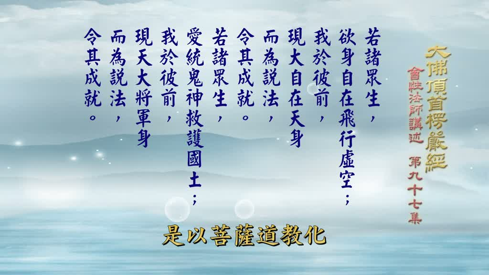

**重點：** 講者的看法：前面梵王、帝釋、自在天、大自在天四位天王，文字上是滿足想做天王的願望，內涵則是菩薩寄位在這些天上繼續行菩薩道，從住行向地一直到等覺而成佛，所以不要平淡看待。

**標籤：** #寄位天王 #菩薩道 #等覺

實際上連上面的兩種天王，四種天王大梵天還有帝釋天王，他化自在天王的自在天，色界最高的色究竟天，這些天王這四位天王，雖然說是現四位天王身，為他說法這是菩薩道，這是菩薩寄位的地方菩薩修行，在這些地方寄位修行，所以文字上看起來，只是想生到這些天做天王而已，而實際它的內涵，是以菩薩道教化，讓他們成就初地以上的菩薩境界，而生到這些天上寄位天王，來繼續行菩薩道，所以依我的看法這四位天王，都是菩薩以菩薩道的方式，來教化他讓他生到這些天上，從住行向地一直到等覺，能夠一步一步圓滿，將來到究竟成佛所以用意，是說現在讓他先生到天上，成就天王的目標他的願望，那麼內涵將來他要成佛，使他們行菩薩道，這才滿他的心願所以這些天王，不要平淡的看他都是菩薩現身，寄位天王將來要成就佛道。

### 投影片 14：現天大將軍身（36:31–39:28）

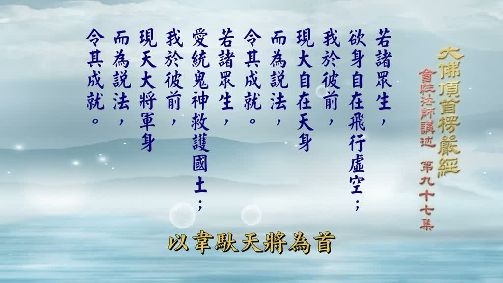

**重點：** 天大將軍是四天王所統領的大將（四王八將，如韋馱天將、散脂大將），領導八部鬼神護持國土；有人想統領鬼神、救護有道的國土，菩薩就現天將身為他說法，並引導他趣向無上菩提。

**標籤：** #天大將軍 #四王八將 #八部鬼神 #護持國土

若諸眾生愛統鬼神救護國土，我於彼前現天大將軍身，而為說法令其成就以下有三位，都是屬於四天王的事情，這裡是指四天王的大將，四王八將每一位天王，他都有兩位大將，以韋馱天將為首，像《金光明經》裡面有散脂大將，這都是四天王所統的，若諸眾生如果有些人，愛統鬼神救護國土，就是做天將鬼神指八部眾生，八部天龍八部因為他四天王，每一位天王統領兩部，所以這都是屬於鬼神道眾生，做天大將軍是領導那些鬼神，來護持國家救護國土，國家如果是實行正法，弘揚佛的正法這些天將們，他就來護持這個國家，有災難他會來幫助救度，那麼使國家得到國泰民安，所以他發願如果有眾生，想要統領八部鬼神，護持有道的國土護持佛的正法，我於彼前現天大將軍身，而為說法令其成就，就是天大將軍之身，現天將的身來說法護持國土，使他能夠成就為天大將軍，天就是指這個四天王，四天王所領導的大將軍，就是天將天將，每一位天王有兩位大將，領導他的八部鬼神，所以天大將軍就是像韋馱天將，《金光明經》裡面的散脂大將等，眾生各人的心願不同，菩薩也讓他先成就這個目標，以後慢慢引導他趣向於無上菩提。

### 投影片 15：現四天王身（39:28–41:10）

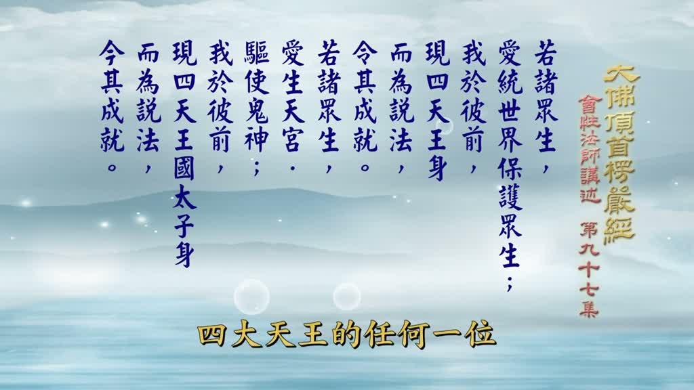

**重點：** 想統領世界、管理四天王以下一切眾生（含幽冥界）的人，菩薩現四天王身；四天王是東方持國、南方增長、北方多聞（毘沙門）等，對帝釋是臣、對下界是王。

**標籤：** #四天王 #持國天王 #毘沙門天王 #多聞

若諸眾生愛統世界保護眾生，我於彼前現四天王身而為說法，令其成就這是現四天王身，如果有人希望來統領這個世界，管理四天王以下的所有，一切所有的眾生包含幽冥界，觀世音菩薩就現四天王的身分，來為他說法使令他能夠成就，四大天王的任何一位，四天王就是東西南北四方，各有一位天王，東方持國天王南方增長天王，就是翻成中國話多聞，在印度把毘沙門天王看作財神，所以毘沙門天王廟很多很普遍，這四位天王就是屬於忉利天以下，帝釋天王站在帝釋天王的立場，這四天王是臣，站在四天王往下統領的立場，他們是王想要做四天王的，菩薩現四天王身讓他能夠成就。

### 投影片 16：現四天王國太子身（41:10–43:00）

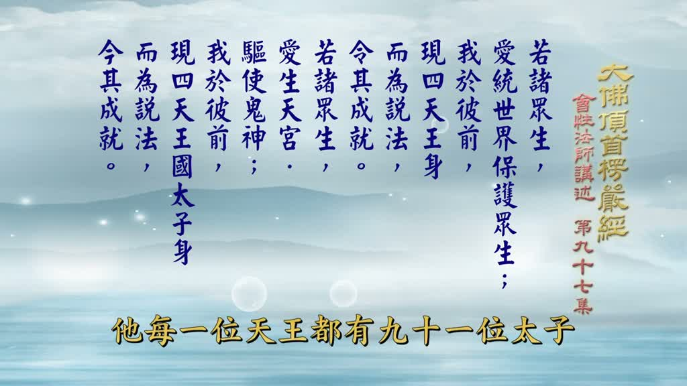

**重點：** 喜歡驅使鬼神的人，菩薩現四天王國太子身；講者引《大吉義經》，說每位天王各有九十一位太子（講者主張，依經所載），哪吒也是其中之一，他們領導鬼神、降伏傷害眾生者。

**標籤：** #四天王太子 #大吉義經 #哪吒 #驅使鬼神

若諸眾生愛生天宮驅使鬼神，我於彼前現四天王國太子身，而為說法令其成就，這是說四天王有太子，叫做《大吉義經》，大小的大吉利的吉意義的義，《大吉義經》裡面記載，護世四王就是四天王，四天王每一位都有九十一個兒子，九十一個他又不多不少九十一，可能現在還要多一點吧，他每一位天王都有九十一位太子，相貌端正都有大勢力，有說就是像哪吒哪吒太子，道教的太子爺，哪吒道教裡面也有，佛教的密部裡面也有，《大吉義經》裡面就說，每一位王有九十一位兒子太子，像哪吒就是其中之一還這樣說，當然還有很多名字沒有編下來，像這些天王太子他驅使鬼神，他領導世間的所有的，幽冥界的鬼神，如果會傷害眾生的他把他降伏，能護持眾生的他去領導，使世間能夠得到安寧。

### 投影片 17：《講義》引《灌頂疏》：不空三藏退寇（43:00–46:05）

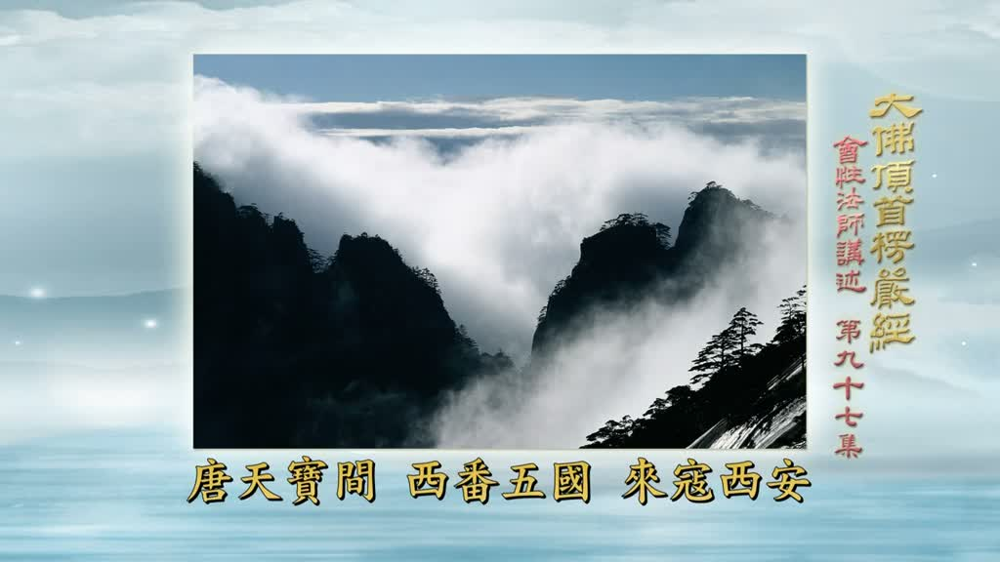

**重點：** 講者念圓瑛法師《講義》引《灌頂疏》的故事：唐天寶年間西番五國來寇，玄宗詔不空三藏持誦仁王陀羅尼，神將五百現身，北方天王第二子獨健往救；並說明不空與開元三大士。

**標籤：** #圓瑛法師 #灌頂疏 #不空三藏 #獨健

四天王或者是四天王太子，護持世間的事情，各位如果有圓瑛法師的《講義》，《講義》到這裡有一段有一段，引證天王太子護持世間的事實，是引證《灌頂疏》，裡面的記載就在圓瑛法師的，也就是講到天王太子這個地方，我念給各位聽《灌頂疏》雲，唐天寶間西番五國來寇西安，國軍莫能禦玄宗詔不空三藏入內，持念護國仁王陀羅尼方二七遍，忽見神將五百荷戈殿前對曰，北方天王第二子獨健往救西安，寇進攻仰見無數天兵天將，布陣空中寇畏數曰，中國有聖人未可犯也即退兵，各位如果有圓瑛法師《講義》，你回去查看就知道，這裡有個問題，第一文字記載有沒有出處，有在哪裡在《高僧傳》，《高僧傳》第三集，這個所謂《宋高僧傳》，是宋朝的贊寧法師編的，多數都是唐朝到宋初，所以有這一段唐玄宗時代的事情，這是說不空三藏，不空三藏是修密的開元，唐朝唐玄宗開元年間，開元三大士有名的開元三大士，善無畏金剛智不空，不空是金剛智的弟子，他十五歲就跟著到中國來，金剛智入滅以後他又回去，回到印度再請很多印度的，梵本的密部經到中國來翻譯，這是不空他修密部很有成就，那麼他是根據《灌頂疏》寫的，這是抄《灌頂疏》的原文，而不是從《高僧傳》裡面，原文抄下來，《灌頂疏》是這樣寫，唐天寶間西番五國來寇安西。

### 投影片 18：考證一：原文是「安西」，不是「西安」（46:05–48:14）

**重點：** 講者指出《灌頂疏》原文是「來寇安西」，《講義》誤寫成「西安」；若真是長安被圍，皇帝早就逃了；「中國有聖人未可犯也即退兵」等字句也是《講義》自己加進去的。

**標籤：** #安西 #西安 #講義 #灌頂疏

這點你特別注意前面說西安，這裡說安西這是地名，我看是《講義》搞錯了，哪裡有安西可能是西安吧，西安就是長安如果是來寇西安，那不得了皇帝就要跑了，不是西安是安西，所以這裡原文原文，《灌頂疏》的原文就寫來寇安西，不是西安你以後如果有《講義》，你裡面把它註不是西安是安西，玄宗詔不空三藏入內，持念護國仁王陀羅尼，方二七遍忽見神將五百，荷戈殿前對曰北方天王，第二子獨健往救安西，也是安西隨後表奏，後邊什麼中國有聖人，那是《講義》加進去的，按照他的《灌頂疏》原文，沒有那些就是往救安西為止，到往救安西那麼以下的文字，這個《講義》裡面寇進宮，布陣空中寇畏數曰，中國有聖人未可犯也即退兵，這是《講義》自己加點醬油，加一點味精那麼這兩種都是，主要《講義》是抄《灌頂疏》，我想《講義》當時他沒有看，而《灌頂疏》他的根據，是根據這個《高僧傳》，而《高僧傳》原文怎麼寫呢，《高僧傳》跟《灌頂疏》的原文，又不一樣事實是如此，但是寫法不一樣《高僧傳》的，就是〈不空三藏傳〉的後邊。

### 投影片 19：考證二：《宋高僧傳》原文——西涼府與安西都護府（48:14–50:00）

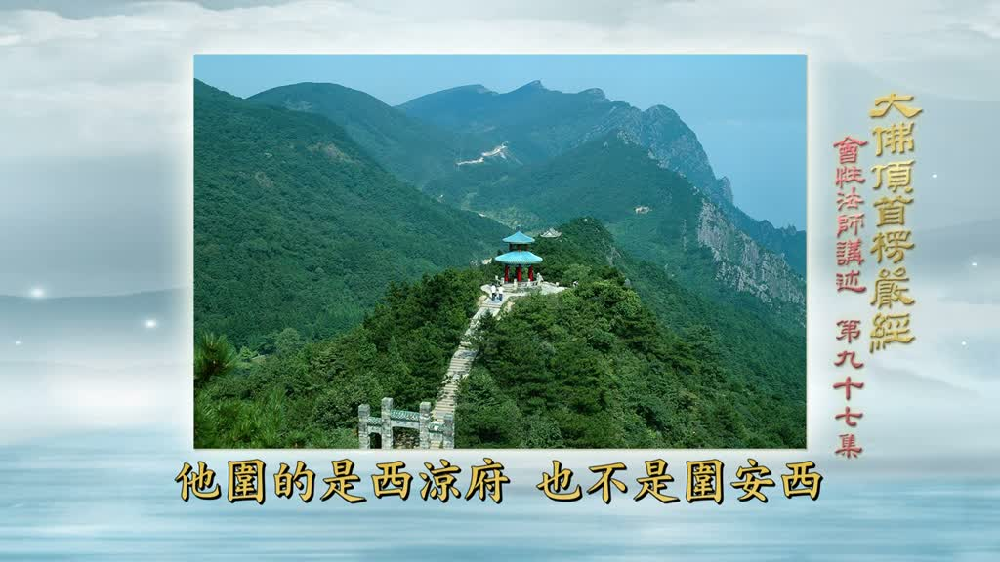

**重點：** 《灌頂疏》其實是根據《宋高僧傳》〈不空三藏傳〉改寫；原文是大、石、康三國兵圍西涼府（涼州），不是圍安西；安西都護府是唐太宗時設立，管理西域小國。

**標籤：** #宋高僧傳 #西涼府 #安西都護府 #贊寧法師

說他在世的時候有這麼一回事，所以《高僧傳》原文是寫說，又天寶中西蕃大石康三國，聽到嗎他改為五國，而這還把名字寫出來，大石康三國，可能是一個大一個石一個康，三個番國就是西戎西番，是三國而他加了兩國變成五，帥兵圍西涼府問題來了，他圍的是西涼府也不是圍安西，安西是安西都護府，安西都護府就是在涼州再過去，到敦煌的地方那是從前漢朝，就已經開始開發西域，這安西都護府是唐朝才增加的，安西都護府是唐朝貞觀年間，唐太宗奠定下來的安西都護府，管理西邊的所有小國，合併在安西都護府裡面統領，這裡說明這個寇就是土匪，他那些外國的西番，他來是圍西涼府西涼就是涼州，涼州的西邊一個大城，被外國三個國家的大兵來圍住了，當時實在是問題很嚴重。

### 投影片 20：不空作法：仁王密語與「可五百員」（50:00–53:03）

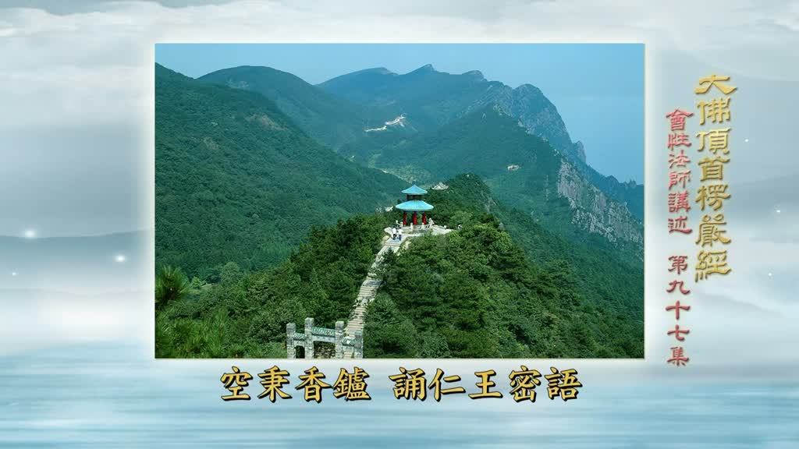

**重點：** 原文只說不空「秉香鑪誦仁王密語」，沒有寫陀羅尼或咒名；講者主張《灌頂疏》是想當然耳加上去的；原文「可五百員」是約略估計，後人刪掉「可」字就變成確定的五百。

**標籤：** #仁王密語 #二七遍 #可五百員

原文就寫詔空入就是玄宗皇帝，這個時候臨時想不出辦法了，當時不空三藏在那邊翻譯佛經，就把不空三藏詔進來，到他的皇宮去帝御於道場，請不空去做什麼趕快作法，救西涼府的被圍的困難，不空三藏馬上就在他的內道場，這個道場就是皇宮裡面的佛殿，空秉香鑪誦仁王密語，空不空三藏不空三藏拿著香鑪，在佛前持仁王的密語，他沒有寫〈仁王護國陀羅尼〉，沒有這些文字仁王密語，因為不空三藏他有翻譯，《仁王護國經》的咒跟儀軌，還有解釋所以當時我想，《灌頂》認為想當然耳，一定唸的是〈仁王護國咒〉，所以就加上〈仁王護國陀羅尼〉，那都是他自己加進去的，原文只有仁王密語，二七遍是對的二七遍，他認為一定是仁王護國的咒，我想也未必不空有他一套，他就是召天王的太子來幫助他，我們沒有辦法知道，只有問不空三藏，二七遍只念兩個七遍，就是十四遍一個七遍兩個七遍，念二個七遍這個時候，兩個七遍唸完之後，帝見神兵可五百員可能有五百，不是一定正好五百，後邊就把那個可去掉，可去掉就變成一定是五百，而這裡可五百員可能有五百，因為他沒有可能一個一個去算，一二三四五沒有可能算下去了，他一看大概有五百吧，就可五百員員是人員的員，可五百員後邊就硬性說五百，都把它刻板了，所以這個抄東西把人家東西抄，實在不能再改，應當就寫可五百員在哪裡，在於殿庭就在皇宮裡面，大殿的前庭庭子那邊，站在前面這個時候。

### 投影片 21：毘沙門天王子救安西；「藥單抄三遍會喫死人」（53:03–55:05）

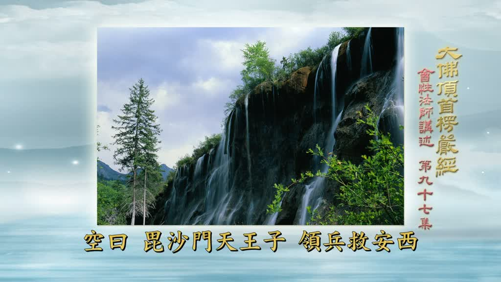

**重點：** 原文是「毘沙門天王子領兵救安西」，沒有「第二子」「獨健」等名字，是後人加的；講者以「藥單抄三遍會喫死人」為喻，說明輾轉傳抄、越加越錯。

**標籤：** #毘沙門天王 #獨健 #傳抄錯誤

皇帝看到害怕了驚問空，原文寫驚問空皇帝害怕，趕快回頭就問不空三藏，這是怎麼一回事，空曰毘沙門天王子領兵救安西，就是北方毘沙門天王，就是多聞天王多聞天王的兒子，後邊還加上名字還是第二個了，是不是《灌頂》作者去問過不空，或者是問過毘沙門天王，硬性的寫是天王的第二子，還名字叫做獨健，因為獨健的名字，可是《高僧傳》裡面他沒有寫，他只寫毘沙門天王子，毘沙門天王的兒子帶領天將，領兵領著天兵天將去救安西，安西才對不是西安，所以世俗有一句話說，藥單抄三遍會喫死人，藥單中藥的藥單，拿去給第二個人抄，第二個人抄又換第三個人抄，第三個再拿第四個抄抄錯了，沒有毒的變成有毒甘草變甘遂，一喫喫死了完蛋了，藥單抄三遍會喫死人，他這一個人加了一點，加了就變成這個樣子，也很普遍流通大家都看，以為真的就是如此。

### 投影片 22：講者查《唐書》與《高僧傳》的經過（55:05–58:56）

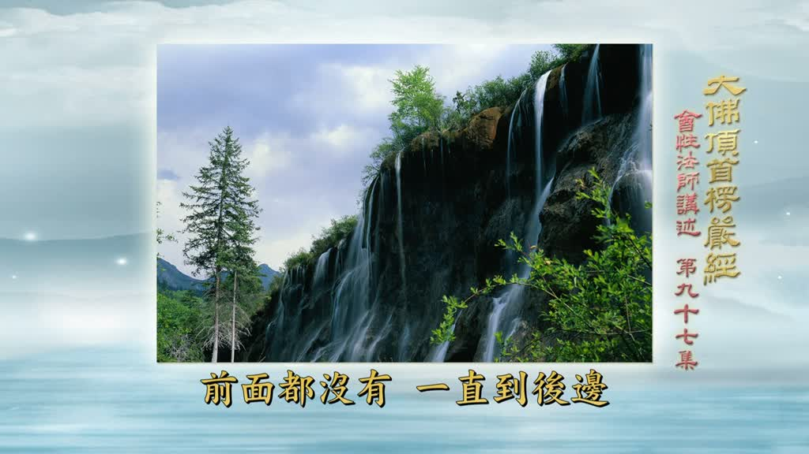

**重點：** 講者自述為求證，先把《舊唐書》《新唐書》天寶年間放大影印逐頁找，都沒有記載，再想到是佛教事蹟，改查《高僧傳》，才在〈不空三藏傳〉後段找到出處。

**標籤：** #舊唐書 #新唐書 #高僧傳 #查證

我這人我讀書很認真一點不馬虎，因為他說是根據《灌頂疏》，我就先查《灌頂疏》，《灌頂疏》查到了我就查，《灌頂疏》他必定有出處，在哪裡您知道這段時間，我的頭多痛怎麼，《灌頂疏》沒有寫，他從哪裡抄下來的這一段，這是唐朝的事情是天寶年間，我第一個動作把唐書找出來，有關天寶年間的那一段，整個把它影印放大來看，你要知道我花了多少時間，只講這麼幾句話我花多少時間，因為現在我有的《二十五史》，《舊唐書》《新唐書》，眼睛看起來很費力很辛苦，因此我只好花時間把它放大，多好幾頁十幾頁，我都是把它放大然後一一看，查沒有，《舊唐書》《新唐書》都沒有，沒有記載《新唐書》沒有記載，我不會怪它因為《新唐書》，它是專刪掉這些東西，它差不多都把它去掉，不過我還是看看，《舊唐書》沒有我就想奇怪了，唐書正史裡面沒有是在哪裡，有好多其他的資料翻一翻沒有，最後想到這是佛法裡面的事情，普通歷史也許沒有，查查佛教裡面的歷史吧，只要查《高僧傳》查《高僧傳》，把它影印放大出來看，前面都沒有一直到後邊，他入滅以後說明他在生的一些，比較神奇的事情記載一些，喔原來《灌頂》是根據這一段，到了《講義》又添了一點，就會變成很多不同的地方，我認為這種事情是可能有，但是正史不會記載，正史對這些事情他不會記載，會有很多麻煩的你要知道，天寶年間到了天寶十四年，安祿山造反弄得最後天下大亂，唐玄宗唐明皇都跑到成都去了，就要逃跑了，皇都都被安祿山佔有了，京城都沒有了整個都丟掉了，人家都認為唐玄宗這一次完蛋了，在另外一個地方就建立帝位了，唐玄宗如果還在沒有死的話，就是太上皇了用這一種方式，如果這個事情記載在正史的話，那人就會問。

### 投影片 23：正史為何不載：安祿山之亂與不空回印度（58:56–60:41）

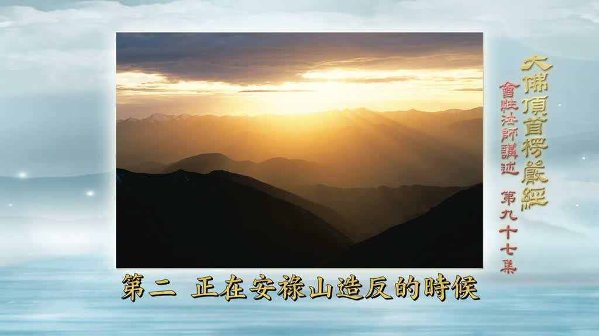

**重點：** 講者推測正史不載的原因：若記載「天將可救涼州」，人們會問為何不救安祿山之亂；講者說這是中國人定業，且當時不空已回印度求密典；《高僧傳》成書於宋，距唐不過一兩百年（講者主張，未查證）。

**標籤：** #安祿山 #正史 #定業 #不空

既然不空三藏有這個辦法，用天將來救涼州，那為什麼不用天將來對付安祿山，安祿山還把整個皇宮都搞亂了，最後楊貴妃也完蛋了，為什麼不趕快用天兵天將來，假如他記載在正史，怎麼會這樣做應當要知道，不空為什麼不救這個事情，而是第一這是中國人的定業，沒有辦法一個人救，第二正在安祿山造反的時候，不空已經回去印度，再去找這個密部的經典回來，所以正史上沒有記載，而這個《高僧傳》裡面有，《高僧傳》宋朝寫的，順序算來是第三集，宋朝贊寧法師寫的《高僧傳》，它距離唐朝也不過是一兩百年吧，也許這些事情是在世間上有流傳，寫歷史的人沒有把它寫進去，也會有這種可能因此之故，因為《唐書》它寫的都是大事，一些小小的比較小的事情，他不會去記載。

### 投影片 24：結論：《講義》要改成「安西」（60:41–63:00）

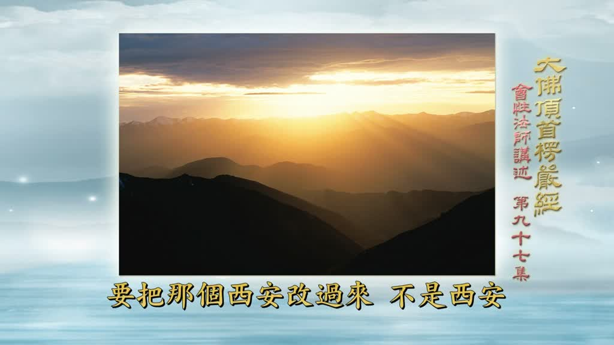

**重點：** 結論：有《講義》的人要把「西安」改成「安西」；講者釐清西涼（五胡十六國舊地）、于闐、焉耆等小國與安西都護府的關係，並說不空天寶八年回印度、再回中國，後在中國入滅（講者說「我記得」，未查證）。

**標籤：** #安西都護府 #于闐 #焉耆 #不空入滅

如果有《講義》的人，關於這一段文第一個，要把那個西安改過來不是西安，如果是圍西安那問題會很嚴重，西安就是長安長安是國都，是首都如果首都被圍，那個問題就嚴重了根本不是，因為它是西涼只在涼州涼州，這個西涼還是從前五胡十六國，時候的西涼的一個小國，由此一直到西邊到敦煌，到還有一些小國像于闐，還有這個好幾個，焉耆這一類那都是很小的國家，都是對中國很誠敬的，所以在唐太宗的時候，另外建立一個安西都護府，安西都護府是在現在的甘肅，那麼它是管這個西邊的，所以這是安西不是西安，其他的文字沒有什麼關係，不過我們要知道原文，就在《高僧傳》，題目叫做《宋高僧傳》，實際上是唐朝的事情，所發生的事情天寶年間，不空三藏他在天寶八年，我記得他天寶八年纔回去印度，又請了好多梵本的經典，回到中國來翻譯，那麼他又重回到中國來，後來是在中國入滅的，他修密很有成就他有神通，他能運用密咒使令鬼神，來做各種事情他有這個能力，在不空三藏的傳裡面有記載。

### 投影片 25：回到經文：護世四王（63:00–64:42）

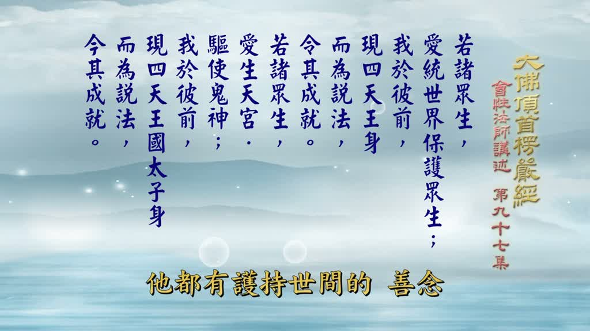

**重點：** 回到《楞嚴經》這一段：四天王太子護持世間，故四天王叫「護世四王」；講者坦言牙齒掉光、講得不流利，仍希望把《楞嚴經》講完。

**標籤：** #護世四王 #四天王太子

若諸眾生愛生天宮驅使鬼神，我於彼前現四天王國太子身，而為說法令其成就，本來是四天王太子的事情，他發心來救安西但是原來，在《灌頂疏》裡面這一段故事，引證的記載是記載在四天王身，之後四天王身這一段之後，才解釋四天王各太子的事情，這是天王天王太子，他都有護持世間的善念，所以叫做護世四王，四天王叫做護世四王，就護持這個世間的四天王，護世四王，我有牙齒講到沒有牙齒，實在覺得很不流利，有的時候漏風搞不清楚，護世四王很不好講，無論如何只要能夠聽得懂，如果大家不嫌麻煩講得不好聽，無論如何希望能夠，把《楞嚴經》講完那是最好。

### 投影片 26：現人王身：菩薩不護持野心家（64:42–68:28）

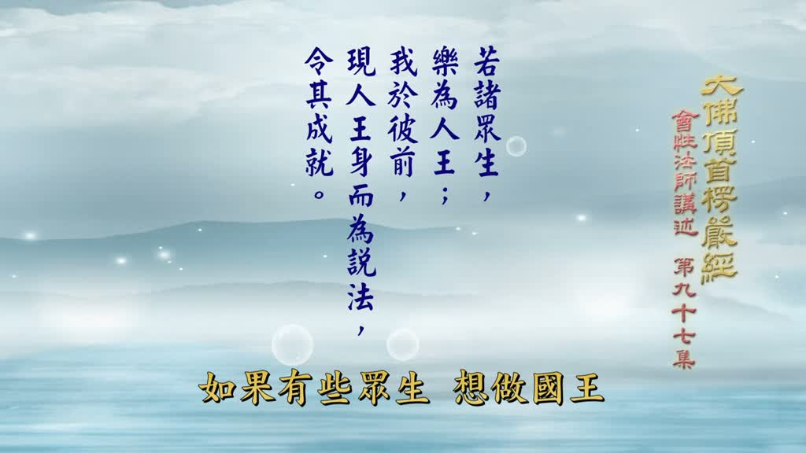

**重點：** 三十二應進入現人身，先講「現人王身」；有人問想做王的野心家菩薩也幫嗎？講者答：菩薩以大圓鏡智觀察，會幫助為公、利益眾生的有道明君，而不是只想享受王位的人。

**標籤：** #人王 #野心家 #有道明君 #大圓鏡智

這是關於現天身，上面講的是現天身，天身一一都現過了，然後就現人身，這裡都是現三十二應，都是屬於慈力方面的與樂，與樂的境界比較沒有什麼多，現人身也是現人王，然後現大臣長者居士等，若諸眾生樂為人王我於彼前，現人王身而為說法令其成就，如果有些眾生想做國王，想做人王就是國家，人間的國家他想要做國王，就現做國王的身分，來為他們說法，關於這一點有人會這樣問，世間想要做王的人太多了，過去那些造反的人都是想做王的，難道那些想做王的野心家，觀世音菩薩也現身跟他說法，叫他能夠做王嗎別打這個妄想，觀世音菩薩的大圓鏡智一照，知道這個人的心並不正，他是想享受王位的享樂，在古代家天下很麻煩的，如果是這個國家帝王皇帝是誰，這整個國家的財產就變成他的，就是一切一切都要聽他的命令，他要怎麼做就該怎麼做，老百姓很難得能夠改變他的心意，不容易的雖然有諫官可以諫，可是要回他的心相當不容易，所以這個想要做人王必定很多，人人想做王，就是民主國家想選總統的也不少，並不是說你想做就成就你，你雖想做人王，菩薩必定會用的智慧觀察，看你這個人有沒有這個資格，心是不是正確是不是野心家，或者是單為一己之利這一種人，菩薩不但不幫助他，而且要把他這個心意打消，你別想了你沒有這個福分，別想做人王應當不會幫助他，幫助的是幫助有道的有道明君，真正能夠維護百姓幫助眾生，是能夠有利益眾生的作用，完全為公以天下為公為主，不會為自己的私利，這一種人菩薩我想會幫助他，所以想做人王的人很多很多，但不可能菩薩都去護持他。

### 投影片 27：結語：感應記無載、《講義》的收穫；下次講人王以下（68:28–1:13:27）

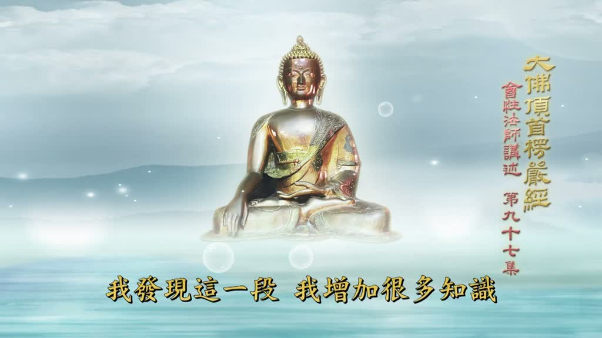

**重點：** 前面所列聲聞、緣覺、天王、人王，觀世音菩薩感應記裡沒有可引證的記載，只好順著文字解釋；講者說這次查《講義》增加不少知識，並預告下次從人王以下的長者、居士、宰官講起。

**標籤：** #感應記 #灌頂疏 #長者居士宰官

都會視情況而定的，前面所列出來的這些，上自聲聞緣覺，乃至中間的天上的天神天王，乃至現在的人王世間的人王，沒有看到觀世音菩薩的，感應記裡面有所記載，說是有示現這些事情，就沒有辦法拿出來作幫助說明，所以只好順著文字作解釋，只有前面的四天王太子的那一段，有那一段我會發現這一段，原因也是想看看，圓瑛法師《講義》裡面，這些三十二應身的記載裡面，是不是有引證可以作幫助的典故，結果翻了一遍沒有發現，只有四天王太子這一段這滿好，我發現這一段我增加很多知識，如果沒有發現的話，我也會忘掉《灌頂疏》裡面，原來就有這些，可是不可能通通記起來，而且這麼一點小事情，在看的時候不是要講，不會很用心看過就算了，走馬看花所以關於這一點，在《灌頂疏》以前雖然看過，沒有印象如果不是在，《講義》裡面發現再查出來，還不會有這一種想法，認為《灌頂疏》裡面有這個記，《高僧傳》也看過，一方面那個時候看《高僧傳》，有一點比較主觀的這個看法，認為屬於修密的人我可以少看，這種不大好就是如果是修密的，因為我不修密既然我不修密，我不修密關於密部那東西，我就少看頂多是翻翻過去，前後看幾行翻過去而已，所以沒有發現根本就沒有印象，看《高僧傳》的時候，好好下工夫也許就會發現，今天就講到人王，下次開始就講人王以下的，長者居士宰官，比較有可以講的地方。

## 已知轉錄錯誤

| 時間 | 聽成 | 應為 |
|---|---|---|
| 11:32 | 變僕 | 變遷（推測：字幕 OCR 讀成「變僕」，語意為無常變遷） |
| 49:22 | 埼定 | 奠定（推測：Whisper 為「定下來」，字幕 OCR「埼」字形近「奠」） |
| 56:50 | 族怪 | 奇怪（推測：Whisper 為「誒，怪了」） |
| 54:40 | 甘道 | 甘遂（推測：Whisper 為「甘碎」，甘草與甘遂為相反藥材） |
| 08:54 | 寂靜妙明寂素 | 寂靜妙明寂靜（推測：Whisper 為「極盡妙名／寂靜」） |
| 18:52 | （字幕漏句） | 補入「觸滅則受滅受滅則愛滅」「有滅則生滅」：講者念完整還滅門順序（Whisper 18:43 為「觸滅者受滅，受滅者愛滅…有滅在生滅」），字幕取樣漏掉 |
| 全片 | 字幕 OCR 同音／形近字 | 已批次校正：雨→兩（兩支／兩種／兩遍／兩位）、昆沙門→毘沙門、闢支→辟支、麪→面、香鎮→香鑪、散脂大米／韋馱天米→大將、於闖→于闐、焉者→焉耆、生列→生死、能約→能夠、馬片→馬虎、解服→解脫、初祥→初禪、色究競→色究竟、袈裝→袈裟、減道→滅道、清凈→清淨 等 |
| 全片 | 字幕未收的講者短句 | 字幕取樣（每 3 秒）漏掉或未打字幕的插話約 40 句（例：17:04「在十二因緣裡面」、22:41「才能斷煩惱」、64:28「我還是繼續講下去」）；原話見 transcript.whisper.md，未補回 |

## 補充資料連結

- 思維導圖：[mindmap.png](mindmap.png)、文字大綱：[mindmap.md](mindmap.md)（與本報告同資料夾）
