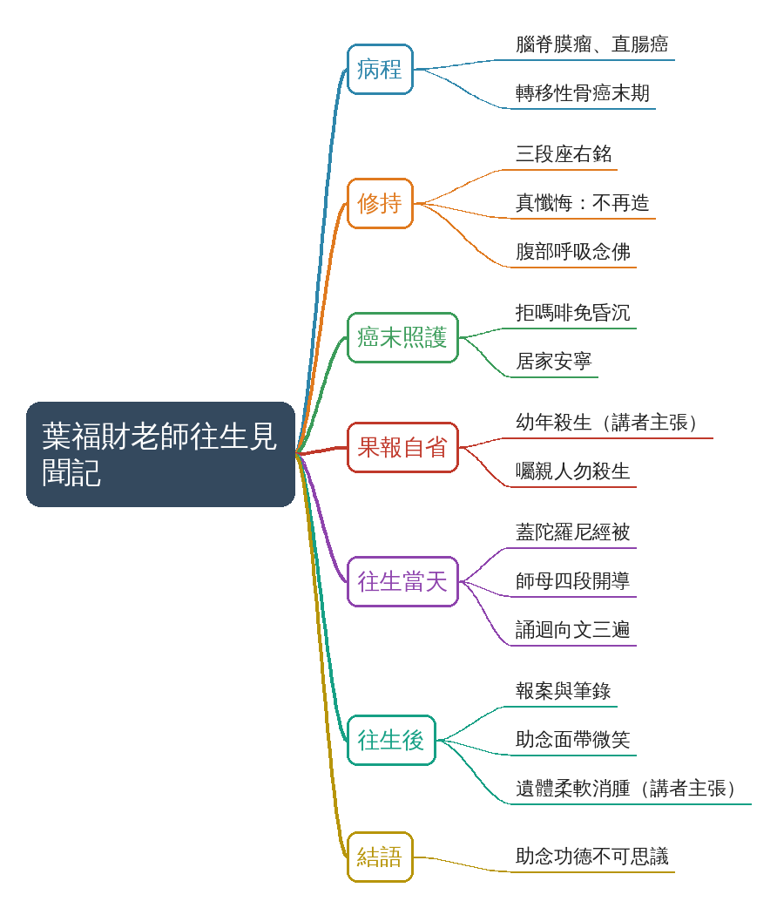

# 葉福財老師往生見聞記（師母分享）

- 來源：https://drive.google.com/file/d/1FCWMcKXHDJ1EYywLsmbhuZqQ5bLRBb1D/view?usp=drivesdk
- 平台 / 上傳者：GoogleDrive / 
- 長度：24:59 (1498.7s)
- 逐字稿來源：whisper (groq)
- 更新日期：2026-11-08
- **關鍵字：** #臨終關懷 #助念 #往生見聞 #念佛 #居家安寧 #陀羅尼經被 #懺悔 #癌末 #面帶微笑

## 摘要與名詞說明

**一句話重點**：師母在助念後的聚會上，分享葉福財老師 2020–2026 年抗癌、以念佛為主的修持，到在家安詳往生與助念後的瑞相（以下皆為講者主張，未查證）。

| 時間 | 重點 |
|---|---|
| 00:00 | 向前來助念的蓮友致謝 |
| 00:31 | 病程：腦脊膜瘤（2020）→直腸癌（2022，已感染到淋巴）→轉移性骨癌末期（2024 起） |
| 02:51 | 認為受佛菩薩護佑；三段座右銘：爭取念佛時間、一切所作皆為往生、如法修行如願成就 |
| 04:35 | 四種錄音檔輪替；「真懺悔」＝不再造；腹部呼吸念佛（呼「阿彌」、吸「陀佛」） |
| 07:41 | 骨癌劇痛，拒嗎啡以免昏沉，選擇居家安寧 |
| 09:13 | 全家留影；回想幼年捕殺青蛙，視為果報，囑親人勿殺生 |
| 12:08 | 八月起減食；九月跌倒；子女備妥外籍看護與電動氣墊床 |
| 14:18 | 往生當天：臨終喉音、蓋陀羅尼經被、師母說四段話並誦迴向文 |
| 18:17 | 約晚間九點多確認往生；在家往生須報案、做筆錄（講者敘述，程序以主管機關為準） |
| 20:42 | 助念至約十二點，掀被見面帶微笑；隔日蓮友再助念 |
| 22:40 | 入殮前遺體柔軟、左腿腫脹消退（講者主張，未查證）；結語：助念與佛號功德不可思議 |

## 名詞說明
- **助念**：往生前後由親友或蓮友陪同念佛，協助亡者一心念佛。
- **臨終喉音**：講者稱因器官衰竭、喉中有痰水而發出的咯咯聲。
- **陀羅尼經被**：覆蓋往生者的經被，講者用於往生後。
- **居家安寧**：在家接受安寧緩和照護，與住院安寧相對。

## 轉錄校正備註
- 本檔為純音檔（.m4a），無畫面，報告無截圖。
- 已校正：腦脊膜瘤、伽瑪刀、骨盆腔、陀羅尼經被、助念、嗎啡、椎間盤、醫學等（Whisper 同音誤聽）；迴向文依通行版本還原。
- 智海、淨廬、黃泳老師、簡大姐、美靜師姐、做七、懺公師父、倓虛法師、最年長、感染到淋巴亦已確認；其餘（約 3 處）仍無法確定，記在 `meta.json.known_asr_errors`（推測，待聽音或師母確認）。
- 病情、醫療與瑞相皆為講者個人敘述，不構成醫療建議。

## 思維導圖

- 原圖：[mindmap.png](mindmap.png)；文字大綱：[mindmap.md](mindmap.md)（與本報告同資料夾）

## 圖文對照（畫面 + 逐字稿）

### 投影片 1：開場：家屬致謝（00:00–00:31）

**重點：** 師母向前來助念的蓮友致謝，並預告要分享葉老師從發病到往生的歷程。

**標籤：** #致謝

這也叫阿彌陀佛，不用忙，來這邊坐，大家也見面，互相熟悉熟悉，簡大姐，我們最年長的簡大姐，梁會長，美靜師姐，各位師長，大家好，阿彌陀佛，感恩各位長輩大德，過來為福財做七，我們家屬真的感恩不盡，報仇、仇恨、仇恨。

### 投影片 2：病程：2020 至 2026（00:31–02:51）

**重點：** 2020 年腦脊膜瘤開刀與伽瑪刀，2022 年大出血檢出直腸癌，2024 年骨盆腔腫瘤壓迫坐骨神經，基因檢測確認轉移性骨癌末期。歷經開刀、放療、化療、標靶，肺肝腎仍相對正常。

**標籤：** #癌末 #治療

那目前就將葉老師從2020年到2026年這個病苦的歷程，我做一個很簡單的敘述，那麼在2020年，這個民國109年，他的頭部長了一顆8乘以9公分的腦脊膜瘤，那這個不是癌，那開刀很成功，那追蹤了半年以後，一顆1乘以2公分的小腫瘤，那醫師就立刻做伽瑪刀把它併住，那麼效果非常好，一直到現在今年往生，他腦部都沒有問題，他頭腦都很清楚，也是這樣，對，那麼到了2022年，就是那個COVID-19的這個期間，他打了三劑的莫德納疫苗，那麼經過了半年，有一天就大出血檢查出直腸癌，那麼已經感染到淋巴，照這個2024年就是民國113年，他因為跌倒疼痛腹腱無效，就檢查出左腿的上方，那麼骨盆腔裡面又長了一顆骨腫瘤，那麼這個骨腫瘤就壓住了坐骨神經，導致他這個大腿後側疼痛，那這個就是做了基因檢測，這個就是轉移性的骨癌已經到了末期，那麼這幾年他歷經了開刀、放射治療，那麼化療還有標靶治療，他都很認命的去治療，而且很認真的念佛，他如果體力允許的話，他就到這個戶外散步運動，那麼在這個艱辛的抗癌歷程中，他的肺部、肝臟、還有這個腎臟都還不錯，沒有受到很大的傷害，所以一切還算正常，甚至連主治醫師懷疑說，因為他肚子很大，懷疑說他有腹水，都沒有發生過。

### 投影片 3：護佑與座右銘（02:51–04:35）

**重點：** 葉老師認為一切是佛菩薩護佑，人生最後只有一句佛號有用。他勉師母發願要說「我一定往生」，並寫下三段座右銘：爭取有限念佛時間、一切所作皆為往生、如法修行如願成就。

**標籤：** #發願 #座右銘

那他就說佛菩薩一直在護佑他，那麼而且說他說人生的最後真的只有一句阿彌陀佛有用，大經大論都是為了成就這句佛號，那有一天他就問我，因為他在看文鈔精華錄，他說你看了這麼多的文鈔、印光大師文鈔，祖師們要我們發願往生，你怎麼發願？他問我，你怎麼發願？我說我一定要往生，葉老師說，願不夠勤，要這麼說，我一定往生，那麼他就寫了這個三段座右銘案，他就壓在桌上，第一段，他說受辭，你們去幫我拿那個，受此大病苦，目的何在？爭取有限的念佛時間，念，他就寫了一個大喊遍詞在旁邊，第二句，一切所作皆為往生，後面第三段，原來我沒看到第三段，上個禮拜那個治海的學妹，就是看到了第三段，如法修行，莫負己凌，如願成就，俊惠、齊樂，他就寫了這三段來鼓勵自己，那麼這是我第一段，第二大段我就下了一個標題，義求脫離病苦，唯有念佛懺悔。

### 投影片 4：日常修持與真懺悔（04:35–07:41）

**重點：** 家中佛號不斷，備四種錄音檔輪替；懺悔的要義是不再造，念佛能把惡業種子如石壓草般壓下；並教以腹部呼吸念佛：呼念「阿彌」、吸念「陀佛」，沒力時只念「阿」字。

**標籤：** #懺悔 #腹部呼吸

這是，OK OK，等一下再給大家看，那麼我們家中24小時多佛號聖不斷，葉老師他自己製作了四種錄音檔，第一個拜佛懺悔，他就用懺公師父唱誦六字弘明的那個拜佛版，第二在佛堂做早晚課的時候，他就用唱誦阿彌陀經和念佛一小時的寺廟版本，他自己那個download，那第三個就是蓮社的女生助念大，第四種就是蘭宗法師單獨誦念四字四音的佛號生辦，那不同的地方就聽誦不同的佛音，以免彈性疲乏，那麼有一次他在拜佛、拜懺悔經的時候，我就看到他痛哭流涕，那我就問他什麼是真懺悔，他說覆不再藏、不要再作，那他就說我們所造的種種惡業，都是無始以來的貪嗔痴所作的殺、盜、淫、妄，在這個八四清天中種下滿滿的惡業種子，那今日懺悔就是我們的身不再作人苦不在照人甚至連心念都不要起身口容易作、心念不起這個太難哪有可能所以他說唯有念佛才能將這個惡業種子，就如同石頭壓草把它壓下去，讓它不起現形，那麼臨終的時候，佛念一起才能引佛感應道交嗎？才能往生西方極樂世界，又有時候他因為有時候到後來都不能出去運動了，他就在家裡這個長廊，也來回的走著，然後大聲的念佛，那有時候他就靜坐在這個椅子上，我很怕他這個沒有念佛，我就問他你有在念佛嗎，他就說別吵，我都有念佛，我都隨溫馨念佛，我問他怎麼念，他說你要用腹部呼吸，呼的時候念阿彌，吸的時候念這個佛佛，那麼我一直都在用這種方式念佛，這是祖師教的，他說這是倓虛法師、印光大師，那麼都有這麼說，但是你的腹部呼吸一定要熟悉，這樣才能夠順其自然。

### 投影片 5：癌末劇痛與居家安寧（07:41–09:13）

**重點：** 六月起骨腫瘤疼痛加劇，葉老師拒絕嗎啡，以免嗜睡昏沉妨礙念佛，選擇居家安寧。

**標籤：** #疼痛 #安寧

那麼今年六月以來，他的這個五腫瘤的疼痛就越來越嚴重，那主治醫師就說，這種嚴重比椎間盤、吐珠還要痛，那吃了止痛藥也只是緩解，不能完全痛，那有十歲前他會有突發性的暴痛，因為癌末了，那真的叫做英雄氣短，還會叫出來，然後我就叫他大聲念阿彌陀佛，阿彌陀佛，有時候沒有力氣就阿，阿，其實這個方式是他教我的，他告訴我的，他說你這個阿一出來，後面的彌陀佛你就出來了，所以你就念阿字這樣子，那麼他說阿字是萬音之母，那學工老師也說阿是代表三藏四合部的正法這樣，那麼癌末的疼痛，他就知道自己日子不多了，那他就告訴這個主治醫師說，他要參加安寧，他不要住院安寧，他說因為他不吃嗎啡，他也不注射嗎啡，他說嗎啡會讓他嗜睡還有昏沉，這樣妨礙他念佛。

### 投影片 6：留影與果報自省（09:13–12:08）

**重點：** 母親節前夕全家留影；九月暴痛時，他回想幼年捕殺青蛙，視為果報現前，囑咐親人不要殺生。

**標籤：** #果報 #殺生

那麼今年母親節的前一天，他就告訴我說，我想和女兒女婿們多照點這個項鍊，那當天我就跟女兒女婿們講，那女兒就幫他照了，我大女兒就幫他照了很多很多相片，這個很多，我就叫他說坐在佛堂前，就照了很多相片，然後照了很多生活照，然後後來我想說他太久沒有穿居士服，我就叫他穿上居士服，他就坐在這邊照，那照了很多照片，而且還笑得笑眯眯的，還有的還笑得燦爛，這一張相片就是那一天照的，大理元聖，這張照片，那九月中有一次突發性的暴痛，那個癌末的痛，他說你不知道那種痛，他就跟我講，他告訴我說好像針在刺，那他說這種密集的這個掙扎感，好像有什麼東西在他身體裡面鑽，那我就趕快用這個醫生有開用一種強效止痛的口含片貼在他的這個口腔內膜裡面，那這個15分鐘就會馬上止痛，後來他就告訴我我現在終於明白他年幼的時候，他的阿嬤在往生前數天告訴他說，你們一定有人那個針隨便亂放，那個針刺到我的身體裡面，就在那邊鑽，那他說我現在果報現前，我就問他什麼果報，他說小時候在鄉下，家庭蛋白質缺乏，他說只要在這個稻穀秋收後，他的阿嬤就會帶他去這個稻田裡，講臺灣話好嗎？共喜咖，共就是敲，喜咖是什麼？青蛙，大家知道青蛙，他說，真是，從幼小，他是長孫，殺生無數，慘不得得，我問他詳細一點，他說我不說，我不說這樣我又照二葉莊子，他就不講了，那就我就告訴他說你一定要往生，你往生後這些生靈才能夠受以得度，然後葉老師說你一定要把這件事告訴我的親人，叫他們不要再殺生了，有機會就跟別人分享，這是第二大段。

### 投影片 7：臨終前的變化（12:08–14:18）

**重點：** 八月起減食，九月跌倒後左腿無力，子女先備妥外籍看護與電動氣墊床；往生前三天僅進流質，意識清楚、持續念佛。

**標籤：** #減食 #照護

好，我再講第三大段，就是把十月五號、六號這個往生祭祠，我把他這個往生的狀況講了一下，從今年的八月開始，葉老師說他要解食早餐就照常中餐那個吃非常的少晚餐就煮蔬菜湯，還有薑黃麵線或是配牙利麥飯，因為早晚都要吃藥，所以一定要吃東西。減食後兩個多月，他瘦了3公斤，從81公斤減到78公斤。他就跟我開玩笑說，人家按摩的都瘦巴巴的，為什麼我還這麼重？然後到了9月27日，洗完澡，他就拿著這個四角走到房間，那因為腿抖就跌倒，但是這個跌倒沒有很嚴重，也沒有傷害到任何的地方，但是這個左腿的無力就越來越嚴重，這個我就告訴女兒們跟女婿們說，我已經無法再單獨自的照顧爸爸，那因為一直都是我陪著他這樣子，那個我的大女兒就跟我說，媽，我們先斬後奏，我們已經請好外籍看護，隨時都可以來，而且我們也好要看電動氣墊床，我聽了實在很高興，因為他們總是在這個最適當的時候，給我最大的助力，謝謝你們，女婿們，那麼往生的前三天他只吃流質的東西，而且體力很差，就真的叫做完全不能治，但是他的意識很清楚就繼續念佛。

### 投影片 8：往生當天的開導與迴向（14:18–18:17）

**重點：** 往生當日安排住院安寧，葉老師不願，師母直言「今晚就走」。出現臨終喉音後蓋陀羅尼經被，向他說四段話：放下身體、弘法者當往生為表率、一生功德圓滿，並誦迴向文三遍。

**標籤：** #臨終喉音 #迴向

那往生的當天我和大女兒就去見主治醫師，我們就安排好要住院安寧，回家後大家就幫忙把身體清潔好、換好衣服，我就開始告訴葉老師說，我跟女兒們的安排，我就告訴她，我說我們明天會用救護車來載妳到榮總，先到急診處理，然後再安排到安寧病房，我就講了三遍，她不理我，我知道他不喜歡住院，然後我就告訴他說，你如果不想住院，你今天晚上就走，你今天晚上就往生，我是很兇的講，然後因為我們真的沒有人理照顧你，那我這很兇的我也講了三遍，他就緊握我的手，我就要他繼續念佛，念到大約晚上七點多，我就聽到他的喉嚨發出咯咯聲，這個咯咯聲在醫學上叫做臨終喉音，大概是器官慢慢地衰竭，然後他這個喉嚨裡面有水，他排不出來，所以就發出咯咯聲，我就很緊接，我就趕快把準備好的，我一直就把陀羅尼經被準備好，這個陀羅尼經被還是劉德海師兄送的，因為那時候他到桃園念慈會，念佛會，他去講那個雪公老師的佛學問答，那個劉師兄送了我們兩床，我就趕快把他從這個胸部蓋上來，蓋上了以後，我就噼哩啪啦的講了四段話，我也不知道，反正就是很流利的講了這四段話，第一段，我說你要放下用了74年破爛不堪的身體，這身體我們不要了，放下一切，一心念佛，第二段，我說你曾說弘法的人要人念佛往生，若自己不往生就是欺佛，你是老師，一生弘法，你要當大家的模範，你一定要往生，你要放下一切，一心念佛，第三段，你是個孝順的兒子，你善待兄弟，是個很棒的大哥，你很愛女兒，你是個好爸爸，你給我一個溫暖的家，你是個可靠的丈夫，你這一生功德圓滿，現在放下一切，一心念佛，第四段，他常用慈吟燦竹、尊師大師的淨土花願文迴向，他背得很熟，那我背得不熟，我只會最後一段，那我自己做課完也用這一段迴向給他，所以我就念的，我就背了念的這一段給他，我說大家應該都，大家都會背，若臨命終、自知時至、身無病苦、心不貪戀、意不顛倒、如入禪定，佛及聖眾、手執金臺，來迎接你，於一念頃，生極樂國，花開見佛、即聞佛乘、頓開佛慧、廣度眾生、滿菩提願，我會連念三次給他。

### 投影片 9：往生與報案（18:17–20:42）

**重點：** 晚間九點多發現無鼻息與心跳；在家自然往生須報案，消防員電話指導按壓確認，救護人員與警察到場做筆錄。

**標籤：** #報案 #流程

然後這個再繼續陪他念佛，那直到八點半的時候，他的喉嚨就沒有個個聲了，然後他面容就很安定，右手就放在這個胸前，然後這個臉稍微偏右，那我這個時候我就把臨盛的那個助念的助念帶我就把他放大聲一點讓他自己聽那我自己就出來休息一下吃個飯那吃完飯以後大概9點多，我就進去看他，我發現他的姿勢不變，看一下鼻息沒有鼻息，我輕輕地按在他的那個心臟上面，沒有心跳，我那時候就趕快通知我女兒女婿說爸爸往生，然後我也在我孃家的亂案情組，我就寫姐夫往生，那我的二弟他立刻打電話給我，他說姐你要報案，我說我問說為什麼，他說在家自然往生都要如此，否則無法開這個死亡證明書，對，那他說我也不知道怎麼辦，他說我幫你處理，那接著很快就我們這邊信義區的消防局人員，就有一個人打電話給我，他說有人報案，我說對，他說請你做一件事情，現在你把這個手放在他的這個心臟上面，看看暗示無面，看看有沒有心跳，我就輕輕的按著，我說沒有，沒有心跳，他說我們的救護車還有三位救護人員馬上會來，那我就趕快通知管理室，管理室說救護車早就來了，三個人就進來，馬上進到房間，也是一樣探鼻息沒有鼻息，他們也是輕輕的暗宿而已，沒有心跳確定往生，然後他還叫我說你要注意溫度的條件，臺北溫度你要潮濕，那出來就做筆錄，筆錄做完以後兩會警察就進來，一樣做筆錄，那筆錄完成就是報案完成，好，就這樣。

### 投影片 10：助念與面帶微笑（20:42–22:40）

**重點：** 親友隨蓮社助念帶助念至十二點多，掀開經被見面帶微笑；隔日蓮友再助念、黃泳老師開示迴向。

**標籤：** #助念 #微笑

那麼確定往生後，我就把這個陀羅尼經被蓋到他的頭上，這個時候我就，我的二弟他從桃園趕到我這裡來，然後我就跟我二弟跟二弟媳，還有我這邊一個熟識的師姐，我們四個人就幫她助念，就隨著蓮社的助念帶，我們四個人就助念，那一直就助念到大概12點20，那因為大家都太累，我就請他們說你們回去休息吧，那大約大概12點半，我就把陀羅尼經被輕輕的把它放開來，哇！我看到他面帶微笑，面帶微笑那個動作還是這樣子，但是面帶微笑，哇！我好高興，阿彌陀佛接走了吧，然後我就把他照了兩張相片跟錄影，我就照相跟錄影，那就告訴我女兒女婿們說爸爸真是往生了，他們也都很高興，那10月6號，智海的好友還有淨廬的師長們都來幫忙助念，然後黃泳老師也特地來為他念佛開示迴向，到了下午大概2點半左右迴向完畢，當黃泳老師開啟陀羅尼經被的時候，大家就如同兩位長家的，哇，大家好高興念在迴向，我看到他的念想比昨天我看到的真的更重要，就像葉明講的，他說葉明說阿財學長笑咪咪的往生到西方極樂世界去了，真的是比這個前一天晚上更加的莊嚴殊勝。

### 投影片 11：助念功德與結語（22:40–24:59）

**重點：** 入殮前遺體柔軟，原本腫硬的左腿與腳掌消腫，家人親眼見證；師母以助念與佛號功德不可思議作結並贈小禮物。

**標籤：** #柔軟 #功德

所以我說助念功德不可思議，真的感恩大家，助念功德真的不可思議，然後入念前就瞻仰一樓，李小姐說我們沒什麼化妝，她臉部很莊嚴，那我因為有我媽媽的經驗，我就牽起她的右手，然後我叫女兒牽她的左手，我的感覺柔軟如綿，那我在摸她，我們在摸她，他原來的左腿真的又腫又硬，然後這個腫得跟阿敏骨幹塊很大這樣子，然後我就發現他不硬也不腫，還真的是柔軟下去的，然後女兒就為他穿上鞋子的時候，那個腳盤也消腫了，原來我每天晚上要幫他穿那一隻腳的襪子，都非常的吃力，吃力到我覺得我都快要脫背，而且很痛這樣子，他說你去買大雙一點的，我說你這個襪子是最大雙的，但是那一天他們說兇總了，我的親人也全部在現場見證了這一幕，我再說一次，真的是助念功德不可思議，佛奧功德不可思議，那默學就報告到這邊，謝謝大家，還有就是我真的是這份喜宴，就我要跟大家分享，那麼我有一份小小的禮物，那這份禮物，我真的希望大家跟我分享喜宴，然後每一個人都要拿，每一個人都要拿，那只是一點小小的東西，那真的再講一遍，助念功德不可思議，佛號功德不可思議，念佛功德真的也無可指引，好，謝謝大家，當初大家的時間，謝謝大家。

## 已知轉錄錯誤

| 時間 | 聽成 | 應為 |
|---|---|---|
| 00:29 | 報仇、仇恨、仇恨 | 感恩（推測，語意為致謝） |
| 00:09 | 謹大姐 | 簡大姐 |
| 00:23 | 為福財做妻 | 為福財做七 |
| 01:30 | 已經感染到08 | 已經感染到淋巴 |
| 04:45 | 蘭宗法師 | 不確定（法師名） |
| 04:53 | 唱功師父 | 懺公師父 |
| 07:28 | 譚希拉法師 | 倓虛法師 |
| 07:50 | 吐珠 | 不確定（疼痛比較對象） |
| 11:44 | 二葉莊子 | 不確定 |
| 21:50 | 至海 | 智海 |
| 21:50 | 靖儒 | 淨廬 |
| 21:50 | 王勇老師 | 黃泳老師 |
| 00:11 | 最原長 | 最年長 |
| 00:15 | 美進師姐 | 美靜師姐 |
| 22:27 | 西方極任世界 | 西方極樂世界 |
| 08:11 | 阿蜜佛 | 阿彌陀佛 |

## 補充資料連結

- 思維導圖：[mindmap.png](mindmap.png)、文字大綱：[mindmap.md](mindmap.md)（與本報告同資料夾）
