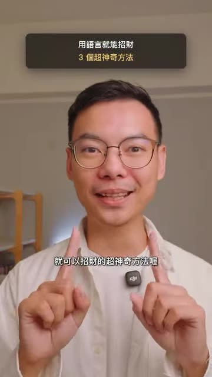

# 三個用語言招財的方法（森森｜財富能量）

- 來源：https://www.instagram.com/reel/DehfUd5AH2h/?xtok=Z2xxemxidXE5cmZu
- 平台 / 上傳者：Instagram / 森森｜財富能量
- 長度：01:54 (114.5s)
- 逐字稿來源：whisper (groq)
- 更新日期：2026-10-20
- **關鍵字：** #潛意識 #招財 #很挑戰 #我允許 #超幸運 #感恩日記 #語言暗示 #講者主張

## 摘要與名詞說明

**一句話重點**：講者「森森｜財富能量」主張，用語言調整潛意識可以「招財」，分享三招：把「很難」改說「很挑戰」、用「我允許」開頭、常說「超幸運」。（皆為講者主張，屬潛意識／吸引力類說法，未經查證，非投資或理財建議。）

| 時間 | 重點 |
|---|---|
| 00:00 | 開場：三個用語言招財的方法，稱很多有錢人偷偷用來調整潛意識 |
| 00:09 | 第一招：不說「很難」，改說「很挑戰」——「很難」讓潛意識覺得做不到也不想做，「很挑戰」暗示有機會突破、自己有能力 |
| 00:30 | 第二招：用「我允許」開頭——很多人想有錢，潛意識卻怕出名或覺得賺錢很累；寫感恩日記或冥想時默唸「我允許自己有錢，同時是輕鬆的」，重複就越容易發生 |
| 01:09 | 第三招：常說「超幸運」——主張常說幸運、感恩、開心的人，身體會在眾多選擇中偏向常講的那個選項（如容易找到停車位、撿到錢、拿到優惠、被升等房間） |
| 01:46 | 結語：分享給身邊常常很幸運的朋友；畫面有「留言『幸運』」提示，片尾字卡「留言你的生日　每週二晚上 8 點直播解盤」 |

## 名詞說明
- **潛意識**：講者的說法，指影響行為與選擇的內在信念；其機制與效果沒有在影片中提供證據。

## 轉錄校正備註
- 逐字稿為 Groq 轉錄；影片有燒錄的繁體字幕，與逐字稿核對後無需修改（00:33「感謝有錢對不對」字幕同為此寫法）。
- 原標題僅為「Video by oscar_347347」，標題為自訂；原始標題在 `meta.json.title_raw`。

## 圖文對照（畫面 + 逐字稿）

### 投影片 1：三個用語言招財的方法（00:00–01:54）

**重點：** 講者主張：①不說「很難」改說「很挑戰」；②用「我允許」開頭（我允許自己有錢，同時是輕鬆的）；③常說「超幸運」（講者主張，未查證）。

**標籤：** #潛意識 #語言

分享三個用語言就可以招財的超神奇方法，你會發現很多有錢人都偷偷這樣子用，來調整他們的潛意識，第一招就是不要講很難，要講很挑戰，因為很難會讓你的潛意識知道，我做不到我也不想去做，但如果你說很挑戰代表這個語言中，你在暗示自己這件事是有機會突破，而且其實你是具備能力的，當你把很難變成很挑戰之後，你會發現其實你成功的機率，成功的機率賺到錢的機率，就會大幅提升，第二個方法是很多人會說，感謝有錢對不對，因為其實很多人想要有錢，但是他的潛意識實際上是害怕出名，或者覺得賺錢很累，所以當你在跟自己講說我想要有錢，但實際上你內在又覺得賺錢很累的話，你的身體根本就會無法賺到錢，所以你可以告訴自己，例如說你在寫感恩日記的時候，或者在心中冥想默唸都可以這樣做，你可以用允許當開頭，我允許自己有錢，同時可以是輕鬆的，用這個方式呢，來連線原本你的潛意識，認為是完全不可能同時發生事情，當你重複重複的，這樣跟自己的潛意識講，它就會越來越容易發生哦，在第三個有錢招財的秘密呢，就是要常常說超幸運，你會發現，常常講很幸運，很感恩，很開心的人，很奇怪哦，他的身邊總是會發生這些事情，當你不斷的告訴潛意識，這些語言的時候，你的身體會在眾多的選擇之中，儘量去選擇你常常講話的那個選項，所以當你常常講很幸運的時候，他就會看到，這邊有一件事是會讓你發生很幸運的，你就會發現有些人很容易找到停車位，然後有些人很容易就是撿到錢，或者是常常拿到優惠，或被升等房間等等，你們可以分享給身邊那個，常常很幸運的朋友吧。
