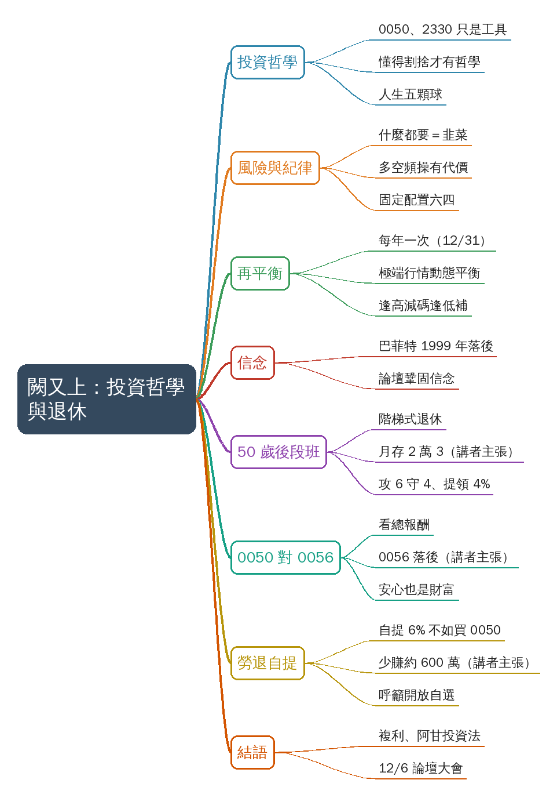

# 五十歲退休後段班莫慌！「月存兩萬三」10年逆轉退休金！- 闕又上 劉寶傑《寶傑怎麼說》20261112-2

- 來源：https://youtu.be/wlq6fpv-EN8?si=SBYi2fkVjLnoiWbZ
- 平台 / 上傳者：YouTube / 寶傑點兵／寶傑怎麼說
- 長度：28:58 (1738.0s)
- 逐字稿來源：whisper (groq)
- 更新日期：2026-11-15
- **關鍵字：** #投資哲學 #0050 #2330 #0056 #高股息 #總報酬 #複利 #資產配置 #再平衡 #階梯式退休 #勞退自提 #闕又上 #阿甘投資法

## 摘要與名詞說明

**一句話重點**：華爾街操盤手闕又上主張，先建立「投資哲學」（懂得割捨），再用 0050／SPY 搭配「進攻／防守」資產配置與每年再平衡，即使 50 歲才起步的「後段班」，靠月存 2 萬 3 與複利也能 60 歲正常退休（以下數字皆為講者主張，未查證）。

| 時間 | 重點 |
|---|---|
| 00:00 | 0050、2330 只是工具；投資哲學→策略→工具，懂得割捨才有哲學（和牛比喻） |
| 03:00 | 人生五顆球：工作會彈回來，健康、家庭、朋友、心靈不會；0050／SPY 是會彈回的球 |
| 04:50 | 吃不完的韭菜源於什麼都要；多空頻繁操作（犀利媽）的睡眠與生命代價 |
| 07:05 | 2000 年泡沫短期失敗、持續補錢與固定配置（如六四）長期拉回 |
| 09:48 | 每年 12/31 再平衡一次，極端行情才動態平衡；逢高減碼、逢低補進 |
| 11:17 | 巴菲特 1999 年落後大盤、2000 年後大漲；用論壇鞏固信念 |
| 13:07 | 50 歲後段班（約 300–400 萬）：階梯式退休、每月多存 2 萬 3（講者主張） |
| 15:25 | 補考班攻擊 6／防守 4，約 900 萬、提領 4%（月 3 萬）＋勞保勞退（講者主張） |
| 17:41 | 0056 高股息爭議：看股利加資本利得的總報酬 |
| 19:18 | 0056 長期落後 0050（講者主張）；安心也是財富，緣分不勉強 |
| 22:21 | 勞退自提 6% 不如自己買 0050；30 年少賺約 600 萬（講者主張，未查證） |
| 24:12 | 批評勞團只爭提繳率、勞退基金報酬低；他校與新制公務員已可自選 |
| 26:00 | 結語：複利；先讀《阿甘投資法》；12/6 論壇大會（票價 1 萬 6） |

## 名詞與縮寫
- **0050**：元大台灣50（台股大型權值 ETF）；**0056**：元大高股息 ETF；**2330**：台積電；**SPY**：追蹤美股 S&P 500 的 ETF。
- **再平衡／動態平衡**：定期把資產比例調回目標；極端行情時提前調整。
- **總報酬**：股利＋資本利得。**複利**：利息再滾入本金。
- **勞退自提**：勞工自願提繳薪資 6% 進勞退個人專戶（由國家基金管理）。

## 轉錄校正備註
- 來源：Whisper（Groq），語言自動偵測為中文，未發現整段漏轉或重複幻覺。畫面燒入字幕與 Whisper 同源（錯字相同），不能當權威；只有名牌（闕又上）與標題條可核對。
- 已校正：邱老師→闕老師、寶傑（保潔／保堅／寶姐）、複利、股利、資本利得、輝達、逢高減碼、範蠡、慢飆股、千年暗室一燈即明、務實自渡。推測詞見 `meta.json.known_asr_errors`；語意不通無法確認的句子（神龍百尾、阿達瑪孔古利、手背做紅袋等）保留原文。
- 所有報酬率、金額、落後幅度與制度評論都是講者主張，未查證；本片非投資建議。
- 28:58 起節目結尾主持人回覆觀眾留言，與投資無關，依使用者要求從逐字稿與報告移除（原話保留在 `transcript.raw.md`；留言原文的補充資料一併刪除，可從 git 歷史找回）。

## 思維導圖

- 原圖：[mindmap.png](mindmap.png)；文字大綱：[mindmap.md](mindmap.md)（與本報告同資料夾）

## 圖文對照（畫面 + 逐字稿）

### 主題 1：投資哲學：工具不是策略（00:00–03:00）

**重點：** 闕又上指出 0050、2330 只是「工具」，要先有生活方式與可承受風險所形成的投資哲學，再推出策略與工具；並以和牛、吃素師父的比喻說明「懂得割捨才算有哲學」。

**標籤：** #投資哲學 #割捨 #0050 #2330

0050跟2330在掙扎到，有些人不適合買2330，有些人不適合買0050，它是一個你必須要符合你的生活習慣，你的生命哲學，你要過的生活，跟你能夠承受的東西，可以去找到你的，我們剛才講的投資哲學，然後投資哲學去找到投資策略，投資策略在下來會管制投資工具，所以2330跟0050，對我們來講它既是工具，它也有策略，所以一般人都一直在比這個工具，這個009是，因為他一直不知道他的策略是什麼，而我剛才講的，你可以看我們剛才回到了，你可以看我們10年7.2，20年才9點多，然後30年10點多不到11，就可以產生巨大的收入，所以你應該要怎麼樣，要穩，穩中求成長，成長中要有穩，這兩個一定要搭配，很多人是飆的時候飆上去，然後下來就又畢業了，所以一直在追逐風追逐雨，他都沒有策略，他也沒有他的投資哲學，你看我們這個，可是老師你的策略就是，我就是0050跟臺積電，我就是選這兩個，然後我就是把錢這樣丟進去，不是你剛才講的這是工具，投資哲學不是這樣，投資哲學裡頭有些人是說，我一年希望只花一個小時，我可以跳著踢踏舞上班，我可以有足夠的收入，但這個收入不會要高到，我跟你講如果，您剛才其實已經提到一個非常好的問題，當我們講23的時候，我說快11%的時候，你第一個直覺是對的，11%有那麼容易嗎，沒有，沒有那麼容易，你其實不要到11，你只要有8% 9%，你就已經不要說23倍，你18倍你也很強，所以當什麼叫哲學，我覺得我們就來講，什麼叫哲學，你腦筋裡頭會想到，有什麼東西叫哲學，就是你可以一直做下去的事情，對，從根本性找到根本解決的問題，那我就問一個例子，我常常舉這個例子，你吃過和牛嗎 火鍋吃過和牛嗎，我沒吃過和牛，你不吃，我吃牛但我不吃和牛 太油了，那牛肉以頭的，突然有一天有一個人就說，吃了和牛他覺得很美味，然後到寺廟的時候，他覺得這太美味了，要跟師父分享，他說師父啊，哇 我昨天吃那個火鍋，那個和牛有給他好吃，你要不要也嘗一下，你認為師父會怎麼說，當然不吃，師父不吃有他的宗教信仰，當你對某一件事情可以割捨的時候，你就已經有哲學，你有些事情你不願意割捨，就代表你，你看你的觀眾裡頭，這個也要那個也要，既要又要還要，既要過癮又要賺錢的時候，他就沒有哲學，真正有哲學，我們的科普里頭已經是，謝謝，阿彌陀佛你吃吧，我要的是，當一個人說，八趴九趴十趴，如果可以讓我致富的時候，我要的是生活，我要的是跳的踢踏舞上班，我要的是我可以享受，其他空出雙手。

### 主題 2：人生五顆球：哪些球掉了會彈回來（03:00–04:50）

**重點：** 引用「人生五顆球」比喻：工作是會彈回來的球，健康、家庭、朋友、心靈掉了會破裂；闕又上主張 0050、SPY 屬於掉下去會彈回來的球，所以不必過度煩惱。

**標籤：** #人生五顆球 #0050 #SPY

經營我的人生五顆球，我稍微跟你分享一下人生五顆球，這也就是一個哲學，喬治亞理工學院的，有一次畢業典禮，請來了可口可樂的子公司總裁，他就跟同學講，他說各位同學，你們畢業之後，會面臨我們人生的一個遊戲，就像一個小丑在空中拋接五顆球，那這個規則是，你不能讓這個球掉落，但是不信，有一個球掉落會彈回來，其他四個球掉下去，會破裂刮傷，永遠不會復原，第一個球會彈回來的是工作，你今天不在谷歌搞不好在輝達，不在輝達搞不好在蘋果，你不必擔心你的工作，這個球掉下去會彈回來，其他四個球健康掉下去會破裂，然後家庭，今天最近有一點點裂痕，有一點掉下去，然後還有就是你的朋友友情，還有第四個心靈，第五個心靈，這四顆球你要非常的小心，那我們剛才講的0050跟SPY，是掉下去會彈回來的球，因為它會太弱俯下，對 而且是500加加50加，幾乎這個國運綁在一塊，所以你不必壓臺積電，壓臺塑你也不必壓臺，那臺積電剛好是，這檔期間我們認為不能錯失的，所以我們拉進來走這個時代紅利，要不然正常情況下是不介紹單一個股，但臺積電例外，就例外裡頭，它穩到夠穩，所以你剛才跟我講要割捨，就不要再去想什麼創意，對，所以你沒有割捨就不會有投資哲學，沒有投資哲學，你的投資策略就開始什麼都要，所以你的割捨是在這個地方割捨，不 割捨就代表，你知道你什麼是可以拿，什麼是不可以，當你會捨去的東西的時候，就已經有哲學，就已經有信仰，這樣合理嗎。

### 主題 3：太單調？股市老手的危機意識（04:50–07:05）

**重點：** 主持人問「太單調」，闕又上回應多數人吃不完的韭菜就是什麼都要；並以每天多空操作的「犀利媽」為例，說明高頻交易的睡眠與生命代價。

**標籤：** #韭菜 #多空操作 #危機意識

合理，對，可是很多人會覺得太單調了，對，所以就是，所以這就是我們經常會有吃不完的韭菜的原因，這些人其實如果那麼簡單，坦白講所有我剛才講的，別人也都有專業，我是摔了，我前面摔了20年屁股還沒摔成兩半還沒通，我是摔了第30年的時候，屁股才裂開兩半才通，對不對，所以這個看起來簡單，所以我，所以你先要問的觀眾要先問自己，10% 9% 8%我不滿意嗎，好不滿意沒關係，那你就好好練功，我有一個影片裡頭，我一陣子臺灣有一個也是武林高手，我叫犀利媽我不知道你聽過沒有，我那個影片你說我媽，我說投資要嘛就犀利，要嘛就是阿甘，他的方式他每一天都在動，他多空交戰，那天台股大跌的時候他LINE給我，他是說今天賺了259萬，大家在跌他賺250萬，他留了四口空單，結果臺股一路大跌，人家說他就想慘了，因為那幾年要拉了，結果他半夜一看整個大跌，我說2點59分，你還在看這個東西，所以這個是要代價的，他的心情是一再懸在內，你是看到他賺，那大家大跌已經趴在地上，他賺300，他馬上多空一直不停的變換，可是就，你知道他是睡眠品質，我不知道，耗費生命，對不對，但因為他享受，他已經形成習慣了，他可以變，他說他是股市公務員，所以他已經習慣了，但你有那個本事嗎，你要過這樣的生活嗎，他也摸索了30年，而且我看他真的是做足了功夫，所以你就是看到，我爸爸有時候以前小時候就警告我，你不要看到強盜吃肉，你要想到強盜捱打，我跟你講我經常在牆角，才被打的這個全身醫學的，就不好意思脫衣服給你看，是吧 所以當你開始理解的時候，你就會開始，在股市裡頭待過越久的人，都一定有危機意識，而且有防禦功能，巴菲特你看好了，只要任何華爾街的大佬，只要超過二三十年被股市修理過的，不管他多好他殺豬從尾，他一定會有危機意識。

### 主題 4：怎麼出場：2000 年泡沫與六四配置（07:05–09:48）

**重點：** 以 2000 年高科技泡沫為例，說明短期策略會失敗、但持續補錢與維持固定資產配置（如進攻六、防守四）後長期仍會拉回；要用錢時從投資組合中提領。

**標籤：** #資產配置 #六四比 #2000年泡沫

好 那闕老師你剛剛講，股市就是進跟出嘛，那你剛剛講的，我對臺積電剛剛講的百年難得一見，然後我的0050是跟臺灣國運綁在一起，我就是進，可是你剛剛講那個出怎麼個選，整個出法，要剛剛講你說我30%可以出，可是你前面不是講複利嗎，我就是要讓那個30留在裡面，我要在那邊滾才有所謂的複利啊，所以我進當然沒有問題，我現在從這邊學到，我就是買0050，然後臺積電也可以做選擇，可是出咧，都在這個股票裡頭，他出就出到了那個弱的地方，舉例來講，2000年以2000年為標準，2000年高科技泡沫股票連跌三年再次連漲三年你這個時候一般來講你只要把再次賺錢的錢轉到SPY股市裡頭，一定賠錢，因為他第一年賠9%，第二年賠10%，第三年更慘賠22%，你把錢轉進來都是找死，以短期這三年來看，我們剛才講的策略完全失敗，可是第四年的時候，股票大漲二三十八就拉回來，因為你一直補錢，房地產比如說一千萬你買一副，八百萬你又買一副，七百萬你又買一副，六百萬買一副，等它又回到一千萬的時候，你這三副會不會賺錢，我講我才懂，原來這就是回到你的資產配置，比如說剛剛講四十歲，我的進攻型的股票六十，然後我的這個所謂的防禦的四十，我就是一直維持在六四比，不管高跟低就是維持在六四比，這是基本款，基本款你還沒有通，如果那麼簡單，就不必我也不必開課授徒了，基本上來講，這個會穩定的一個成長當中，那你哪天想要度假，要拿個十萬二十萬美金，你就拿嘛，這裡面從你的一百萬，已經慢慢漲到了一百五一百六，你想花錢你就在這個投資組合來拿，至於也不是六四，因為隨著你年紀在變動，然後我們就開始有進入變化題了，稍微點一下，但不能延遲，要想去看書，基本上我們有一個叫神龍百尾，他某一個時間點突然出現的時候，你可以不可以提前動，通常我們鼓勵你一年平衡一次，什麼時候呢，12月31號看完煙火，然後用10分鐘，今年賺了30萬，拿個5萬去度個假，或者今年賺了300萬，譬如說你有300萬來講，你這幾年都是30%，如果在0050賺了快90萬，你拿個10萬去度假 對不對，然後呢看去哪裡度假，做一個計畫然後再把平衡，轉的挪到1的，好吧就這樣就結束了。

### 主題 5：再平衡：一年一次到動態平衡（09:48–11:17）

**重點：** 基本款是每年 12 月 31 日平衡一次，勤快者半年一次，市場極端時才做動態平衡（以 2025 年川普貿易戰台積電下殺為例）；逢高減碼、逢低補進，用範蠡的買賣比喻。

**標籤：** #再平衡 #動態平衡 #逢高減碼

好這是基本款，可是如果像碰到，6月有一個很大的行情，哇漲得很高，或者突然某一個跌跌，你可以著量怎麼樣，動態平衡，因為機會來了，你不把它高的賣掉到低的，搞不好過一陣子叫，船過水無痕，以2025年的川普貿易戰來講，臺積電啪他下殺48，這時候是不是一個好平衡，好平衡，買了進來，但是你不買，你逛逛逛逛到12月底，他回去了，那你白走了一趟，叫船過去水河沒有看到，你這個時候叫動態平衡，是吧，叫做，現在叫做氣候極端的表現情況，就股市極端的時候，你可以叫動態平衡，原則上一年平衡一次，你要半年平衡一次也OK，半年平衡也不壞，半年平衡，今年的股市在高檔你抓到，對吧，然後低檔現在，所以要偷懶的人一年一次，稍微勤奮一點的人就一年兩次，但一年兩次恐怕就多十分鐘，然後更勤快有關注股市的就動態平衡，這樣清楚了嗎，這樣你就是很穩健的賺錢逢高減碼，有紀律的把它從賭場的table，那個桌上拿一些出來，然後低的我逢低補進，就有點像西施的老公範蠡，夏天買什麼，夏天買冬天的衣服便宜，冬天買夏天的衣服便宜，然後倒著賣，就是這個道理。

### 主題 6：信念鞏固：巴菲特 1999 年的例子（11:17–13:07）

**重點：** 講者說明逢低是機會但需要信念，並以巴菲特 1999 年落後大盤、2000 年泡沫後反而大漲為例，說明透過參加論壇不斷鞏固信念。

**標籤：** #信念 #巴菲特 #論壇

你看古人也會懂得資產平衡再平衡，而且剛剛在跟您私底下聊天的時候，您當時有很多人非常謝謝，也非常感興趣，就是從臺積電，1200一直跌到800，跌到700的時候，那個時候逢低那就是一個，絕佳機會，但是沒有信念，沒有看過我慢飆股臺積電，啟示錄的書的人，就沒有定見，也沒有遠見，我舉一個例子，你剛才講的是，我們在裡頭記得，所以這就是我為什麼，我自己本身有會員，然後我每一年的12月裡頭，我都會辦一場論壇大會，很多人就說老師我參加會員了，我還需要參加，他一直是不停的信念鞏固，鞏固鞏固形成了信仰，所以以2000年巴菲特的高科技，泡沫的時候，巴菲特在199幾年的時候，他的投資1999年他是下跌20%，股市上漲20%，他來回差了輸給人家40%，哇這個很多人都在消遣巴菲特，巴過去了，那當時在他的那個論壇大會就，媒體就採訪那些參加的，他說去年你們巴菲特賠了20%，股市漲20%，你們不擔心嗎，他說我們擔心，這就是我們來鞏固信仰的時候，結果呢2021年的時候，2000年的時候，美股大跌，巴菲特大漲，就像他現在，現在巴菲特伯克夏又創歷史新高，所以呢，我覺得您剛才講的就是，我們有些學員裡頭也是一樣，透過一次一次一次的信念去鞏固，當他有形成信念有哲學的時候，你和牛在他面前的時候，他說，阿彌陀佛施主請用，我們有些，我們的會員跟能夠達到這樣的時候，他就有時候我們會錯，但這個系統基本上不容易錯。

### 主題 7：50 歲後段班：階梯式退休與月存 2 萬 3（13:07–15:25）

**重點：** 針對 50 歲手上只有約 300–400 萬的「後段班」，建議階梯式退休：每月多存約 2 萬 3（含兼差），約 9–10 年可多出約 300 萬，勉強及格、不淪為下流老人。

**標籤：** #50歲 #後段班 #階梯式退休 #月存2萬3

好那闕老師你在這，這本阿甘的退休包店裡面，你這投資裡面是有分時間的，40歲50歲60歲，那我現在不行，我60歲是相見恨晚的時候，可以說有個關鍵期，其實也是所有人最焦慮的50歲，50歲是你準備要退休，50歲是你準備要去你的佈局，你的資產配置的時候，最關鍵的一個時間，也是一個最焦慮的年紀，對，一般來講退休金不應該是這麼晚才來規劃，到50歲，但是現在很多人前面為小孩的教育，為買房什麼東西搞到50歲的時候發現，退休的議題出現了，手邊的錢不多，臺灣平均起來大概在350到300萬到400萬之間，所以嚴格講這些都是叫後段班，理財不及格的後段班，太晚才看到我們的書或瞭解這個系統，基本上怎麼辦也有，那就是要快馬加鞭，因為你已經落後了，50歲基本上假設你現在是300萬，350了，350我就會鼓勵大家用，第一種是階梯式的退休方法，一般50歲，我還是希望你能夠身強體壯的時候，能夠開始旅遊退休，要不然現在臺灣好像平均的，那個退休人的餘命，最後躺在床上是8年，那我們覺得很可惜，所以你不能等到那個時候再去退休，好那我們就做一個比喻，那你可能可以早一點，比如說我們假設60歲，你辛苦個10年，50歲60歲，你還是比別人早5年退休，60歲，那我就希望你每一個月，能夠開始加強，大概存2萬3，這2萬3，不管你是親兼副業，哪怕是洗個碗盤，這個幫人家看個狗，遛狗的狗旅館，或做你有興趣的，你有興趣的幫人家代採購Uber什麼東西，就每個月如果你可以開始，可能有些時候是你可以多兼一個差，工作之餘多個你存個一萬三，那另外一萬呢就自己去兼個差，洗個碗盤說難聽一點，這個兩個小時一天四百塊，再加上人家給你的供餐，你洗個二十天一萬塊就進來，這一萬塊大概在九年左右，會給你多增加三百萬，多三百萬，那你原本的三百五加三百萬，就勉強及格的撐住在那裡了。

### 主題 8：補考班：攻擊 6 防守 4 與 4% 提領（15:25–17:41）

**重點：** 對落後者把 60 歲時的配置反過來（攻擊六、防守四），講者主張資產可到約 800–900 萬，每年提領 4% 約月領 3 萬，加勞保勞退約月 5 萬。

**標籤：** #資產配置 #4%提領 #下流老人

不會變下流老人，然後接下來用我們剛才講的資產配置，本來60歲的時候，他已經經過10年應該到60歲，本來應該是多少 防守是多少 60對吧 本來防守應該60因為60歲 年紀就是你防守部可是你以前功課太差了你是補考這時候呢我們可以在資產配置中，把它反過來攻擊6，防守4，本來應該是防守4，可是因為，我現在又懂，你剛剛講40歲的時候是，我的進攻60防守40，這40是我的年紀，那如果50歲就是50 50，那60歲是剛好顛倒過來，就是攻擊40防守60，對 這是60歲的人，可是這一群是落後的補考班的，他中50歲他手邊只有個六七百萬，照理都快變下流老人，這時候我讓你的攻擊力度稍微加大，你可以看我們的書上，你放在定存大概只能拿400多萬，如果用我們剛才的方式，大概就800多萬到900萬，假設900萬每一年拿4%，4%，36萬，一個月3萬，加上勞保勞退，大概還可以拿到18000到20000，加起來50000塊，稍微體面一點，看到嗎，一個50歲我讓你60歲退休，你這樣子一個月還有5萬塊的東西，因為勞欠保持，勞保 勞退只有大概差不多，我就給你算1萬8 2萬，你從我這邊，從這邊拉出去，你還可以每一個月有3萬，就把你的稍微體面，夫妻兩個人就有10萬，一個人就5萬，就省著用，然後後面如果機會再往上滾，你的比例還可以再拿大，4%是低一點，搞不好股票大漲的時候，你可以拿個5% 6%，6%如果9%，6% 54，一個月快5萬塊，4萬多，那再加上2萬 7萬，也不錯啦，本來從下流老人，現在跟你拉到正常的退休生活，而且是60歲，可以了啦，50歲才跟你，你以前應該努力的才給你，而且跟你60歲開始，60歲你可以再進入，叫階梯式的退休生活，60歲你可能也不需要，每天都在旅遊狀態，搞不好有一個月當個顧問，什麼東西裡頭，再賺一點，你就慢慢的很輕鬆的部分，還是給你60歲退休，不錯啦，50歲不及格的人，現在可以60歲退休。

### 主題 9：0050 對 0056：總報酬才是硬道理（17:41–19:18）

**重點：** 講者說月存 2 萬 3 放 0050 約 6% 報酬可到 300 萬；並談 0056 高股息的爭議：高股息通常代表成長動能較小，應看股利加資本利得的總報酬。

**標籤：** #0056 #高股息 #總報酬 #資本配置

所以你剛剛講的50歲就是，那23000是你已經計算出來過的，對23000每一年，你放在臺灣的0050，大概差不多6%就可以到300萬，我還沒有給你9%，才6%保守的，是 所以等於說，你到現在還是要第10年就承續，可是在0050裡面有一個爭議，剛剛講我到了60歲，我只說我到了50幾歲，有人講說我不要再這麼進攻了，我應該是有很多的現金要回來啊，所以我就不要去做0050啊，我應該去做0056啊，0056的這個，所謂的他配息的這個額度比較高，我可以拿回更多的錢啊，好基本上啊，0056有他的設計的功能，0056叫高股息，但一個公司啊在，財務界裡頭只要一個公司到了，給高股息的時候基本上有幾種狀況，這個叫資本配置，一個是我們剛才講到資產配置，資本配置是一個公司CEO，要把公司資源用到最大，有些人會發高股息，發高股息的時候都通常代表，他的公司盈餘成長已經受到，不會那麼高的成長，不需要像臺積電，錢要蓋廠房他捨不得給你股利，但一個公司很大方給你股利的時候，就說明說，對不起，我實在找不到很好的投資標的，錢發給你，所以這個時候你覺得成長動能就小，請記住我們看的是一個總報酬，股利加上資本利得，這個地方比較大，等於總報酬，你如果只看這個股利，0056就只看股利，資本利得他希望有，但不是他最重視，0050是股利少一點，0050資本利得多一點。

### 主題 10：0056 落後 0050 多少、為什麼仍有人買（19:18–22:21）

**重點：** 講者主張 0056 長期落後 0050 數百個百分點；但有人因為每季領息而心安，講者認為「安心也是財富」，各有緣分、青菜蘿蔔不勉強。

**標籤：** #0056 #0050 #股利 #緣分

好那我們就用實際來講，2005，0050是比較早成立的，大概在2005，0056大概在2007年的12月20幾號，那我們就兩個同一天，兩個鳴槍起跑，那我曾經在三年前還是做影片的時候，我就說0056已經落後0050大概在137%，就是放100萬少137萬，放1000萬少137萬，我說未來會突破300，0056會落後0050 300%，300%就是你當時放100少300，放1000少3000，寶傑你猜我們現在在錄影的時候，這個數字突破了沒，突破了，而且搞不好在400以上，未來會不會再持續擴大，所以我多賺了那個5%的利息，或是6%的利息，其實這兩個股利率大概差一點多，差一點，所以這一點，但是為什麼有些人我還是建議他買0056呢，我就我們的學員總指講師就碰到計程車司機，他買0056，為什麼，因為每個月，每個季度都看到錢，怎麼樣，爽，這些人要繳稅，因為這個是發放二代健保，第一個是爽，第二個，寶傑我們這樣講下來，也花了一天，他有時間聽嗎，他如果聽不懂這個，他第一個直覺就是，0056的股利比你那邊多1.5%，我為什麼要這個，他不知道有資本利得，他也不知道複利，所以你今天的觀眾多寶貴，他得到了複利概念的時候，所以這些司機怎麼辦，你要講，那你那個計程車就跑到基隆了，你要扶到基隆去教育他了，你就只好下車吧，能通就通，這叫緣分，你無法去教育每一個人，但是他這個也有個好處，0056一定有他適用的，我舉個例子，有人因為看這個股利多一點，5%，他晚上睡覺不要安眠藥，就可以睡得很穩，心靈的問題，我覺得這個也是財富，賺0050的人搞不好要吃安眠藥，賺0056他就有個信仰，買錢就是，他那個信仰不管他對不對，他就有個信仰你記不記得，那當年這個，一旦他有信仰的時候，他能夠睡得安穩，我說可以，這些人適合買0056，知識是不是個財富，只要他安心，就你剛剛講的，我心靈財富健康，如果滿足心靈那也是一個好處，因為他看到就是，股利多嘛，他晚上去睡覺，而且每個月就拿到錢 對不對，他都滿足了嘛，那我就覺得好啦，就少賺一百萬就少賺一百萬嘛，他的緣分就是少賺一百萬，對不對 青菜蘿蔔不勉強，以前我會勉強，現在慢慢阿彌陀佛，你是什麼都可以，就是你只要覺得，因為他的緣分就這樣，他可能沒有時間聽你，聽你這個或看到這個影片，所以知識是力量也是財富，但他就沒有辦法接觸到，這就叫緣分啊，要不然怎麼會有那麼詐騙，那麼多詐騙機構還可以生存。

### 主題 11：勞退自提 6%：不如自己買 0050（22:21–24:12）

**重點：** 講者主張勞退自提 6% 由國家管理報酬偏低，建議寧可繳稅、自己買 0050 或台積電，估計 30 年少賺 600 多萬；若法律改為可自選（類似美國 401）則應參加。

**標籤：** #勞退自提 #401 #0050

對 報告學長，那我們最後一個就是，你在這裡面還特別談到稅的問題，剛剛講到是說，你這個0056其實你很多這是算股利、股利，可是你說有提到，這中間你要去思考，那個稅的問題其實有時候比你想像的來得更多，對 但是那個問題基本上要講的話就是，建你這個機會就是勞退自選，很多人不應該去自提啦，不應該自提就是因為他自提，由國家來管理，那個的落後我們算過，大家去看這本書，你如果說有些小資族，他老闆會給他6%，公司給他6%，他自己又放6%，很多會計師也做錯了一個決定，做錯了建議，建議投資者去把它省稅，為了賺那個6%，放到了國家的勞退基金，我認為不對，應該要回到最強的0050，你讓公務員管理你的錢，打破藥瓶有共無常合理嗎，這一個機制本身就是說，全臺灣的勞退機制，全世界非常落後的，因為國家希望來個什麼國安基金，有時候來護盤，然後又加上這個沒有那個，這是一個極端錯誤，你看我的書這裡面選擇把錢給國家管理在國家還不能自選之前你的自選自提6%不要進行你寧可繳了一點稅，自己到外面去買0050或臺積電，這麼棒的公司，我們上面已經說明瞭，已經落差已經超過600萬，一個人從30歲，30歲到65歲，這30年當中，大概已經落後了，一個人少賺了600多萬，這是國家政策錯誤，從你口袋裡頭剝奪的錢，所以你在講說，你應該像美國一樣，那401的那個，對，就是說你可以自己去選擇，對，如果當哪一天，我們中華民國的法律改變，允許你自己可以提撥的時候，那你就一定要參加，你是借重他的。

### 主題 12：制度問題：坐在金山上哭泣（24:12–26:00）

**重點：** 批評勞團只爭雇主多提繳，卻忽視勞退基金報酬低、資金被外資賺走；舉私校與新制公務人員已可自選，唯獨勞工未開放。

**標籤：** #勞退基金 #外資 #制度

這個問題一延伸起來，我跟你講我們是窮，窮在制度出了問題，真的你每一次看到這個東西，你真的會可惜，我們的一些勞團，腦袋也是阿達瑪孔古利，他一直在為什麼現在法，在立法院大概有7個啊17個，七個啊十七個過不了，他一直說老闆你現在付六對不對，不夠你要付七 付十 付十二 付十五，一直僵在那裡，奇怪這邊你是坐在金山上哭泣，這麼多錢你給外資拿掉六趴 六十趴，外資每一次都拍拍臺積電的董事長，你幹得好明年繼續幹，明年我們繼續來拿六十五趴，這個那麼多的錢你不去拿，幾兆的錢你不去拿，在那邊跟老闆說你要給我今年要多少，老闆那麼輕易都給，老闆說我們經營也很辛苦，所以那個腦袋裡頭啊，你可以看到一堆坐在金山上哭泣的人啊，手上帶著金銀去要麵包，是，不然你又才讓我去想到，郭臺銘在選總統的時候，他很多政界我沒有那麼印象，他講到一個就是說，臺灣的勞動基金的報酬率太低了，太低了，全世界的報酬率，因為一般來講報酬率就是7跟8，你只有2、2、3、4，那中間你可以有多少，保證你今天聽看看，我們剛才講下來的這個6%、7%裡頭，我們現在只要達到7%、6%，基本上那個財富的累積，我跟你講真的是那個下次你有機會這個地方改變，你幾乎我跟你講私立學校已經都改了，觀念已經老是快速度快但已經可以自選，然後公務人員的新制的部分的全序部也改了，新進的工程也可以自己投資，那舊的其實也應該改，唯一是勞工朋友最需要改的沒改，你知道有些勞工朋友不見得碰到高科技，臺積電這些賺錢他沒有跟他完全無分，就必須要透過這個把他財富，對 要透過這個財富縮短，我們最好的工具呢，卻把它堵住了，這個簡直就是，真的是把男性給結紮了。

### 主題 13：結語：複利、阿甘投資法與論壇大會（26:00–28:58）

**重點：** 總結哲學穩定後要「手頭留好聽、用時間用複利」；建議先讀《阿甘投資法》與資產配置，並介紹 12 月 6 日論壇大會與 1 萬 6 的票價承諾（講者主張，未查證）。

**標籤：** #阿甘投資法 #複利 #論壇大會

這個東西那個真的是沒，叫做死了兒子，這寡婦死了兒子沒指望，我們現在時間過得太快了，已經快了60分鐘過去了，我覺得今天我們真的學到滿滿的，一個那這是非常的難得，闕老師來幫我們上了一課，就是你要有，這是一個哲學，你讓你這個哲學穩定了以後呢，要心頭留好聽，不要手背做紅袋，手背留好聽，不要手頭做紅袋，對，留好聽，好好的做，用時間用複利，好好的去為你累積財富，這才是一個最關鍵的，所以，對我借這個東西，因為很多人不知道怎麼切進來，您剛才已經講得非常對，那怎麼去建立哲學跟那個，我建議各位先去圖書館借阿甘投資法，或者你，您這個已經寫十本書了，阿甘投資法是他的部分，這本書很多人收穫，有些人說這本書改變他命運，你就到圖書館去借，或者你買書全家看也可以，你然後再把影片影片從第一集，只要找到你適合的東西，把阿甘投資法，我就建議只有兩檔很單純，臺灣0050跟SPY，然後再加資產配置，資產配置你也可以去買書，也可以去借書，那我們今年剛好12月6號，在臺北國際會議中心，我辦了一場一年一次的論壇大會，門票是很貴，1萬6但是我給自己的KPI是，如果不能賺到16萬，寶傑你的觀眾萬一真的買了這個票，因為你的錢買了1萬6，如果他聽完課，他覺得沒有開啟16萬的觀念，那他可以跟闕老師講，但是他可以跟闕老師，那我就送他兩門影音課程，一個是阿甘投資法，一個資產配置，這兩個加起來快1萬塊，你如果覺得沒有收獲，收獲超過16萬，我送你1萬塊錢的影音課程，但是有一個條件，他打電話給我們的時候一定要摸一下良心，說我上了寶傑的這個影片，買了你這個東西，因為本來要先上阿甘投資法資產配置，再來聽我們的論壇大會，但是現在時間來不及了，如果來不及就先這個再回頭去學習，我認為那個觀念開啟，我們其實我的樂趣我是理財傳教士，我的財富已經真的是，我剛才私底下跟你講，我就不講那個數字了，對已經夠，我真的是有點像理財傳教士，那我覺得能夠救一個算一個，因為臺灣人民夠善良，也夠勤奮，但是那腦袋沒開啟好不好，所以借你這個部分裡頭，你可以買書不必參加任何課程，但是如果真的叫，我們叫務實自渡，像寶傑你今天通物了，就自己可以度自己，迷時迷的時候，老師來度你叫師度好不好，所以看你的緣分，可以從最簡單買書，看書是最好，看書最棒 把它看爛了，我不相信你不能翻身，所以我們講千年暗室一燈即明，希望，現在這闕老師就是那個燈，讓你這個暗室一燈即明。

## 已知轉錄錯誤

| 時間 | 聽成 | 應為 |
|---|---|---|
| 全片 | 邱老師 | 闕老師（畫面名牌「闕又上」） |
| 全片 | 保潔／保堅／寶姐 | 寶傑（推測，主持人劉寶傑） |
| 全片 | 負利／富利／福利 | 複利（推測，畫面標題「複利奇蹟」） |
| 全片 | 鼓勵／股力 | 股利（推測，語意為配息） |
| 全片 | 資本利的 | 資本利得（推測） |
| 03:36 | 揮打 | 輝達（推測，與谷歌、蘋果並列） |
| 10:51 | 逢高竭馬 | 逢高減碼（推測） |
| 11:03 | 範黎 | 範蠡（推測） |
| 11:33 | 半標古臺積電 | 慢飆股臺積電（畫面字幕寫「慢飆股」） |
| 28:50 | 千年暗示一燈幾明 | 千年暗室一燈即明（畫面字幕寫「千年暗室」） |
| 28:36 | 務實制度 | 務實自渡（畫面字幕） |
| 16:29 | 4936一個月3萬 | 4%、36萬、一個月3萬（推測，900萬×4%＝36萬） |
| 16:16 | 供給力度 | 攻擊力度（推測，畫面字幕寫「攻擊力度」） |
| 未改 | 神龍百尾（09:16）、變化題（09:11）、2021年（12:31）、2005（19:20）、勞欠保持（16:42）、全身醫學的（06:42）、阿達瑪孔古利（24:20）、手背做紅袋（26:21）等 | 語意不通或可疑，無法確認原話；推測依序為神龍見首不見尾、2001年或2000年、2003年（0050 成立）等，僅供參考，不改原文 |

## 補充資料連結

- 思維導圖：[mindmap.png](mindmap.png)、文字大綱：[mindmap.md](mindmap.md)（與本報告同資料夾）
