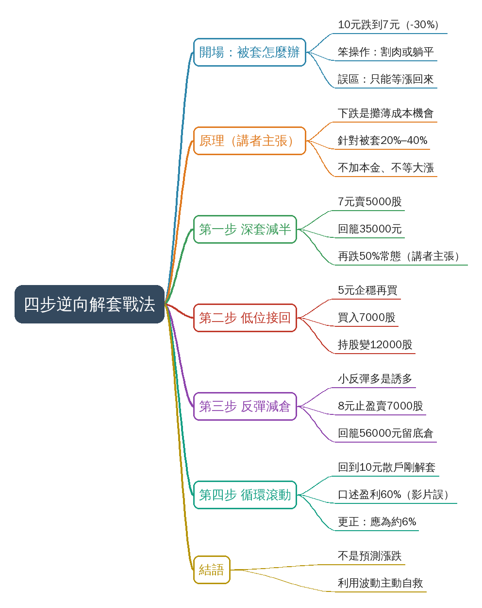
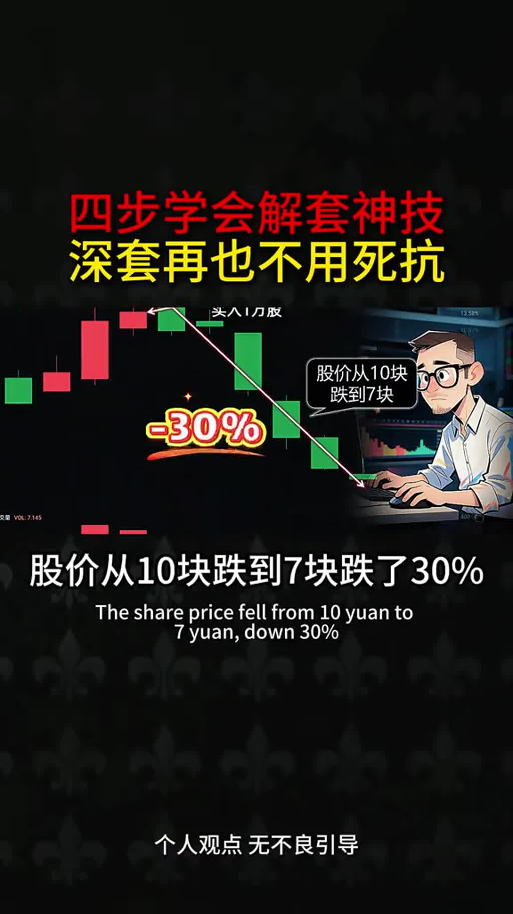
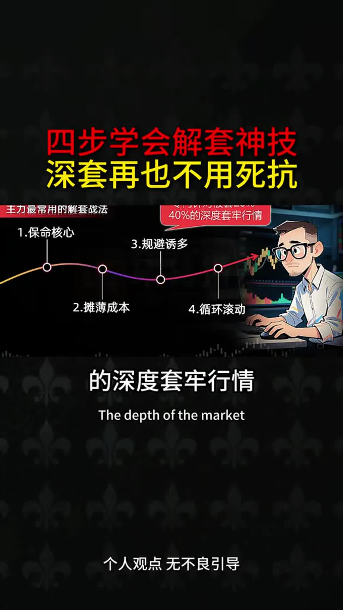
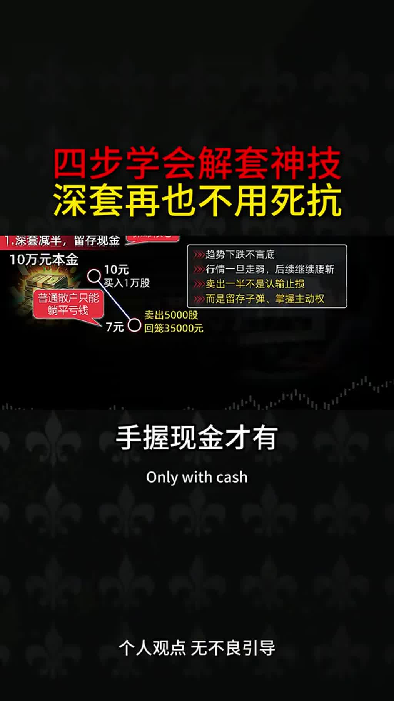
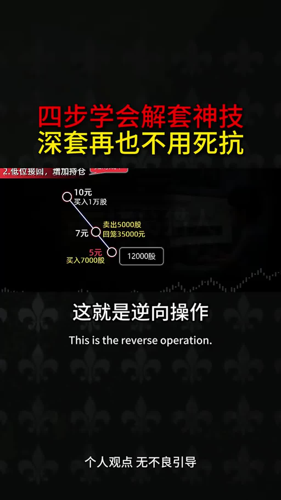
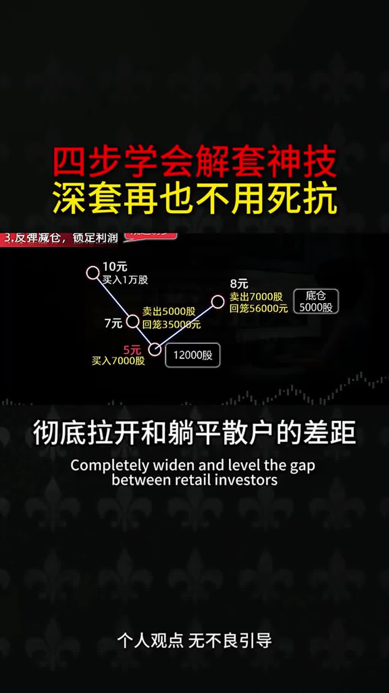
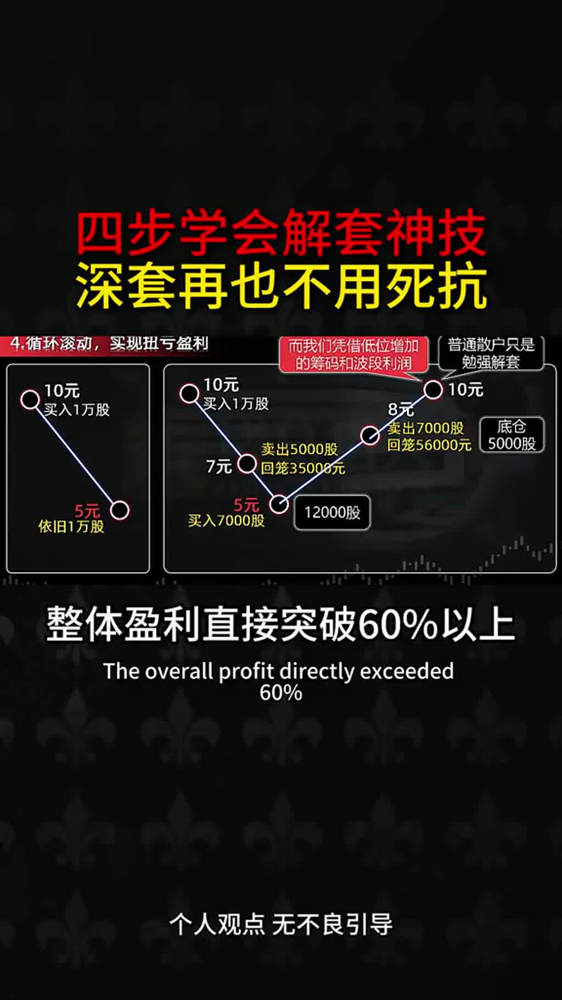

# 四步學會解套神技，深套再也不用死扛

- 來源：https://vt.tiktok.com/ZSpp86AXD/
- 平台 / 上傳者：TikTok / vuuffp6
- 長度：03:06 (185.5s)
- 逐字稿來源：whisper (groq)
- 更新日期：2026-11-16
- **關鍵字：** #解套 #深度套牢 #減倉 #低位加倉 #攤薄成本 #波段操作 #止盈 #底倉 #散戶心理 #逆向操作

## 摘要與名詞說明

**一句話重點**：講者主張股票被套 30% 時，不要死扛也不要割肉，而是用「減半留現金 → 低位接回 → 反彈止盈 → 保留底倉循環」四步波段操作攤薄成本；影片口述與字幕寫「整體盈利突破 60%」，經使用者更正與驗算，應為約 6%（影片數字有誤）。

## 重點時間軸

| 時間 | 段落 | 重點 |
|---|---|---|
| 00:00 | 開場 | 10 萬買 1 萬股、從 10 元跌到 7 元（-30%）；散戶兩種笨操作：恐慌割肉、死扛躺平 |
| 00:24 | 原理與案例 | 下跌是「攤薄成本的最佳機會」；四步逆向解套戰法針對被套 20%–40%，不加本金、不等大漲（講者主張） |
| 01:00 | 第一步 深套減半、留存現金 | 7 元賣出 5,000 股、回籠 35,000 元；理由：趨勢下跌不言底，再跌 50% 是常態（講者主張） |
| 01:33 | 第二步 低位接回、增加持倉 | 跌到 5 元企穩後用 35,000 元買 7,000 股，持股變 12,000 股 |
| 02:00 | 第三步 反彈減倉、鎖定利潤 | 反彈到 8 元滯漲時賣出 7,000 股、回籠 56,000 元，留底倉 5,000 股 |
| 02:30 | 第四步 循環滾動、扭虧盈利 | 股價回到 10 元時，躺平散戶剛解套，講者口述「盈利突破 60%」，應為 6%（影片誤，見 S2）；精髓是利用波動主動自救 |

## 用影片自己的數字驗算（Claude 計算，非影片內容）

| 時點 | 動作 | 持股 | 現金 | 以當時股價計總值 |
|---|---|---|---|---|
| 10 元 | 買入 1 萬股 | 10,000 | 0 | 100,000 |
| 7 元 | 賣 5,000 股 | 5,000 | 35,000 | 70,000 |
| 5 元 | 買 7,000 股 | 12,000 | 0 | 60,000 |
| 8 元 | 賣 7,000 股 | 5,000 | 56,000 | 96,000 |
| 回到 10 元 | 不動 | 5,000 | 56,000 | **106,000（約 +6%）** |

- 影片說「整體盈利突破 60% 以上」是錯誤：使用者更正為 6%，與上表驗算一致（106,000 ÷ 100,000 − 1 ≈ 6%）。60% 疑為只算第二、三步那 7,000 股的波段報酬（35,000 → 56,000，+60%）或漏掉小數點，屬推測，影片未說明。
- 躺平不動在 10 元時為 100,000（0%）。四步法多賺的約 6,000 元，前提是**股價恰好先跌到 5 元、再反彈到 8 元、最後回到 10 元**，且每一步都買賣在影片設定的價位。
- 反向情境（Claude 推論）：若 7 元減半後股價直接反彈，會少賺一半；若 5 元加倉後繼續下跌，虧損反而放大。影片沒有討論這些情況，也沒提交易成本與稅。

## 名詞說明

- **解套**：股價回到買入成本以上，帳面不再虧損。**深套**：虧損幅度大（影片指 20%–40%）。
- **攤薄成本**：低價加買讓平均持股成本下降（中國用語「摊薄」）。
- **底倉**：長期保留、不隨波段進出的基本持股。
- **止盈**：達到預期獲利時賣出鎖定利潤（相對於「止損」）。
- **誘多**：拉出反彈引誘散戶買進，主力趁機出貨。
- **企穩**：股價止跌並穩住。**滯漲承壓**：上漲動能轉弱、遇到賣壓。
- **主力**：影片泛指資金大的機構或大戶，未指明對象。

## 轉錄與校正備註

- 逐字稿來源：Groq Whisper 自動偵測為中文，簡轉繁；影片畫面有燒入的簡體中文字幕（附英文翻譯），以字幕核對修正：貪博成本→攤薄成本、力度乏力至漲成壓時→力度乏力、滯漲承壓時、指引賣出→止盈賣出、迴圈滾動→循環滾動（OpenCC 誤轉）、「10元／原價」斷句；「低位起穩→企穩」為依術語推測。見 `meta.json.known_asr_errors`。
- 01:26 一行原本無標點連寫，已加標點並把「第二步」拆到 01:33（依畫面字幕時間）。
- 影片為大陸用語（帳戶、割肉、倉位等），逐字稿保留原用語；未去除語助詞。
- 畫面全程標示「個人觀點 無不良引導」。影片中的數字與主張一律為講者主張，未查證，不構成投資建議。

## 補充資料（影片未呈現的資訊）


### S1｜畫面遺漏：四步戰法流程圖與重點框
- 來源：影片畫面（00:32–00:47 四步總覽、01:20–01:32 第一步重點框、02:50–03:05 第四步對照圖；對應 `frames/slide_02.jpg`、`slide_03.jpg`、`slide_06.jpg`）；取得日期：2026-11-16；取得方式：自影片截取原始解析度畫面逐字抄錄（畫面為簡體，照錄）。
- 為何需要補充：講者口述的是整句，畫面另有步驟標題與價位圖，把每一步的價格、股數、金額標在折線上。
**原文（逐字）**
```
（00:32 四步總覽，標題「主力最常用的解套战法」）
1.保命核心
2.摊薄成本
3.规避诱多
4.循环滚动
（右上紅框）40%的深度套牢行情

（01:20–01:32 第一步，標題「1.深套减半，留存现金」）
10万元本金
10元 买入1万股
7元 卖出5000股 回笼35000元
»»趋势下跌不言底
»»行情一旦走弱，后续继续腰斩
»»卖出一半不是认输止损
»»而是留存子弹、掌握主动权

（02:50 起 第四步，標題「4.循环滚动，实现扭亏盈利」）
左圖：10元 买入1万股 → 5元 依旧1万股
右圖：10元 买入1万股 → 7元 卖出5000股 回笼35000元 → 5元 买入7000股 12000股
      → 8元 卖出7000股 回笼56000元 → 10元
      底仓 5000股
（紅框）而我们凭借低位增加的筹码和波段利润
（黑框）普通散户只是勉强解套
（全片底部）个人观点 无不良引导
```
**Claude 的對照分析**
- 與影片一致：四步標題（畫面「保命核心／摊薄成本／规避诱多／循环滚动」對應口述的四步目的）、各價位與股數、金額都和逐字稿相同。
- 畫面直接寫明：「摊薄成本」確認逐字稿「貪博成本」為誤聽；第四步標題「循环滚动，实现扭亏盈利」確認「迴圈滾動」是 OpenCC 誤轉。
- 據此推定（非畫面直接寫明）：右圖最後回到 10 元時持有「底倉 5000 股＋現金 56,000 元」，總值約 106,000 元，相對 10 萬本金約 +6%；口述「整體盈利突破 60%」為影片錯誤，應為 6%（見 S2、`summary.md` 驗算表）。
**備註**
- 所有價位、比例（再跌 50% 是常態）均為講者自設的示意情境，未查證，不代表真實行情；畫面自註「个人观点 无不良引导」。

### S2｜更正：影片「整體盈利突破 60%」應為 6%
- 來源：使用者更正（對話中提供）；取得日期：2026-11-16；取得方式：使用者來訊。對應 `transcript.md` 02:52、畫面 02:53（字幕「整体盈利直接突破60%以上」）。
- 為何需要補充：影片口述與字幕都寫 60%，但依影片自己的數字，結果只有約 6%。
**原文（逐字）**
```
整體盈利直接突破60%以上　（影片口述與字幕，02:52–02:55）
更正：應是 6%　（使用者）
```
**Claude 的對照分析**
- 補充直接寫明：使用者指出應為 6%。
- 與影片數字一致：5,000 股 × 10 元＋現金 56,000 元＝106,000 元，相對 10 萬本金 +6%，與使用者更正吻合。
- 據此推定（非補充直接寫明）：60% 可能是漏掉小數點，或只算 7,000 股波段（35,000 → 56,000 為 +60%）；影片未說明。
**備註**
- 報告以「6%」為準，逐字稿保留講者原話並加註；其餘價位與比例仍為講者自設情境，未查證。

## 思維導圖



- 原圖：[mindmap.png](mindmap.png)；文字大綱：[mindmap.md](mindmap.md)（與本報告同資料夾）

## 圖文對照（畫面 + 逐字稿）

### 投影片 1：開場：被套 30% 該怎麼辦（00:00–00:24）



**重點：** 影片以 10 萬元買 1 萬股、股價從 10 元跌到 7 元（浮虧 30%）的情境開場，指出散戶被套後常見兩種「笨操作」：恐慌割肉賣在底部，或死扛躺平任帳戶縮水。講者認為誤區在於以為股票跌了只能等漲回來。

**標籤：** #被套 #割肉 #躺平

10萬塊買入1萬股，股價從10塊跌到7塊，跌了30%，這個時候該怎麼辦呢？別慌，本期影片分享主力最常用的解套戰法，就四步操作，不僅能解套，還能賺利潤。很多散戶被套後只有兩種笨操作，要麼恐慌割肉，賣在絕對底部，要麼死扛躺平。任由帳戶深度縮水套十幾個點，直接變套三四十個點，很多散戶都有這麼一個誤區，那就是股票跌了就只能等漲回來。

### 投影片 2：原理與案例設定：下跌是攤薄成本的機會（00:24–01:00）



**重點：** 講者主張主力的邏輯相反：下跌不是虧損終點，而是低成本套利、攤薄成本的機會。這套「四步逆向解套戰法」針對被套 20%–40% 的行情，標榜不必追加本金、不必死等大漲，靠波段滾動解套並賺超額利潤（講者主張，未查證）。接著設定案例：10 萬本金、10 元買 1 萬股、跌到 7 元。

**標籤：** #逆向解套 #攤薄成本 #波段滾動

其實真正的主力操盤邏輯完全相反，下跌不是虧損的終點，而是低成本套利，攤薄成本的最佳機會，本期影片就把主力內部常用的，四步逆向解套戰法完整的分享出來，專門針對被套20%，40%的深度套牢行情，不用加倉砸本金，不用死等大漲，靠波段滾動操作，既能快速解套，還能逆勢賺超額利潤，新手看完直接上手套用，我們用最真實的實戰案例講解，假如你有10萬元本金，在10元股價買入1萬股，後續股價跌至7元，浮虧直接達到30%，普通散戶只能躺平虧錢，而高手就用這套四步戰法下跌，行情照樣扭虧為盈。

### 投影片 3：第一步：深套減半，留存現金（01:00–01:33）



**重點：** 浮虧 30% 時第一時間對半減倉：1 萬股賣出 5,000 股，以 7 元計回籠 35,000 元現金。理由是趨勢下跌不言底，走弱後再跌 50% 是常態（講者主張，未查證）；賣一半不是認輸止損，而是保留「子彈」與主動權。注意這一步等於在 7 元實現 15,000 元虧損。

**標籤：** #減倉 #留存現金 #趨勢下跌

第一步　深套減半，留存現金，這是保命的核心，持倉虧損30%後，千萬不要死扛不動，第一時間對半減倉，手裡1萬股直接賣出5000股，按照7元股價計算，直接回籠35000元流動資金，很多人會疑惑，跌這麼多為什麼還要賣，這裡講透核心邏輯，趨勢下跌不言底，行情一旦走弱，後續繼續腰斬，再跌50%是常態，賣出一半不是認輸止損，而是留存子彈、掌握主動權。滿倉被套只能被動等待，手握現金才有低位翻盤的機會。

### 投影片 4：第二步：低位接回，增加持倉（01:33–02:00）



**重點：** 等股價續跌到 5 元並止跌企穩後，用第一步回籠的 35,000 元全數加倉，買入 7,000 股，持股從 5,000 股變成 12,000 股。講者說這比躺平的 1 萬股「憑空多出 2,000 股低價籌碼」，是逆向操作的核心利潤來源。前提是股價真的跌到 5 元並在那裡企穩，影片沒說如何判斷。

**標籤：** #低位加倉 #攤薄成本 #企穩

第二步　低位接回、增加持倉，這一步是為了攤薄成本，耐心等待股價繼續回落，從7元跌至5元低位企穩，此時用第一步回籠的35000元現金，全部低位加倉，可以買入7000股，操作完成後，你的持倉從原本剩下的5000股，變成12000股，對比全程躺平不動，依舊持有一萬股的散戶，而你在持續下跌的行情裡，憑空多出2000股低價籌碼，這就是逆向操作的核心利潤來源。

### 投影片 5：第三步：反彈減倉，鎖定利潤（02:00–02:30）



**重點：** 講者主張下跌途中的小反彈多半不是反轉，而是主力誘多出貨。當股價從 5 元反彈到 8 元、力度轉弱滯漲時，把低位加的 7,000 股全部止盈賣出，回籠 56,000 元，保留底倉 5,000 股。關鍵是只吃反彈波段、不貪反轉行情。

**標籤：** #止盈 #誘多 #底倉

第三步　反彈減倉、鎖定利潤，這一步主要是為了規避誘多行情，我們都知道，下跌行情裡的小幅反彈，大多不是反轉，是主力誘多出貨修復盤面的假象，當股價從5元反彈至8元，力度乏力、滯漲承壓時，果斷把低位加倉的7000股全部止盈賣出，這次操作可以直接回籠56000元現金，手裡依舊保留底倉5000股，這一步的關鍵就是，吃準下跌波段的反彈利潤，不貪戀反轉行情，把浮動籌碼的利潤穩穩落袋，徹底拉開和躺平散戶的差距。

### 投影片 6：第四步：循環滾動，扭虧為盈（含結語）（02:30–03:06）



**重點：** 對比躺平散戶 1 萬股從 10 元跌到 5 元仍深套，四步操作後鎖定波段利潤、保留底倉、持倉成本大幅降低；講者口述股價回到 10 元時「整體盈利突破 60%」，經使用者更正應為 6%（影片誤；5,000 股 × 10 元＋現金 56,000 元＝106,000 元，相對 10 萬本金約 +6%）。結語：精髓不是預測漲跌，而是利用波動主動自救。

**標籤：** #循環滾動 #扭虧為盈 #持倉成本

第四步　循環滾動，實現扭虧盈利，全程對比就能直接看出差距，普通散戶從10元跌到5元，全程不動，依舊1萬股，深度套牢，而四步戰法操作完畢後，我們不僅鎖定了波段利潤，還留存底倉，整體持倉成本大幅降低，後續股價只要重回10元原價，普通散戶只是勉強解套，而我們憑藉低位增加的籌碼和波段利潤，整體盈利直接突破60%以上〔使用者更正：影片誤，應為6%；見 supplement S2〕，真正實現別人被套，我們賺錢，這套戰法的精髓不是預測漲跌，而是利用波動主動自救，好了，本期影片就分享到這裡了，咱們下期影片。

## 已知轉錄錯誤

| 時間 | 聽成 | 應為 |
|---|---|---|
| 00:29 | 貪博成本 | 攤薄成本（畫面字幕） |
| 01:00 | 一步 深套減半 | 第一步　深套減半（畫面標籤） |
| 01:33 | 貪博成本 | 攤薄成本（畫面字幕） |
| 01:39 | 低位起穩 | 低位企穩（股市術語；推測） |
| 02:12 | 力度乏力至漲成壓時 | 力度乏力、滯漲承壓時（畫面字幕「滞涨承压时」） |
| 02:14 | 全部指引賣出 | 全部止盈賣出（畫面字幕） |
| 02:30 | 迴圈滾動 | 循環滾動（OpenCC 把「循环」轉成「迴圈」；畫面「循环滚动」） |
| 02:46 | 重回10元／原價普通散戶 | 重回10元原價／普通散戶（斷句，依畫面字幕） |
| 02:52 | 整體盈利直接突破60%以上 | 應為 6%（影片本身的錯誤，非轉錄錯誤；使用者更正） |

## 補充資料連結

- 補充資料檔：[supplement.md](supplement.md)（與本報告同資料夾；內容已收錄於上方〈補充資料〉）
- 思維導圖：[mindmap.png](mindmap.png)、文字大綱：[mindmap.md](mindmap.md)（與本報告同資料夾）
