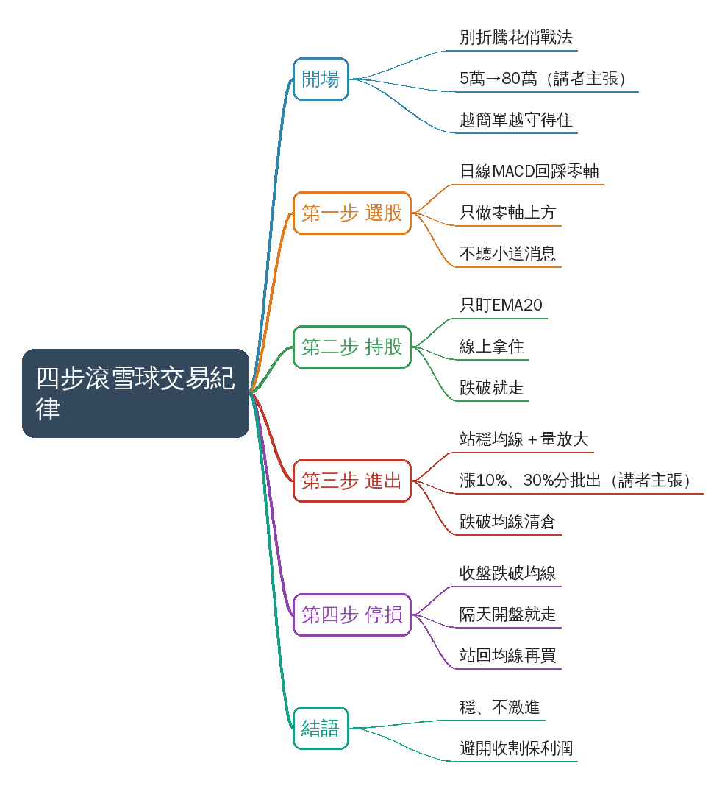
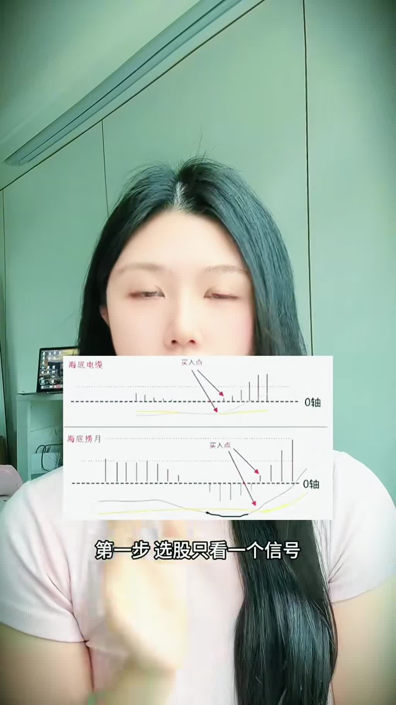

# 四步滾雪球：小資金三年從5萬做到80萬

- 來源：https://vm.tiktok.com/ZSpsroe8q/
- 平台 / 上傳者：TikTok / kiki84991
- 長度：01:14 (74.0s)
- 逐字稿來源：whisper (groq)
- 更新日期：2026-11-16
- **關鍵字：** #滾雪球 #交易紀律 #MACD #零軸回踩 #EMA20 #20日均線 #量價 #分批停利 #停損 #散戶

## 摘要與名詞說明

**一句話重點**：講者自稱早年以 5 萬元帳戶、三年做到 80 多萬（講者主張，未查證），分享一套給小資金散戶的四步交易紀律：選股只看日線 MACD 零軸上方回踩、持股只盯 EMA20（20 日均線）、進場看「價格站穩均線＋成交量放大」並分批停利、收盤跌破均線隔天開盤就走；核心是用簡單、可機械執行的規則取代消息與花俏戰法。

## 重點時間軸

| 時間 | 段落 | 重點 |
|---|---|---|
| 00:00 | 開場 | 帳戶只有幾萬元、沒找到穩定方法的人，別折騰花俏戰法，照四步慢慢滾雪球；5 萬三年做到 80 多萬（講者主張） |
| 00:20 | 第一步 選股 | 只看一個訊號：日線 MACD 回踩零軸；只做零軸上方的回踩，不聽消息 |
| 00:29 | 第二步 持股 | 只盯 EMA20（20 日均線）：線上拿住、跌破就走；偏保守但適合散戶 |
| 00:40 | 第三步 進出 | 價格站穩均線＋成交量同步放大才跟；漲 10% 出一部分、漲 30% 再出一部分；跌破均線全部清倉，回到第一步 |
| 00:54 | 第四步 停損 | 收盤價跌破均線，第二天開盤直接走；等重新站上均線再買回 |
| 01:04 | 結語 | 簡單到不能再簡單的交易紀律：穩、不激進，最容易避開被收割、保住利潤 |

## Claude 的備註（非影片內容）

- 第三步「跌破均線全部清倉」與第四步「收盤跌破均線、隔天開盤走」講的是同一個出場條件，差別在第四步明確以**收盤價**判斷、**隔日開盤**執行；實際操作可視為一條規則。
- 影片沒有說明：MACD 參數（常見為 12、26、9）、「回踩零軸」要多接近才算、成交量「放大」的門檻、分批停利各出多少比例，以及第三步的「均線」是否就是第二步的 EMA20。這些都要自行定義後回測。
- 均線停損在盤整行情容易反覆進出、被「洗」掉（多次小額虧損）；講者主張的報酬沒有交易紀錄、回測或勝率佐證（講者主張，未查證）。
- 畫面字幕為簡體，屬中國 A 股語境；套用到台股需另行評估。本報告不構成投資建議。

## 名詞說明

- **MACD**：指數平滑異同移動平均線；柱狀圖與 DIF／DEA 線以**零軸**為多空分界，在零軸上方代表短期均線高於長期均線。
- **回踩零軸**：MACD 從零軸上方回落靠近零軸，未跌破後再轉強；講者把它當唯一選股訊號。畫面示意圖另標「海底電纜」「海底撈月」兩種型態（見補充 S1）。
- **EMA20**：20 日指數移動平均線，比簡單均線更重視近期價格。
- **站穩／站上均線**：收盤價維持在均線之上。
- **清倉**：全部賣出持股。**收割**：散戶被主力或市場波動吃掉資金的比喻。

## 轉錄與校正備註

- 逐字稿來源：Groq Whisper（自動偵測中文，簡轉繁）；未帶詞典。全片有燒入的簡體字幕，已逐句核對。
- 依字幕更正：花裡無壽→花裡胡哨、就像我說的→就按我說的、漫漫過絕球→慢慢滾雪球、影片簡單收藏→影片點讚收藏、回菜→回踩、只遞一條線→只盯一條線、引力了→盈利了、全部行倉→全部清倉、收盤價跌回均線→如果收盤價跌破均線、占上→站上、這次股→這四步；「消息」被 OpenCC 轉成「訊息」，改回「消息」；詳見 `meta.json.known_asr_errors`。
- 一般短影音，非講座，未去語助詞。

## 補充資料（影片未呈現的資訊）


### S1｜畫面遺漏：標題卡與兩張示意圖的畫面文字
- 來源：影片畫面（標題卡 00:00–00:19；MACD 示意圖約 00:21–00:23；均線 K 線圖約 00:30–00:32）；取得日期：2026-11-16；取得方式：自影片截取原始解析度畫面逐字抄錄（簡體照錄）。對應截圖：`frames/slide_01.jpg`、`slide_02.jpg`、`slide_03.jpg`。
- 為何需要補充：標題卡的「四步滾雪球」與兩張示意圖上的型態名稱、均線標籤，講者都沒有唸出來。
**原文（逐字）**
```
（標題卡，00:00–00:19）
四步滚雪球
三年从5万做到80万

（第一步示意圖，00:21–00:23；上下兩格 MACD 柱狀圖）
上格：海底电缆　　　（畫面標：買入点 → 箭頭指向柱體回落到 0轴 附近後再翻紅處）　0轴
下格：海底捞月　　　（畫面標：買入点 → 同上）　0轴

（第二步示意圖，00:30–00:32；日 K 線＋三條均線）
5日均线
10日均线
20日均线
```
**Claude 的對照分析**
- 與影片一致：標題卡「三年从5万做到80万」與口述「五萬的帳戶……三年做到八十多萬」一致；第一步示意圖標「0轴」與口述「日線 MACD 回踩零軸」一致。
- 補充直接寫明（影片沒唸的）：方法名「四步滾雪球」；第一步的兩種型態名稱「海底電纜」「海底撈月」與「買入點」標記；第二步圖上同時畫了 5 日、10 日、20 日三條均線。
- 據此推定（非畫面直接寫明）：「海底電纜」「海底撈月」應是坊間對 MACD 在零軸附近回踩後再轉強的型態俗稱；第二步圖雖畫三條均線，講者只要求盯 20 日線（EMA20），圖中均線是否為 EMA 畫面未標。
**備註**
- 「5 萬做到 80 萬」為講者自述，未查證；影片沒有附交易紀錄或回測。「箭頭」等視覺描述為 Claude 加註。

## 思維導圖



- 原圖：[mindmap.png](mindmap.png)；文字大綱：[mindmap.md](mindmap.md)（與本報告同資料夾）

## 圖文對照（畫面 + 逐字稿）

### 投影片 1：開場：小帳戶別折騰花俏戰法（00:00–00:20）


**重點：** 講者對帳戶只有幾萬元、還沒找到穩定方法的散戶喊話：別再折騰花裡胡哨的戰法，照這四步慢慢滾雪球。講者自述早年用 5 萬元帳戶反覆驗證這套方法，三年做到 80 多萬（講者主張，未查證）。強調方法越簡單越能堅持、越不會跑偏，建議收藏後交易時照著做。

**標籤：** #滾雪球 #5萬到80萬 #交易紀律

如果你的帳戶只有幾萬塊，沒找到穩定的方法，聽我一句勸，別再折騰那些花裡胡哨的戰法了，就按我說的這四步走，慢慢滾雪球，我早年拿過一個五萬的帳戶，就靠這套方法反覆驗證，三年做到八十多萬，方法不複雜，但越簡單，你越能堅持得住，或者說不會跑偏，影片點讚收藏，交易時翻出來照著做就可以，說回正題。

### 投影片 2：第一步：選股只看 MACD 回踩零軸（00:20–00:29）



**重點：** 選股只看一個訊號：日線 MACD 回踩零軸，其他都不看、也不聽消息。只做零軸上方的回踩（即 MACD 仍在零軸之上、回落靠近零軸後再轉強的型態）。講者主張技術指標擺在那，比任何小道消息都可靠。

**標籤：** #MACD #零軸回踩 #選股

第一步，選股只看一個訊號，日線MACD回踩零軸，別的都不看，也別聽消息，只做零軸上方的回踩，技術指標擺在那，比什麼小道消息都靠譜。

### 投影片 3：第二步：操作只盯 EMA20 一條線（00:29–00:40）


**重點：** 持股期間只盯一條線：EMA20，也就是 20 日均線。股價在線上就拿住，跌破就走。講者承認這個做法偏保守，但認為連保守都做不好的人，玩別的方法只是送錢。

**標籤：** #EMA20 #20日均線 #持股

第二步，操作只盯一條線，EMA20也就是20日均線，線上就拿住，跌破就走，這個做法有點保守，但說實話，連保守都做不明白，玩別的就是送錢。

### 投影片 4：第三步：進出時機看價格與成交量（00:40–00:54）


**重點：** 進場看兩件事：價格站穩均線、成交量同步放大，兩者同時成立才跟進。獲利後分批兌現：漲 10% 先出一部分、漲 30% 再出一部分；一旦價格跌破均線就全部清倉，回到第一步重新找標的。分批比例為講者個人做法，未查證效果。

**標籤：** #量價 #分批停利 #清倉

第三步，進出時機看兩個東西，價格和成交量，價格站穩均線，成交量同步放大就可以跟，盈利了分批兌現，漲10%出一部分，漲30%再出一部分，一旦價格跌破均線，全部清倉，再回到第一步重新找目標。

### 投影片 5：第四步：收盤跌破均線，隔天開盤就走（00:54–01:04）


**重點：** 如果收盤價跌破均線，第二天開盤直接出場，不要猶豫；講者說猶豫一秒都可能虧掉所有利潤。市場不會關門、機會永遠都有，等股價重新站上均線再買回來即可——用紀律取代對單一部位的執著。

**標籤：** #停損 #收盤價 #紀律

第四步，如果收盤價跌破均線，第二天開盤直接走，別猶豫，猶豫一秒都可能虧掉所有利潤，市場不關門，機會永遠有，等股價重新站上均線，再買回來就行。

### 投影片 6：結語：簡單、穩、不激進的交易紀律（01:04–01:14）


**重點：** 講者總結這四步是一套簡單到不能再簡單的交易紀律，談不上聰明，但穩、不激進；對散戶來說，這才是最容易避開被收割、保住利潤的路子（講者主張，未查證）。

**標籤：** #散戶 #避開收割 #保住利潤

這四步就是一套，簡單到不能再簡單的交易紀律，談不上多聰明，但它穩、不激進，對散戶來說，這才是最容易避開收割，保住利潤的路子。

## 已知轉錄錯誤

| 時間 | 聽成 | 應為 |
|---|---|---|
| 00:03 | 花裡無壽 | 花裡胡哨（畫面字幕） |
| 00:05 | 就像我說的這四步走 | 就按我說的這四步走（畫面字幕） |
| 00:06 | 漫漫過絕球 | 慢慢滾雪球（畫面字幕） |
| 00:16 | 影片簡單收藏 | 影片點讚收藏（畫面字幕「視頻點贊收藏」） |
| 00:24 | 也別聽訊息／小道訊息 | 也別聽消息／小道消息（字幕「消息」；OpenCC 轉成訊息） |
| 00:25 | 回菜 | 回踩（畫面字幕） |
| 00:29 | 只遞一條線 | 只盯一條線（畫面字幕） |
| 00:46 | 引力了 | 盈利了（畫面字幕） |
| 00:52 | 全部行倉 | 全部清倉（畫面字幕） |
| 00:55 | 收盤價跌回均線 | 如果收盤價跌破均線（畫面字幕） |
| 01:02 | 重新占上均線 | 重新站上均線（畫面字幕） |
| 01:04 | 這次股就是一套 | 這四步就是一套（畫面字幕） |

## 補充資料連結

- 補充資料檔：[supplement.md](supplement.md)（與本報告同資料夾；內容已收錄於上方〈補充資料〉）
- 思維導圖：[mindmap.png](mindmap.png)、文字大綱：[mindmap.md](mindmap.md)（與本報告同資料夾）
