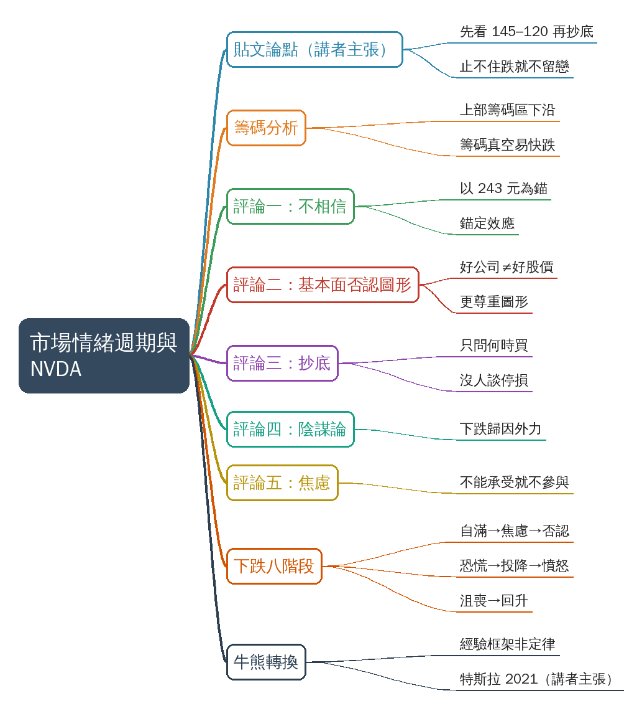
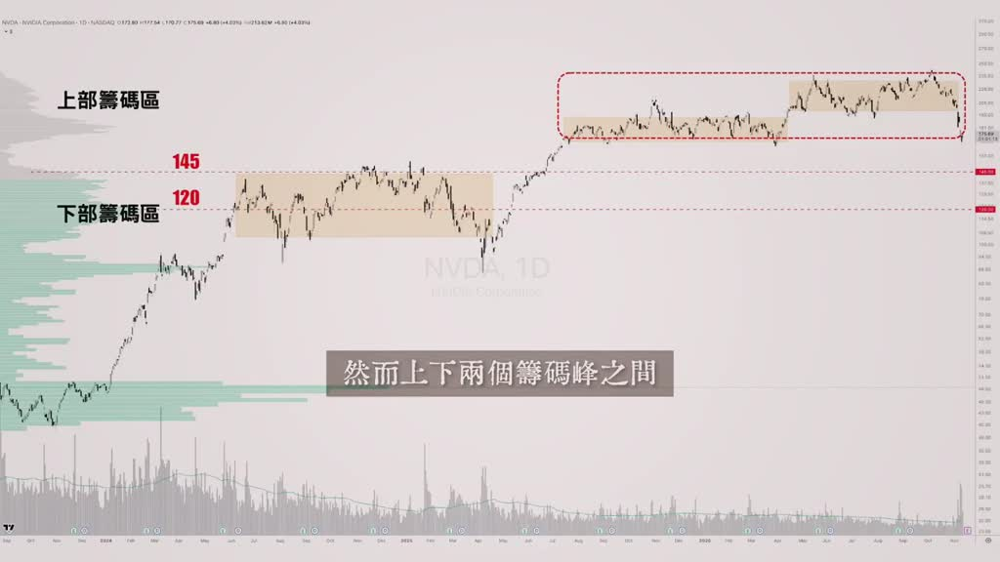
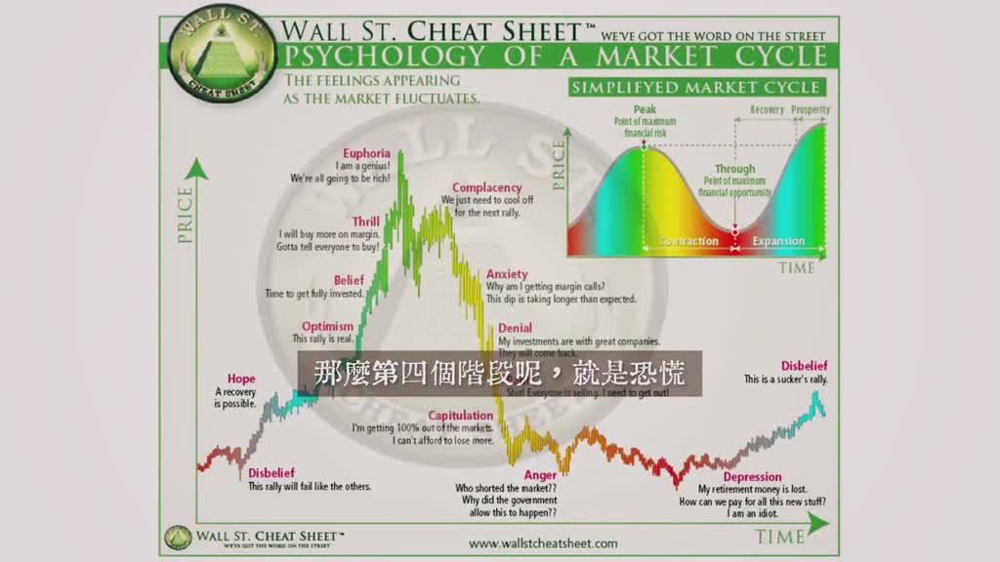

# LEI - 這麼多人看好 $NVDA ，這下麻煩了！ 你需要理解市場情緒週期 Psychology of market cycle

- 來源：https://x.com/TheMarketMemo/status/2120720742681825713?a=__dBiozNPgjKESJJsgE&s=19
- 平台 / 上傳者：X / LEI
- 長度：09:49 (589.4s)
- 逐字稿來源：captions (zh, manual, original)
- 更新日期：2026-11-18
- **關鍵字：** #股市投資 #NVDA #市場情緒週期 #籌碼分布 #錨定效應 #抄底 #LEI #Wall St Cheat Sheet

## 摘要與名詞說明

**一句話重點**：講者（LEI，X 帳號 TheMarketMemo）以自己一則「輝達跌到 145–120 才考慮抄底」的貼文，整理評論區五類反應，說明大家都在問「何時買」卻無人談風險與停損，並用八階段市場情緒週期指出評論像處於「否認」階段（以下價位與預測為講者主張，未查證；非投資建議）。

| 時間 | 重點 |
|---|---|
| 00:00 | 開場：分享貼文與市場情緒週期 |
| 00:28 | 145–120 為下方大籌碼峰；上下籌碼峰間為籌碼真空（講者主張） |
| 02:12 | 評論一「不相信」：以 243 元為錨，覺得已便宜（錨定效應） |
| 03:17 | 評論二：用基本面否認圖形；好公司≠好股價，基本面不可用來做交易（講者信條） |
| 04:34 | 評論三：抄底；無人談減倉與停損 |
| 05:10 | 評論四：陰謀論與政治敘事＝把下跌歸因外力 |
| 05:57 | 評論五：焦慮；選擇待在指數是清醒的 |
| 06:31 | 下跌八階段：自滿→焦慮→否認→恐慌→投降→憤怒→沮喪→回升 |
| 08:46 | 牛熊轉換；2021 年特斯拉見頂類比（講者主張，未查證） |

## 名詞與縮寫

- **籌碼峰／籌碼真空**：成交量在各價位累積的分布高峰；兩峰之間幾乎沒有成交的價格帶。
- **錨定效應**：以某個參考價（如 243 元）決定「多少算便宜」。
- **市場情緒週期**：影片使用 Wall St. Cheat Sheet「Psychology of a Market Cycle」圖。
- **英偉達**：即輝達（NVIDIA）；字幕為中國用語，保留原文。

## 轉錄校正備註

- 逐字稿來源為 X 平台字幕（翻譯字幕），非 Whisper；不需中譯。
- 已校正：籌碼風→籌碼峰、滯滿→自滿（對照圖上 Complacency）、三角到山頂→山腳到山頂（推測）、過度籌碼→過渡籌碼（推測）。

- 第二輪逐行重讀（2026-11-21）：修正 1 處，細節見 meta.json 的 known_asr_errors。

## 思維導圖

- 原圖：[mindmap.png](mindmap.png)；文字大綱：[mindmap.md](mindmap.md)（與本報告同資料夾）

## 圖文對照（畫面 + 逐字稿）

### 主題 1：開場：分享一則貼文與市場情緒週期（00:00–00:28）

**重點：** 講者（LEI）說明這支影片要分享自己的一則貼文，並探討「市場情緒週期」這個嚴肅話題；貼文主旨是輝達（英偉達，NVDA）這波下跌先看 145 到 120，想抄底要等見底跡象，若在此止不住跌，可能代表股票已被市場拋棄。

**標籤：** #NVDA #貼文 #市場情緒週期

哈嘍大家好，今天這支影片呢我想給大，家來分享我的一條貼文，呃一種分析方法然後呢，我們來探討一個非常嚴肅的話題，叫做市場情緒週期，先來看我這條貼文，貼文大致的意思就是說，英偉達，這一波下跌先看到 145 到 120，如果想抄底的話呢，要在這個區間等到見底跡，象出來之後再動手，如果說這個位置止不住跌，有可能說明這隻股票已經，被市場拋棄了。

### 主題 2：為什麼看 145–120：籌碼區與籌碼真空（00:28–02:12）

**重點：** 講者主張股價已在上部籌碼區下沿，2025 年 7 月以來買進者全數套牢；下方較大籌碼峰約在 145–120，價格往下走阻力越來越大、在此抄底勝算較高。上下兩個籌碼峰之間是「籌碼真空」，一旦跌破上部籌碼峰就可能快速下探。他強調籌碼是直觀、客觀的指標、可視為公允價值區間，貼文只是陳述現況而非判斷（講者主張）。

**標籤：** #籌碼峰 #籌碼真空 #公允價值

就不要再留戀了為什麼說，這波下跌要看到 145 到 120，呢是因為目前英偉達的股價已經，位於，上部籌碼區的下沿，這表明所有在 2025 年 7 月以來到現在，買入英偉達股票的投資者，全部套牢了當前價下方較，大的籌碼峰位置，大概就是在 145 到 120 之間，從這個山腳到山頂的這一，段價格區間，確切地說，當價格跌到一百四十五附近，往一百二十下跌的過程當，中這個阻力啊，會越來越大，那麼如果說你看好英偉達，那麼，如果說是在這個位置附近抄底，你的勝算是比較大的，然而上下兩個籌碼峰之間啊，是沒有過渡籌碼的我們叫，做籌碼真空，這意味著一旦價格跌破了，上部籌碼峰之後啊，就會快速下跌到一百四十，五到一百二十之間，中間是沒有什麼阻力的，那麼籌碼呢是一個，非常直觀，並且是非常客觀的一個指標，籌碼密集的地方，就是有很多人在這裡換手，換句話說，你也可以把這種，籌碼峰啊看作是一個，公允價值區間那麼這條貼文呢，只是說，把我看到的一些資訊啊，記錄下來，給大家做參考我相信有很，多網友其實，並不瞭解，這種觀察方式我並不是在做判斷，而是客觀地，陳述當前市場上存在的現實情況，那麼這條貼文呢，有十幾萬的瀏覽量，那麼下面有四十多條認證，使用者的評論，讓我沒有想到的是，會有如此一邊倒的傾向，我覺得這個是值得拿出來，給大家分享一下的。

### 主題 3：第一類評論：不相信（錨定效應）（02:12–03:17）

**重點：** 貼文有十幾萬瀏覽、四十多則認證用戶評論，傾向一邊倒。聲量最大的是「不相信」：說被市場拋棄太誇大、只有財報與指引全下調才會跌到 145、短期只會在夢裡。講者指出這些評論在討論「可能性」而非對錯，因為大家的參考點是 243 元高點，從 243 跌到約 168–170 已跌三成就覺得便宜，這就是錨定效應。

**標籤：** #錨定效應 #243元高點 #評論

那麼我把評論呢分成幾類第一類，也是，這個聲音最大的一類就是不相信，啊點贊數最高的評論說，光憑走勢就說被市場拋棄這個結論，太誇大了點贊數第二高的評論說，英偉達只有一種情況會跌，到 145 那就是財報和指引，全部下調但可能性很低還有人說，這個價格短期只能出現在夢裡，請注意啊，這些評論，並沒有在討論，我說的對不對他們在討論，這件事情的可能性啊可不可能發生，結論是，不可能發生為什麼覺得不可能呢，是因為大家心裡的參考點，是那個 243 元的那個高點，從 243 元跌到，168 170 已經跌了三成了差不多，所以很多人，認為已經很便宜了，他們認為再往下跌到 145 根，本想象不到，這就是，我之前有一個影片講的叫做，錨定效應你的價格參考點決定了，你會認為什麼樣的價格是便宜的，而這個參考點。

### 主題 4：第二類評論：用基本面否認圖形（03:17–04:34）

**重點：** 有人說輝達是印鈔機、AI 需求走出這樣的 K 線、護城河沒變。講者承認它是好公司，但好公司與好股價是兩回事；股價是對未來預期的定價，預期太滿而業績達不到，好公司照樣大跌。他的信條是「基本面不可以用來做交易」，基本面與圖形矛盾時更尊重圖形，因為圖形就是市場的看法（講者主張）。

**標籤：** #好公司≠好股價 #基本面 #圖形

本身可能就是錯的第二類呢就是說，拿基本面去否認圖形分析，有人說，這是一臺瘋狂加速的印鈔機，有人說英偉達，不是靠 K 線走上來的是，AI 巨大的需求走出了這樣的 K 線，還有人說英偉達的護城河沒變，英偉達的產品是 AI 的硬通貨，我不否認英偉達是一家好公司啊，但這裡有一個混淆就是好公司和，好股價，是兩回事情好公司，和股價會不會跌是兩回事情，股價是對市場未來預期的定價，預期如果說，定得太滿太高，但是公司達不到業績的時候，好公司照樣可以大跌那，歷史上這種例子太多了那，麼我有一個信條叫做，基本面不可以用來做交易，這個信條的反面就是說，當基本面，和圖形發生矛盾的時候你，認為基本面依然非常好，但是這個股價就是開始往，下跌的時候，怎麼辦，我，會更尊重圖形，那麼經常有些網友問我說，這個怎麼怎麼看那個怎麼看，其實最重要的你要學會，理解市場的看法，那麼圖形，就是市場的看法。

### 主題 5：第三類評論：抄底（04:34–05:10）

**重點：** 有人說到 120 就舒服了必須抄底、現在是黃金坑、輝達雙十一打折不買十年後後悔。講者觀察整個評論區幾乎沒人討論該不該減倉、有沒有風險、停損放哪，所有問題都是「什麼時候買」，他認為這非常危險。

**標籤：** #抄底 #停損 #風險

第三類評論呢就是說抄底啊有人說，能到一百二就舒服了那必須抄底，有人會說，看營收的話那麼現在就是，一個黃金坑還有人說，英偉達雙十一打折，現在不買，那麼十年後再後悔就來不及了，你會發現整個評論區，幾乎沒有人在討論，該不該減倉有沒有風險也沒有人在，討論說萬一股價跌到什麼位置我，需要把停損放在哪裡，所有的問題現在都是同一個方向，什麼時候買我認為這是非常非常。

### 主題 6：第四類評論：陰謀論與政治敘事（05:10–05:57）

**重點：** 有人說是民主黨大佬發動輿論戰先做空再抄底、提醒要計入輝達的政治屬性、甚至扯到黃仁勳個人事件。講者解讀這類說法背後的心理是把下跌歸因於外力、暫時、與公司無關，歸給別人搞鬼就能忽視趨勢已轉弱。

**標籤：** #陰謀論 #歸因外力 #趨勢轉弱

危險的第四類就是用陰謀論和，政治敘事解釋這個下跌有人說，這是民主黨大佬們發動的輿論戰，他們會先做空然後，等價格跌下來再抄底，那麼也有人提醒說不要忘記，計算英偉達的政治屬性，還有人扯到，什麼黃仁勳本人的事件說，白人不相信黃種人不相信，亞洲人然後去扶持英特爾然後，這種說法背後的心理，就是說，下跌，是外力造成的是暫時的，跟公司本身沒關係只要把下跌，歸因到別人的責任上別人在搞鬼，就可以忽視，好像這個趨勢，已經轉弱了這樣的一個現實。

### 主題 7：第五類評論：少數人的焦慮（05:57–06:31）

**重點：** 少數人問「真的會這麼嚴重嗎」、說太嚇人，並提到 11 月 17 日輝達財報、怕跳空下跌扛不住，所以乖乖待在指數裡。講者認為這位網友是整個評論區最清醒的人之一，因為知道自己承受不了什麼風險而選擇不參與，這比任何抄底技巧都重要（講者主張）。

**標籤：** #焦慮 #財報跳空 #風險承受

第五類呢就是說，少數人的焦慮和不確定有人問，真的會這麼嚴重嗎，有人說，太嚇人了，還有人提到，這個 11 月 17 號馬上要發布，的這個英偉達的財報，說這個，財報這種跳空，萬一跳空下跌自己扛不住，那麼還是乖乖地待在指數，裡頭我想說誒，這位網友，是整個評論區當中，最清醒的人之一他知道自己，承受不了什麼風險所以選擇不參與，這比任何抄底技巧都重要。

### 主題 8：市場情緒週期：下跌的八個階段（06:31–08:46）

**重點：** 講者用 Wall St. Cheat Sheet 的情緒週期圖，說明見頂下跌分八階段：①自滿（回落當正常回調）②焦慮（仍堅持、加倉攤平）③否認（說基本面沒問題、被操縱，貼文評論就像這階段）④恐慌（停損盤與被迫平倉）⑤投降（成交量最大、跌最猛）⑥憤怒（怪別人怪機構）⑦沮喪（低位反覆摩擦、無人關心，真正的底在此走出）⑧回升（多數人只當死貓跳，新一輪上漲在懷疑中展開）。

**標籤：** #情緒週期 #自滿 #否認 #投降 #沮喪

所以說到這裡呢我就想來，聊一聊市場情緒週期這個話題，現在我們看到的這張圖呢，描繪的就是市場情緒週期，市場見頂下跌的過程當中，共分成八個階段，第一個階段是下跌初期的自滿，剛剛從高點回落那麼大家，只覺得這是一個，嗯這是一個正常的回撥，那麼好公司跌一跌是很正常的，第二個階段呢就是焦慮，這個時候呢，跌幅已經擴大了，那麼開始有點兒不舒服了，但是呢很多人還是堅持，啊我要持有啊甚至，有些人會去加倉攤平，那麼第三個階段就是否認，這個，這個時候這個跌勢已經比較明顯了，但是很多人依然，啊，不肯承認，這個趨勢已經轉弱了那麼大家會說，基本面沒問題啊這是被操縱的呀，不可能跌到那個，那麼多啊是不是那麼，抄底的意願依然是非常強的，那麼前面我這條貼文下面的評論啊，基本上反映出來的，就有點像這個階段，那麼第四個階段呢就是，恐慌急跌加上某些利空訊息那麼，止損盤和被迫平倉的人大量的出現，開始不計成本的拋售，成交量逐漸放大，那麼第五個階段呢，就是所謂的投降階段，最後一批堅定的人，也放棄了那大家會說，再也不碰這隻股票了要割肉離場啊，這個階段往往是成交量最大，跌是最猛的一段第六個階段呢就是，表達出一種憤怒，很多人忍痛割肉之後他們就開始，抱怨別人怪別人都是別人的錯，那不是我的錯是公司的錯，是這些機構這些主力在搞鬼，怪這些分析師分析得不靠譜甚至呢，怪自己當初，信錯了人那麼第七個階段呢就是，沮喪階段那麼股價在低位反覆摩擦，已經沒有人在討論了沒有人關心，那麼交易清淡，真正的底部其實就是在這，個階段逐漸走出來的，第八個階段呢就是價格開始回升，但是大多數人，不會相信的，只是覺得啊這就是一個死，貓跳對吧或者說，有些人會說我在等第二次探底，然而，新一輪的上漲往往就是在，這個懷疑過程當中。

### 主題 9：牛熊轉換、特斯拉案例與結語（08:46–09:49）

**重點：** 之後進入牛市情緒週期：希望、樂觀、信仰、極度興奮到狂熱見頂，構成完整牛熊轉換。講者強調這是經驗框架而非定律，實際會在階段間來回跳躍；並說 2021 年 11 月曾用同樣邏輯指出特斯拉見頂跡象，其後股價跌超過七成（講者主張，未查證）。今天的輝達未必走同樣的路，但人類貪婪與恐懼的本性不會變。

**標籤：** #牛熊週期 #特斯拉2021 #貪婪恐懼

逐漸開展起來的之後呢又會進入，牛市的情緒週期人們開始，充滿希望啊，逐漸的這種樂觀情緒出現啊，然後開始出現，信仰啊對不對然後最後是，極度興奮再到狂熱見頂，這就是一個完整的，牛熊轉換週期當然了這是一個，經驗框架它不是一個定律，實際的走勢呢有可能會在某一些，某幾個階段之間來回跳躍來回反覆，但是這個框架本身，它對我們理解市場參與者的情緒，是有非常大的幫助的，記得在 2021 年 11 月，那個時候特斯拉快要見頂的時候啊，我也是用同樣的這種分析邏輯指出，特斯拉，當時有見頂的跡象，事後回頭看，這個散戶資金瘋狂湧入之後啊，特斯拉見頂，那麼此後那個股價呢也是，大跌了超過百分之七十當，然今天的英偉達未必會走一樣的路，但是呢人類貪婪恐懼，這種本性啊是永遠不會變的。

## 已知轉錄錯誤

| 時間 | 聽成 | 應為 |
|---|---|---|
| 00:52 | 從這個三角到山頂 | 山腳到山頂（推測） |
| 01:12 | 沒有過度籌碼 | 沒有過渡籌碼（推測） |
| 01:36 | 籌碼風 | 籌碼峰 |
| 06:42 | 下跌初期的滯滿 | 自滿（對照情緒週期圖 Complacency） |
| 全片 | 平台字幕（翻譯字幕）；用語為中國用法（英偉達＝輝達、止損＝停損） | 保留原用語，不強改 |
| 06:07 | 馬上要釋出的財報 | 馬上要發布的財報（第二輪；其餘行重讀無誤） |

## 補充資料連結

- 思維導圖：[mindmap.png](mindmap.png)、文字大綱：[mindmap.md](mindmap.md)（與本報告同資料夾）
