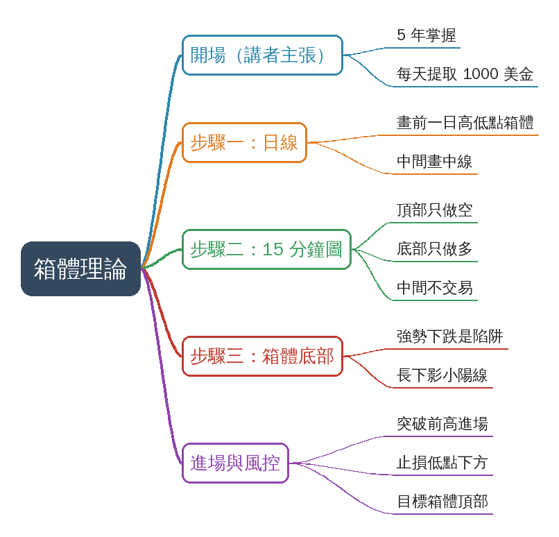
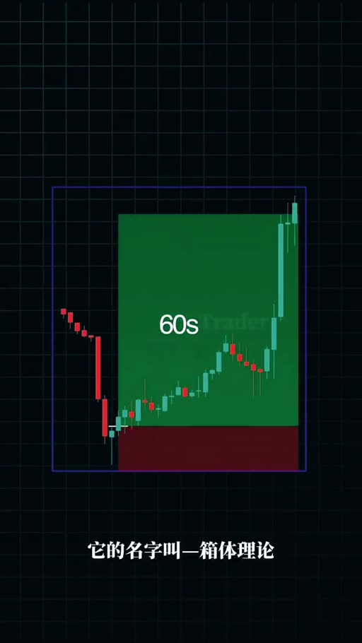
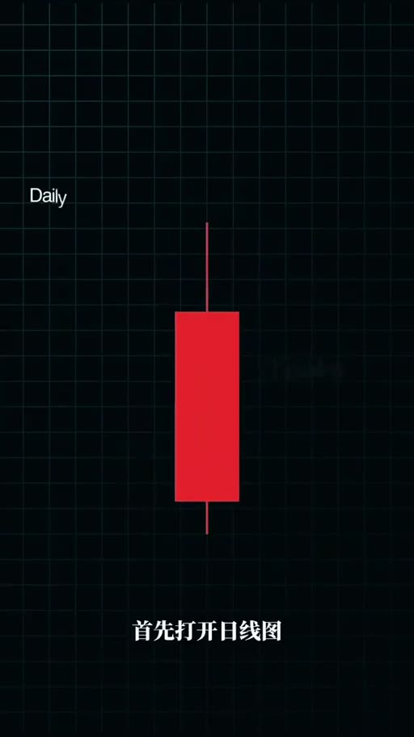
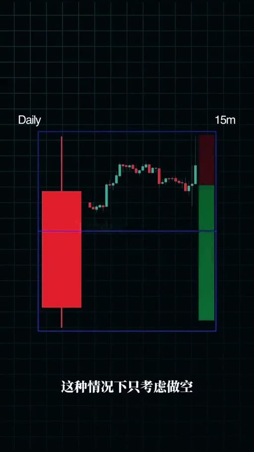
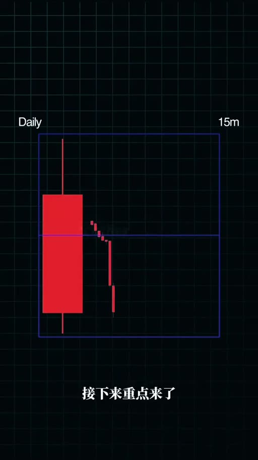
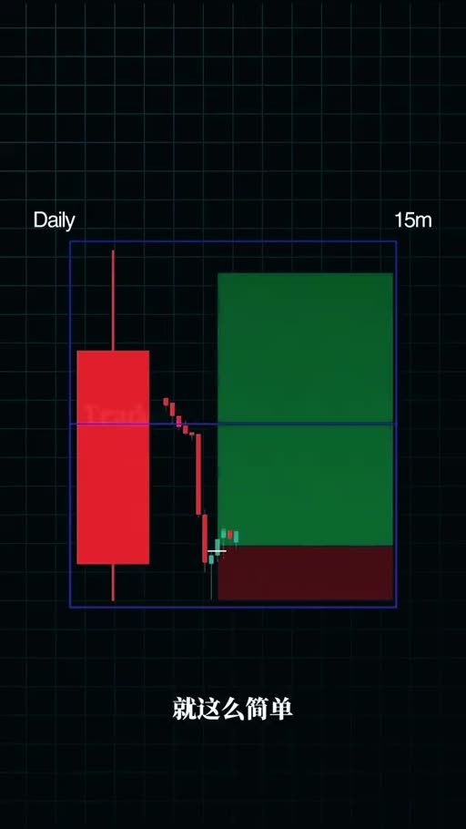

# 5年才學會的交易秘密

- 來源：https://vm.tiktok.com/ZSpovWFc2/
- 平台 / 上傳者：TikTok / caijun167
- 長度：01:21 (80.6s)
- 逐字稿來源：whisper (groq)
- 更新日期：2026-11-21
- **關鍵字：** #箱體理論 #日線 #15分鐘圖 #期貨 #進場訊號 #止損 #機構方向 #技術分析

## 摘要與名詞說明

**一句話重點**：講者（caijun167）說她花 5 年掌握「箱體理論」：在日線把前一日高低點畫成箱體，再到 15 分鐘圖依價格在箱體的位置決定只做多或只做空，箱體底部出現強勢下跌多半是陷阱，等長下影小陽線並突破前高進場，止損放低點下方、目標看箱體頂部（以下策略與每天賺 1000 美金等說法皆為講者所述，未查證；非投資建議）。

| 時間 | 重點 |
|---|---|
| 00:00 | 開場：箱體理論，5 年才掌握（講者主張） |
| 00:15 | 步驟一：日線畫前一日高低點箱體＋中線 |
| 00:25 | 步驟二：15 分鐘圖——頂部只做空、底部只做多、中間不做 |
| 00:46 | 步驟三：箱體底部的強勢下跌常是陷阱 |
| 00:59 | 進場：長下影小陽線＋突破前高；止損低點下方；目標箱體頂部 |

## 領域判斷

- 使用者指定 `投資理財`；載入 `stock-investing` 詞典。

## 轉錄校正備註

- 逐字稿為 Groq Whisper（中文，已轉繁體）；影片為直式動畫，畫面有燒入字幕可對照。
- 確定（畫面字幕）：相體→箱體。
- 推測：箱體頂部那句「說明買方掌控市場」應為「賣方」（頂部→只做空，與底部那句對稱）。
- 待確認：「雙維 candle」的名稱（描述為小陽線帶很長下影線）。
- 第二輪：全文 22 行已逐行重讀。

## 思維導圖

- 原圖：[mindmap.png](mindmap.png)；文字大綱：[mindmap.md](mindmap.md)（與本報告同資料夾）

## 圖文對照（畫面 + 逐字稿）

### 主題 1：開場：5 年才掌握的「箱體理論」（00:00–00:15）

**重點：** 講者說她花了整整 5 年才真正掌握這套策略，會在 60 秒內講清楚；這是她最大一筆交易背後的核心秘密，穩定到每天都在用，並稱靠它每天從期貨市場提取 1000 美金，名字叫「箱體理論」（講者主張，未查證）。

**標籤：** #箱體理論 #期貨 #核心秘密

我花了整整5年，才真正掌握這套策略，但今天，我會在60秒內講清楚，這是我那筆最大交易背後的核心秘密，而且它穩定到我每天都會使用，甚至靠它每天從期貨市場提取1000美金，它的名字叫箱體理論。

### 主題 2：步驟一：日線畫出前一日高低點的箱體與中線（00:15–00:25）

**重點：** 先開日線圖，把前一天的高點和低點畫成一個箱體，中間再畫一條中線，不需要絕對精準、目測即可；這個箱體會告訴你當前市場到底是誰在掌控（講者主張）。

**標籤：** #日線 #箱體 #中線

首先，開啟日線圖，把前一天的高點和低點畫成一個箱體，然後在中間畫一條中線，不需要絕對精準目測即可，這個箱體會告訴你，當前市場到底是誰在掌控。

### 主題 3：步驟二：切到 15 分鐘圖，依價格位置決定多空（00:25–00:46）

**重點：** 價格運行在箱體頂部，說明賣方掌控市場，只考慮做空、目標看向箱體底部；運行在箱體底部，說明買方掌控，只考慮做多、目標看向箱體頂部；處於箱體中間就什麼都別做。這樣交易的就是機構方向，而不是隨便亂進場（講者主張，未查證）。

**標籤：** #15分鐘圖 #做多做空 #機構方向

接下來切換到15分鐘圖，如果價格執行在箱體頂部，說明賣方掌控市場，這種情況下只考慮做空，目標看向箱體底部，如果價格執行在箱體底部，說明買方掌控市場，這種情況下只考慮做多，目標看向箱體頂部，如果價格處於箱體中間，那就什麼都別做，這樣一來，你交易的就是機構方向，而不是隨便亂進場。

### 主題 4：步驟三：箱體底部的強勢下跌往往是陷阱（00:46–00:59）

**重點：** 重點來了：價格到箱體底部時，等待市場出現一波強勢下跌；多數交易者此時會恐慌、以為要崩盤，但她說這只是個陷阱（講者主張，未查證）。

**標籤：** #陷阱 #恐慌 #箱體底部

接下來重點來了，當價格來到箱體底部時，等待市場出現一波強勢下跌，大部分交易者這時候會開始恐慌，他們會以為市場馬上要崩盤，但實際上，這只是一個陷阱，如何確認這是陷阱？

### 主題 5：進場訊號、止損與目標（00:59–01:21）

**重點：** 如何確認是陷阱：觀察一根帶很長下影線的小陽線（逐字稿寫「雙維 candle」，名稱待確認），意味著流動性已被製造出來、買方開始進場；隨後等價格突破前一根 K 線高點，就是「狙擊進場位」，止損放在低點下方，目標直接看向箱體頂部。結語：把策略存下來，自己復盤、測試並實踐（講者主張；非投資建議）。

**標籤：** #長下影線 #突破前高 #止損 #復盤

觀察所謂的雙維candle,也就是一根小陽線，並帶著很長的下影線，這意味著流動性已經被製造出來，同時買方已經開始進場，隨後等待價格突破前一根K線高點，這裡就是你的狙擊進場位，止損放在低點下方，目標直接看向箱體頂部，就這麼簡單，把這個策略儲存下來，自己去復盤，測試並實踐。

## 已知轉錄錯誤

| 時間 | 聽成 | 應為 |
|---|---|---|
| 00:12 | 相體理論／相體 | 箱體理論／箱體（畫面字幕「箱体理论」確認） |
| 00:29 | （箱體頂部）說明買方掌控市場 | 說明賣方掌控市場（頂部→只做空，語意推測） |
| 00:59 | 雙維candle | 名稱無法確定（描述為「小陽線帶很長下影線」），保留原句待確認 |

## 補充資料連結

- 思維導圖：[mindmap.png](mindmap.png)、文字大綱：[mindmap.md](mindmap.md)（與本報告同資料夾）
