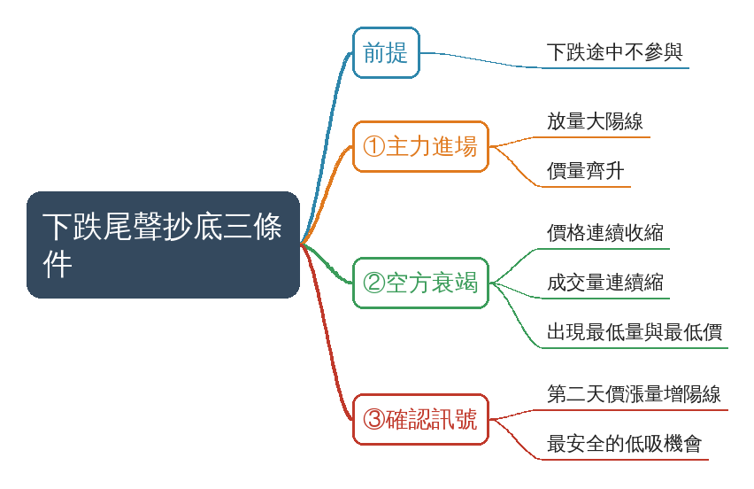
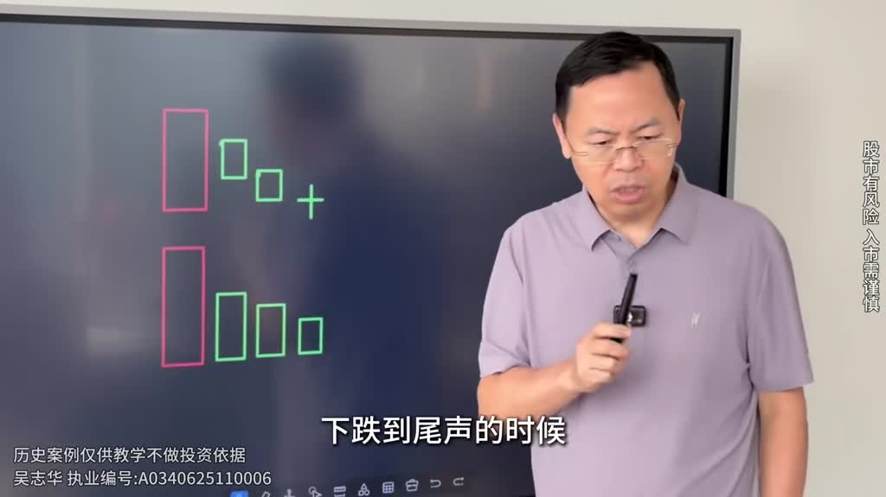
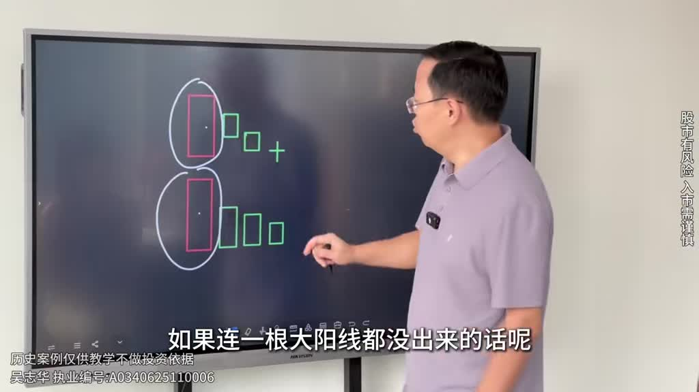
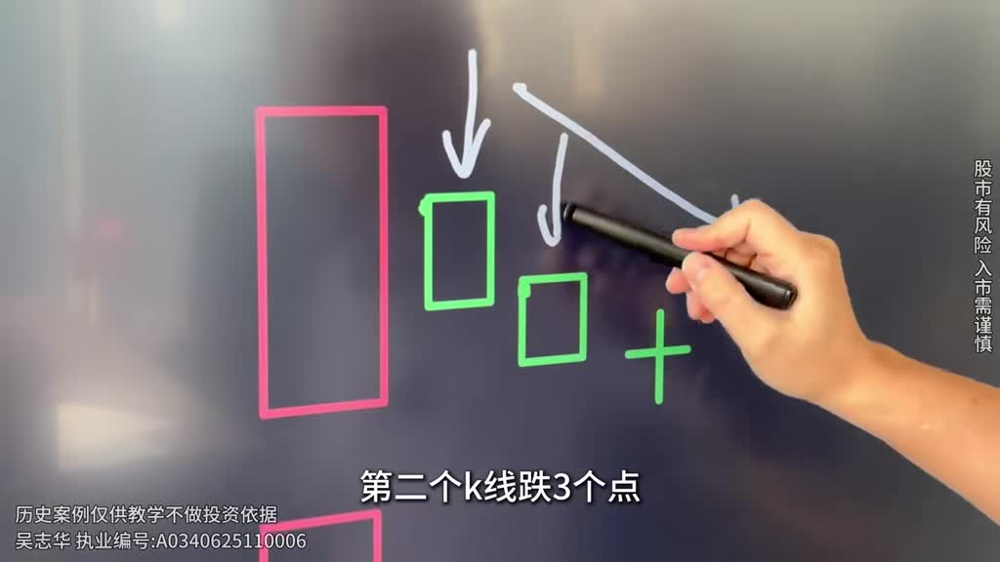
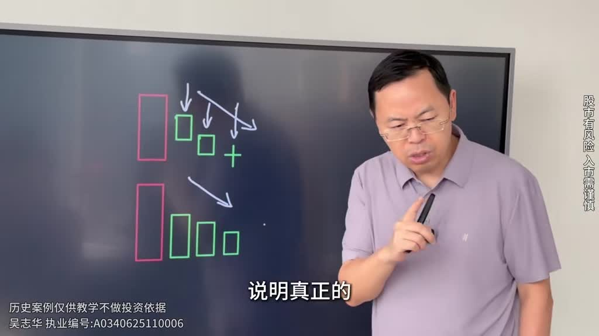
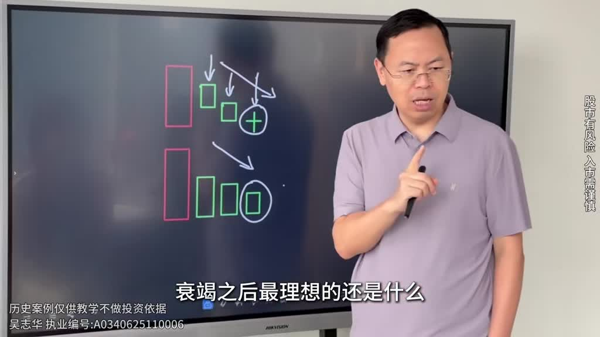
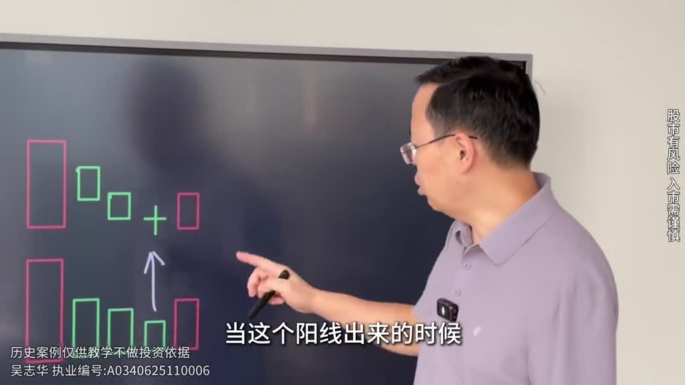

# 股票

- 來源：https://vt.tiktok.com/ZSpoFQDJq/
- 平台 / 上傳者：TikTok / linconpltsd
- 長度：01:45 (104.7s)
- 逐字稿來源：whisper (groq)
- 更新日期：2026-11-21
- **關鍵字：** #股票 #技術分析 #抄底 #縮量 #價漲量增 #主力 #衰竭 #K線

## 摘要與名詞說明

**一句話重點**：講者主張下跌途中不能參與，要等下跌尾聲同時出現三個條件才低吸：①主力進場（放量大陽線）；②空方衰竭（價格連續收縮、成交量同步收縮，出現最低量與最低價）；③確認訊號（最安全是第二天價漲量增的陽線）。以上為講者主張，未查證；影片畫面標示為教學用、不作投資依據，非投資建議。

| 時間 | 重點 |
|---|---|
| 00:00 | 下跌途中不參與，因為不知道底在哪 |
| 00:12 | 條件一：主力進場——價量齊升的放量大陽線 |
| 00:29 | 條件二（一）：價格連續收縮（跌 5→3→1 個點的舉例） |
| 00:48 | 條件二（二）：成交量也連續縮，出現最低量與最低價＝衰竭 |
| 01:14 | 條件三：衰竭後等確認訊號 |
| 01:19 | 第二天價漲量增的陽線最安全 |

## 領域判斷

- 歸 `投資理財`（沒有指定領域；標題只有「#股票」，內容為股票技術分析，載入 `stock-investing` 詞典）。

## 轉錄校正備註

- 逐字稿為 Groq Whisper（中文，已轉繁體），中文口音造成多處誤辨；畫面燒入簡體字幕，可對照。
- 確定（畫面字幕佐證）：大洋線→大陽線、摔跌→衰竭。
- 推測：主力城堡→主力進場、你才能夠利息→你才能夠低吸、阻力入場後→主力入場後、第二個天線／第三天線→第二個K線／第三個K線、路程機會→入場機會、低息機會→低吸機會。
- 「最理想的是轉平板」語意不清，保留原句待確認。
- 第二輪：全文 29 行已逐行重讀。

## 思維導圖

- 原圖：[mindmap.png](mindmap.png)；文字大綱：[mindmap.md](mindmap.md)（與本報告同資料夾）

## 圖文對照（畫面 + 逐字稿）

### 主題 1：開場：下跌途中不參與，等下跌尾聲的三個條件（00:00–00:12）

**重點：** 講者（畫面標示為證券從業者，附「歷史案例僅供教學、不作投資依據」字樣）說下跌途中不能參與股票，因為你永遠不知道底在哪裡；要等到下跌尾聲出現三個核心條件才能低吸（講者主張，未查證）。

**標籤：** #下跌 #抄底 #三個條件

下跌途中是不能夠參與股票的，因為你永遠不知道底在哪裡，下跌到尾聲的時候，你必須得出現三個核心的條件，你才能夠低吸。

### 主題 2：條件一：主力進場——一根價量齊升的放量大陽線（00:12–00:29）

**重點：** 第一個條件是主力進場的訊號：一根放量的大陽線，最理想的是接近漲停板；必須同時有價（大陽線）、有量（放量）。講者說如果連一根大陽線都沒出來，就要問主力資金到底有沒有進場（講者主張）。

**標籤：** #主力 #放量大陽線

第一個條件呢，我們叫主力進場，主力進場就是一根放量的大陽線，當然最理想的是轉平板，有價，同時有量的一根大陽線先要出來，如果連一根大陽線都沒出來的話呢，請問主力資金有沒有入場。

### 主題 3：條件二（一）：主力入場後，價格連續收縮（00:29–00:48）

**重點：** 第二個條件是主力入場後看到空方力量衰竭，必須有兩點。第一，價格連續收縮：例如第一根 K 線跌 5 個點、第二根跌 3 個點、第三根可能只跌 1 個點，跌幅越來越小（講者舉例，非實際數據）。

**標籤：** #空方衰竭 #價格收縮 #K線

第二個，主力入場後，看到空方力量的衰竭，必須有兩個條件，第一，價格是連續縮的，比如說，第一根K線跌5個點，第二個K線跌3個點，第三個K線可能跌1個點，價格是越來越跌的。

### 主題 4：條件二（二）：成交量同步收縮，出現最低量與最低價（00:48–01:14）

**重點：** 第二點是成交量也要逐步下降：價格連續縮、量也連續縮，說明真正的空方力量開始衰竭、沒有人賣了；這個位置出現一個最低的量、同時有個最低的價，說明賣的人已經沒有力量再往下拋，講者稱這叫真正的衰竭（講者主張，未查證）。

**標籤：** #縮量 #最低量 #衰竭

第二個條件，量是越來越縮的，第二個條件，它的成交量要逐步下跌的，價格連續縮，量也連續縮，說明什麼？說明真正的空方力量開始衰竭了，沒有人賣了，這個地方出現一個最低的量，同時有個最低的價，說明這個地方賣的人已經沒有力量再往下拋了，這叫真正的衰竭。

### 主題 5：條件三：衰竭之後要等確認訊號（01:14–01:19）

**重點：** 第三個條件是衰竭之後最理想的還是出現一個確認的訊號；講者問「這一天能不能直接進場」，答案是原則上可以。

**標籤：** #確認訊號

第三個衰竭之後最理想的還是一個確認的訊號。

### 主題 6：進場時機：第二天價漲量增的陽線最安全（01:19–01:45）

**重點：** 講者說最安全的機會是第二天出現一根確認的陽線，而且是價漲量增的陽線；當這根陽線出現時再買，他稱是最安全的低吸機會（講者主張，未查證；非投資建議）。

**標籤：** #價漲量增 #低吸 #陽線

這一天能不能直接進場呢，原則上是可以的，當然最安全機會是第二天出現一個確認的陽線，而且價漲量增的陽線，當這個陽線出來的時候，這一天是最安全的入場機會，當這根價漲量增的陽線出現的時候，你再去買，可以說是最安全的低吸機會。

## 已知轉錄錯誤

| 時間 | 聽成 | 應為 |
|---|---|---|
| 00:15 | 主力城堡 | 主力進場（推測，發音相近）；使用者同意 |
| 00:15 | 大洋線 | 大陽線（畫面字幕「大阳线」確認） |
| 00:11 | 你才能夠利息 | 你才能夠低吸（推測；與結尾「低吸機會」對應）；使用者同意 |
| 00:29 | 阻力入場後 | 主力入場後（推測）；使用者同意 |
| 00:38 | 第二個天線／第三天線 | 第二個K線／第三個K線（畫面字幕「第二个k线跌3个点」確認第二個；第三個為對仗推測）；使用者同意 |
| 00:57 | 摔跌 | 衰竭（畫面字幕「这叫真正的衰竭」「衰竭之后最理想的还是什么」確認） |
| 01:32 | 最安全的路程機會／低息機會 | 最安全的入場機會／低吸機會（推測）；使用者同意 |
| 00:18 | 最理想的是轉平板 | 可能是「接近漲停板」之類，語意不清，保留原句（待確認） |

## 補充資料連結

- 思維導圖：[mindmap.png](mindmap.png)、文字大綱：[mindmap.md](mindmap.md)（與本報告同資料夾）
