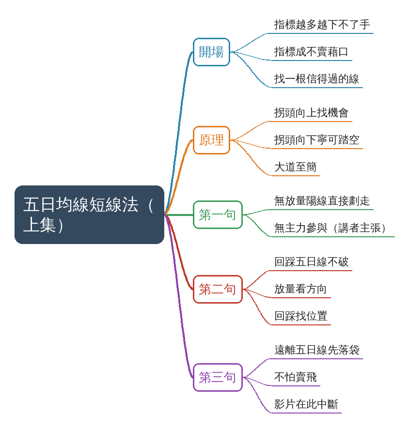

# 一根線五句話 短線跑贏90%散戶

- 來源：https://vt.tiktok.com/ZSse1Sdsy/
- 平台 / 上傳者：TikTok / juliapitts9502wg9q
- 長度：02:31 (151.3s)
- 逐字稿來源：whisper (groq)
- 更新日期：2026-11-22
- **關鍵字：** #五日均線 #均線拐頭 #短線 #放量陽線 #回踩 #浮籌 #落袋為安 #技術指標 #散戶 #上集

## 摘要與名詞說明

**一句話重點**：講者主張散戶做短線不必疊一堆指標（MACD、KDJ、RSI 反而成了不賣的藉口），只盯「五日均線」：拐頭向上找機會上車、拐頭向下寧可踏空；並以「五句話」說明用法，本片（標示 1/2）講到第三句：沒有放量陽線的票直接劃走、放量啟動後回踩五日線不破是入場位置、股價遠離五日線時先落袋一部分。皆為講者主張，未查證。

## 重點時間軸

| 時間 | 段落 | 重點 |
|---|---|---|
| 00:00 | 開場 | 指標越多越下不了手，每個指標都給你不賣的藉口，從淺套扛到深套；要找一根信得過的線 |
| 00:44 | 原理 | 五日均線一句話：拐頭向上找機會上車、拐頭向下寧可踏空也別伸手；大道至簡 |
| 01:21 | 第一句 | 很久都沒有像樣放量陽線的票＝沒主力參與，形態再好也直接劃走 |
| 01:41 | 第二句 | 放量啟動後回踩五日線、踩住不破＝入場位置；「放量看方向，回踩找位置」 |
| 02:10 | 第三句 | 加速拉升遠離五日線時先落袋一部分，偏離太遠必回到均線；不怕賣飛（影片在此中斷） |

## Claude 的備註（非影片內容）

- **只有上集**：標題寫「五句話」，本片只講到第三句一半；第四、五句要看下集（網址未知）。
- 五日均線很短，盤整時頻繁拐頭向上／向下，容易來回進出；影片沒談盤整怎麼處理，也沒定義「有效跌破」（收盤跌破？跌幅幾 %？）與「遠遠甩開」的乖離門檻。
- 「沒有放量陽線＝沒主力」「回踩是主力洗浮籌」是講者對量價的解讀，未提供回測（講者主張，未查證）。
- 與同領域《四步滾雪球》（盯 EMA20）思路相同但用更短的均線，訊號更快、雜訊也更多。本報告不構成投資建議。

## 名詞說明

- **五日均線**：最近 5 個交易日收盤價的平均連成的線，反映約一週的短線成本。**拐頭**：均線方向由下轉上（或由上轉下）。
- **淺套／深套**：小幅／大幅被套牢。**踏空**：沒買到、錯過上漲。
- **放量陽線**：成交量放大、收盤高於開盤的 K 線。**回踩**：上漲後回落到某條支撐線附近。
- **浮籌**：短線、不穩定的持股；**洗浮籌**指主力震盪讓這些人賣出。**賣飛**：賣出後股價繼續大漲。

## 轉錄與校正備註

- 逐字稿來源：Groq Whisper（自動偵測中文，簡轉繁），載入 `stock-investing` 詞典（自動校正「大洋線」1 處）；全片有燒入簡體字幕，已逐句核對。
- 依字幕更正：沙爹→殺跌、釘→盯、悶心自問→捫心自問、潛套／神套→淺套／深套、出級→初級、大道之解→大道至簡、滑走→劃走、浮酬→浮籌、回財→回踩、借貨→接貨、50線→5日線、回貪→回彈；多處長行依字幕拆行。02:21「賣飛賣飛」是「不要怕賣飛，賣飛了…」，不是口吃。詳見 `meta.json.known_asr_errors`。未去語助詞。

## 補充資料（影片未呈現的資訊）


### S1｜畫面遺漏：片頭標題與「1/2」分集標記
- 來源：影片畫面（全片頂端常駐標題與左上角標記）；取得日期：2026-11-22；取得方式：自影片截圖抄錄（簡體照錄）。
- 為何需要補充：講者沒說這是上集，逐字稿也看不出「五句話」只講了三句。
**原文（逐字）**
```
（頂端標題，全片常駐）
一根线　五句话
短线跑赢90%散户
（左上角）1/2
（說明欄標題）一根线五句话 短线跑赢90%散户 #股票
```
**Claude 的對照分析**
- 補充直接寫明：本片是兩集中的第 1 集（「1/2」）。
- 據此推定（非畫面直接寫明）：第四、五句在第 2 集；本片於 02:28 第三句講到一半（「如果你非要去賺預期之外的那一段」）結束。下集網址未知，使用者提供後可另行歸檔並互相連結。
**備註**
- 「跑贏 90% 散戶」「摸爬滾打 15 年」為講者／標題主張，未查證。

## 思維導圖



- 原圖：[mindmap.png](mindmap.png)；文字大綱：[mindmap.md](mindmap.md)（與本報告同資料夾）

## 圖文對照（畫面 + 逐字稿）

### 主題 1：開場：指標越多越下不了手（00:00–00:44）


**重點：** 講者以「科技這一輪殺跌」開場，主張散戶做短線不必用一堆指標，盯一根線就夠了。MACD、KDJ、RSI 不是沒用，但看越多越下不了手：跌破支撐時等 MACD 死叉、死叉了又等 RSI 超賣反彈，每個指標都成了不賣的藉口，一路從淺套扛到深套。關鍵是找到一根信得過的線反覆用到底。

**標籤：** #MACD #RSI #淺套深套

科技這一輪殺跌，你有沒有悟出來一個道理？就是你越研究你越會發現，散戶做短線真不用搞那麼多的花活，盯一根線就夠了。不是說那個MACD、KDJ、RSI這些東西沒有用，但是捫心自問，你是不是看的越多反而越下不了手？就跌破支撐你覺得MACD還沒有死叉，你再等等，那等到MACD死叉了，你又覺得RSI超賣了，該反彈了。就一個指標給你一個不賣的藉口，那三個指標加一起你就把自己騙得死死的，一路從淺套扛到了深套，所以說啊，散戶想真正在短線裡面吃上肉，關鍵不是學一百種指標，而是找到一根你信得過的線，反覆用用到底。

### 主題 2：原理：五日均線一句話（00:44–01:21）


**重點：** 講者選五日均線，核心一句話：均線拐頭向上就找機會上車，拐頭向下寧可踏空也別伸手。講者自述原本嫌這方法太初級，市場摸爬滾打 15 年後發現大道至簡，它或許不能每次都賺，但能讓你虧的時候不至於爬不起來（講者主張，未查證）。接著預告「五句話」，請觀眾每天盤前看一遍。

**標籤：** #五日均線 #拐頭 #大道至簡

那今天啊，我就把這個五日均線掰開揉碎，講給您，簡單到什麼程度呢，就一句話，均線拐頭向上，你就找機會上車，均線拐頭向下，寧可踏空也別伸手，說實話我以前我也覺得這個玩意兒太初級了看不起，但市場摸爬滾打15年歸來真的發現大道至簡，最簡單的方法和紀律反而是最經得起時間的考驗的，它或許不能讓你每一次都賺，但是它一定能讓你在虧的時候不至於虧到爬不起來，這五日均線怎麼用呢？簡單五句話，您拿筆記下來，每天盤前看一遍。

### 主題 3：第一句：沒有放量陽線的票直接劃走（01:21–01:41）


**重點：** 很長一段時間連一根像樣、有力度的放量陽線都擠不出來的股票，講者解讀為沒有資金在認真做、主力根本沒進來；沒有主力參與，你進去賺不到誰的錢。不管形態多好看都直接劃走，不要浪費時間。

**標籤：** #放量陽線 #主力 #選股

第一句，連根像樣的放量陽線都沒有的票，直接劃走，一個票如果說很長一段時間裡，連一根有力度的陽線它都擠不出來，說明什麼，說明沒有資金在認真做它，主力根本就沒進來，那沒有主力參與的票，你進去能賺誰的錢，這種票不管形態多好看，劃走就完事，不要浪費時間。

### 主題 4：第二句：放量啟動後回踩五日線不破（01:41–02:10）


**重點：** 放量啟動後回踩五日均線、踩住不破，就是要盯的位置。講者說底部放量的第一根大陽線之後，主力很少直接連拉，大機率借回踩洗一波浮籌；只要五日線沒被有效跌破，這裡就是重新找入場機會的地方。口訣十個字：「放量看方向，回踩找位置」。

**標籤：** #回踩 #浮籌 #入場位置

第二句，放量啟動之後，回踩五日均線，踩住不破，這個就是你要盯的位置，底部放量的第一根大陽線之後，主力很少會直接連拉，大機率會要借回踩去洗一波浮籌，但是只要五日均線沒有被有效的跌破，那麼這個位置就是你重新找入場機會的地方，記住十個字，放量看方向，回踩找位置，放量呢它告訴你主力來了，回踩告訴你主力在哪接貨。

### 主題 5：第三句：遠離五日線時先落袋一部分（影片在此中斷）（02:10–02:31）


**重點：** 股價加速拉升、遠遠甩開五日線時不要貪，先落袋一部分。講者比喻偏離均線太遠像橡皮筋拉到極限，回到均線是遲早的事；可先兌現部分利潤，不怕賣飛，因為還留有倉位。本片標示「1/2」，講到「如果你非要去賺預期之外的那一段」就結束，第四、五句在下集。

**標籤：** #乖離 #分批停利 #賣飛

第三句，股價加速拉升遠遠甩開5日線的時候不要貪，先落袋一部分，股價它偏離均線太遠呢，就像橡皮筋拉到了極限，那麼回彈是遲早的事，那這個時候呢可以先兌現一部分利潤，不要怕賣飛，賣飛了後面還有倉位還能吃嘛，但是如果你非要去賺預期之外的那一段。

## 已知轉錄錯誤

| 時間 | 聽成 | 應為 |
|---|---|---|
| 00:00 | 沙爹 | 殺跌（畫面字幕） |
| 00:04 | 釘一根線 | 盯一根線（畫面字幕） |
| 00:11 | 悶心自問 | 捫心自問（畫面字幕「扪心自问」） |
| 00:31 | 潛套／神套 | 淺套／深套（畫面字幕） |
| 00:56 | 太出級了 | 太初級了（畫面字幕） |
| 01:00 | 大道之解 | 大道至簡（畫面字幕） |
| 01:24 | 滑走 | 劃走（畫面字幕「划走」；01:39 同） |
| 01:48 | 浮酬 | 浮籌（畫面字幕「浮筹」） |
| 02:05 | 回財／借貨 | 回踩／接貨（畫面字幕） |
| 02:10 | 50線 | 5日線（畫面字幕「5日线」） |
| 02:16 | 回貪 | 回彈（畫面字幕「回弹」；此處指股價回到均線） |
| 00:00 | （00:00、01:09、01:41–02:21 長行連寫） | 依字幕時間拆行並加標點 |

## 補充資料連結

- 補充資料檔：[supplement.md](supplement.md)（與本報告同資料夾；內容已收錄於上方〈補充資料〉）
- 思維導圖：[mindmap.png](mindmap.png)、文字大綱：[mindmap.md](mindmap.md)（與本報告同資料夾）
