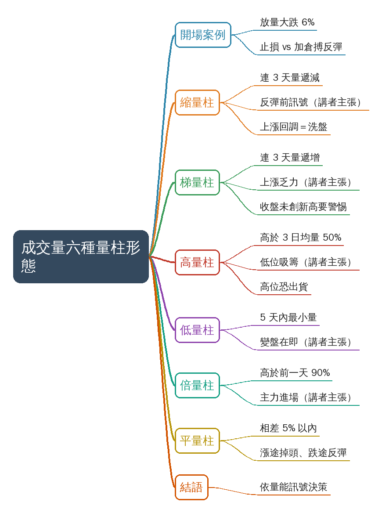
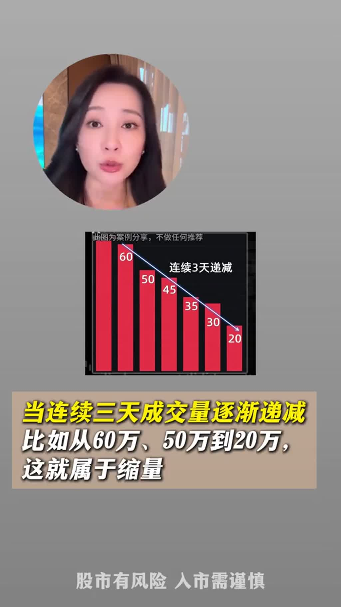
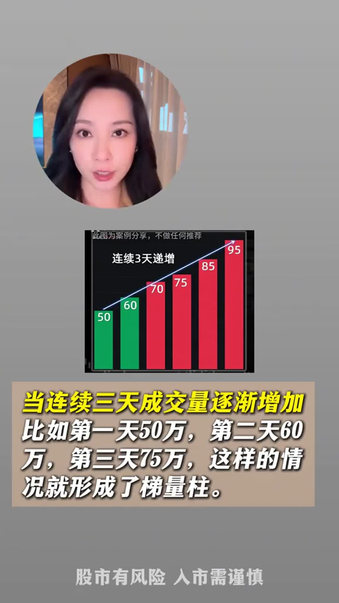
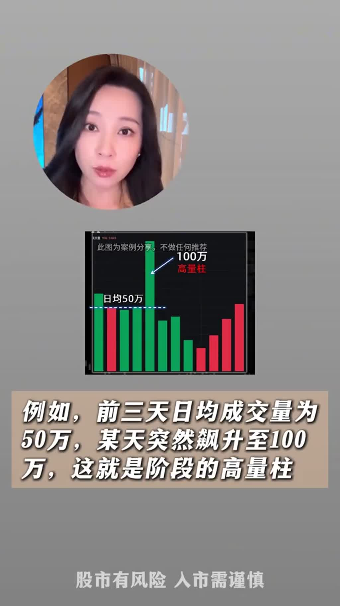
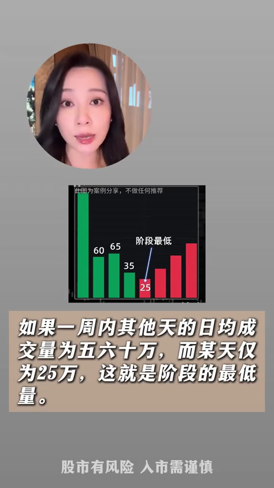
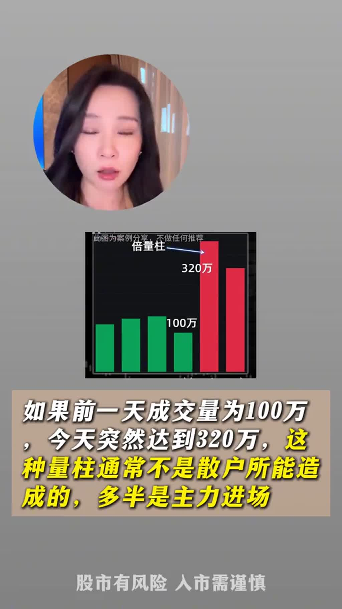
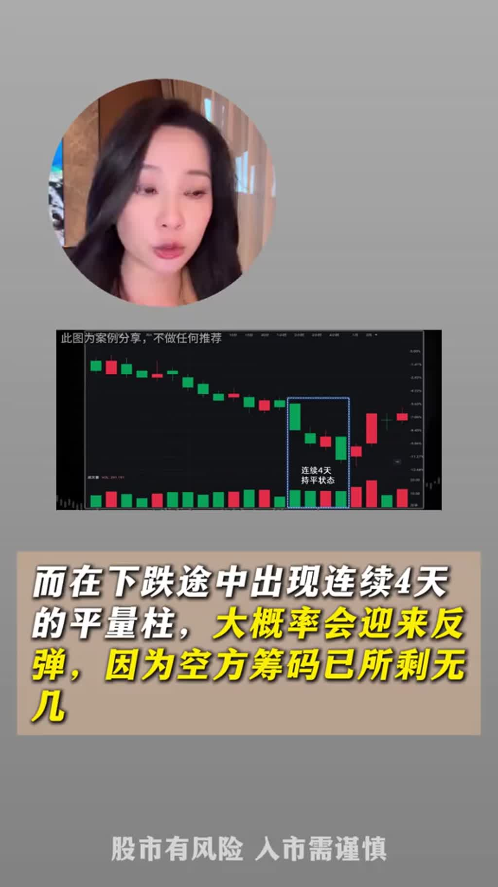

# 成交量六種量柱形態：看懂主力真實意圖

- 來源：https://vt.tiktok.com/ZSsJEVBBw/
- 平台 / 上傳者：TikTok / vanfleetmoravek
- 長度：04:42 (282.0s)
- 逐字稿來源：whisper (groq)
- 更新日期：2026-11-22
- **關鍵字：** #成交量 #量柱 #縮量柱 #梯量柱 #高量柱 #低量柱 #倍量柱 #平量柱 #主力意圖 #洗盤

## 摘要與名詞說明

**一句話重點**：講者（珊姐）主張成交量變化能透露主力意圖，並以「放量大跌 6%，該止損還是加倉？」開場，介紹六種量柱形態：縮量柱（反彈前）、梯量柱（上漲乏力）、高量柱（市場活躍；低位吸籌、高位出貨）、低量柱（沉默、變盤在即）、倍量柱（資金進攻）、平量柱（變盤前兆）；各形態的判讀皆為講者主張，未查證。

## 重點時間軸

| 時間 | 段落 | 定義（影片） | 講者解讀 |
|---|---|---|---|
| 00:00 | 開場 | 滿倉後橫盤震盪、突然放量大跌 6%、浮虧 6000 元 | 止損留半倉觀望 vs 加倉搏反彈，看量能訊號決定 |
| 00:44 | 縮量柱 | 連續 3 天量遞減（60→50→20 萬） | 下跌中＝拋盤耗盡；上漲回調中＝洗盤，均線未破就等反彈 |
| 01:24 | 梯量柱 | 連續 3 天量遞增（50→60→75 萬） | 透支買入；連漲 7 天後出現且收盤未創新高＝拉不動、恐回調 |
| 02:00 | 高量柱 | 比前 3 天均量高 50% 以上（50→100 萬） | 低位＝吸籌、有望主升浪；高位＝可能拉高出貨 |
| 02:38 | 低量柱 | 至少 5 天內最小量（五六十萬中的 25 萬） | 交易活躍度極低，風險小機會大，變盤在即 |
| 03:16 | 倍量柱 | 比前一天高 90% 以上，甚至 2–3 倍（100→320 萬） | 多半主力進場；遇壓力位或放量突破均線＝新一輪拉升 |
| 03:49 | 平量柱 | 連續幾天量持平、至少兩根相差 ≤ 5% | 上漲途中連 3 天＝掉頭；下跌途中連 3 天＝反彈 |
| 04:23 | 結語 | 回到開場案例 | 「如果出現了倍量柱」就能依量能決策 |

## Claude 的備註（非影片內容）

- **開場案例沒有真正回答**：結語只說「如果出現了倍量柱」就能決策，沒說放量大跌時該止損還是加倉；而依倍量柱的定義，放量大跌那根也可能是倍量柱，但講者對倍量柱的解讀（資金進攻、拉升）是以上漲情境為主，兩者如何對應影片沒說明。
- 部分定義會重疊：倍量柱（比前一天高 90%）多半也同時是高量柱（比前 3 天均量高 50%）；平量柱「至少兩根相差 ≤ 5%」與標題「連續三天」的門檻不一致。
- 「主力洗盤／吸籌／進場」是對量價的解讀，影片沒有提供回測或勝率（講者主張，未查證）；畫面自註「此图为案例分享，不做任何推荐」。
- 影片為中國 A 股語境（萬股／萬手為單位未說明）。本報告不構成投資建議。

## 名詞說明

- **量柱**：成交量圖上每天一根的柱子；紅綠通常對應當天收漲／收跌。
- **縮量／放量**：成交量比前期減少／增加。**洗盤**：主力壓低或震盪股價，讓散戶交出籌碼。
- **吸籌**：主力在低位買進籌碼。**主升浪**：一輪行情中漲幅最大的階段。
- **壓力位**：過去成交密集或高點所在、股價不易突破的價位。**變盤**：走勢方向改變。

## 轉錄與校正備註

- 逐字稿來源：Groq Whisper（自動偵測中文，簡轉繁）；全片有燒入簡體字幕與圖表文字卡，已逐句核對。
- 主要更正：「亮柱／亮注／量注」→ 量柱（全片）、T亮柱→梯量柱、被亮注／費量柱→倍量柱、紅盤→橫盤、放眼→放量、加倉或反彈→加倉搏反彈、回撥→回調、起盤→洗盤、吸出→吸籌、主持望→主升浪、新聞拉昇→新一輪拉升、上漲圖中→上漲途中；三處長行依字幕拆行。詳見 `meta.json.known_asr_errors`。
- 02:01–02:16 畫面卡片誤植為「第二種：梯量柱」，以口述「第三種：高量柱」為準（見補充 S1）。未去語助詞。

## 補充資料（影片未呈現的資訊）


### S1｜畫面遺漏：開場選項卡與六種量柱文字卡（含一處剪輯誤植）
- 來源：影片畫面（灰底圖表段落的文字卡與 00:19–00:24 選項卡）；取得日期：2026-11-22；取得方式：自影片逐秒截取原始解析度畫面逐字抄錄（簡體照錄）。對應截圖：`frames/slide_01.jpg`～`slide_07.jpg`。
- 為何需要補充：卡片是書面版，部分數字與口述不同；第三種的標題卡放錯。
**原文（逐字）**
```
（00:06–00:14）如果你在某个时刻满仓一只票，结果却遇到横盘震荡，突然放量大跌6%，账户浮亏6000元
（00:19–00:24）① 止损留半仓观望　② 加仓搏反弹

（00:45–）第一种：缩量柱
缩量柱通常是反弹前的信号
当连续三天成交量逐渐递减 比如从60万、50万到20万，这就属于缩量
比如某只股票在涨了几天后出现缩量回调，只要均线没有被跌破，这通常只是短期洗盘，耐心等待反弹即可
（圖表標：连续3天递减）

（01:25–）第二种：梯量柱
梯量柱则是上涨乏力的信号
当连续三天成交量逐渐增加 比如第一天50万，第二天60万，第三天75万，这样的情况就形成了梯量柱。
如果在价格连涨7天后，出现梯量柱且收盘价未能创新高，这就说明主力已经拉不动了，接下来很可能（後續未停在完整畫面）
（圖表標：连续3天递增；成交量逐渐放大）

（02:01–02:16，講者口述「第三種：高量柱」時）第二种：梯量柱
梯量柱则是上涨乏力的信号　← 與口述不符，疑為剪輯誤植
例如，前三天日均成交量为50万，某天突然飙升至100万，这就是阶段的高量柱
如果高量柱出现在低位，通常是主力吸筹的信号，经过洗盘后有望开启主（後續未停在完整畫面）
反之，如果高量柱出现在高位，就需要格外小心，可能是主力拉（後續未停在完整畫面）
（圖表標：日均50万；100万 高量柱）

（02:39–）第四种：低量柱
低量柱被称为市场的沉默信号
如果一周内其他天的日均成交量为五六十万，而某天仅为25万，这就是阶段的最低量。
（圖表標：阶段最低）

（03:17–）第五种：倍量柱
倍量柱是资金进攻的信号
如果前一天成交量为100万，今天突然达到320万，这种量柱通常不是散户所能造成的，多半是主力进场
（圖表標：100万；320万 倍量柱）

（03:50–）第六种：平量柱
平量柱是变盘的前兆
比如在上涨途中出现连续3天的平量柱，大概率会掉头（後續未停在完整畫面）
而在下跌途中出现连续4天的平量柱，大概率会迎来反弹，因为空方筹码已所剩无几
（圖表標：连续3天持平状态；连续4天持平状态）

（圖表角落）此图为案例分享，不做任何推荐
（全片底部）股市有风险 入市需谨慎
```
**Claude 的對照分析**
- 與影片一致：六種量柱的名稱、定義與數字例（60→50→20 萬；50／60／75 萬；50→100 萬；五六十萬對 25 萬；100→320 萬），與口述相同。
- 補充直接寫明（影片沒唸的）：開場兩個選項的書面寫法「加倉搏反彈」；圖表標註與「此图为案例分享，不做任何推荐」。
- 與口述不同處：**02:01–02:16 卡片寫「第二種：梯量柱／上漲乏力的信號」，講者口述是「第三種：高量柱／市場活躍的訊號」**，報告以口述為準；第六種下跌途中卡片寫「連續 4 天」，口述是「連續三天」（圖表標「连续4天持平状态」，逐字稿保留口述）。
- 「（後續未停在完整畫面）」是 Claude 註記：卡片在打字動畫完成前就換場，未逐字推測。
**備註**
- 六種形態的判讀（主力洗盤、吸籌、進場等）為講者主張，未查證；影片沒有回測或勝率數據。

## 思維導圖



- 原圖：[mindmap.png](mindmap.png)；文字大綱：[mindmap.md](mindmap.md)（與本報告同資料夾）

## 圖文對照（畫面 + 逐字稿）

### 主題 1：開場：放量大跌 6%，止損還是加倉？（00:00–00:44）


**重點：** 講者（珊姐）以案例開場：滿倉一檔股票，橫盤震盪後突然放量大跌 6%、帳戶浮虧 6000 元，離收盤只剩 10 分鐘，是「止損留半倉觀望」還是「加倉搏反彈」？講者主張看懂這根大跌 K 線背後的量能訊號就能做更明智的決策，並預告要解析六種經典量柱形態。

**標籤：** #放量大跌 #止損 #加倉

在股市當中啊，成交量的變化往往是能夠去透露出主力的真實意圖的，如果說你在某一個時刻去滿倉了一隻票，結果呢卻遇到了橫盤震盪，突然放量大跌了6%，帳戶呢浮虧6000元，眼看離收盤的就剩10分鐘了，你可能會陷入兩難啊，是止損留半倉觀望，還是加倉搏反彈，其實呢這個時候啊，如果說你能夠看懂這根大跌K線背後的量能訊號，就能夠做出更為明智的決策了，這期的影片呢，將為你去解析成交量的六種經典量柱形態，讓你能夠輕鬆去掌握其中的奧秘啊，即使是新手小白，也是能夠快速上手的啊。

### 主題 2：第一種：縮量柱——反彈前的訊號（00:44–01:24）



**重點：** 連續三天成交量逐漸遞減（例：60 萬、50 萬到 20 萬）就是縮量。下跌中縮量，講者解讀為拋盤耗盡、賣方力量減弱；上漲回調時縮量，往往是主力洗盤，只要均線沒跌破，通常只是短期洗盤，耐心等反彈即可（講者主張，未查證）。

**標籤：** #縮量 #洗盤 #均線

第一種，縮量柱，縮量柱啊，通常的是反彈前的訊號，當連續三天成交量逐漸遞減，比如說從60萬啊，50萬到20萬，這就屬於縮量的，那麼在下跌的過程當中出現了縮量，說明了拋盤已經耗盡了，賣方力量減弱，而在上漲回調的時候出現了縮量，往往是主力在洗盤，這個時候不必輕易的被嚇跑，比如說某一隻股票在漲了幾天之後出現了縮量回調，只要它的均線沒有被跌破，這通常只是短期的洗盤，耐心等待反彈即可。

### 主題 3：第二種：梯量柱——上漲乏力的訊號（01:24–02:00）



**重點：** 連續三天成交量逐漸增加（例：50 萬、60 萬、75 萬）形成梯量柱。看似資金持續進場，講者認為實際是透支買入；若價格連漲 7 天後出現梯量柱、收盤價卻沒創新高，說明主力拉不動了，接下來可能回調，要提前警惕（講者主張，未查證）。

**標籤：** #梯量柱 #透支 #回調

第二種就是梯量柱，梯量柱它則是上漲乏力的一個訊號，當連續三天成交量逐漸增加，比如說第一天是50萬，第二天是60萬，第三天是75萬，這樣的情況就形成了一個梯量柱，那麼雖然看起來這個資金在持續的進場，但實際上是在透支買入的，如果說在價格連漲了7天後，出現了梯量柱，且收盤價未能夠創新高，這個就說明主力已經是拉不動了，接下來還有可能會出現回調，需要提前警惕。

### 主題 4：第三種：高量柱——市場活躍的訊號（02:00–02:38）



**重點：** 某根量柱比前三天平均量高出 50% 以上即為高量柱（例：前三天日均 50 萬、某天飆到 100 萬）。出現在低位，講者解讀為主力吸籌，洗盤後有望開啟主升浪；出現在高位則要格外小心，可能是主力拉高出貨。注意這段畫面卡片誤植為「第二種：梯量柱」（見補充 S1）。

**標籤：** #高量柱 #吸籌 #拉高出貨

第三種，高量柱，高量柱是市場活躍的訊號，只要某根量柱比前三天的平均量高出了50%以上，就可以認定為高量柱了，例如說前三天日均成交量為50萬，某天突然是飆升出了100萬，這就是階段的高量柱，如果說高量柱出現是在低位的，通常呢是主力吸籌的訊號，經過洗盤後呢是有望開啟主升浪的，但反之呢，如果說高量柱出現是在高位的，就需要格外的小心了，可能是主力拉高出貨的行為。

### 主題 5：第四種：低量柱——市場的沉默訊號（02:38–03:16）



**重點：** 至少 5 天裡出現的最小量柱即為低量柱（例：一週其他天日均五六十萬、某天僅 25 萬）。講者說這代表交易活躍度極低：賣方因價格過低不願賣、買方暗中等待時機；風險相對較小、機會較大，往往預示變盤在即（講者主張，未查證）。

**標籤：** #低量柱 #沉默 #變盤

第四種，低量柱，低量柱啊，被稱為是市場的沉默訊號，在某段時間內啊，至少五天裡頭出現了最小量柱，即為低量柱，那如果說一週之內，其他天的日均成交量為五六十萬，而某一天的僅為二十五萬，這個就是階段的最低量，低量柱的出現，就意味著這個市場的交易活躍度極低了，賣方因價格過低而不願意出售，買方則在暗中等待更佳的時機，這種情況下，風險相對較小，機會更大，往往預示著變盤在即。

### 主題 6：第五種：倍量柱——資金進攻的訊號（03:16–03:49）



**重點：** 最低標準是比前一天量柱高出 90% 以上，甚至是前一天的兩到三倍（例：前一天 100 萬、今天 320 萬）。講者認為這種量不是散戶能造成的，多半是主力進場；尤其在股價面臨壓力位、或關鍵均線被放量突破時，往往意味新一輪拉升即將開始（講者主張，未查證）。

**標籤：** #倍量柱 #主力進場 #放量突破

第五種，倍量柱，倍量柱呢，是資金進攻的訊號，最低標準呢，是比前一天的量柱呢，高出90%以上，甚至呢可能是前一天的兩到三倍，如果說前一天的成交量為100萬，今天突然就達到320萬，那麼這種量柱通常不是散戶能夠造成的，多半是主力進場，特別是在股價面臨壓力位，或者說是關鍵均線被放量突破的時候，往往是意味著新一輪拉升即將要開始。

### 主題 7：第六種：平量柱——變盤的前兆（03:49–04:23）



**重點：** 連續幾天成交量基本持平、至少兩根量柱數值相差不超過 5% 即為平量柱。講者說上漲途中連續三天平量柱，大機率掉頭向下（多方力量接近枯竭）；下跌途中連續三天平量柱，大機率迎來反彈（空方籌碼所剩無幾）。畫面卡片寫下跌途中是「連續 4 天」。

**標籤：** #平量柱 #持平 #掉頭

第六種，平量柱，平量柱是變盤的前兆，當連續幾天成交量基本是持平的，至少兩根量柱數值相差不超過5%，那就形成了一個平量柱了，比如說在上漲途中出現連續三天的平量柱，大機率會掉頭向下，因為多方力量已經是接近枯竭的，而在下跌途中出現連續三天的平量柱，大機率會迎來反彈，因為空方籌碼已經是所剩無幾。

### 主題 8：結語：回到開場案例（04:23–04:42）


**重點：** 講者請觀眾掌握六種量柱形態後回到開場的放量大跌案例，「如果出現了倍量柱」就能依量能訊號做出更明智的決策，最後請觀眾關注。影片沒有明說該案例最後應選止損還是加倉。

**標籤：** #量能訊號 #倍量柱 #決策

那掌握了這六種核心的量柱形態之後呢，再回到最初提到的案例啊，如果說出現了倍量柱，你就能夠根據量能訊號，做出更為明智的決策了，大家都聽懂了嗎，如果說喜歡珊姐的知識分享的，別忘了點個關注哦。

## 已知轉錄錯誤

| 時間 | 聽成 | 應為 |
|---|---|---|
| 00:08 | 紅盤震盪 | 橫盤震盪（畫面卡片） |
| 00:10 | 放眼大跌 | 放量大跌（畫面卡片） |
| 00:21 | 加倉或反彈 | 加倉搏反彈（畫面選項卡） |
| 00:34 | 亮柱／亮注／量注（全片） | 量柱（畫面字幕與卡片；縮量柱、梯量柱、高量柱、低量柱、倍量柱、平量柱） |
| 01:24 | T亮柱 | 梯量柱（畫面卡片） |
| 03:17 | 被亮注／費量柱（04:29） | 倍量柱（畫面卡片與字幕） |
| 01:04 | 回撥／起盤 | 回調／洗盤（畫面字幕） |
| 01:31 | 成效量／成就量 | 成交量（畫面卡片） |
| 02:24 | 吸出／主持望 | 吸籌／主升浪（畫面卡片） |
| 03:35 | 量重 | 量柱（畫面卡片「這種量柱」） |
| 03:46 | 新聞拉昇 | 新一輪拉升（畫面字幕） |
| 04:05 | 上漲圖中／下跌圖中 | 上漲途中／下跌途中（畫面卡片） |
| 01:04 | （01:04、02:14、03:25 三處長行連寫） | 依字幕拆行 |

## 補充資料連結

- 補充資料檔：[supplement.md](supplement.md)（與本報告同資料夾；內容已收錄於上方〈補充資料〉）
- 思維導圖：[mindmap.png](mindmap.png)、文字大綱：[mindmap.md](mindmap.md)（與本報告同資料夾）
