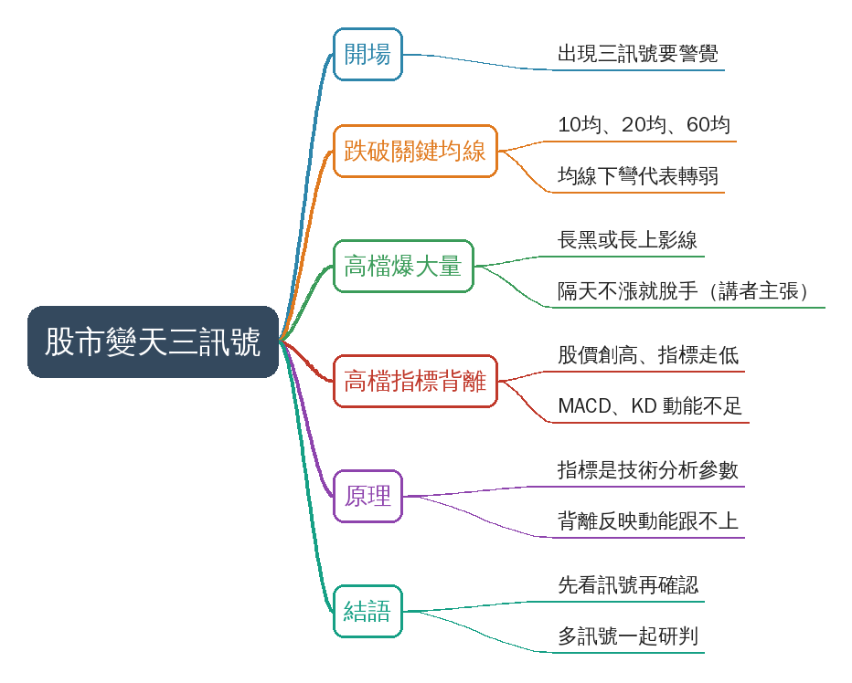

# 股市變天 其實都能提早知道？報名【技術分析全攻略】免費體驗課，朱家泓老師教你怎麼看

- 來源：https://www.facebook.com/share/r/1G9rfc5jPb/
- 平台 / 上傳者：Facebook / ShiFu｜讓大師成為你的師父
- 長度：01:25 (85.3s)
- 逐字稿來源：whisper (groq)
- 更新日期：2026-11-24
- **關鍵字：** #均線 #10均 #20均 #60均 #爆大量 #長黑 #長上影 #指標背離 #MACD #KD #高檔背離 #出貨 #變天 #技術分析

## 摘要與名詞說明

**一句話重點**：講者（畫面標示「飆股上校 朱家泓」）主張，股票出現三個訊號要提高警覺：跌破關鍵均線、高檔爆大量長黑或長上影線、高檔指標背離；多個訊號一起研判才能判斷市場是不是變天（講者主張，未查證，不構成投資建議）。

| 時間 | 重點 |
|---|---|
| 00:00 | 開場：股票出現三個訊號要提高警覺 |
| 00:03 | 第一：跌破 10 均、20 均、60 均或均線下彎，代表越走越弱 |
| 00:14 | 第二：高檔爆大量長黑／長上影線，代表大量賣壓；隔天不漲或下跌就要脫手 |
| 00:29 | 第三：股價頭越來越高、MACD／KD 的頭越來越低，稱為高檔背離 |
| 00:48 | 原因：指標是技術分析參數設計成公式，背離反映動能跟不上 |
| 01:04 | 先看訊號、後確認；多個訊號一起研判；結尾為免費體驗課招生 |

## 名詞說明
- **均線（10均、20均、60均）**：10、20、60 日移動平均線。
- **長黑／長上影線**：實體很長的黑 K，或上影線很長的 K 棒。
- **背離**：股價創高但技術指標（如 MACD、KD）沒有跟著創高，講者稱為高檔背離。
- **MACD、KD**：常見的技術分析指標。

## 轉錄校正備註
- 逐字稿來源：Whisper（Groq），語言偵測 zh。畫面有燒入字幕與疊字標籤，已確認：技術分析參數、高檔的背離、研判、長上影線。
- 「變天」「體驗課」依標題改；Whisper 原作「變貼」「體驗者」。
- 影片結尾是「技術分析全攻略」免費體驗課的招生；招生與標題內容與投資訊號無關，僅記錄。
- 影片中的主張皆為講者主張，未查證，不構成投資建議。

## 思維導圖

- 原圖：[mindmap.png](mindmap.png)；文字大綱：[mindmap.md](mindmap.md)（與本報告同資料夾）

## 圖文對照（畫面 + 逐字稿）

### 主題 1：開場：股票出現三個訊號要提高警覺（00:00–00:03）

**重點：** 講者（畫面標示「飆股上校 朱家泓」）開場說股票出現下面這三個訊號一定要提高警覺；畫面疊字依序列出三個訊號（講者主張，未查證）。

**標籤：** #警覺

股票出現下面這三個訊號一定要提高警覺。

### 主題 2：第一個訊號：跌破關鍵均線或均線下彎（00:03–00:14）

**重點：** 股票跌破 10 均、20 均、60 均，或均線開始下彎，講者說代表股票越走越弱，局勢可能改變，要特別小心（講者主張，未查證）。

**標籤：** #10均 #20均 #60均

第一個訊號就是股票跌破了關鍵的均線，10均、20均、60均跌破了均線或者均線已經開始下彎，代表這支股票越走越弱，要特別小心有可能局勢會改變。

### 主題 3：第二個訊號：高檔爆大量長黑／長上影線（00:14–00:29）

**重點：** 股票走到高檔出現爆大量的長黑或長上影，代表當天有大量賣壓。講者說若還抱著，隔天不漲或下跌就要趕快脫手，因為這是有人出貨的訊號（講者主張，未查證）。

**標籤：** #爆大量 #長黑 #出貨

第二個就是股票走到高檔出現了爆大量的長黑或者長上影，這都代表今天有大量的賣壓出現，如果你還抱著這支股票就要提高警覺，明天如果不漲或下跌你要趕快把股票脫手，因為這個就是有人出貨的訊號。

### 主題 4：第三個訊號：高檔指標背離（00:29–00:48）

**重點：** 股價一個頭比一個頭高，但 MACD 或 KD 的頭卻越來越低、方向相反，稱為高檔的指標背離；講者說這時要注意股價會不會下跌（講者主張，未查證）。

**標籤：** #MACD #KD #背離

第三個就是你在高檔的時候看到下面的指標出現了背離，也就是你的股價一個頭比一個頭高，可是你去看MACD或者看KD這些的指標的頭卻是越來越低方向走了相反，那就代表高檔有指標的背離，這時候你要提高警覺注意你的股價會不會下跌。

### 主題 5：為什麼會背離：指標反映動能跟不上（00:48–01:04）

**重點：** 講者解釋指標是用技術分析參數設計成公式，背離反映的是動能跟不上：股價還在漲，但指標的動能越來越弱，所以指標越來越低（講者主張，未查證）。

**標籤：** #動能 #參數

為什麼會出現這樣的狀況，因為指標都是技術分析參數去把它設計成一個公式的，換句話講這裡面就會反映比如說動能它跟不上，股價還在漲，但這個指標的動能已經開始越來越弱，所以指標越來越低，這個就是我們叫做高檔的背離。

### 主題 6：結語：先看訊號再確認，多個訊號一起研判（01:04–01:25）

**重點：** 看到以上三個訊號，要注意手上股票的股價走勢，先看到訊號、後面確認判斷對不對，判斷對了就要趕快離開；判斷市場是否真的變天，要把不同訊號一起研判。結尾為免費體驗課招生（講者主張，未查證，不構成投資建議）。

**標籤：** #研判 #確認

看到上面三個訊號，你要注意就是你手上股票的股價，因為我們先看到訊號，後面來確認，這個訊號我們判斷的對不對，判斷對了，你當然就要趕快離開，所以你要判斷市場是不是真的變天，你要把這些不同的訊號都要一起研判，想要看懂更多股市的訊號，歡迎報名技術分析全攻略的體驗課。

## 已知轉錄錯誤

| 時間 | 聽成 | 應為 |
|---|---|---|
| 00:29 | 出現了背影／指標的背影 | 出現了背離／指標的背離 |
| 01:02 | 高漲的背景 | 高檔的背離 |
| 00:49 | 技術分析引數 | 技術分析參數 |
| 01:14 | 變貼 | 變天 |
| 01:20 | 體驗者 | 體驗課 |
| 00:14 | 長上一些 | 長上影線 |
| 00:12 | 而特別的小心 | 要特別小心 |

## 補充資料連結

- 思維導圖：[mindmap.png](mindmap.png)、文字大綱：[mindmap.md](mindmap.md)（與本報告同資料夾）
