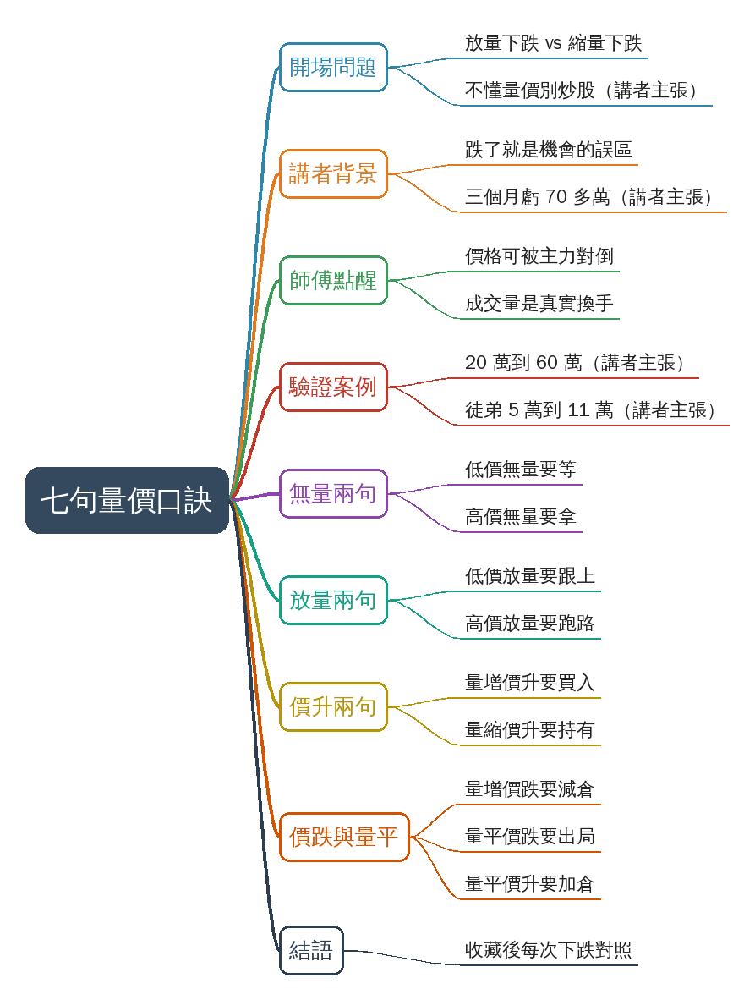

# 投資

- 來源：https://vm.tiktok.com/ZSsYRBxaR/
- 平台 / 上傳者：TikTok / bsyf57543y1
- 長度：04:09 (248.7s)
- 逐字稿來源：whisper (groq)
- 更新日期：2026-11-24
- **關鍵字：** #量價關係 #量價口訣 #放量下跌 #縮量下跌 #量增價升 #量縮價升 #量增價跌 #低價放量 #高價放量 #成交量 #主力對倒 #實盤

## 摘要與名詞說明

**一句話重點**：講者（影片中自稱「三姐／嬌姐」）主張，只要背熟「七句量價口訣」，就能分辨放量下跌、縮量下跌等情況並決定等待、買進、持有、減倉或離場（講者主張，未查證）。

| 時間 | 重點 |
|---|---|
| 00:00 | 開場：放量下跌與縮量下跌哪個是陷阱、哪個是機會？不懂量價就別炒股 |
| 00:35 | 講者背景：早年「跌了就是機會」無腦低吸，三個月虧 70 多萬（講者主張） |
| 01:24 | 師傅點醒：價格可被主力對倒做出來，成交量是真實換手，騙不了人 |
| 02:17 | 驗證：自己帳戶 20 萬→60 萬、徒弟 5 萬→11 萬（講者主張，未查證） |
| 02:51 | 君子之約：點小紅心、留言「量價為王」、關注 |
| 03:20 | 第一句：低價無量要等，高價無量要拿 |
| 03:26 | 第二句：低價放量要跟上，高價放量要跑路 |
| 03:30 | 第三句：量增價升要買入 |
| 03:32 | 第四句：量縮價升要持有 |
| 03:35 | 第五句：量增價跌要減倉 |
| 03:38 | 第六句：量平價跌要出局 |
| 03:41 | 第七句：量平價升要加倉 |
| 03:44 | 結語：收藏起來，每次下跌對照一遍 |

## 名詞說明
- **放量／縮量**：成交量相對近期明顯變大／變小。
- **量增價升、量縮價升、量增價跌、量平價跌、量平價升**：成交量與價格同時變化的組合。
- **對倒**：同一方（主力）自買自賣，製造成交假象（影片原話：價格可以被主力對倒；此處依語意推測）。
- **低吸**：下跌中逢低買進（字幕寫「DC」，推測為「低吸」縮寫）。

## 轉錄校正備註
- 逐字稿來源：Whisper（Groq），語言偵測 zh，未做去語助詞（非講座）。
- 已依畫面字幕確認：撿漏、磨底、實盤、大數據、三姐只講；「無腦低吸」「主力對倒」為推測，列在 `known_asr_errors`。
- 影片中的數字與績效皆為講者主張，未查證；七句口訣是否有效亦未驗證，不構成投資建議。
- 口訣第一句的完整意義（「要等」「要拿」）講者未展開，註解為講者主張的轉述，非影片明說的原理。

## 思維導圖

- 原圖：[mindmap.png](mindmap.png)；文字大綱：[mindmap.md](mindmap.md)（與本報告同資料夾）

## 圖文對照（畫面 + 逐字稿）

### 主題 1：開場：放量下跌與縮量下跌，哪個是陷阱（00:00–00:35）

**重點：** 講者拋出問題：放量下跌和縮量下跌，哪一個是陷阱、哪一個是機會？她主張答不上來就別炒股，量價不懂等於閉眼上高速；只要記住七句話，牛市、熊市、震盪都能獲利（講者主張，未查證）。

**標籤：** #放量下跌 #縮量下跌

放量下跌跟縮量下跌到底哪一個是陷阱，哪一個才是機會呢？這個問題你要是答不上來，你聽我一句勸，你先別炒股了，連成交量這種最基本的門道你都摸不清楚，那麼你衝進來只會是給主力送錢，特別是當下這種分化嚴重的行情，量價這個技巧你搞不明白，你就去炒股，那就等於閉上眼睛上高速，但是今天你只要把以下的這七句話記住了，往後不管是牛市、還是熊市、還是震盪磨底，那麼盈利都跟呼吸一樣簡單。

### 主題 2：講者背景：虧損與「跌了就是機會」的誤區（00:35–01:24）

**重點：** 講者自述早年在機構做盤面覆盤，剛接觸實盤時總以為跌了就是機會、無腦低吸越跌越補，三個月虧 70 多萬、帳戶剩不到 20 萬（講者主張，未查證）。

**標籤：** #背景與誤區

老粉都知道，我早期是純技術派出身，早年在機構做盤面覆盤工作，專門輔助操盤手做資料統計，說句實話，我不是什麼天賦型選手，剛接觸實盤的時候，我也是虧得想跳樓的那個韭菜，那個時候我有一個致命的誤區，總以為跌了就是機會，漲了就是風險，只要是大跌，我就覺得撿漏的機會來了，無腦低吸，越跌越補，最慘的一次，三個月虧了70多萬，帳戶裡只剩20萬不到，每天盯盤七八個小時，晚上睡不著，白天不敢看盤，我是又後悔又不甘。明明每天認真復盤，認真看盤，學的技術指標也不少，難道技術分析根本就沒有用嗎？股市全都是靠運氣博弈。

### 主題 3：師傅點醒：價格會騙人，成交量不會（01:24–02:17）

**重點：** 機構老操盤手指出，她分不清下跌性質，是因為只看價格漲跌、忽略成交量；價格可被對倒做出來，成交量是真實換手，資金進出騙不了人。他給了七句話要她背三個月（講者主張，未查證）。

**標籤：** #成交量 #對倒

後來真正把我點醒的是帶我入行的一個機構老操盤手，他算是我半個師傅，我自己實在是想不明白，我就去找他吃飯，大吐苦水，他放下筷子只說了一句話，你分不清下跌的性質，是因為你沒搞懂成交量和價格之間的關係，你太看重價格了，只看漲跌價格買賣，完全忽略了成交量，這個是非常危險的，價格可以被主力對倒，做多做空做出來，但是成交量是真實的換手，資金進出是騙不了人的，這裡我有七句話你背下來，回去對著盤面啃三個月，如果沒用你來找我。我當時也是半信半疑，還是老老實實的背下來了。結果呢，三個月之後，帳戶從20萬變到了35萬，半年之後突破了60萬。那一刻我才明白，原來量價關係才是股市裡最不會騙人的語言。

### 主題 4：驗證：自己與徒弟的帳戶變化（02:17–02:51）

**重點：** 講者稱背誦七句話後，自己帳戶三個月從 20 萬到 35 萬、半年破 60 萬；老粉絲背兩個月，帳戶從 5 萬到 11 萬（均為講者主張，未查證）。

**標籤：** #案例

後來我開始帶徒弟，第一個教的就是這七句話。有個全職炒股的老粉絲，炒股8年，帳戶本來是20多萬，折騰了一年多，虧的就只剩5、6萬了。他就是典型的看不懂下跌，一跌就慌，一慌就亂操作，後來找到我，我沒有教他複雜的戰法，我只讓他死記硬背這七句量價口訣，讓他每天開盤之前背一遍，對著盤面硬啃，他咬著牙做了兩個月不到，帳戶從5萬幹到了11萬，他打電話跟我說，三姐，原來看量價真的不用再提心吊膽了。

### 主題 5：君子之約：互動三件事（02:51–03:20）

**重點：** 在分享之前，講者要求觀眾點小紅心、留言「量價為王」、第一次看到的朋友點關注。屬於影片的互動要求，與量價內容無關。

**標籤：** #互動

今天我毫無保留的把這七句話也交給你，但是在我分享之前，咱們做一個君子之約，第一點，點亮小紅心，讓大數據知道你在認真學習，以後平台會繼續給你推送有用的乾貨。第二，留下一句，量價為王，讓我看到你想賺錢的決心第三，第一次刷到我的朋友，點上一個小關小注，三姐只講散戶聽得懂，用得上的乾貨，帶你少走十年的彎路，下面我直接講乾貨，記好了。

### 主題 6：第一句：低價無量要等，高價無量要拿（03:20–03:26）

**重點：** 低價區沒有成交量，代表還沒有資金進場，先等；高價區沒有量，代表籌碼穩定、持股續抱（講者主張，未查證）。

**標籤：** #低價無量 #高價無量

第一句，低價無量要等，高價無量要拿。

### 主題 7：第二句：低價放量要跟上，高價放量要跑路（03:26–03:30）

**重點：** 低價區出現放量是資金進場訊號，可跟進；高價區放量則可能是主力出貨，先離場（講者主張，未查證）。

**標籤：** #低價放量 #高價放量

第二句，低價放量要跟上，高價放量要跑路。

### 主題 8：第三句：量增價升要買入（03:30–03:32）

**重點：** 成交量放大且價格上漲，代表買盤積極，講者建議買入（講者主張，未查證）。

**標籤：** #量增價升

第三句，量增價升要買入。

### 主題 9：第四句：量縮價升要持有（03:32–03:35）

**重點：** 價格上漲但成交量縮小，講者建議續抱持有（講者主張，未查證）。

**標籤：** #量縮價升

第四句，量縮價升要持有。

### 主題 10：第五句：量增價跌要減倉（03:35–03:38）

**重點：** 成交量放大且價格下跌，講者建議減倉（講者主張，未查證）。

**標籤：** #量增價跌

第五句，量增價跌要減倉。

### 主題 11：第六句：量平價跌要出局（03:38–03:41）

**重點：** 成交量持平而價格下跌，講者建議出局（講者主張，未查證）。

**標籤：** #量平價跌

第六句，量平價跌要出局。

### 主題 12：第七句：量平價升要加倉（03:41–03:44）

**重點：** 成交量持平而價格上漲，講者建議加倉（講者主張，未查證）。

**標籤：** #量平價升

第七句，量平價升要加倉。

### 主題 13：結語：收藏起來，每次下跌對照一遍（03:44–04:09）

**重點：** 講者要觀眾收藏影片，下跌拿不準時翻出來對照；稱徹底啃透七句話足夠在股市吃一輩子，並呼籲關注（講者主張，未查證）。

**標籤：** #結語

你能把這個影片看完，說明你的核心足夠穩，你一定要點上小紅心收藏好，以後每次盤面下跌，拿捏不準走勢的時候，你就翻出來對照一遍，這七句話，你只要徹底啃透了，足夠你在股市裡頭吃一輩子了，我是嬌姐，不講空洞的大道理，只分享散戶能落地、能用得上的實戰乾貨，點關注不吃虧，我們明天見。

## 已知轉錄錯誤

| 時間 | 聽成 | 應為 |
|---|---|---|
| 00:51 | 簡陋的機會 | 撿漏的機會 |
| 01:01 | 無腦滴稀 | 無腦低吸（推測） |
| 01:48 | 價格可以被主義對倒 | 價格可以被主力對倒（推測） |
| 00:33 | 震盪摩底 | 震盪磨底 |
| 00:47 | 石盤 | 實盤 |
| 02:57 | 讓大叔就知道你 | 讓大數據知道你 |
| 03:13 | 三姐之講 | 三姐只講 |
| 02:57 | 小關小注 | （原樣保留） |

## 補充資料連結

- 思維導圖：[mindmap.png](mindmap.png)、文字大綱：[mindmap.md](mindmap.md)（與本報告同資料夾）
