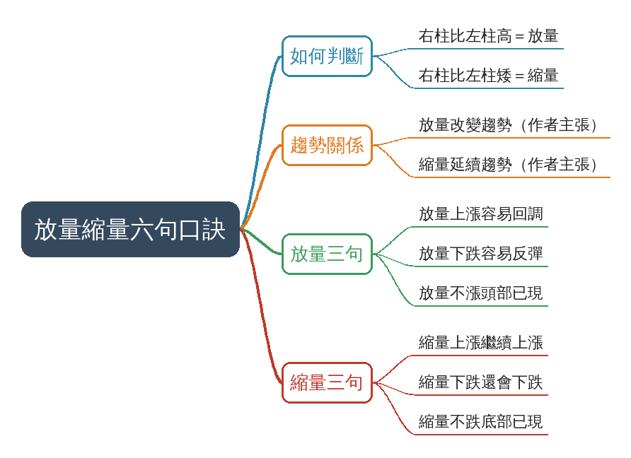
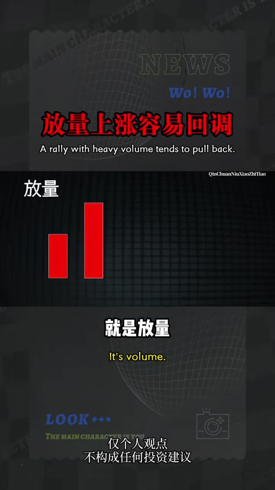
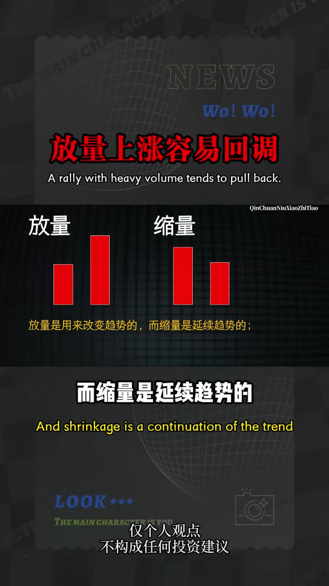
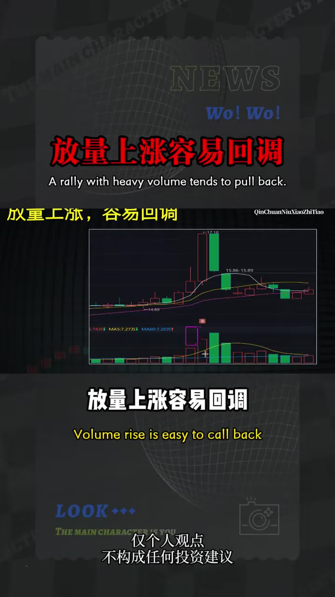
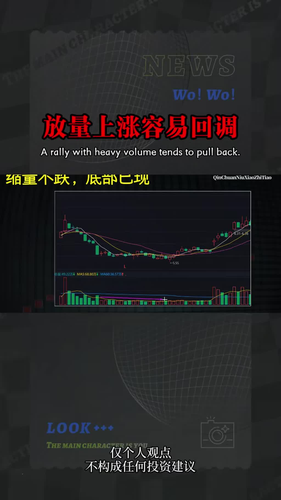

# 放量上漲容易回調

- 來源：https://vt.tiktok.com/ZSs65snhN/
- 平台 / 上傳者：TikTok / mce1j6
- 長度：00:35 (35.1s)
- 逐字稿來源：whisper (groq)
- 更新日期：2026-11-25
- **關鍵字：** #放量 #縮量 #放量上漲 #放量下跌 #縮量上漲 #縮量下跌 #量價關係 #頭部 #底部 #回調 #反彈 #趨勢

## 摘要與名詞說明

**一句話重點**：作者（帳號 mce1j6，影片無真人出鏡，為動畫圖解＋旁白）主張：右邊成交量柱比左邊高是放量、矮是縮量；放量用來改變趨勢，縮量用來延續趨勢，並以六句量價口訣判斷（作者主張，未查證，不構成投資建議；畫面標示「僅個人觀點，不構成任何投資建議」）。

| 時間 | 重點 |
|---|---|
| 00:00 | 右邊柱子比左邊高＝放量；比左邊矮＝縮量 |
| 00:06 | 放量改變趨勢、縮量延續趨勢；上升趨勢突然放量可能漲到頂，下跌趨勢突然放量可能要反轉 |
| 00:18 | 放量上漲容易回調；放量下跌容易反彈；放量不漲，頭部已現 |
| 00:24 | 縮量上漲繼續上漲；縮量下跌還會下跌；縮量不跌，底部已現 |

## 名詞說明
- **放量／縮量**：成交量柱相對前一根變高／變矮（影片用相鄰兩根柱子比較）。
- **回調**：上漲後的回檔；**頭部已現**／**底部已現**：作者認為價格可能見頂／見底的說法。

## 轉錄校正備註
- 逐字稿來源：Whisper（Groq），語言偵測 zh，共 12 行；畫面有簡體疊字與中英雙語字幕。
- 已依畫面確認：回調（Whisper 原作「回撥」）、底部已現（原作「底部已陷」）。
- 影片只有口訣，沒有給出判斷的前提（例如多大算放量）；內容為作者主張，未查證。

## 思維導圖

- 原圖：[mindmap.png](mindmap.png)；文字大綱：[mindmap.md](mindmap.md)（與本報告同資料夾）

## 圖文對照（畫面 + 逐字稿）

### 主題 1：怎麼分辨放量與縮量：看右邊柱子比左邊高或矮（00:00–00:06）

**重點：** 影片用成交量柱狀圖說明：右邊的柱子比左邊高就是放量，右邊比左邊矮就是縮量（作者說法，未查證）。

**標籤：** #放量 #縮量 #成交量柱

只要右邊的柱子比左邊的高就是放量，右邊的柱子比左邊的矮就是縮量。

### 主題 2：放量改變趨勢，縮量延續趨勢（00:06–00:18）

**重點：** 作者主張放量是用來改變趨勢的，縮量是延續趨勢的；例如上升趨勢突然放量，可能就是漲到頂，下跌趨勢突然放量，可能就是要反轉（作者主張，未查證）。

**標籤：** #趨勢 #到頂 #反轉

放量是用來改變趨勢的，而縮量是延續趨勢的，比如上升趨勢突然放量了可能就是漲到頂了，下跌趨勢突然放量了可能就是要反轉了。

### 主題 3：放量三句：上漲回調、下跌反彈、不漲見頭（00:18–00:24）

**重點：** 作者的三句口訣：放量上漲容易回調；放量下跌容易反彈；放量不漲，頭部已現。畫面各配一張 K 線與成交量圖例（作者主張，未查證）。

**標籤：** #放量上漲 #放量下跌 #頭部

放量上漲容易回調，放量下跌容易反彈，放量不漲頭部已現。

### 主題 4：縮量三句：上漲續漲、下跌續跌、不跌見底（00:24–00:35）

**重點：** 作者的三句口訣：縮量上漲繼續上漲；縮量下跌還會下跌；縮量不跌，底部已現（作者主張，未查證，不構成投資建議；畫面也標示「僅個人觀點，不構成任何投資建議」）。

**標籤：** #縮量上漲 #縮量下跌 #底部

縮量上漲繼續上漲，縮量下跌還會下跌，縮量不跌底部已現。

## 已知轉錄錯誤

| 時間 | 聽成 | 應為 |
|---|---|---|
| 00:18 | 放量上漲容易回撥 | 放量上漲容易回調 |
| 00:31 | 縮量不跌底部已陷 | 縮量不跌底部已現 |

## 補充資料連結

- 思維導圖：[mindmap.png](mindmap.png)、文字大綱：[mindmap.md](mindmap.md)（與本報告同資料夾）
