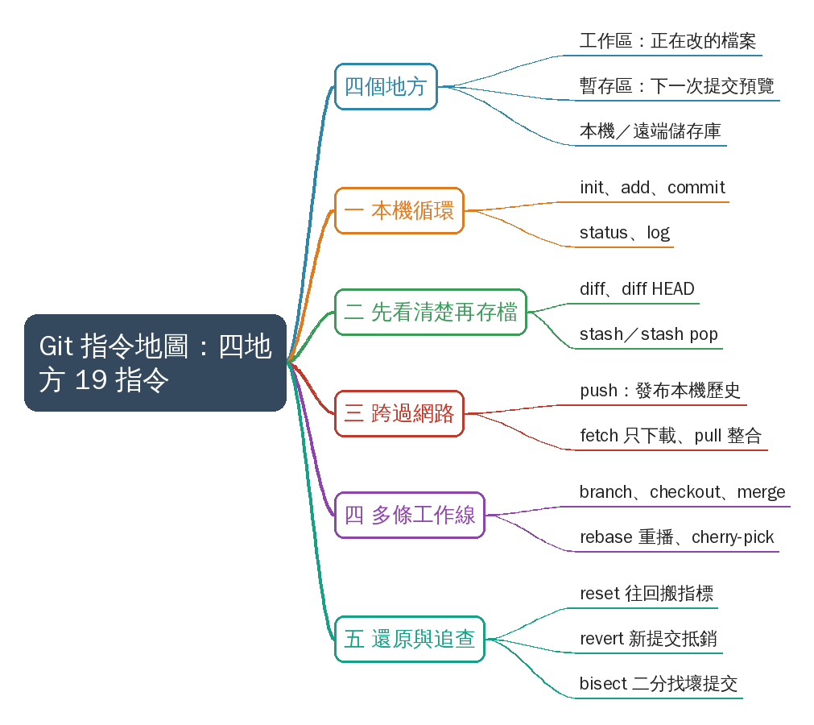
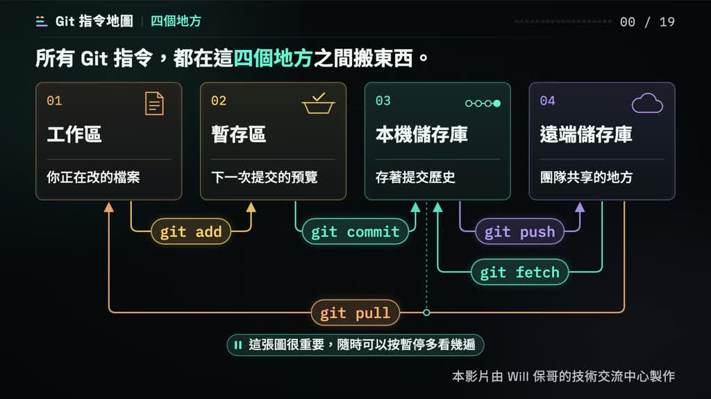
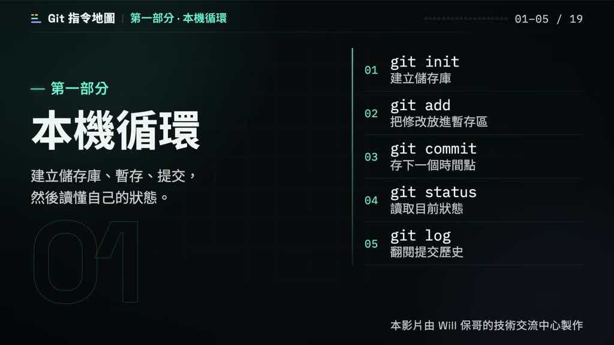
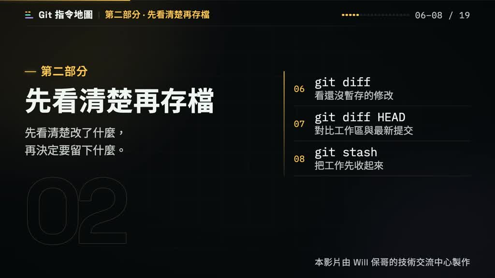
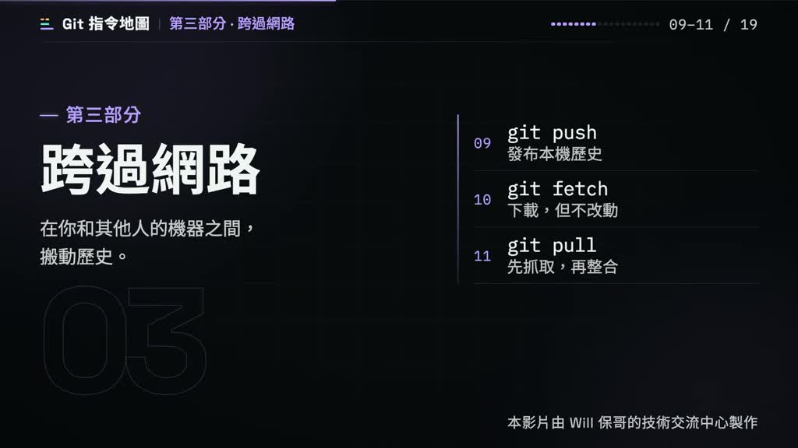
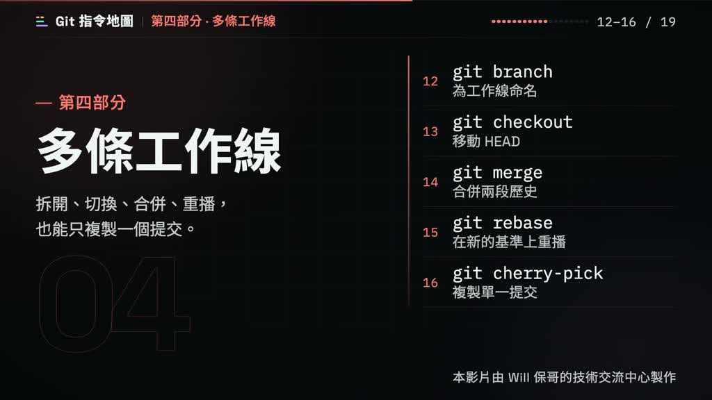
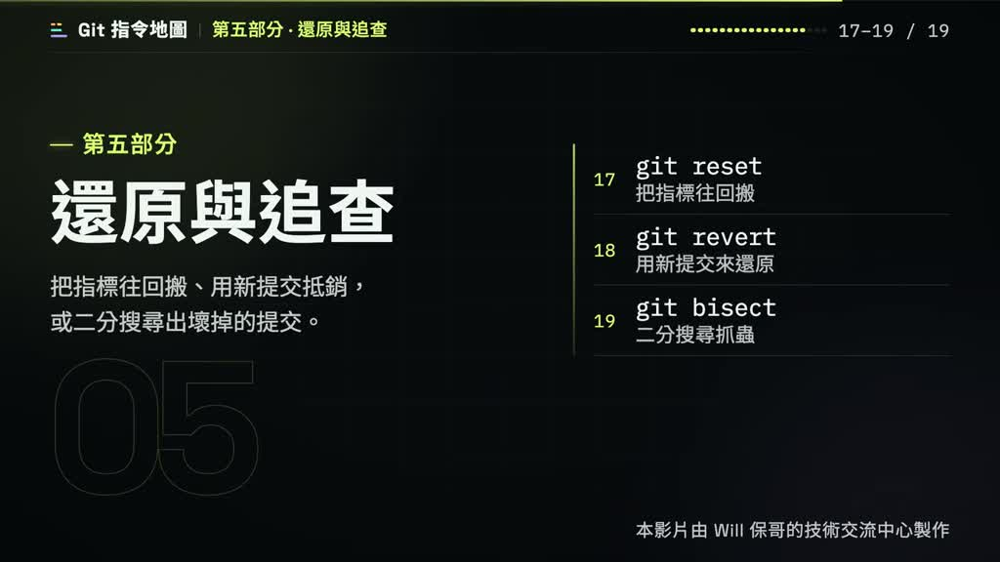
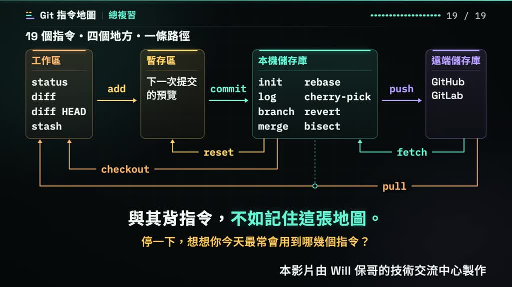

# Git 指令那麼多，其實都只是在「四個地方」之間搬東西：工作區 → 暫存區 → 本機儲存庫 → 遠端儲存庫。 我今天製作這支影片用 5 分鐘，把 19 個常用 Git 指令放進同一張地圖，讓你記住的不是指令清單，而是它們之間的關係。 👍

- 來源：https://www.facebook.com/share/v/1A8y1afS6q/
- 平台 / 上傳者：Facebook / Will 保哥的技術交流中心
- 長度：05:35 (335.0s)
- 逐字稿來源：whisper (groq)
- 更新日期：2026-10-25
- **關鍵字：** #Git #版本控制 #Git 指令地圖 #工作區 #暫存區 #本機儲存庫 #遠端儲存庫 #分支 #還原 #Will 保哥

## 摘要與名詞說明

**一句話重點**：5 分鐘把 19 個常用 Git 指令放進同一張地圖：工作區 → 暫存區 → 本機儲存庫 → 遠端儲存庫，記住它們之間的關係，比背指令清單有用（Will 保哥的技術交流中心）。

> 影片是動畫投影片，講者逐一講解；指令的行為說明是講者的教學簡化，細節（例如 `git pull` 預設行為、`reset` 的三種模式）未逐項對照 Git 官方文件查證。

## 重點表

| 時間 | 部分 | 指令與重點 |
|---|---|---|
| 00:00 | 開場：四個地方 | 工作區（正在改的檔案）、暫存區（下一次提交的預覽）、本機儲存庫（歷史）、遠端儲存庫（團隊共享）；分五部分、照學習順序走完 19 個指令 |
| 00:33 | 一、本機循環 | `init` 建立儲存庫（每專案一次）；`add` 放進暫存區；`commit` 存成時間點、產生雜湊編號；`status` 最該先打；`log`（`--oneline`）看歷史 |
| 01:46 | 二、先看清楚再存檔 | `diff` 看未暫存修改；`diff HEAD` 與最新提交比；`stash` 收起做一半的工作、`stash pop` 拿回 |
| 02:29 | 三、跨過網路 | `push` 推上遠端（被拒絕時先拉）；`fetch` 只下載；`pull` ＝ fetch ＋ merge |
| 03:13 | 四、多條工作線 | `branch` 為提交取名；`checkout` 移動 HEAD；`merge` 合併（產生合併提交、兩個父提交）；`rebase` 重播（雜湊會變，已推送的分支要小心）；`cherry-pick` 只複製單一提交 |
| 04:24 | 五、還原與追查 | `reset` 把指標往回搬（soft／hard）；`revert` 用新提交抵消舊提交（已推送最安全）；`bisect` 二分搜尋找第一個壞提交 |
| 05:08 | 回頭看 | 19 個指令、4 個地方、一條路徑；與其背指令，不如記住這張地圖 |

完整 19 條指令與畫面說明見補充資料 S1。

## 名詞與縮寫

- **工作區／暫存區／本機儲存庫／遠端儲存庫**：影片的四個地方，對應 working directory、staging area（index）、local repository、remote repository。
- **HEAD**：目前所在位置的指標；`checkout` 移動它、`reset` 把它往回搬。
- **雜湊編號**：每個提交的專屬編號（hash）；`rebase` 重播後會全部換新。
- **origin**：遠端儲存庫的預設名稱；`fetch` 抓回的提交放在 `origin/…` 底下。

## 轉錄校正備註

- 轉錄來源：Groq Whisper，語言自動偵測為中文；以 `--terms` 帶入 Git 術語提示詞重跑，錯字比第一次少很多。
- 已校正（穩定的已入 `glossary/common.json`）：原端→遠端儲存庫、雜臭→雜湊、已站存／未站存→已暫存／未暫存、工作序→工作區、做一般→做一半、答案→檔案、投效→提交、副提交→父提交（畫面標「父提交」）、喚醒→換新；「迴圈」→「循環」（畫面章節卡為「本機循環」，僅此影片）。
- 標「推測」：04:19「實像」→「實務上」。
- 講者語助詞不多，未去除。
- 領域暫放 `未分類`：現有白名單沒有適合「軟體開發／Git」的領域，見使用者確認事項。

## 補充資料（影片未呈現的資訊）


### S1｜畫面遺漏：19 個指令清單、各部分章節卡與結尾提問
- 來源：影片畫面（動畫投影片，頁尾署名「本影片由 Will 保哥的技術交流中心製作」）；取得日期：2026-10-25；取得方式：從 `frames/slide_02.jpg`（00:41）、`slide_03.jpg`（01:51）、`slide_04.jpg`（02:34）、`slide_05.jpg`（03:18）、`slide_06.jpg`（04:28）、`slide_07.jpg`（05:32）的 1024px 截圖逐字抄錄。
- 為何需要補充：講者逐一講解指令，但每部分的編號（01–19）、一句話說明與章節副標只在畫面上；結尾的提問畫面有、講者沒唸。

**原文（逐字）**
```
第一部分 · 本機循環 （01–05 / 19）
  建立儲存庫、暫存、提交，
  然後讀懂自己的狀態。
  01 git init       建立儲存庫
  02 git add        把修改放進暫存區
  03 git commit     存下一個時間點
  04 git status     讀取目前狀態
  05 git log        翻閱提交歷史

第二部分 · 先看清楚再存檔 （06–08 / 19）
  先看清楚改了什麼，
  再決定要留下什麼。
  06 git diff       看還沒暫存的修改
  07 git diff HEAD  對比工作區與最新提交
  08 git stash      把工作先收起來

第三部分 · 跨過網路 （09–11 / 19）
  在你和其他人的機器之間，
  搬動歷史。
  09 git push       發布本機歷史
  10 git fetch      下載，但不改動
  11 git pull       先抓取，再整合

第四部分 · 多條工作線 （12–16 / 19）
  拆開、切換、合併、重播，
  也能只複製一個提交。
  12 git branch       為工作線命名
  13 git checkout     移動 HEAD
  14 git merge        合併兩段歷史
  15 git rebase       在新的基準上重播
  16 git cherry-pick  複製單一提交

第五部分 · 還原與追查 （17–19 / 19）
  把指標往回搬、用新提交抵銷，
  或二分搜尋出壞掉的提交。
  17 git reset   把指標往回搬
  18 git revert  用新提交來還原
  19 git bisect  二分搜尋抓蟲

總複習（05:08–05:36）
  19 個指令・四個地方・一條路徑
  與其背指令，不如記住這張地圖。
  停一下，想想你今天最常會用到哪幾個指令？
```

**Claude 的對照分析**
- 與影片一致：五個部分的順序與講者口述相同；19 個指令的編號即講者說的「19 個指令」（`git diff HEAD` 算一個，`stash pop` 沒有獨立編號）。
- 補充直接寫明（畫面直接寫明，講者沒唸）：各指令的編號與一句話說明、各部分副標、結尾提問「停一下，想想你今天最常會用到哪幾個指令？」。
- 與逐字稿的對照：畫面章節名為「本機循環」，已把逐字稿的「迴圈」改成「循環」；「第二部分 先看清楚再存檔」就是講者說的「存檔之前要怎麼先檢查」。
- 總複習地圖（畫面，講者只唸了「19 個指令、4 個地方、一條路徑」）依畫面歸類：工作區＝status、diff、diff HEAD、stash；本機儲存庫＝init、log、branch、merge、rebase、cherry-pick、revert、bisect；遠端儲存庫＝GitHub、GitLab；箭頭標 add、commit、push、reset、checkout、fetch、pull。
- 據此推定（非畫面直接寫明）：`git reset` 的 `--soft`／`--mixed`／`--hard` 三種模式，講者只提到 soft 與 hard（畫面 04:33 起列出 `--soft`／`--mixed`／`--hard` 三列，各列的小字說明太小，未逐字抄錄）。

**備註**
- 19 條說明文字皆以 1024px 截圖核對，字跡清楚；章節卡與總複習畫面的文字未經改寫。
- 指令用法（例如「git pull 等於 fetch 加 merge」「rebase 會讓雜湊改變」）是講者的教學說明，未逐一對照 Git 官方文件查證；預設行為與設定相關的細節以官方文件為準。

## 思維導圖



- 原圖：[mindmap.png](mindmap.png)；文字大綱：[mindmap.md](mindmap.md)（與本報告同資料夾）

## 圖文對照（畫面 + 逐字稿）

### 投影片 1：Git 指令地圖：四個地方（00:00–00:33）



**重點：** 整支影片只有一張地圖：工作區（正在改的檔案）、暫存區（下一次提交的預覽）、本機儲存庫（存歷史）、遠端儲存庫（團隊共享）。所有 Git 指令都只是在這四個地方之間搬東西。講者說明接下來分五個部分、依學習順序走完 19 個指令，先學本機循環，再學改寫歷史。

**標籤：** #四個地方 #工作區 #暫存區 #遠端儲存庫

歡迎來到Git指令地圖，所有Git指令都只是在這四個地方之間搬東西，工作區放你正在改的檔案，暫存區是下一次提交的預覽，本機儲存庫存著歷史，遠端儲存庫則是團隊共享的地方，這張圖很重要，想看仔細的話隨時可以按下暫停多看幾遍，接下來我們分成五個部分，照學習順序一路走完19個指令，先把本機的循環學會，再學著改寫歷史，這樣最不容易迷路。

### 投影片 2：第一部分：本機循環（00:33–01:46）



**重點：** 本機循環：git init 建立空儲存庫（每專案一次，產生隱藏資料夾）；git add 把修改複製進暫存區，可只挑部分檔案；git commit 把暫存區存成一個時間點，產生專屬雜湊編號，訊息要寫清楚為什麼；git status 最該先打，分列已暫存、未暫存與未追蹤；git log（加 --oneline）沿時間往回看歷史。

**標籤：** #init #add #commit #status #log

首先，我們先來介紹本機循環的指令。git init,建立一個空的儲存庫，之後所有歷史都放在裡面。每個專案只需要做一次，做完以後，資料夾裡就會多一個隱藏的資料夾。git add把修改複製進暫存區，這是下一次提交的預覽，你可以只挑幾個檔案加入，沒有挑到的下一次提交就不會帶走，git commit把暫存區存成一個時間點，訊息要寫清楚為什麼，提交一旦建立就有一個專屬的雜湊編號，之後隨時都能回到這個時間點。git status是最該先打的指令，它告訴你現在站在哪裡，它會分開列出已暫存、未暫存，還有還沒被追蹤的檔案，git log讓你沿著時間往回走，看每個提交是誰、為什麼，加上 --oneline可以讓每個提交只佔一行，快速掃過整段歷史。

### 投影片 3：第二部分：先看清楚再存檔（01:46–02:29）



**重點：** 先看清楚再存檔：git diff 只看工作區與暫存區的差別（加號為新增行、減號為刪除行，沒輸出即無差別）；git diff HEAD 與最新提交比，已暫存與未暫存一起看，提交前跑一次最保險；git stash 把做一半的工作先收起來讓工作區乾淨，回來用 stash pop 拿回。

**標籤：** #diff #stash #HEAD

接著來看看存檔之前要怎麼先檢查，git diff只看還沒暫存的修改，也就是工作區和暫存區的差別，看到加號是新增的行，減號是被刪掉的行，沒有輸出就代表沒有差別，加上 HEAD就變成跟最新提交比，已暫存未暫存一起看，提交之前跑一次最保險，這張圖資訊多，想看仔細可以按暫停，git stash,把做一半的工作先收起來，讓工作區回到乾淨，這樣回來的時候，用stash pop,就能把收起來的修改拿回來。

### 投影片 4：第三部分：與遠端互動（02:29–03:13）



**重點：** 與遠端互動：git push 把本機提交推上遠端，只有已提交的算數，遠端較新時會被拒絕；git fetch 只下載、不動分支與工作區，抓回的提交放在 origin 底下，確認後再合併；git pull 等於 fetch 加 merge，想先看再整合就拆開用。

**標籤：** #push #fetch #pull

再來，讓歷史跨過網路和遠端互動，git push,把本機的提交推上遠端，只有提交過的才算數，如果遠端比你多了新的提交推送會被拒絕要先把他們拉下來。git fetch只下載，不動你的分支和工作區，先看清楚再說，抓回來的提交放在origin底下，確認沒問題再決定要不要合併，git pull等於fetch加merge,抓下來，然後直接整合，如果你想先看再整合，就拆開來用，先fetch再merge。

### 投影片 5：第四部分：多線工作（03:13–04:24）



**重點：** 多線工作：git branch 只是替某個提交取名字，建立幾乎沒成本，一個功能一條分支；git checkout 移動 HEAD、工作區跟著換，切換前先提交或 stash；git merge 接起兩條歷史，分歧時產生合併提交（有兩個父提交）；git rebase 把提交重播到新基準，歷史變乾淨但雜湊全換，推送過的分支要小心；git cherry-pick 只複製單一提交。

**標籤：** #branch #checkout #merge #rebase #cherry-pick

然後是分支，讓你同時進行好幾條工作線，git branch只是替某個提交取名字，它會跟著你移動，建立分支幾乎沒有成本，一個功能開一條分支，是最常見的習慣，git checkout移動head,工作區也跟著換，切換之前，記得先把手上的修改提交，或是用stash收起來。git merge,把兩條歷史接起來，分歧時會產生合併提交。這張圖比較複雜，想看仔細可以按暫停，慢慢看兩個父提交。git rebase,把你的提交重播到新基準，歷史變乾淨，但雜湊會變。重播之後雜湊會全部換新，推送過的分支要小心。想看仔細可以按暫停。git cherry-pick,只挑一個提交複製過來，不用整個分支，實務上把某個修正（推測）搬到另一條分支時很好用，想看仔細可以按暫停。

### 投影片 6：第五部分：還原與追查（04:24–05:08）



**重點：** 還原與追查：git reset 把指標往回搬，三種模式差在保留多少修改（soft 留暫存、hard 全丟，要小心）；git revert 用新提交抵消舊提交、歷史不被抹掉，已推送的歷史退回最安全；git bisect 以二分搜尋每次砍半，只要告訴它哪次好、哪次壞，就能找到第一個壞提交。

**標籤：** #reset #revert #bisect

最後萬一出錯了要怎麼還原和追查，git reset,把指標往回搬，soft留暫存，hard直接丟掉，三種模式差在保留多少修改，hard會全部丟掉，要小心使用，git revert，用一個新提交抵消舊的，歷史不會被抹掉，已經推送出去的歷史要退回的時候，用revert最安全，git bisect，用二分搜尋，每次砍半，很快找到第一個壞提交，你只要告訴它哪一次好，哪一次壞，剩下的交給他，想看仔細可以按暫停。

### 投影片 7：回頭看：一張地圖（05:08–05:35）



**重點：** 回頭看：19 個指令都在同一張圖上，四個地方、一條路徑；不熟的指令可隨時暫停回看。結論是與其背指令，不如記住這張地圖。畫面另有提問：想想你今天最常會用到哪幾個指令？

**標籤：** #19 個指令 #一張地圖

回頭看,19個指令都在同一張圖上,4個地方，一條路徑，如果哪個指令還不熟，隨時可以回來按下暫停多看幾遍，與其背指令，不如記住這張地圖。

## 已知轉錄錯誤

| 時間 | 聽成 | 應為 |
|---|---|---|
| 04:19 | 實像 | 實務上（推測；已在逐字稿標「推測」） |
| 03:53 | 慢慢看到兩個副提交 | 慢慢看兩個父提交（畫面 merge 圖標「父提交 1／2」） |

## 補充資料連結

- 補充資料檔：[supplement.md](supplement.md)（與本報告同資料夾；內容已收錄於上方〈補充資料〉）
- 思維導圖：[mindmap.png](mindmap.png)、文字大綱：[mindmap.md](mindmap.md)（與本報告同資料夾）
