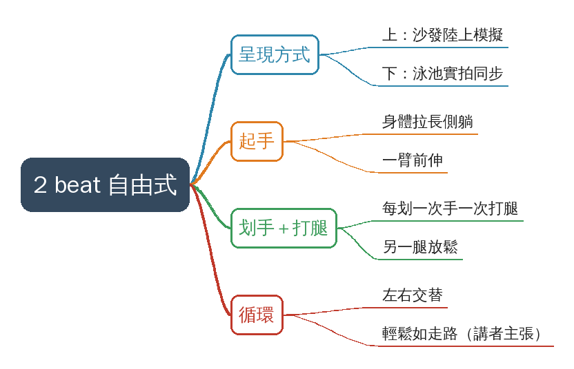
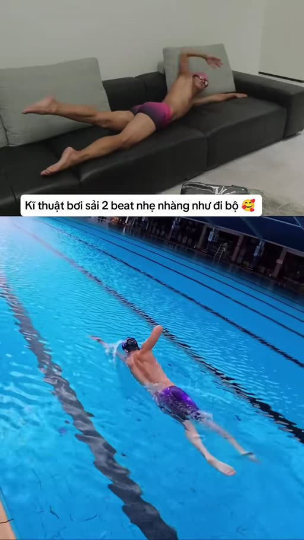
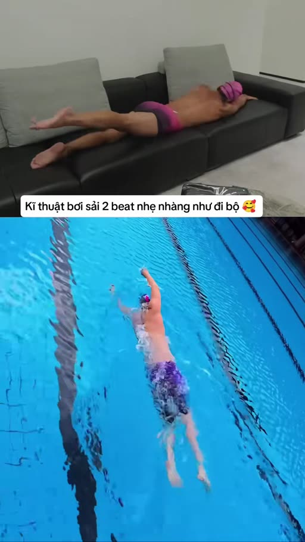
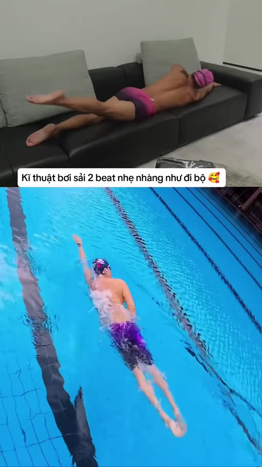

# Kĩ thuật bơi sải nhẹ nhàng như đi bộ

- 來源：https://vt.tiktok.com/ZSpYhDSY6/
- 平台 / 上傳者：TikTok / dayboisinhtonbmt
- 長度：00:13 (12.5s)
- 逐字稿來源：whisper (groq)
- 更新日期：2026-11-05
- **關鍵字：** #游泳 #自由式 #2 beat 打腿 #省力 #陸上模擬 #分割畫面 #身體滾動 #打腿節奏 #越南語標題 #無人聲

## 摘要與名詞說明

**一句話重點**：越南語短片（12.5 秒、無人聲），以「上方沙發陸上模擬＋下方泳池實拍」同步示範 2 beat 自由式——每划一次手只配一次打腿，標題主張（講者主張，未查證）這樣游起來「輕鬆如走路」。

## 重點表

| 時間 | 重點 |
|---|---|
| 00:00 | 起手：身體拉長側躺、一臂前伸、雙腿在身後 |
| 00:04 | 手臂回收入水划動時，配合單腿一次打腿，另一腿放鬆 |
| 00:09 | 左右交替循環，上下畫面同步對照 |

## 名詞說明

- **自由式（bơi sải）**：游泳四式之一，手臂交替划水、腿部打水。
- **2 beat kick**：每一個手臂循環（左右各划一次）打兩下腿，即每划一次手一次打腿；常見的對照是 6 beat（每循環六下）。2 beat 較省力，常見於長距離（此為一般泳技常識，非影片所述，未查證）。
- **陸上模擬（dry-land）**：在沙發上側躺模擬游泳動作，放慢、放大以便看清手腿配合。

## 逐字稿備註

影片沒有人聲。Whisper 輸出的「Thanks for watching!」是無語音時的典型幻覺，已記在 `known_asr_errors`（推測）。內容以畫面與標題為準；影片沒說明的細節（換氣時機、打腿的左右邊與入水手的對應關係）請見 `supplement.md` 的「影片未示範」。

## 補充資料（影片未呈現的資訊）

### 畫面文字（原文）

- 畫面標題：「Kĩ thuật bơi sải 2 beat nhẹ nhàng như đi bộ 🥰」＝「像走路一樣輕鬆的 2 beat 自由式技術」。
- 原貼文標籤：#bơi #bơilội #swimming #swim（越南語：游泳）。

### 影片未示範／未說明

- 換氣的時機與方式：影片未示範。
- 打腿的腳與入水手的對應（同側或對側）：畫面看得到單腿較大幅度打腿，但哪一側對應哪隻手，影片沒有文字標示，推測需逐格對照，未確認。
- 速度、距離、適用對象：影片未說明；「輕鬆如走路」是標題主張，未查證。

## 思維導圖

- 原圖：[mindmap.png](mindmap.png)；文字大綱：[mindmap.md](mindmap.md)（與本報告同資料夾）

## 圖文對照（畫面 + 逐字稿＋中譯）

### 投影片 1：起手：身體側躺、一臂前伸（00:00–00:04）

**重點：** 畫面上下同步：上方是在沙發上側躺的陸上模擬，下方是泳池實拍。起手時身體拉長、一手前伸，另一手開始回收，雙腿伸直在身後。這是影片標題所說「2 beat」節奏的起點（每一次划手配一次打腿）。

**標籤：** #起手 #一臂前伸

Thanks for watching!

**中譯：** （全片無人聲；Whisper 只輸出「Thanks for watching!」，疑為無語音片段的幻覺。畫面標題：「Kĩ thuật bơi sải 2 beat nhẹ nhàng như đi bộ」＝「像走路一樣輕鬆的 2 beat 自由式技術」。）

### 投影片 2：划手配合單腿打腿（00:04–00:09）

**重點：** 手臂回收、入水並向前划的同時，只有一條腿做一次較大的打腿，另一條腿放鬆跟隨；沙發版本把動作放慢、放大，方便看清腿與手的配合。池中的泳者身體幾乎不晃，看起來像走路般輕鬆（標題主張）。

**標籤：** #划手 #打腿

### 投影片 3：左右循環，維持輕鬆節奏（00:09–00:13）

**重點：** 後段重複同樣的循環：左右手交替、每划一次手配一次打腿，上下兩個畫面同步對照，示範動作可連續、低耗能地進行。影片結束時沒有文字講解，細節需自行對照畫面。

**標籤：** #循環 #節奏

## 已知轉錄錯誤

| 時間 | 聽成 | 應為 |
|---|---|---|
| 00:00 | Thanks for watching! | （無人聲，推測為 Whisper 對無語音片段的幻覺） |

## 補充資料連結

- 補充資料檔：[supplement.md](supplement.md)（與本報告同資料夾；內容已收錄於上方〈補充資料〉）
- 思維導圖：[mindmap.png](mindmap.png)、文字大綱：[mindmap.md](mindmap.md)（與本報告同資料夾）
