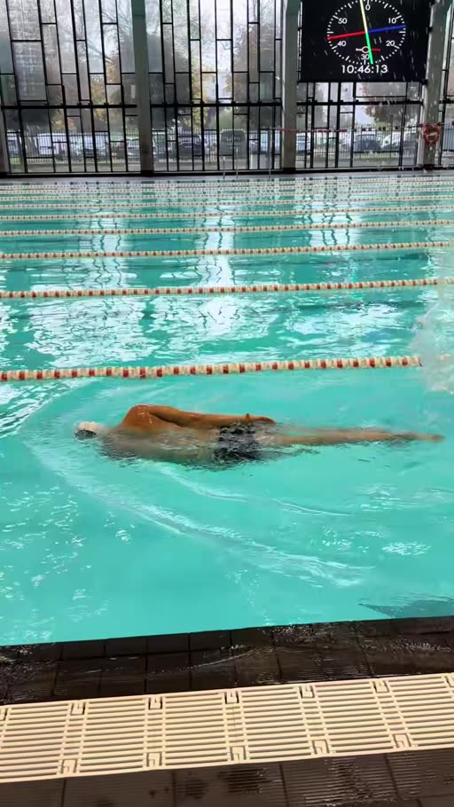

# Сохраняйте и пробуйте новое упражнение для развития 2х ударного кроля...

- 來源：https://vt.tiktok.com/ZSpYUkxHN/
- 平台 / 上傳者：TikTok / poseidon.swim
- 長度：00:16 (15.9s)
- 逐字稿來源：whisper (groq)
- 更新日期：2026-11-05

## 摘要與名詞說明

_待補：請依逐字稿撰寫含時間戳的摘要。_

## 圖文對照（畫面 + 逐字稿）

### 畫面 00:00–00:16

Thanks for watching!
