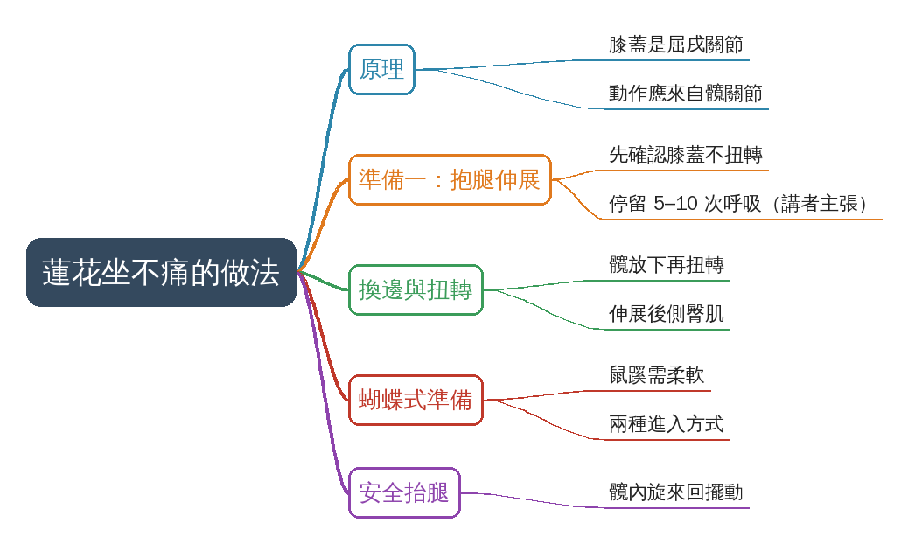

# Padmasana is not painful if you do this way

- 來源：https://www.facebook.com/share/v/19wM8h9Hdy/
- 平台 / 上傳者：Facebook / Prashant Jakhmola
- 長度：02:49 (169.4s)
- 逐字稿來源：whisper (groq)
- 更新日期：2026-11-03
- **關鍵字：** #蓮花坐 #Padmasana #瑜伽 #髖關節 #膝蓋保護 #蝴蝶式 #髖內旋 #運動傷害預防

## 摘要與名詞說明

**一句話重點**：講者 Prashant Jakhmola（畫面帳號 @prashantjyoga）說明蓮花坐的力量應來自髖關節而非扭轉膝蓋，並示範用抱腿伸展、扭轉、蝴蝶式與髖內旋做準備（以下皆講者主張，未查證）。

| 時間 | 重點 |
|---|---|
| 00:00 | 膝蓋是屈戌關節，只能彎曲／伸直；蓮花坐的動作來自髖關節 |
| 00:33 | 先確認膝蓋不扭轉，抱腿推髖伸展，停留 5–10 次呼吸 |
| 01:11 | 另一側做法；扭轉時髖要放下，伸展後側臀肌 |
| 01:41 | 蝴蝶式是前置準備；兩種進入方式 |
| 02:13 | 抬腿放上另一腿時用髖內旋，較安全 |

**名詞**：Padmasana＝蓮花坐；hinge joint＝屈戌（鉸鏈）關節；internal rotation＝內旋。
**語言**：英文，已寫繁中中譯 `transcript.zh.md`（Whisper 偵測 en）。
**校正備註**：02:13 之後逐字稿片段化，中譯含推測；「here joint」推測為 hip joint。
**提醒**：這是運動教學短片，不是醫療建議；膝蓋或髖有傷、疼痛者應先諮詢專業人員，疼痛時停止。

## 思維導圖

- 原圖：[mindmap.png](mindmap.png)；文字大綱：[mindmap.md](mindmap.md)（與本報告同資料夾）

## 圖文對照（畫面 + 逐字稿＋中譯）

### 投影片 1：蓮花坐為何會痛：膝蓋是屈戌關節（00:00–00:33）

**重點：** 講者說膝蓋是屈戌（鉸鏈）關節，只能彎曲與伸直；蓮花坐看似扭轉膝蓋，把腿抬起來的動作其實來自髖關節。圖為講者示範抬腿（00:17 另有一張關節構造圖，標題被裁切）。（講者主張，未查證）

**標籤：** #膝蓋 #屈戌關節 #髖關節

how to perform and achieve padmasana, the lotus pose, so you don't feel pain and how to avoid the pain and the injuries while you perform padmasana. It's a bending pose. So first of all, it's a knee pose, right? Remember, it's a hinge joint, the knee. You can only do flexion and extension with the knee. So what may look twisting in padmasana when you perform like that, you know, many people they put what may look that you are lifting this leg up is not actually the movement.

**中譯：** 教你怎麼做到蓮花坐（Padmasana），而且不會痛，也避免做蓮花坐時受傷。首先，蓮花坐是個彎曲的姿勢，也就是膝蓋的姿勢。要記得膝蓋是屈戌（鉸鏈）關節，只能做彎曲和伸直。所以蓮花坐看起來像是扭轉，很多人把腿抬起來，看起來像是膝蓋在動，其實那不是膝蓋的動作，而是直接來自髖關節。

### 投影片 2：準備一：膝不扭轉，抓腿推伸展髖（00:33–01:11）

**重點：** 先彎曲並確認膝蓋沒有扭轉，用力抓住小腿往前推，伸展髖與臀肌，減輕蓮花坐對下背與薦骨的壓力；停留 5–10 次呼吸（講者建議）。圖為抱腿推伸的畫面。

**標籤：** #髖伸展 #5–10 次呼吸

of the knee which comes directly from the here joint so remember in padmasana you first bend like that make sure there's no twist with the knee and now you try to take this leg including this bending make a strong grip this side first do this padmasana okay and now start pushing it so that you can stretch the hip more because padmasana also create lots of pressure with the lower back especially the sacrum so this kind of twisting will prepare your hip the glutes so that padmasana is easier for you just at least for five to ten breath just stay here.

**中譯：** 記住，做蓮花坐時先這樣彎曲，確認膝蓋沒有扭轉；然後把這條腿連同彎曲的部分，用力抓住這一側，先做這個蓮花坐的準備。接著開始往前推，讓髖部伸展得更多。因為蓮花坐會對下背部、特別是薦骨造成很大壓力，這種扭轉會讓你的髖部與臀肌做好準備，蓮花坐就會比較容易。至少停留五到十次呼吸，輕柔地感受伸展，你就準備好了。

### 投影片 3：換邊與扭轉：髖要放下（01:11–01:41）

**重點：** 換另一側，同樣先確認沒有扭轉，把整條腿抱起放到另一側再扭轉；扭轉時一手撐地、髖要放下而不是抬起，才能伸展後側臀肌。圖為扭轉時髖放下的畫面。

**標籤：** #扭轉 #臀肌

to feel the stretch gently so you are ready other side the same way you're straight you first bend like this make sure there no twisting just hold this whole leg place it other side grab it and just simply twist see and when you twist don just try to lift the hip you drop the hip and then twist like this and this is how you stretch the back glute you come step number one first simply rotate.

**中譯：** 換另一側，同樣的方式。先彎曲，確認沒有扭轉，把整條腿抱起放到另一側，抓住，然後單純扭轉。扭轉時，不要只是把髖部抬起來，要讓髖部放下，再去扭轉。這樣就能伸展到後側臀肌。這是第一步：先單純旋轉、放下；

### 投影片 4：蝴蝶式作為前置準備（01:41–02:13）

**重點：** 講者稱蓮花坐前蝴蝶式非常重要，鼠蹊要有足夠柔軟度；並提出兩種進入蓮花坐的方式：旋轉彎曲，或完全彎曲放下再把腳拉近。圖為蝴蝶式。

**標籤：** #蝴蝶式 #鼠蹊柔軟度

drop it out and how you drop it it means you should have a good flexibility in the groins here so the next asana as a preparation comes butterfly pose so before you do padmasana butterfly movement is must very very important two way to perform padmasana first is rotate bend second is bend completely drop out you drop it take and slightly bring it close see the gap.

**中譯：** 要放得下去，代表你的鼠蹊（腹股溝）要有不錯的柔軟度。下一個動作作為準備是蝴蝶式。做蓮花坐之前，蝴蝶式的動作非常、非常重要。做蓮花坐有兩種方式：第一種是旋轉、彎曲；第二種是完全彎曲放下，再稍微把腳拉近，看看中間的空隙。

### 投影片 5：安全抬腿：髖內旋（02:13–02:49）

**重點：** 要把腳放到另一條腿上時會產生一點扭轉，講者示範較安全的做法：把整條腿從下方抬起，做髖關節內旋並來回擺動，再放下。圖為把腳抱到另一條腿上的畫面；02:16 起畫面有「Step-2」標籤，結尾有「Complete video on YouTube」與帳號字樣。此段逐字稿片段化（見校正備註）。

**標籤：** #髖內旋 #Step-2

In step come the other leg because now you need to take this foot on top of the other Which creates little twisting there's a one way to do safely the way is Once suppose you press, okay Now you lift the whole leg from the bottom Take internal rotation of the hip socket the ball and socket internal rotation swing This you can do right take few rotation like this and move the entire hip there drop.

**中譯：** 接下來換另一條腿，因為現在要把這隻腳放到另一條腿上面，這會產生一點扭轉。有一個安全的做法：先壓住，然後把整條腿從下方抬起，做髖臼（球窩關節）的內旋，來回擺動幾次，帶動整個髖部，然後放下。

## 已知轉錄錯誤

| 時間 | 聽成 | 應為 |
|---|---|---|
| 00:26 | the here joint | 推測為 hip joint（髖關節） |
| 02:13 | In step come the other leg | 推測為「Next step, come to the other leg」；02:13 後逐字稿片段化，中譯依上下文整理（推測） |

## 補充資料連結

- 思維導圖：[mindmap.png](mindmap.png)、文字大綱：[mindmap.md](mindmap.md)（與本報告同資料夾）
