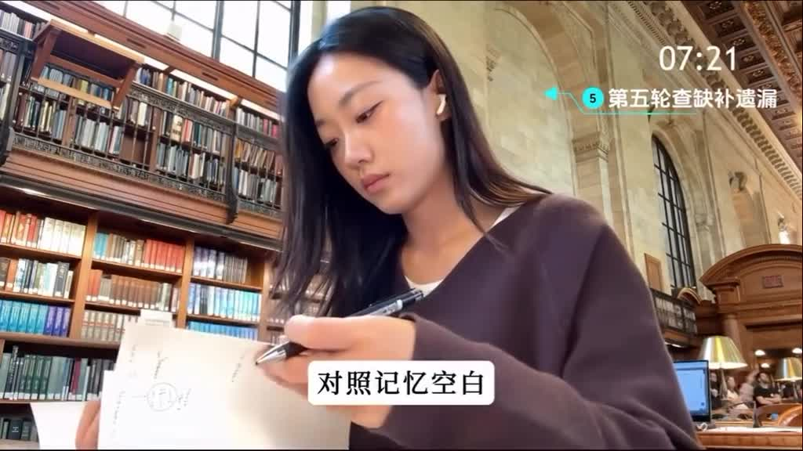

# Threads 讀書上癮的秘訣

- 來源：https://www.threads.com/share/BAfZMwitD9/
- 平台 / 上傳者：Web / abingbuleng（Threads）
- 長度：03:10 (189.6s)
- 逐字稿來源：whisper (groq)
- 更新日期：2026-10-21
- **關鍵字：** #讀書記憶 #六輪滾動記憶法 #背書 #艾賓浩斯遺忘曲線 #短時記憶／長時記憶 #費曼式複述 #默寫 #思維導圖 #查缺補漏 #考試

## 摘要與名詞說明

**一句話重點**：講者（Threads 帳號 abingbuleng）推廣「六輪滾動記憶法」：依艾賓浩斯遺忘曲線，用六遍遞進的背書流程（翻書講→抓關鍵詞→閉書講→默寫→查缺補漏→完整複述），把短時記憶轉成長時記憶；成效數字皆為講者主張，未查證。

| 時間 | 重點 |
|---|---|
| 00:00 | 開場主張：過目不忘可後天養成、99% 考試拼記憶、背書速度可超越同學十倍、三天背完「馬原」得 90 分、一週背 2,000 單詞過四六級（講者主張，未查證） |
| 00:48 | 「完整版不在此展示，想學敲 666」（引流話術）；用艾賓浩斯遺忘曲線說明：短時記憶容量有限，新內容會擠掉舊內容，需轉成長時記憶 |
| 01:09 | 節奏：六遍為一輪，建議每週循環一遍 |
| 01:17 | 第一輪 翻書講內容：先建立整體框架，不細摳詞句，邊翻邊講給自己聽 |
| 01:34 | 第二輪 抓關鍵詞語：回原文找關鍵概念與高頻點，標記關鍵詞、畫邏輯箭頭，盡量熟練 |
| 01:52 | 第三輪 閉書講一遍：看筆記或思維導圖、合上書說出內容，找出記不牢處再回書補 |
| 02:07 | 第四輪 動手寫下來：空白紙默寫，目的是讓大腦主動提取資訊 |
| 02:23 | 第五輪 查缺補漏：對照思維導圖與默寫內容，用不同顏色補上沒記住的，再複述 |
| 02:40 | 第六輪 完整複述：不依賴工具、合上書用講課方式講一遍（可錄音自我檢驗），求流暢而非完美 |
| 02:59 | 結語：每一遍都有目的、有重點地加深，六遍走完形成立體掌握 |

## 名詞說明
- **六輪滾動記憶法**：講者自創的稱呼（畫面字幕「6轮滚动记忆法」），非通用學術名詞。
- **艾賓浩斯遺忘曲線**：描述記憶隨時間遺忘的曲線；講者以此引出「短時→長時記憶」。
- **馬原**：依畫面字幕「马原」，推測為大陸大學課程「馬克思主義基本原理」，未查證。
- **四六級**：大陸大學英語四級／六級考試。
- **普心**：推測為「普通心理學」，畫面無字幕可核對。

## 轉錄校正備註
- 中文影片，Groq 轉錄，語言自動偵測為 zh；影片有燒錄的簡體字幕，已用來核對（詳見 `meta.json.known_asr_errors`）。
- 主要校正：混動→滾動、馬雲→馬原、46級→四六級、心機收→新吸收、常識記憶→長時記憶、戲口→細摳、高評點→高頻點、公智和上書→工具合上書等。
- 非講座類影片，未去除語助詞。
- 影片來源：yt-dlp 不支援 Threads，影片是從貼文頁面取得的 mp4（`meta.json.source_post`）。畫面右上角的計時（如 05:10）是原片剪輯殘留，與本報告時間戳無關。

## 補充資料（影片未呈現的資訊）


### S1｜貼文：Threads 貼文說明文字
- 來源：Threads 貼文頁面（帳號 abingbuleng，約 4 天前發布）；取得日期：2026-10-21；取得方式：Claude 以瀏覽器渲染貼文頁面，讀取頁面文字。
- 為何需要補充：影片本身沒有貼文標題；貼文說明文字交代了這支影片的定位。
**原文（逐字）**
```
一個很變態，但可以讓你讀書上癮的秘訣！
```
**Claude 的對照分析**
- 補充直接寫明：貼文用語為「很變態、讓你讀書上癮」，即影片 00:09「越背越上頭」的行銷包裝。
- 與影片一致：貼文主題即影片的六輪背書法。
- 未取得：留言、按讚數；頁面需登入才能顯示完整內容。
**備註**
- 影片中的成效（三天背完馬原 90 分、一週 2,000 單詞過四六級、速度十倍、恢復 300% 記憶力）皆為講者主張，未查證。
- 影片 00:48 的「敲 666」是向觀眾索取完整版的引流話術；完整版未提供，本報告只涵蓋影片所述的六輪流程。

## 圖文對照（畫面 + 逐字稿）

### 投影片 1：開場：六輪滾動記憶法的主張（00:00–00:48）


**重點：** 講者主張過目不忘可以後天養成，99% 的考試拼的是記憶而不是智商。她說自己用六輪滾動記憶法，背書速度可超越同學十倍、三天背完馬原得 90 分、一週背 2,000 單詞過四六級（以上皆講者主張，未查證）。

**標籤：** #六輪滾動記憶法 #考試拼記憶

沒錯，過目不忘是可以後天養成的，只不過是八天背完一本書罷了，其實99%的考試不拼智商，只拼記憶，其實只要方法對了，它真的會讓人越背越上頭，不是誇張，我自己用的六輪滾動記憶法，堅持幾周後，你的背書速度就可以超越身邊同學的十倍，長期擺爛後也能快速恢復300%的記憶力，我曾經靠著這個方法只花了三天的時間就把馬原背完了，並取得了90分的成績，只花了一週的時間，就背下英語2,000個單詞，並且拿下英語四六級高分的成績，帶領粉絲朋友們一起學習，收到很多積極的反饋，事實證明，這個方法無論對誰都非常有效，適用於各種考試，這只是單一的一種方法，完整的這裡就不展示了。

### 投影片 2：原理：遺忘曲線與短時→長時記憶（00:48–01:09）


**重點：** 講者先說完整版不在此展示，想學要留言「666」（引流話術）。接著依艾賓浩斯遺忘曲線說明：短時記憶只能在一定時間內儲存一定量的內容，新吸收的東西會擠走舊內容。要把短時記憶轉成長時記憶，就必須採用滾車輪式背誦法。

**標籤：** #艾賓浩斯遺忘曲線 #短時記憶 #長時記憶

特別想學的話敲666，學過普心的同學都知道，根據艾賓浩斯的遺忘曲線，我們的短時記憶，只能夠在一定時間內儲存一定量的事情，時間長了，新吸收的東西就會擠走原本看過的舊內容，所以要將這種短時記憶轉變成長時記憶，就必須採取滾車輪式背誦法。

### 投影片 3：節奏：六遍為一輪、每週循環（01:09–01:17）


**重點：** 講者的背書節奏是六遍為一輪，建議每週循環一遍；每背一輪都會更清晰、更熟練。這段是進入六個步驟前的總說明。

**標籤：** #六遍一輪 #每週循環

以下是我自己的背書節奏，六遍為一輪，建議每週迴圈一遍，每背一輪都會更清晰，更熟練。

### 投影片 4：第一輪：翻書講內容，先建立整體框架（01:17–01:34）


**重點：** 第一輪不要一開始就細摳詞句，先打開書，像講故事一樣一邊翻一邊講給自己聽。重點是抓住結構和章節邏輯，像搭建知識大廈的骨架。

**標籤：** #整體框架 #章節邏輯

一，第一輪，翻書講內容，先建立整體框架，別一開始就細摳詞句，先開啟書，像講故事一樣一邊翻一邊講給自己聽，先把大概內容過一遍，重點是抓住結構和章節邏輯，像搭建一座知識大廈的骨架。

### 投影片 5：第二輪：抓關鍵詞語，把細節填進骨架（01:34–01:52）


**重點：** 回到原文，找出關鍵概念和高頻點，把第一輪的框架填滿。這個階段可以標記關鍵詞、畫邏輯箭頭來連結資訊，內容不需要百分百精準，但要盡量熟練。

**標籤：** #關鍵詞 #高頻點 #邏輯箭頭

2. 第二輪，抓關鍵詞語，細節填進大骨架回到原文，找出關鍵概念和高頻點，把框架填滿肉。這個階段可以標記關鍵詞，畫邏輯箭頭，幫助你連線資訊，內容不需要百分百精準，但要盡量熟練。

### 投影片 6：第三輪：閉書講一遍，捋順邏輯（01:52–02:07）


**重點：** 拿出自己的筆記本或思維導圖，合上書，邊看結構邊把內容說出來。這個階段會發現哪些地方記得不牢，要及時回書查漏補缺。

**標籤：** #閉書講 #思維導圖

3. 第三輪，閉書講一遍，捋順自己的邏輯，拿出自己的筆記本或思維導圖，合上書，嘗試邊看結構邊把內容說出來，這個階段會發現哪些地方記得不牢，及時回書查漏補缺。

### 投影片 7：第四輪：動手寫下來，模擬輸出（02:07–02:23）


**重點：** 找一張空白紙，邊背邊默寫。目的不是練字，而是讓大腦主動提取資訊；講者說寫的過程相當於在腦海裡影印一次，所以記得更牢。

**標籤：** #默寫 #主動提取

四，第四輪，動手寫下來，模擬輸出表達，找一張空白紙，邊背邊默寫，不是為了練字，而是為了讓大腦主動提取資訊，寫的過程相當於在腦海裡影印一次，記得更牢。

### 投影片 8：第五輪：查缺補漏，對照記憶空白（02:23–02:40）



**重點：** 拿第三輪的思維導圖或重點筆記，對照剛才默寫的內容，把沒記住的地方用不同顏色補上，再複述一遍。講者說做到這裡，你其實已經掌握七七八八了。

**標籤：** #查缺補漏 #不同顏色

五，第五輪，查缺補漏，對照記憶空白，拿第三輪的思維導圖或重點筆記，對照剛才默寫的內容，把沒記住的地方用不同顏色補上，再複述一遍，這時候你會發現，你其實已經掌握的七七八八了。

### 投影片 9：第六輪：完整複述，強化記憶流暢度（02:40–02:59）


**重點：** 最後一輪不要再依賴工具，合上書用講課的方式完整講一遍，可以默講，也可以開錄音自我檢驗。這一步不追求完美，而是追求流暢、順暢調動的能力，並模擬考試狀態。

**標籤：** #完整複述 #錄音自我檢驗 #模擬考試

六，第六輪，完整複述，強化記憶流暢度，最後一輪不要再依賴工具合上書，用講課的方式完整講一遍，可以默默講，也可以開錄音自我檢驗，這一步不追求完美，而是追求流暢和順暢調動的能力，模擬考試狀態。

### 投影片 10：結語：每一遍都有目的地加深（02:59–03:10）


**重點：** 講者總結每一遍都不是簡單重複，而是有目的、有重點地加深；六遍走完，會對那部分內容形成非常立體的掌握。

**標籤：** #立體掌握

每一遍其實都不是簡單重複，而是有目的，有重點的加深，六遍走完，你會對那部分內容形成非常立體的掌握。

## 已知轉錄錯誤

| 時間 | 聽成 | 應為 |
|---|---|---|
| 00:13 | 六輪混動記憶法 | 六輪滾動記憶法（依畫面字幕） |
| 00:24 | 馬雲 | 馬原（馬克思主義基本原理，依畫面字幕；課程名稱為推測） |
| 00:33 | 46級 | 四六級（依畫面字幕「四六级完成」） |
| 00:56 | 一定要的事情 | 一定量的事情（依畫面字幕） |
| 01:00 | 心機收的東西 | 新吸收的東西（依畫面字幕） |
| 01:03 | 常識記憶 | 長時記憶（依畫面字幕） |
| 01:06 | 滾車人士背誦法 | 滾車輪式背誦法（依畫面字幕「滚车轮式背诵法」；講者原話可能是「滾輪式」，推測） |
| 01:22 | 戲口詞句 | 細摳詞句（依畫面字幕） |
| 01:39 | 高評點 | 高頻點（依畫面字幕） |
| 01:50 | 儘量熟三 | 盡量熟練（依字幕「尽量熟」，後字推測） |
| 01:52 | 一書講一遍 | 閉書講一遍（依畫面字幕） |
| 02:45 | 公智和上書 | 工具合上書（依畫面字幕「不要再依赖工具合上书」） |
| 02:52 | 看錄音 | 開錄音（依畫面字幕） |
| 00:50 | 普心 | 保留；推測為「普通心理學」的簡稱，畫面無字幕可核對 |

## 補充資料連結

- 補充資料檔：[supplement.md](supplement.md)（與本報告同資料夾；內容已收錄於上方〈補充資料〉）
