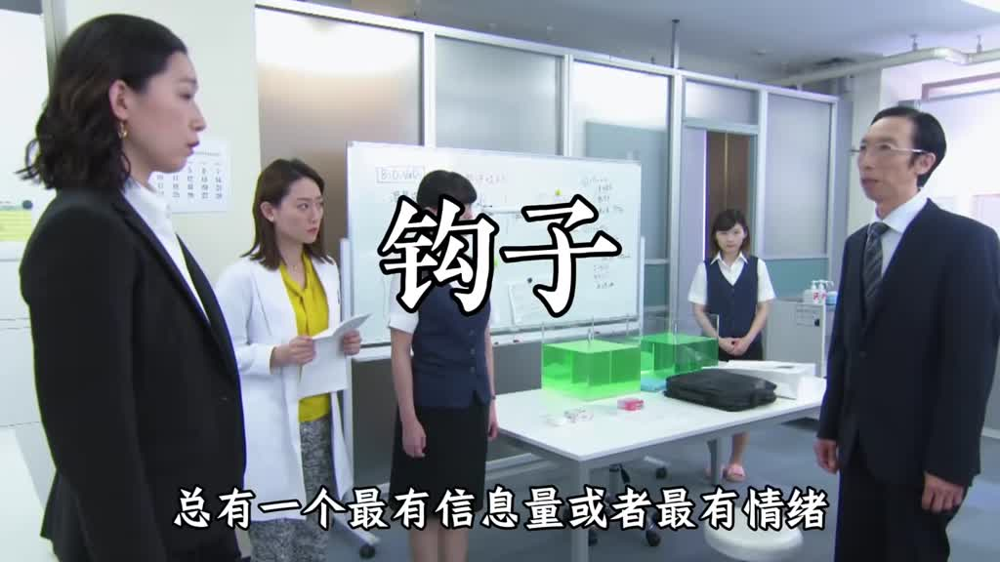

# 聊天不要聊自己，要聊對方剛才那一句

- 來源：https://vm.tiktok.com/ZSgTvnqFB/
- 平台 / 上傳者：TikTok / juzhongren33
- 長度：03:04 (184.3s)
- 逐字稿來源：whisper (groq)
- 更新日期：2026-11-01
- **關鍵字：** #溝通技巧 #聊天 #接話 #傾聽 #鉤子詞 #同理心 #破冷場 #七天練習

## 摘要與名詞說明

**一句話重點**：講者主張，把注意力放在對方「剛才那一句」上，就能讓話題接得住、拉得長；用七天、每天一個小動作練成（效果為講者主張，未查證）。

- 來源：TikTok（juzhongren33），3:04，中文，Whisper（Groq）轉錄，已轉繁體。
- 影片形式：電影／影集片段混剪＋燒入字幕與標題字，沒有講者出鏡；逐字稿以畫面字幕核對。

## 含時間戳重點

| 時間 | 重點 |
|---|---|
| 00:00 | 對比：回「我也在學、我做了紅燒肉」是聊自己；回「學多久了？」才是聊對方，對方會越聊越來勁 |
| 00:29 | 第一天 聽完再開口：等對方完整說完，默數兩秒再接 |
| 00:46 | 第二天 找鉤子詞：挑出對方話裡資訊量最大或最有情緒的詞，圍繞它發問 |
| 01:07 | 第三天 複述加一問：先複述再追問，對方覺得被聽見、話題自然延續 |
| 01:26 | 第四天 先接情緒再接事件：「被當眾批評，那挺難受的吧？」 |
| 01:51 | 第五天 模仿採訪式問法：觀察主持人如何在對方的話上推進，不跳題、不轉移 |
| 02:09 | 第六天 專項破冷場：對「還好」追問「是什麼意思？比上次好還是差不多？」，給選擇 |
| 02:27 | 第七天 綜合實戰：每句話從對方剛才那句出發，聊完檢討有沒有聊回自己 |
| 02:44 | 日常加練：每天十分鐘看談話節目；結語：底層是把注意力放在對方身上 |

## 名詞說明

- **鉤子詞**：對方話裡資訊量最大或情緒最重的詞，用來當下一句的切入點。
- **聊回自己**：接話時把話題拉到自己的經驗上。

## 轉錄校正備註

- 「順時拉長」→「順勢拉長」、「統治自己的回答」→「組織自己的回答」（畫面字幕）、「莫屬兩秒」→「默數兩秒」（皆記入 `known_asr_errors`）。
- 非講座，未去除語助詞。

## 思維導圖

- 原圖：[mindmap.png](mindmap.png)；文字大綱：[mindmap.md](mindmap.md)（與本報告同資料夾）

## 圖文對照（畫面 + 逐字稿）

### 投影片 1：開場：接住對方剛才那一句（00:00–00:29）

**重點：** 聊天的關鍵不是聊自己，而是聊對方剛才說的那一句。以「最近在學做飯」為例：回「我也在學、上週做紅燒肉」是在聊自己，話題很快斷；回「學多久了、跟影片學還是有人帶」才是聊對方，對方會越聊越來勁。影片承諾練七天就能把每句話接住、順勢拉長。

**標籤：** #聊對方 #接話

聊天不要聊自己 要聊對方剛才那一句，這句話聽起來簡單 但大多數人聊天的時候根本沒做到，對方說我最近在學做飯 你接 哦我也在學 我上週做了紅燒肉，這就是在聊自己 對方說我最近在學做飯 你接 真的，學了多久了 跟影片學還是有人帶，這才是聊對方剛才那一句 感受到差別了嗎，第一種 話題很快就斷了 第二種 對方會越聊越來勁，這期內容專門解決一個問題 讓你學會把對方的每句話接住 順勢拉長，只需要練七天 你會發現自己跟任何人都能聊下去。

### 投影片 2：第一天：聽完再開口（00:29–00:46）

**重點：** 今天只做一件事：等對方把話完整說完再開口。多數人在對方說到一半時，腦子已在組織自己的回答，根本沒聽後半段。練習方式是對方說完一句後默數兩秒再接話，光這一個動作就有差別。

**標籤：** #傾聽 #默數兩秒

第一天練聽完再開口，今天只做一件事，和任何人聊天的時候，等對方把話說完，完整說完，你再開口，聽起來廢話，但你試試就知道，大多數人在對方說到一半的時候，腦子已經在組織自己的回答了，根本沒在聽後半段，今天對方沒說完一句，你默數兩秒再接話，就這一個動作。

### 投影片 3：第二天：找出鉤子詞（00:46–01:07）

**重點：** 對方的話裡總有一個資訊量最大、或情緒最重的詞，就是「鉤子」。例如「我最近壓力好大，一直在加班」，鉤子是「壓力大」和「加班」。聽完把鉤子挑出來、圍繞它開口（加班多久了？是最近專案忙嗎？），不用自己找話題，因為對方已經給了。

**標籤：** #鉤子詞 #找話題

第二天找對方話裡的鉤子詞，對方說的話裡，總有一個最有資訊量，或者最有情緒的詞，那就是鉤子，比如對方說我最近壓力好大，一直在加班，鉤子就是壓力大和加班，你今天練的動作就是，聽完之後把鉤子挑出來，圍繞他開口，就說加班多久了，是最近專案忙嗎，不用自己找話題，對方已經給你了，你只是接住他。

### 投影片 4：第三天：複述加一問（01:07–01:26）

**重點：** 練一個公式：先複述對方的話，再追問一個問題。例如對方說「昨天去爬山了，累慘了」，你回「你昨天去爬山了？爬了多久？」。好處有二：對方感覺被聽見、被重視；話題自然延續，不必絞盡腦汁想下一句。今天找一個人，認真用這個公式五次。

**標籤：** #複述 #追問公式

第三天，複述加一問，今天練一個公式，先複述對方的話，再追一個問題，對方說昨天去爬山了，累慘了，你說你昨天去爬山了，爬了多久，這個動作有兩個好處，第一對方感覺到你在聽，有被重視的感覺，第二話題自然延續，你不需要絞盡腦汁，想下一句聊什麼，今天找一個人練，認真用這個公式。

### 投影片 5：第四天：先接情緒再接事件（01:26–01:51）

**重點：** 很多人只接事件、漏掉情緒，讓對方覺得被敷衍。對方說「我今天被領導當眾批評了」，只接事件會問「批評什麼？」；先接情緒則說「被當眾批評，那挺難受的吧？怎麼了？」，對方會立刻打開話匣子。練習：每次聽到對方說話，先感受他說這話時的情緒，再決定怎麼接。

**標籤：** #先接情緒 #同理

用五次，第四天先接情緒再接事件很多人接話只接事件漏掉了情緒這就讓對方覺得你是在敷衍，對方說我今天被領導當眾批評了。如果你只接事件就會問，批評什麼？但如果先接情緒，就說被當眾批評，那挺難受的吧？怎麼了？你會發現後一種方式，對方會立刻開啟話匣子。今天練這個動作，每次聽到對方說話，先感受他說這話時是什麼情緒，再決定怎麼接。

### 投影片 6：第五天：模仿採訪式問法（01:51–02:09）

**重點：** 找三到五段訪談節目，重點不是聽嘉賓說什麼，而是觀察主持人怎麼接話、怎麼追問。高手的共同點是永遠在對方剛才說的基礎上推進：不跳題、不轉移、不急著表達自己的看法。模仿這個節奏，並在當天聊天時帶進去試試。

**標籤：** #訪談 #追問

第五天，模仿採訪式問法，今天找三到五段訪談節目。重點不是聽嘉賓說什麼，而是觀察主持人怎麼接話怎麼追問，你會發現高手接話有一個共同點，永遠在對方剛才說的基礎上推進，不跳題，不轉移，不急著表達自己的看法，模仿這個節奏，今天和人聊天的時候，把這個感覺帶進去試試。

### 投影片 7：第六天：專項破冷場（02:09–02:27）

**重點：** 最怕遇到只回一兩個字的人（「嗯」「哦」「還好」）。這時不要放棄，也不要自己硬撐著說。對方說「還好」，就問「還好是什麼意思？比上次好一點，還是差不多？」，給他一個選擇，引導他多說一句。

**標籤：** #破冷場 #二選一提問

第六天，專項破冷場，聊天最怕遇到那種，說什麼都只會一兩個字的人，嗯哦還好，然後就沒了，今天專門練這種場景，遇到這種情況不要放棄，也不要自己硬撐著說，對方說還好，你就說還好是什麼意思，比上次好一點還是差不多，給他一個選擇，引導他多說一句。

### 投影片 8：第七天：綜合實戰（02:27–02:44）

**重點：** 今天不設新動作，綜合用前六天練的東西。找一個平時聊天最容易斷的人主動開啟對話，全程貫徹一個原則：每句話都從他剛才說的那句出發。聊完自我檢討：這次有沒有聊回自己？那段話是什麼？下次怎麼接？

**標籤：** #實戰 #複盤

第七天，綜合實戰，今天不設新動作，綜合用前六天練的東西，找一個你平時聊天最容易斷的人，主動開啟一段對話，全程貫徹一個原則，每句話都從他剛才說的那句裡出發，聊完之後問自己，這次有沒有出現聊回自己的情況，如果有，那段話是什麼，下次怎麼接。

### 投影片 9：日常加練與結語（02:44–03:04）

**重點：** 每天留十分鐘看一段談話類節目（訪談、播客、街頭訪談），觀察誰更會接話、為什麼那個話題聊得起來，看完用一句話記下今天學到的接話方式。結語：接話表面上是聊天技巧，底層是你有沒有真的把注意力放在對方身上，練到位就能跟任何人聊下去。

**標籤：** #日常練習 #注意力

每天留十分鐘看一段談話類節目，不是為了娛樂，是觀察對話裡誰更會接話，為什麼那個話題能聊起來，可以看採訪影片，播客或者街頭訪談，看完用一句話記下今天學到的接話方式，接話這個能力表面上是聊天技巧，底層是你有沒有真的把注意力放在對方身上，練到位了，你會發現自己跟任何人都能找到聊下去的方向。

## 已知轉錄錯誤

| 時間 | 聽成 | 應為 |
|---|---|---|
| 00:21 | 順時拉長 | 順勢拉長（推測，字幕為「顺势拉长」） |
| 00:39 | 統治自己的回答 | 組織自己的回答（畫面字幕「組織回答」） |
| 00:44 | 你莫屬兩秒 | 你默數兩秒（推測） |

## 補充資料連結

- 思維導圖：[mindmap.png](mindmap.png)、文字大綱：[mindmap.md](mindmap.md)（與本報告同資料夾）
