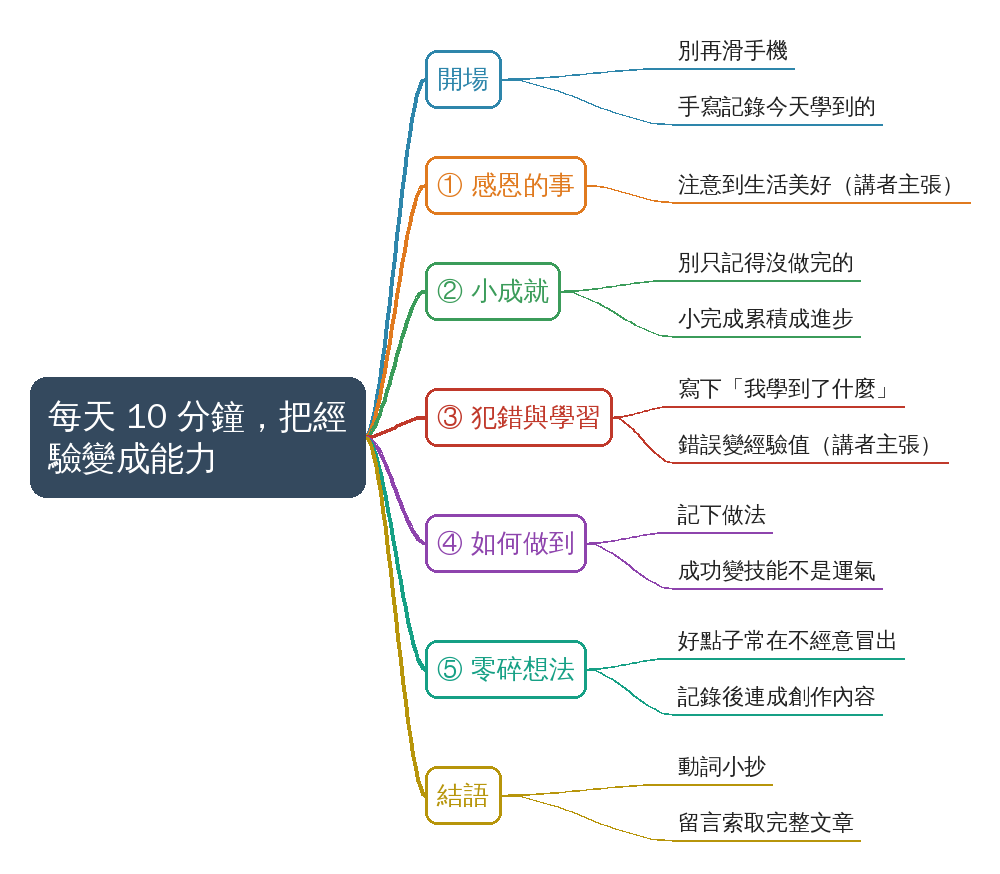
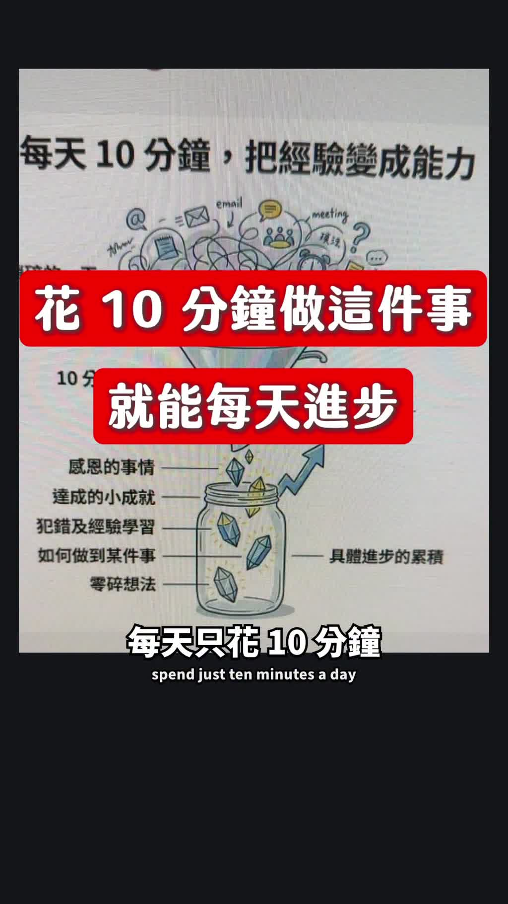
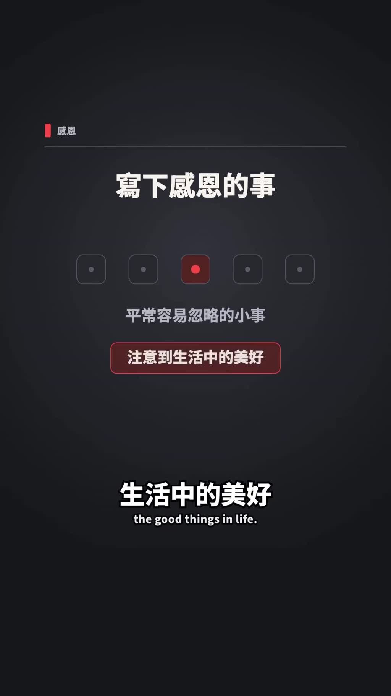
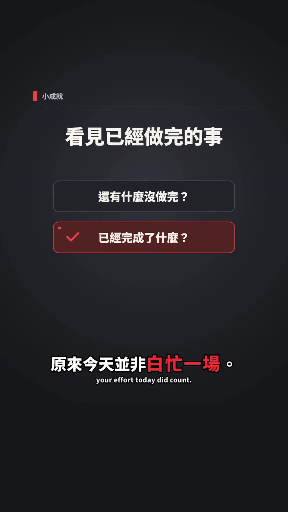
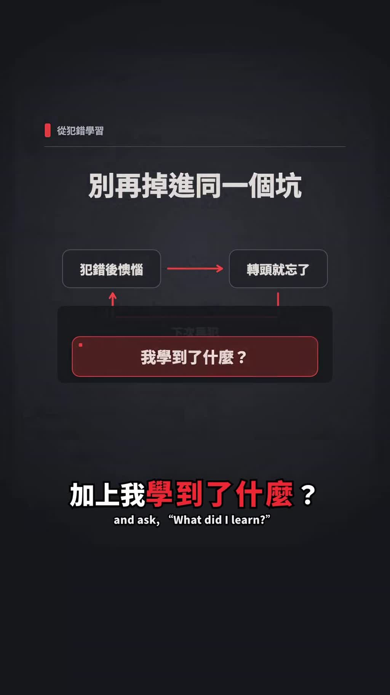
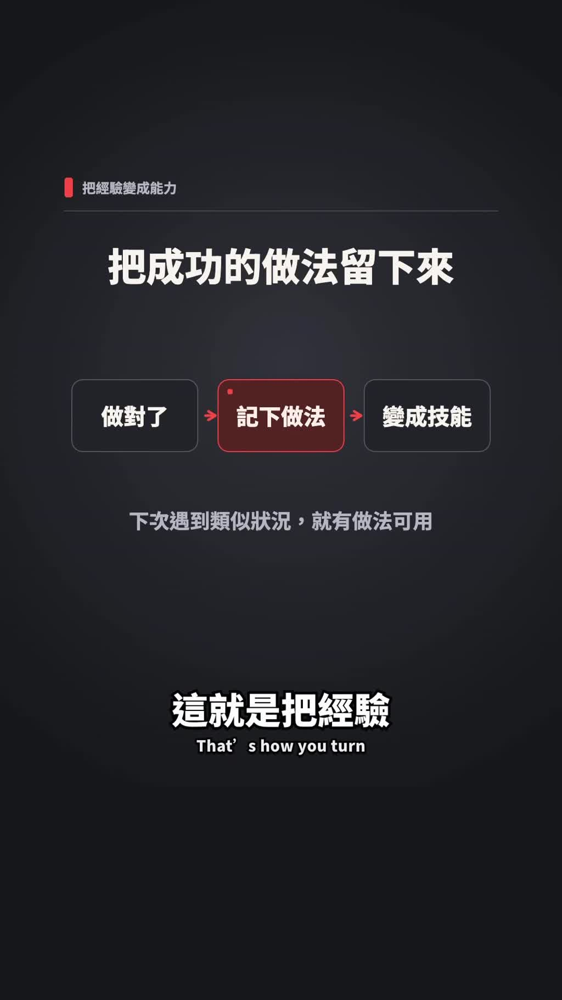
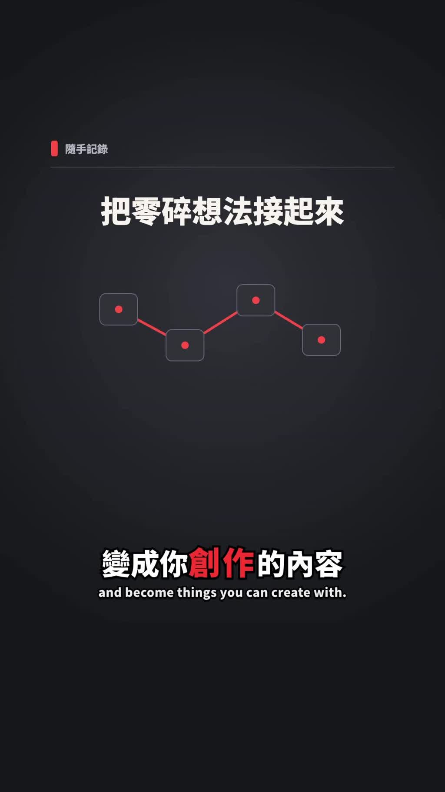
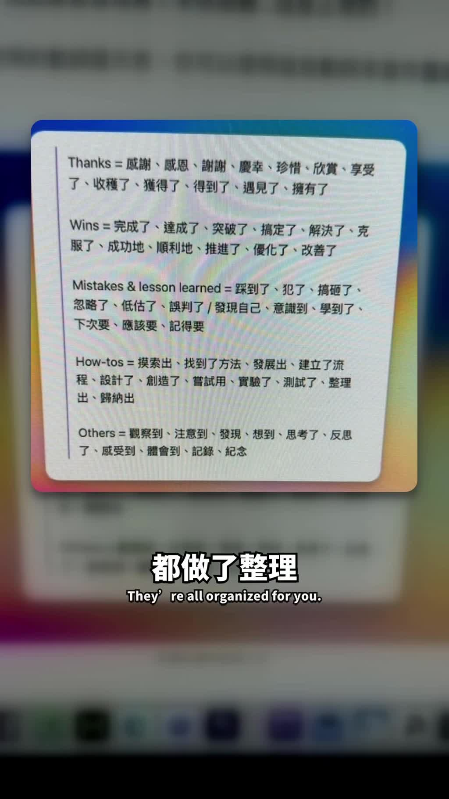

# 每天十分鐘寫下五件事讓自己進步

- 來源：https://www.facebook.com/share/r/1K5oJdZBoZ/
- 平台 / 上傳者：Facebook / 朱騏
- 長度：01:30 (89.8s)
- 逐字稿來源：whisper (groq)
- 更新日期：2026-11-11
- **關鍵字：** #自我成長 #每日回顧 #10 分鐘 #手寫記錄 #感恩 #小成就 #錯誤學習 #經驗變能力 #零碎想法 #動詞小抄

## 摘要與名詞說明

**一句話重點**：講者（朱騏）建議用每天 10 分鐘取代滑手機，手寫記錄五類內容——感恩的事、小成就、犯錯與學習、如何做到某件事、零碎想法——把當天經驗累積成能力（講者主張，未查證）。

- 來源：Facebook Reel，上傳者「朱騏」，約 1 分 30 秒；標題原為「留言『動詞小抄』我把完整教學傳給你」。
- 逐字稿：Groq Whisper 轉錄（自動偵測中文），與畫面字幕核對後無需修改。
- 領域：`身心生活`（使用者給的「自我成長」不在領域白名單，已存為關鍵字）。

## 重點表（步驟式：一項一段）

| 時間 | 重點 |
|---|---|
| 00:00 | 別再每天滑手機；每天花 10 分鐘寫下今天學到什麼，就能進步一點 |
| 00:11 | ① 今天感恩的事：大腦會開始注意到生活中的美好，從「今天好累」變成「今天有收穫」 |
| 00:21 | ② 今天達成的小成就：別只記得沒做完的，小完成累積成大進步 |
| 00:32 | ③ 今天的犯錯與經驗學習：寫下錯誤加「我學到了什麼」，錯誤變成經驗值 |
| 00:48 | ④ 今天如何做到某件事：寫下怎麼做到的，成功就不是運氣而是技能 |
| 01:02 | ⑤ 零碎想法：好點子常在不經意時冒出，記錄後會慢慢連起來變成創作內容 |
| 01:19 | 另有「動詞小抄」整理該用什麼動詞記錄；留言「動詞小抄」索取完整文章 |

## 名詞與縮寫

- **動詞小抄**：講者整理的「記錄各類內容時可用的動詞」清單，畫面為 Thanks／Wins／Mistakes & lesson learned／How-tos／Others 五類，原文逐字見補充資料 S1。
- **10 分鐘回顧**：畫面資訊圖的漏斗，把「瑣碎的一天」濾成罐子裡的五類內容，累積為「具體進步的累積」（S2）。

## 轉錄校正備註

- 無校正項目。「洗澡拉屎」為講者原話（字幕同為「洗澡、拉屎」），保留。
- 未去除語助詞（非講座類影片）。

## 備註

- 所有效果說法（感恩讓大腦注意美好、記錄錯誤變經驗值、十分鐘就能每天進步等）都是講者主張，未查證，影片未提供研究或數據。
- 完整「動詞小抄」文章需到貼文留言索取，影片只露出清單的畫面，且不一定完整（S1 備註）。

## 補充資料（影片未呈現的資訊）


### S1｜畫面遺漏：動詞小抄（記錄時可用的動詞）
- 來源：影片畫面（01:19–01:25，背景模糊的電腦畫面上的白色卡片）；取得日期：2026-11-11；取得方式：從原始解析度（1080×1920）截圖放大抄錄
- 為何需要補充：講者只說「我寫了一個小抄，你應該用什麼樣的動詞記錄下來都做了整理」，沒唸內容；對應 `slide_07`
**原文（逐字）**
```
Thanks = 感謝、感恩、謝謝、慶幸、珍惜、欣賞、享受了、收穫了、獲得了、得到了、遇見了、擁有了

Wins = 完成了、達成了、突破了、搞定了、解決了、克服了、成功地、順利地、推進了、優化了、改善了

Mistakes & lesson learned = 踩到了、犯了、搞砸了、忽略了、低估了、誤判了 / 發現自己、意識到、學到了、下次要、應該要、記得要

How-tos = 摸索出、找到了方法、發展出、建立了流程、設計了、創造了、嘗試用、實驗了、測試了、整理出、歸納出

Others = 觀察到、注意到、發現、想到、思考了、反思了、感受到、體會到、記錄、紀念
```
（換行為畫面自動折行，Claude 已合併成一行一類；`/` 為畫面原有符號。）
**Claude 的對照分析**
- 與影片一致：五類對應講者的五個記錄項目：Thanks＝感恩的事、Wins＝小成就、Mistakes & lesson learned＝犯錯與經驗學習、How-tos＝如何做到某件事。
- 據此推定（非畫面直接寫明）：Others 對應第五項「零碎想法」。
**備註**
- 畫面卡片可能只是完整文章的一部分；是否還有更多內容未知。動詞用法的效果為講者主張，未查證。

### S2｜畫面遺漏：資訊圖與卡片文字
- 來源：影片畫面（00:00–01:18）；取得日期：2026-11-11；取得方式：截圖抄錄（畫面為一張手機／螢幕上的資訊圖，講者手指著講解）
- 為何需要補充：資訊圖把整個方法畫成一張圖，講者沒唸圖上的所有文字；對應 `slide_01`
**原文（逐字）**
```
每天 10 分鐘，把經驗變成能力
瑣碎的一天
10 分鐘回顧
感恩的事情
達成的小成就
犯錯及經驗學習
如何做到某件事
零碎想法
具體進步的累積
（左上角：慢慢跟你說明）
```
後續各項說明用深色卡片，卡片標題（畫面標）：
```
寫下感恩的事　　　　　　平常容易忽略的小事 → 注意到生活中的美好
看見已經做完的事　　　　還有什麼沒做完？／已經完成了什麼？
別再掉進同一個坑　　　　犯錯後懊惱 → 轉頭就忘了 → 下次再犯；我學到了什麼？
把成功的做法留下來　　　做對了 → 記下做法 → 變成技能；下次遇到類似狀況，就有做法可用
把零碎想法接起來
留言領取文章　　　　　　動詞小抄　完整文章
```
**Claude 的對照分析**
- 與影片一致：資訊圖五個標籤與講者的五個項目相同；卡片文字是各項口述的摘要。
- 畫面直接寫明（影片沒唸的）：資訊圖標題「把經驗變成能力」與漏斗／罐子的比喻；「感恩」項的「平常容易忽略的小事」。
**備註**
- 資訊圖左上「慢慢跟你說明」文字被畫面裁切，意義不明，不推測。

## 思維導圖



- 原圖：[mindmap.png](mindmap.png)；文字大綱：[mindmap.md](mindmap.md)（與本報告同資料夾）

## 圖文對照（畫面 + 逐字稿）

### 投影片 1：開場：每天 10 分鐘，把經驗變成能力（00:00–00:11）



**重點：** 講者建議別再每天滑手機，改花十分鐘寫下今天學到了什麼，就能每天進步一點。畫面資訊圖：把瑣碎的一天透過「10 分鐘回顧」的漏斗，收進罐子，變成具體進步的累積。

**標籤：** #10 分鐘回顧

不要再每天滑手機了，實際上你可以每天只花十分鐘做這一件事情，就能讓自己都進步一點，訣竅就是花十分鐘寫下今天自己到底學到了什麼，具體來說我建議寫以下五個東西。

### 投影片 2：第一項：今天感恩的事（00:11–00:21）



**重點：** 寫下感恩的事，大腦會開始注意到生活中的美好，原本覺得理所當然的事其實是讓自己變好的養分；講者說這個習慣能讓心情從「今天好累」變成「今天有收穫」。

**標籤：** #感恩

第一個的話是今天感恩的事情，因為當你寫下感恩的事，大腦會開始注意到生活中的美好，你會發現原本覺得理所當然的事情，其實都是讓自己變得更好的養分，這個習慣會讓你從今天好累變成今天有收穫。

### 投影片 3：第二項：今天達成的小成就（00:21–00:32）



**重點：** 我們常只記得還有什麼沒做完，卻忘了已完成的事。把小成就寫下來，會發現今天不是白忙一場，小小的完成累積起來就是大大的進步。

**標籤：** #小成就

第二個的話是今天達成的小成就，很多時候我們都只記得還有什麼沒做完，卻忘了已經完成了什麼，當你把小成就寫下來，你就會發現 原來今天並不是白忙一場，這些小小的完成啊 累積起來都是大大的進步。

### 投影片 4：第三項：今天的犯錯與經驗學習（00:32–00:48）



**重點：** 多數人犯錯後只懊惱一下就忘，下次又掉進同一個坑。把錯誤連同「我學到了什麼」寫下來，錯誤就不再只是浪費時間，而會變成經驗值。

**標籤：** #犯錯 #經驗值

第三個的話是 今天的犯錯 還有經驗學習，那為什麼要記錄呢，因為大部分的人犯錯之後 都會懊惱一下 然後就忘了，結果呢 下次遇到類似的狀況 又掉進同一個坑裡面，但當你把錯誤寫下來 加上我學到了什麼，這個錯誤它就不會再只是浪費你的時間，它會變成你的經驗值。

### 投影片 5：第四項：今天如何做到某一件事（00:48–01:02）



**重點：** 做對一件事卻不知道為什麼成功，成功就只是運氣。把「怎麼做到的」寫下來，就變成可重複使用的技能，下次遇到類似狀況就知道怎麼辦——這是把經驗變成能力的關鍵。

**標籤：** #如何做到 #技能

第四個的話是 今天如何做到某一件事情，很多時候啊 我們做對了一件事，卻不知道自己為什麼會成功，當你把怎麼做到的寫下來的時候，這個成功呢 就不是變成運氣，因為它會變成你的技能，下次遇到類似的狀況你就知道該怎麼辦，這就是把經驗變成能力的關鍵。

### 投影片 6：第五項：零碎想法（01:02–01:19）



**重點：** 好點子常在走路、洗澡或和朋友聊天時冒出來，不寫下來很快就忘。養成記錄習慣後，零碎想法會慢慢連在一起，變成創作的內容。

**標籤：** #零碎想法 #創作

而最後一個是可以記錄一些你的零碎想法，因為很多的好點子都是在不經意之間冒出來的，可能是走路的時候突然想到的，或在洗澡拉屎的時候靈光一閃，或是跟朋友聊天的時候被啟發到，如果不寫下來，你會發現這些想法很快就會忘記，當你養成記錄的習慣，這些零碎的想法就會慢慢的連在一起，變成你創作的內容。

### 投影片 7：結語：動詞小抄（01:19–01:30）



**重點：** 講者另外整理了「該用什麼動詞記錄」的小抄（畫面為各類別的動詞清單，原文見補充資料 S1），留言「動詞小抄」即可索取完整文章（留言索取需求，未驗證是否有效）。

**標籤：** #動詞小抄

實際上我還寫了一個小抄，你應該用什麼樣的動詞記錄下來都做了整理，如果你想要這個動詞小抄的話，請你留言動詞小抄，我把完整的文章傳給你。

## 補充資料連結

- 補充資料檔：[supplement.md](supplement.md)（與本報告同資料夾；內容已收錄於上方〈補充資料〉）
- 思維導圖：[mindmap.png](mindmap.png)、文字大綱：[mindmap.md](mindmap.md)（與本報告同資料夾）
